# animals — reference photos

[← Gallery index](./README.md) | [Credits](../catalog/CREDITS.md)

## 牛の体形・毛・蹄 — cattle-shapes

制作で見るところ：胴体と頭部比、角、脚・蹄、毛色の分かれ目

関連コード：`app/src/world/animal-meshes.js`、`app/src/world/ranch-meshes.js`

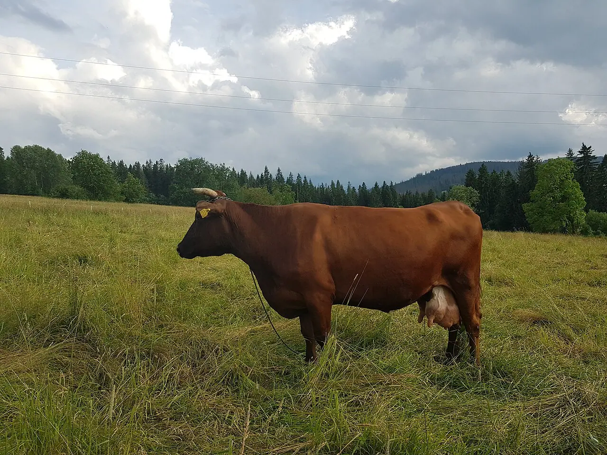

2019-07-07 Cow standing on the field.jpg — Maksym Kozlenko / [CC BY-SA 4.0](https://creativecommons.org/licenses/by-sa/4.0) / [原典](https://commons.wikimedia.org/wiki/File:2019-07-07_Cow_standing_on_the_field.jpg)

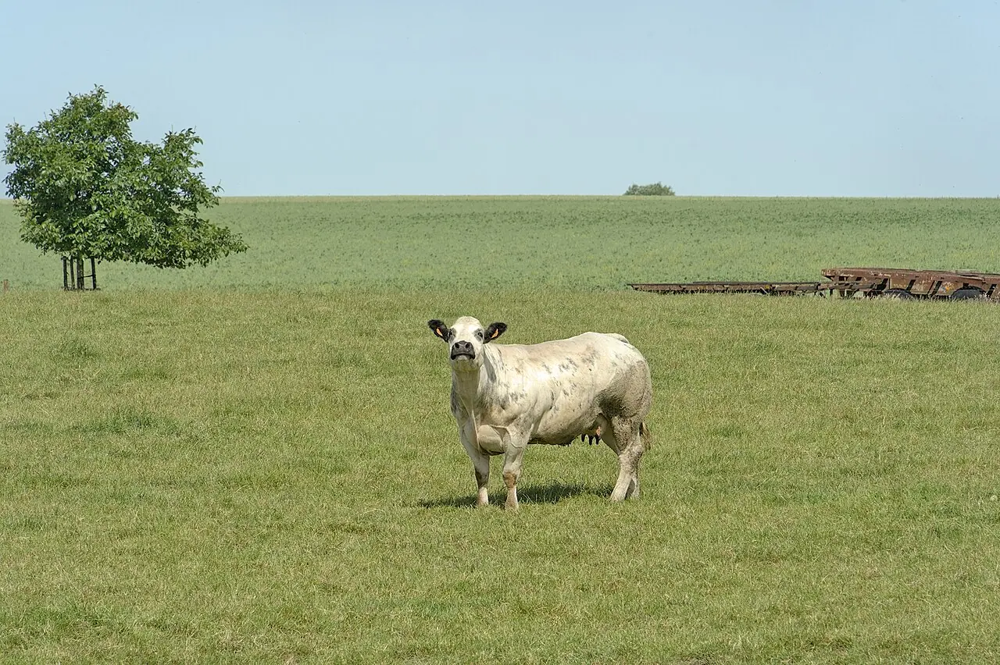

Cow standing on a field in Chastre (DSC02477).jpg — Trougnouf (Benoit Brummer) / [CC BY 4.0](https://creativecommons.org/licenses/by/4.0) / [原典](https://commons.wikimedia.org/wiki/File:Cow_standing_on_a_field_in_Chastre_%28DSC02477%29.jpg)

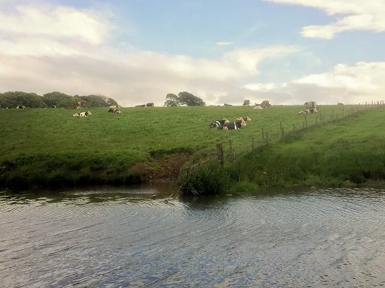

Cows at the side of The Glasson Branch - geograph.org.uk - 3997607.jpg — David Dixon / [CC BY-SA 2.0](https://creativecommons.org/licenses/by-sa/2.0) / [原典](https://commons.wikimedia.org/wiki/File:Cows_at_the_side_of_The_Glasson_Branch_-_geograph.org.uk_-_3997607.jpg)

## 羊と毛並み — sheep-fleece

制作で見るところ：丸い胴体と細い脚、羊毛のかたまり

関連コード：`app/src/world/animal-meshes.js`、`app/src/world/ranch-meshes.js`

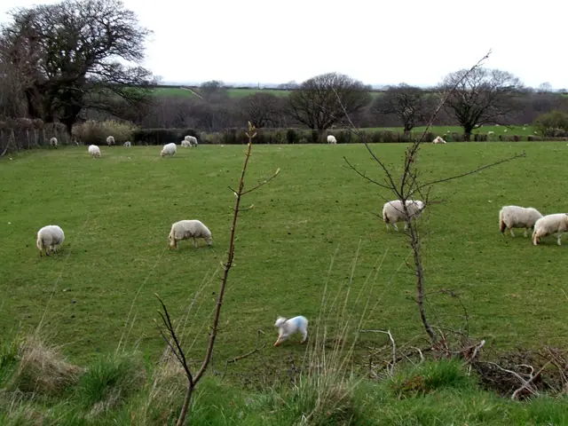

Sheep grazing in a field - geograph.org.uk - 152927.jpg — Nigel Williams / [CC BY-SA 2.0](https://creativecommons.org/licenses/by-sa/2.0) / [原典](https://commons.wikimedia.org/wiki/File:Sheep_grazing_in_a_field_-_geograph.org.uk_-_152927.jpg)

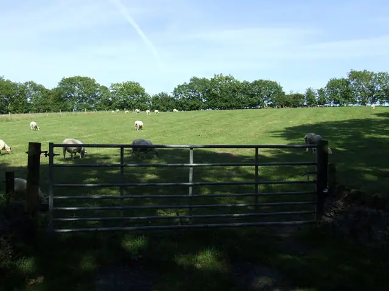

Sheep grazing in a field - geograph.org.uk - 200298.jpg — Nigel Williams / [CC BY-SA 2.0](https://creativecommons.org/licenses/by-sa/2.0) / [原典](https://commons.wikimedia.org/wiki/File:Sheep_grazing_in_a_field_-_geograph.org.uk_-_200298.jpg)

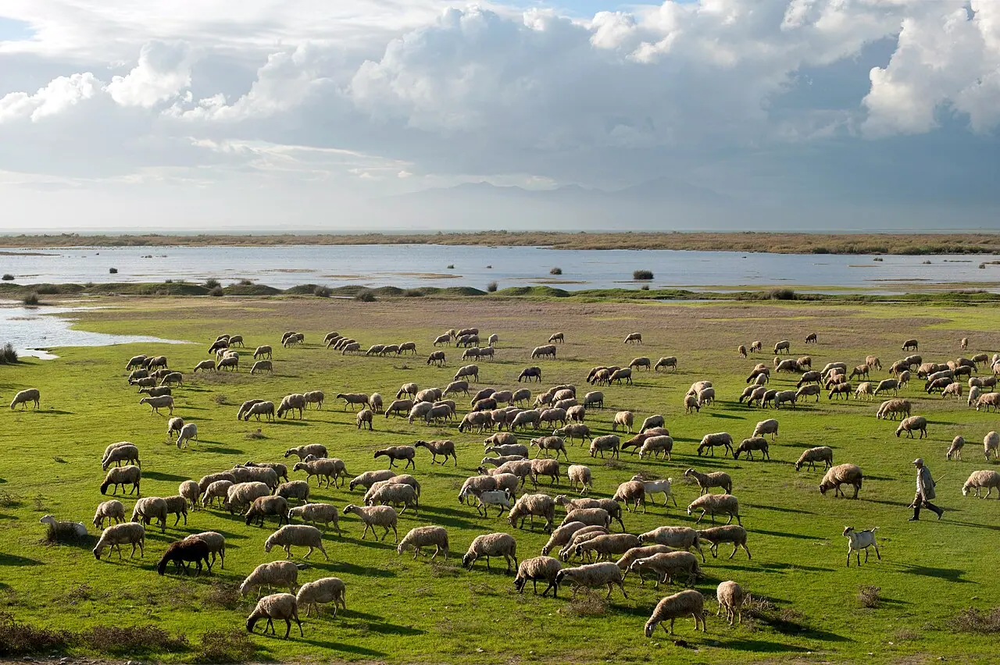

20101020 Sheep shepherd at Vistonida lake Glikoneri Rhodope Prefecture Thrace Greece.jpg — Ggia / [CC BY-SA 3.0](https://creativecommons.org/licenses/by-sa/3.0) / [原典](https://commons.wikimedia.org/wiki/File:20101020_Sheep_shepherd_at_Vistonida_lake_Glikoneri_Rhodope_Prefecture_Thrace_Greece.jpg)

## 馬の立ち姿 — horses

制作で見るところ：首から背への曲線、足関節、たてがみ

関連コード：`app/src/world/animal-meshes.js`、`app/src/world/ranch-meshes.js`

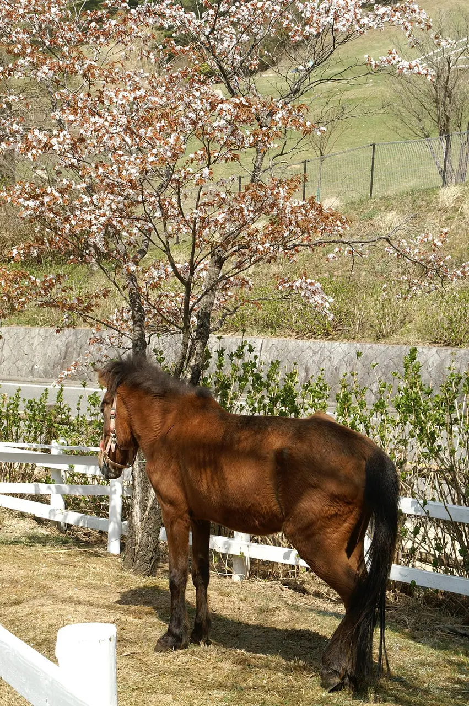

Yonaguni Horse @ Rokkosan Pasture.jpg — Hideyuki KAMON / [CC BY-SA 2.0](https://creativecommons.org/licenses/by-sa/2.0) / [原典](https://commons.wikimedia.org/wiki/File:Yonaguni_Horse_%40_Rokkosan_Pasture.jpg)

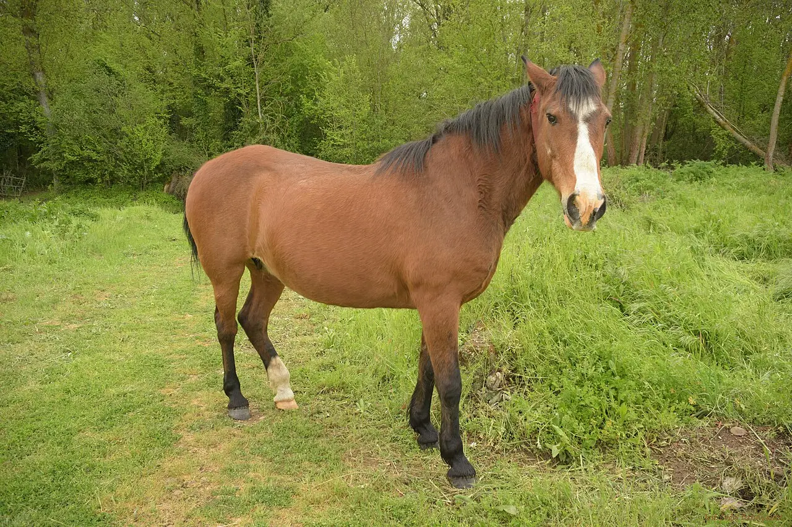

Horse posing in the grass.jpg — Joselodos / [CC0](https://creativecommons.org/publicdomain/zero/1.0/deed.en) / [原典](https://commons.wikimedia.org/wiki/File:Horse_posing_in_the_grass.jpg)

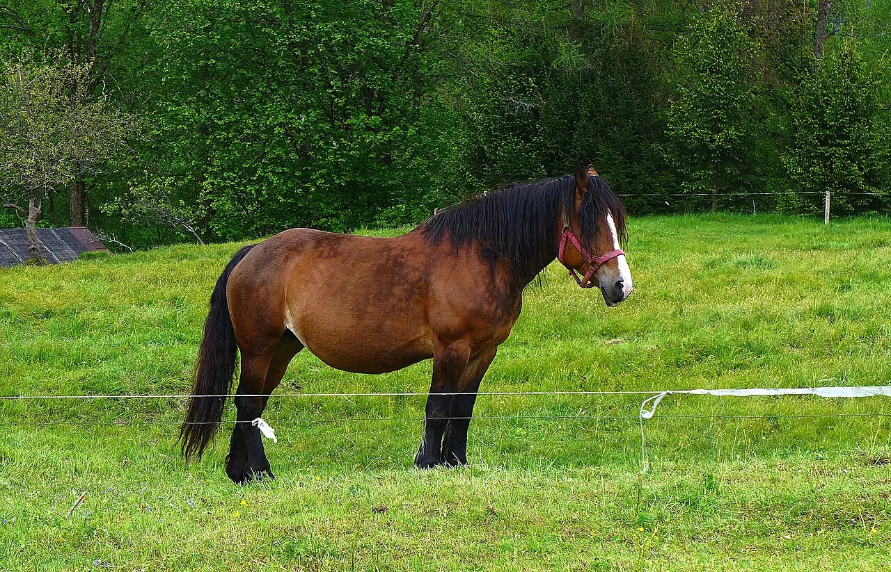

Horse in a meadow.jpg — BogTar201213 / [CC BY-SA 4.0](https://creativecommons.org/licenses/by-sa/4.0) / [原典](https://commons.wikimedia.org/wiki/File:Horse_in_a_meadow.jpg)

## ヤギの顔と角 — goats

制作で見るところ：顔の比率、角・耳の方向、脚の細さ

関連コード：`app/src/world/animal-meshes.js`、`app/src/world/ranch-meshes.js`

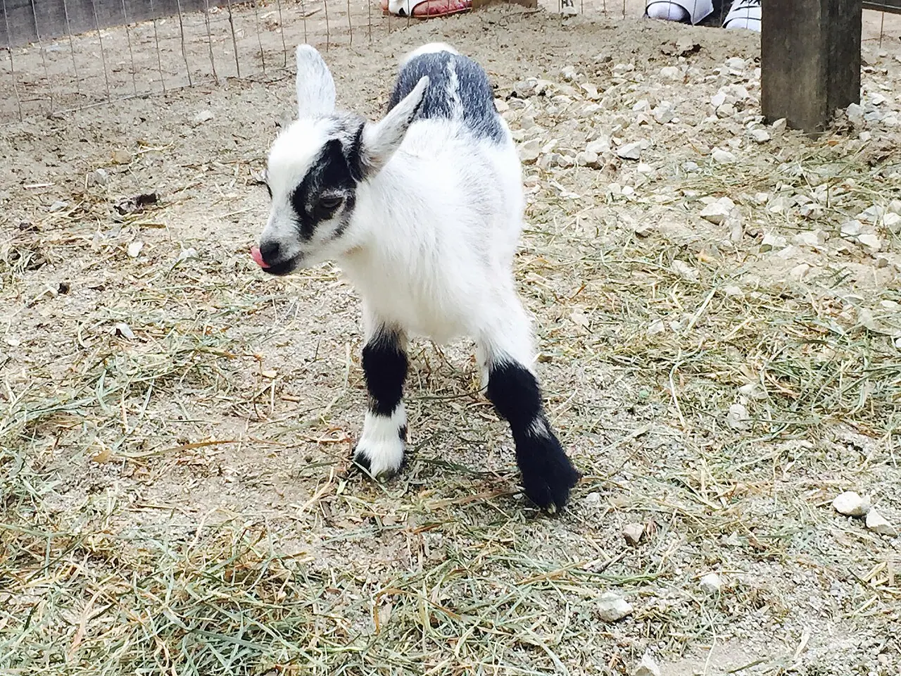

Cedar Point animal farm baby goat (2995).jpg — Bobby Proffer / [CC BY-SA 3.0](https://creativecommons.org/licenses/by-sa/3.0) / [原典](https://commons.wikimedia.org/wiki/File:Cedar_Point_animal_farm_baby_goat_%282995%29.jpg)

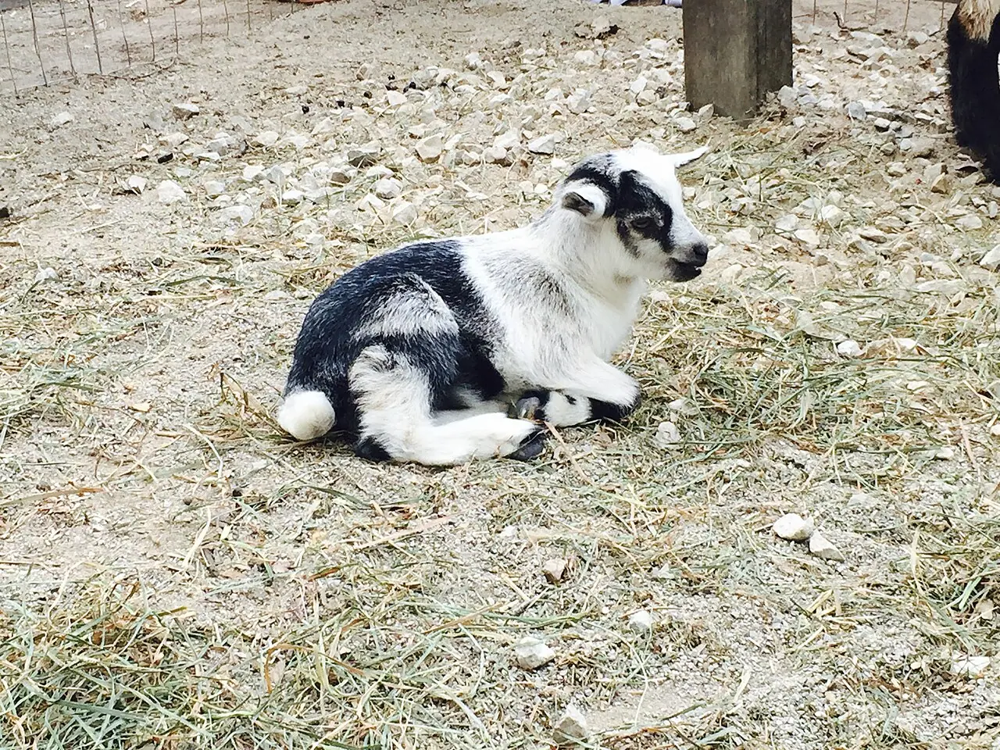

Cedar Point animal farm baby goat (3006).jpg — Bobby Proffer / [CC BY-SA 3.0](https://creativecommons.org/licenses/by-sa/3.0) / [原典](https://commons.wikimedia.org/wiki/File:Cedar_Point_animal_farm_baby_goat_%283006%29.jpg)

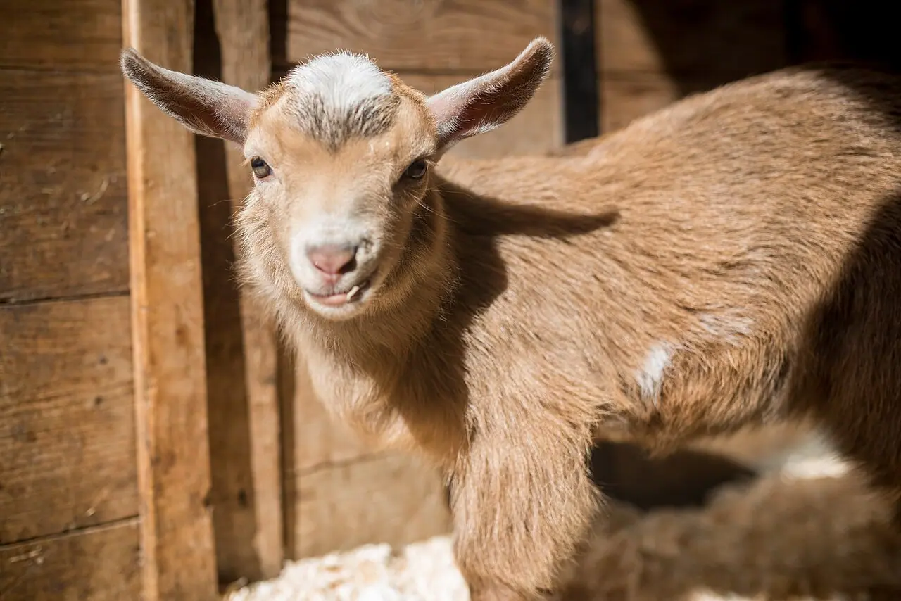

Baby Goat Standing with Ears Out.jpg — Eric Kilby / [CC BY-SA 2.0](https://creativecommons.org/licenses/by-sa/2.0) / [原典](https://commons.wikimedia.org/wiki/File:Baby_Goat_Standing_with_Ears_Out.jpg)

## 牧場の犬 — farm-dogs

制作で見るところ：歩行姿勢・耳・毛並み・周囲との距離感

関連コード：`app/src/world/animal-meshes.js`、`app/src/world/ranch-meshes.js`

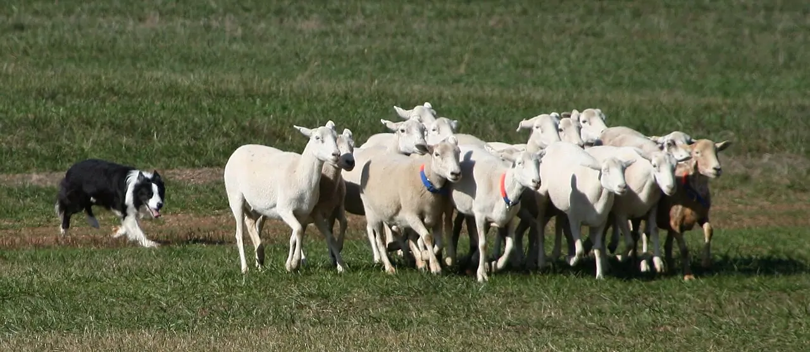

Border Collie sheepdog trial.jpg — Scot Campbell / [CC BY-SA 2.0](https://creativecommons.org/licenses/by-sa/2.0) / [原典](https://commons.wikimedia.org/wiki/File:Border_Collie_sheepdog_trial.jpg)

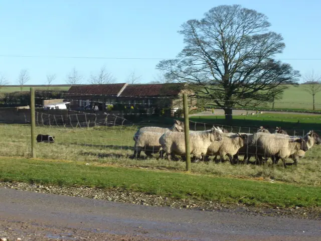

Sheepdog working Sheep Swaythorpe - geograph.org.uk - 1128045.jpg — martin dawes / [CC BY-SA 2.0](https://creativecommons.org/licenses/by-sa/2.0) / [原典](https://commons.wikimedia.org/wiki/File:Sheepdog_working_Sheep_Swaythorpe_-_geograph.org.uk_-_1128045.jpg)

## 町と庭の猫 — village-cats

制作で見るところ：姿勢、足の置き方、壁・道端での居場所

関連コード：`app/src/world/animal-meshes.js`、`app/src/systems/cat.js`

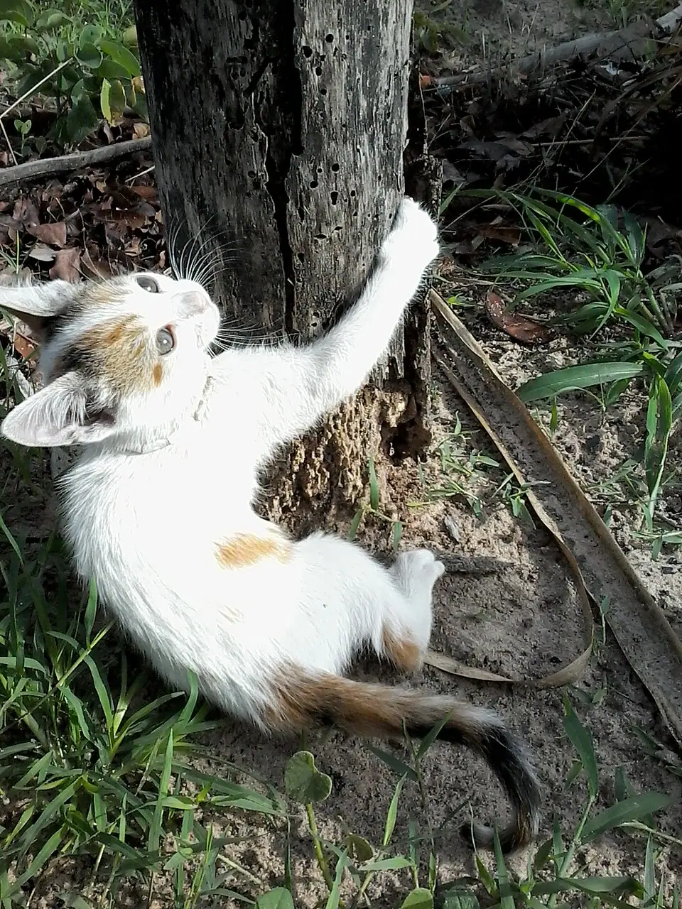

Lax enjoying the outdoors 05.jpg — Samson CpS / [CC BY-SA 4.0](https://creativecommons.org/licenses/by-sa/4.0) / [原典](https://commons.wikimedia.org/wiki/File:Lax_enjoying_the_outdoors_05.jpg)

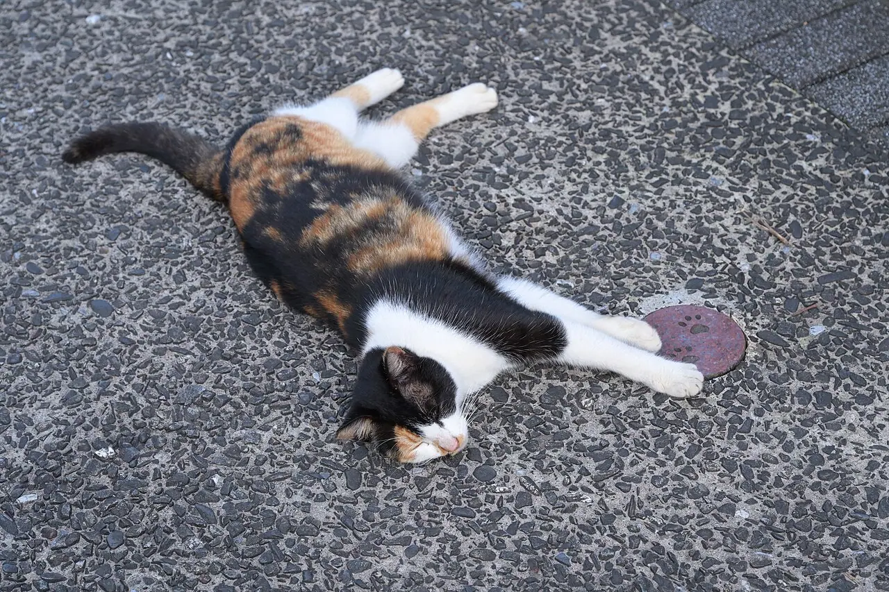

Calico cat at Houtong Cat Village February 2026 01.jpg — 4300streetcar / [CC BY 4.0](https://creativecommons.org/licenses/by/4.0) / [原典](https://commons.wikimedia.org/wiki/File:Calico_cat_at_Houtong_Cat_Village_February_2026_01.jpg)

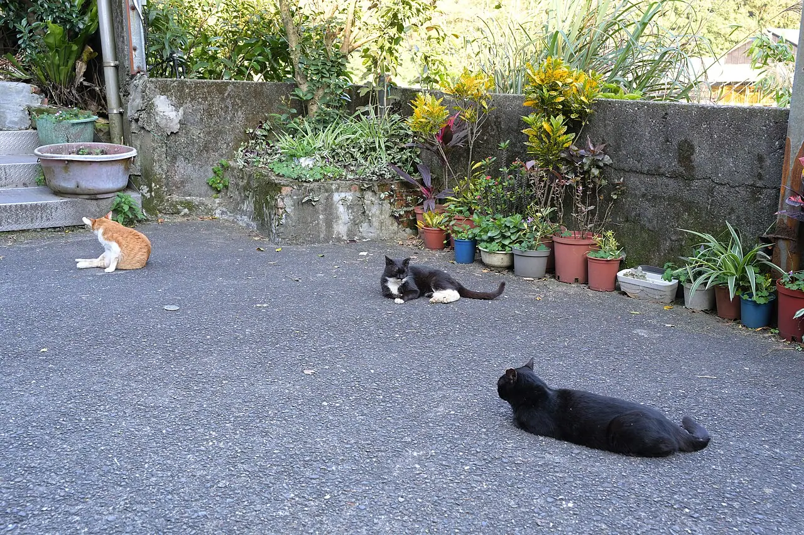

Cats at Houtong Cat Village February 2026.jpg — 4300streetcar / [CC BY 4.0](https://creativecommons.org/licenses/by/4.0) / [原典](https://commons.wikimedia.org/wiki/File:Cats_at_Houtong_Cat_Village_February_2026.jpg)

## 樹木と小鳥 — forest-birds

制作で見るところ：止まり木の太さと足、くちばし・羽の重なり

関連コード：`app/src/world/life-meshes.js`、`app/src/systems/animals.js`

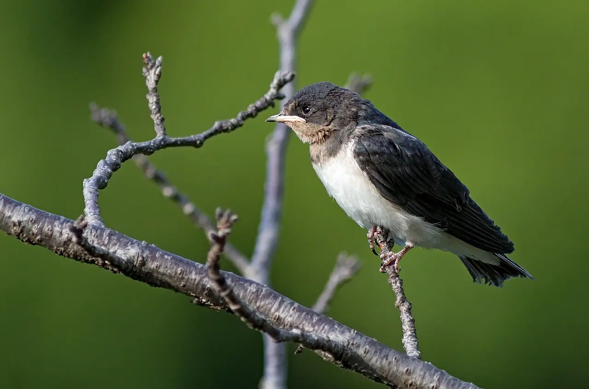

Small bird perching on a branch.jpg — Laitche / [CC BY-SA 4.0](https://creativecommons.org/licenses/by-sa/4.0) / [原典](https://commons.wikimedia.org/wiki/File:Small_bird_perching_on_a_branch.jpg)

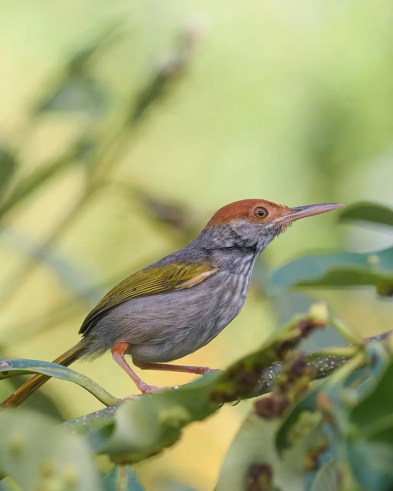

Grey-backed tailorbird.jpg — Micluna / [CC BY-SA 4.0](https://creativecommons.org/licenses/by-sa/4.0) / [原典](https://commons.wikimedia.org/wiki/File:Grey-backed_tailorbird.jpg)

## 蝶と蜂 — butterflies-and-bees

制作で見るところ：羽の姿勢、花との大きさ関係・止まり方

関連コード：`app/src/world/life-meshes.js`、`app/src/world/plant-meshes.js`

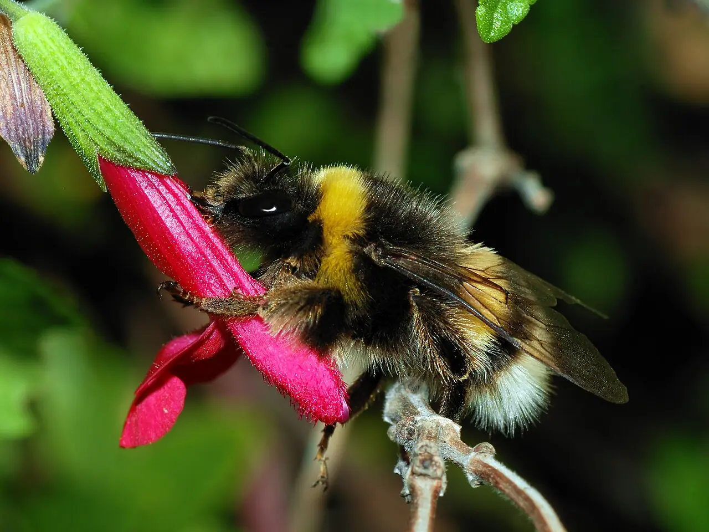

Bumblebee October 2007-3a.jpg — Alvesgaspar / [CC BY-SA 3.0](https://creativecommons.org/licenses/by-sa/3.0) / [原典](https://commons.wikimedia.org/wiki/File:Bumblebee_October_2007-3a.jpg)

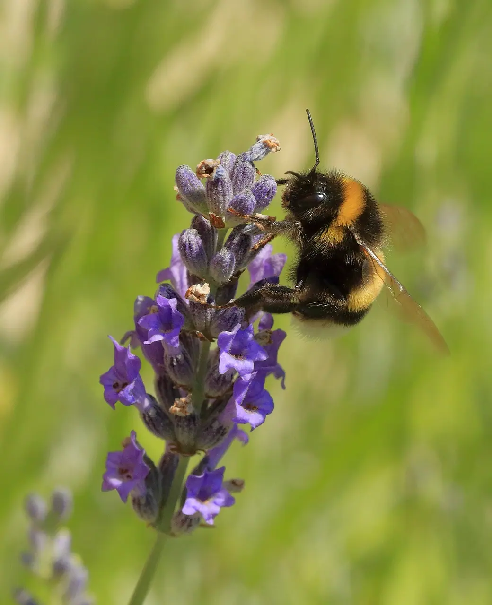

Bumblebee on Lavender Blossom.JPG — Martin Falbisoner / [CC BY-SA 4.0](https://creativecommons.org/licenses/by-sa/4.0) / [原典](https://commons.wikimedia.org/wiki/File:Bumblebee_on_Lavender_Blossom.JPG)

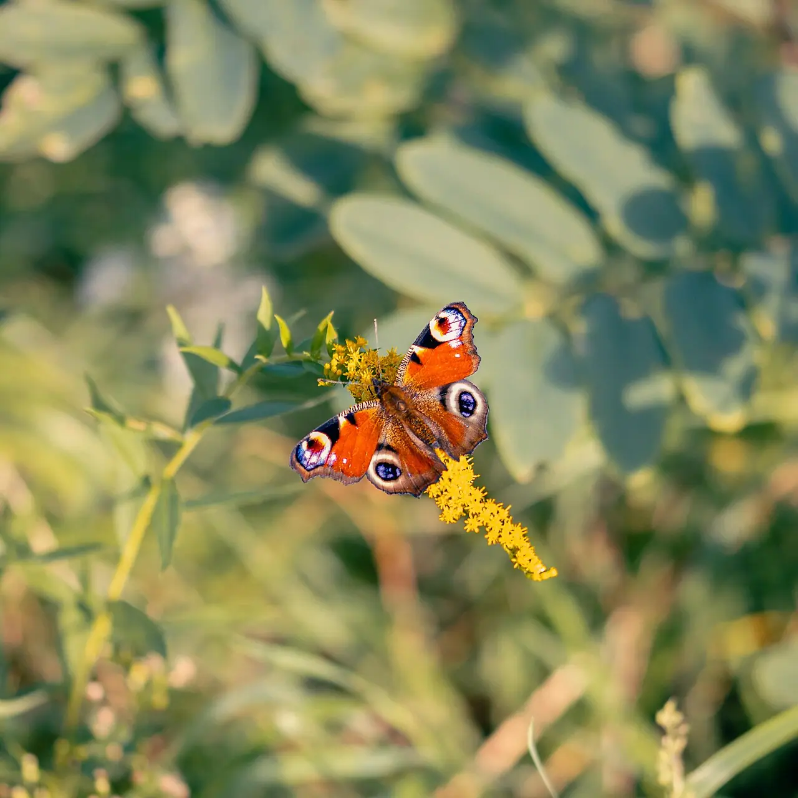

Closeup of a Butterfly on a Wildflower.jpg — Lonnyphotography / [CC BY-SA 4.0](https://creativecommons.org/licenses/by-sa/4.0) / [原典](https://commons.wikimedia.org/wiki/File:Closeup_of_a_Butterfly_on_a_Wildflower.jpg)

## 森の動物 — woodland-wildlife

制作で見るところ：森の中にいる時の輪郭、隠れ方、足元

関連コード：`app/src/world/life-meshes.js`、`app/src/systems/forest-life.js`

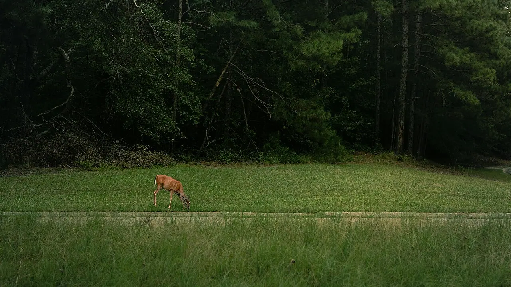

Serene Deer Grazing in a Woodland Clearing.jpg — Kikod91670 / [CC0](https://creativecommons.org/publicdomain/zero/1.0/deed.en) / [原典](https://commons.wikimedia.org/wiki/File:Serene_Deer_Grazing_in_a_Woodland_Clearing.jpg)

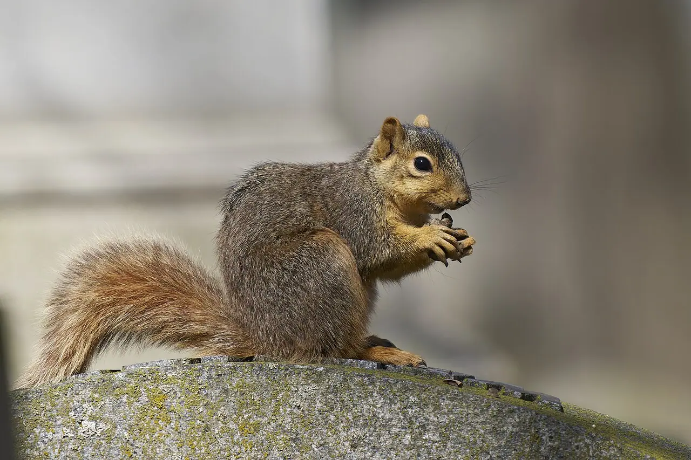

Fox squirrel, Forest Hill Cemetery, U-Mich PD06167.jpg — Paul Danese / [CC BY-SA 4.0](https://creativecommons.org/licenses/by-sa/4.0) / [原典](https://commons.wikimedia.org/wiki/File:Fox_squirrel%2C_Forest_Hill_Cemetery%2C_U-Mich_PD06167.jpg)

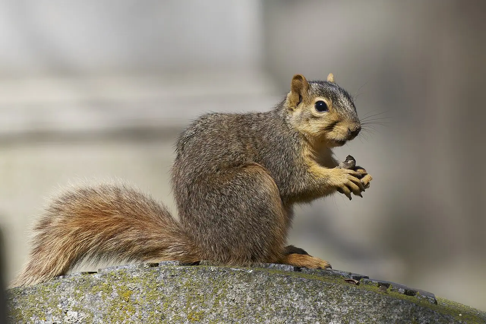

Fox squirrel, Forest Hill Cemetery, U-Mich PD06153.jpg — Paul Danese / [CC BY-SA 4.0](https://creativecommons.org/licenses/by-sa/4.0) / [原典](https://commons.wikimedia.org/wiki/File:Fox_squirrel%2C_Forest_Hill_Cemetery%2C_U-Mich_PD06153.jpg)

## 池と川の生き物 — pond-life

制作で見るところ：浅い水中の姿・水面との関係・水草

関連コード：`app/src/world/life-meshes.js`、`app/src/systems/stream-life.js`

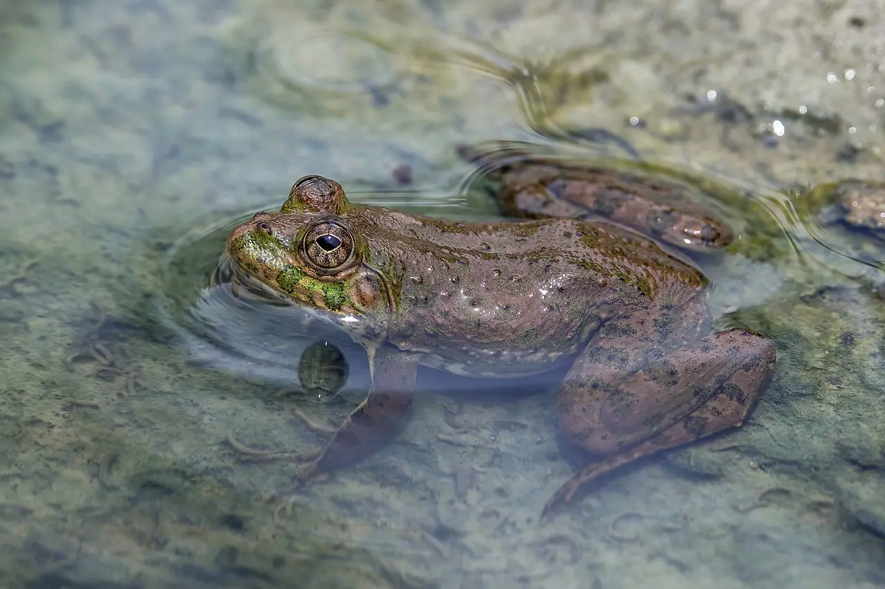

Green pond frog (Euphlyctis hexadactylus).jpg — Charles J. Sharp / [CC BY-SA 4.0](https://creativecommons.org/licenses/by-sa/4.0) / [原典](https://commons.wikimedia.org/wiki/File:Green_pond_frog_%28Euphlyctis_hexadactylus%29.jpg)

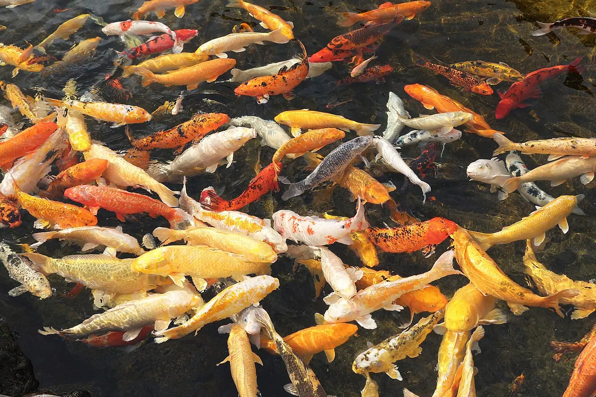

Fish in Spirited Garden.jpg — Bernard Gagnon / [CC0](https://creativecommons.org/publicdomain/zero/1.0/deed.en) / [原典](https://commons.wikimedia.org/wiki/File:Fish_in_Spirited_Garden.jpg)

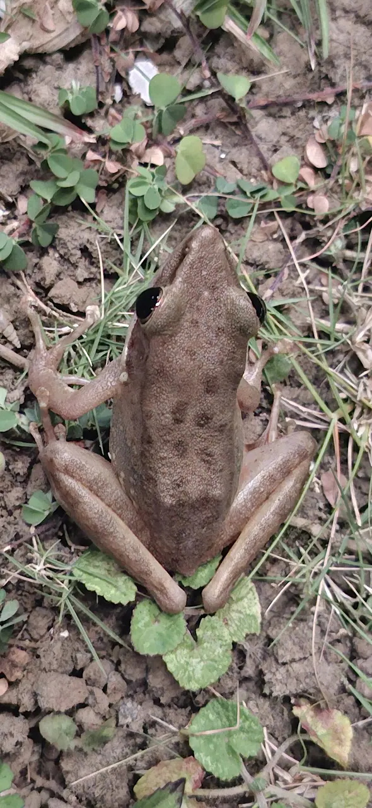

Small frog near a pond (close up).jpg — Cun Cun / [CC BY-SA 4.0](https://creativecommons.org/licenses/by-sa/4.0) / [原典](https://commons.wikimedia.org/wiki/File:Small_frog_near_a_pond_%28close_up%29.jpg)

