# farm — reference photos

[← Gallery index](./README.md) | [Credits](../catalog/CREDITS.md)

## 牧草地 — pastures

制作で見るところ：柵・動物・傾斜・草丈の組み合わせ

関連コード：`app/src/world/ranch-meshes.js`、`app/src/world/ranch-structures.js`

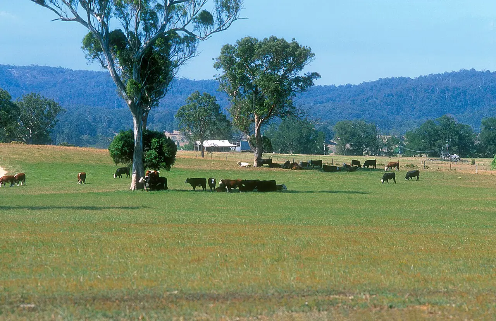

CSIRO ScienceImage 4483 Cattle grazing on lush pastures at Bega NSW 2002.jpg — Gregory Heath, CSIRO / [CC BY 3.0](https://creativecommons.org/licenses/by/3.0) / [原典](https://commons.wikimedia.org/wiki/File:CSIRO_ScienceImage_4483_Cattle_grazing_on_lush_pastures_at_Bega_NSW_2002.jpg)

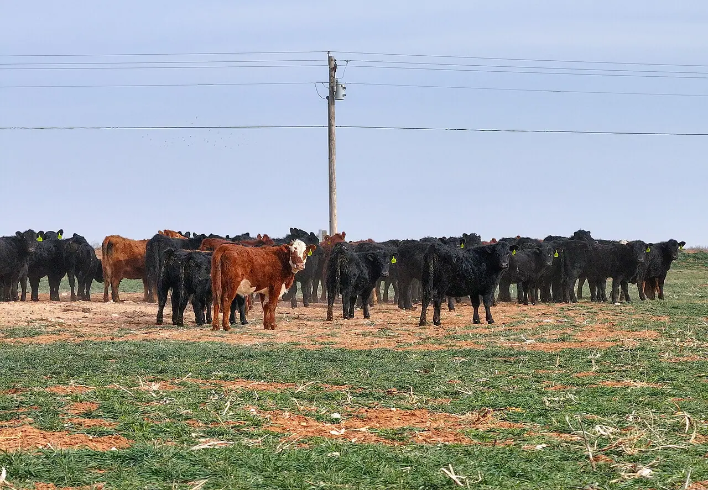

Grazing cattle on a pasture in eastern New Mexico.jpg — Quintin Soloviev / [CC0](https://creativecommons.org/publicdomain/zero/1.0/deed.en) / [原典](https://commons.wikimedia.org/wiki/File:Grazing_cattle_on_a_pasture_in_eastern_New_Mexico.jpg)

## 納屋と牧舎 — farm-barns

制作で見るところ：外壁の板張り、入口、屋根勾配、規模

関連コード：`app/src/world/ranch-structures.js`

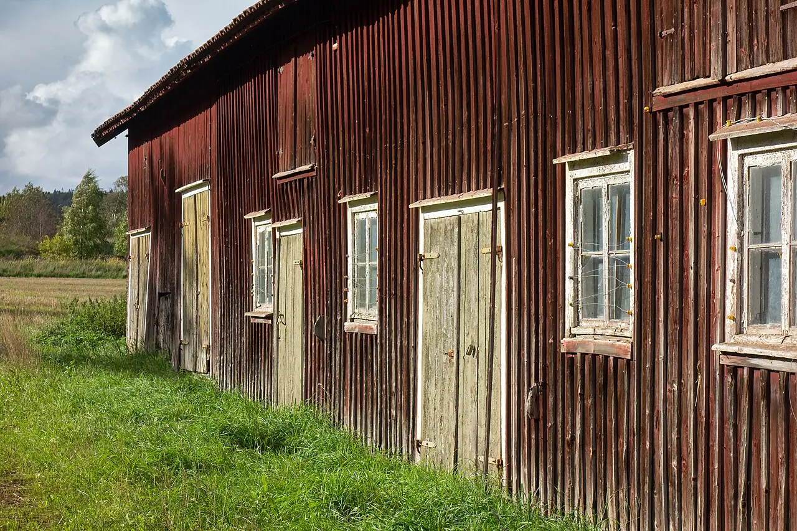

Barn in Färlev 5.jpg — W.carter / [CC0](https://creativecommons.org/publicdomain/zero/1.0/deed.en) / [原典](https://commons.wikimedia.org/wiki/File:Barn_in_F%C3%A4rlev_5.jpg)

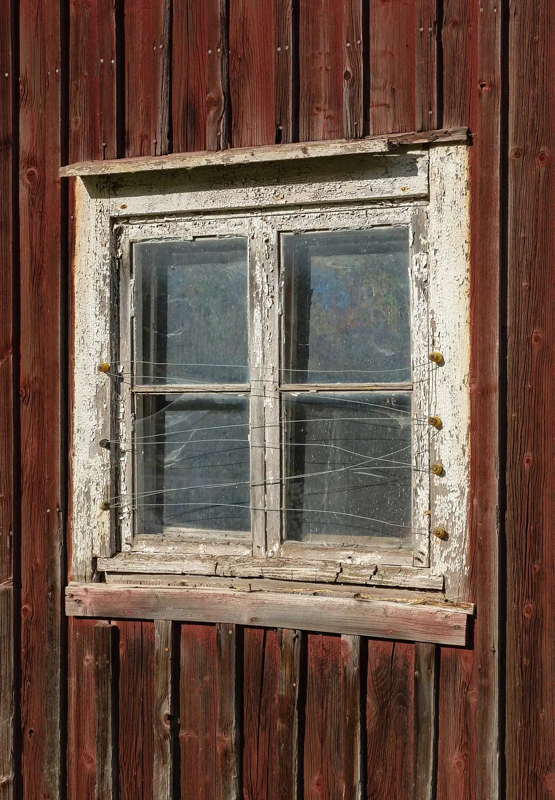

Window on a barn in Färlev.jpg — W.carter / [CC0](https://creativecommons.org/publicdomain/zero/1.0/deed.en) / [原典](https://commons.wikimedia.org/wiki/File:Window_on_a_barn_in_F%C3%A4rlev.jpg)

## 牧場の木柵 — farm-fences

制作で見るところ：柱間隔、横木の数、足元の地形との接続

関連コード：`app/src/world/ranch-structures.js`

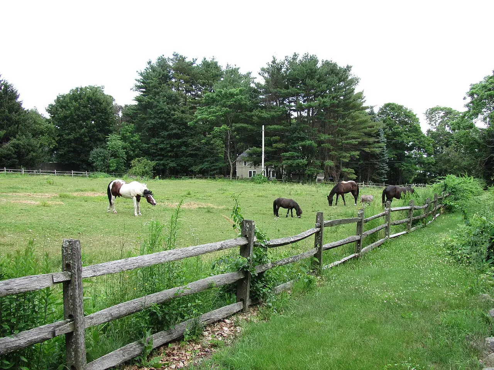

Pasture on Old Billerica Road, Bedford Springs MA.jpg — John Phelan / [CC BY 3.0](https://creativecommons.org/licenses/by/3.0) / [原典](https://commons.wikimedia.org/wiki/File:Pasture_on_Old_Billerica_Road%2C_Bedford_Springs_MA.jpg)

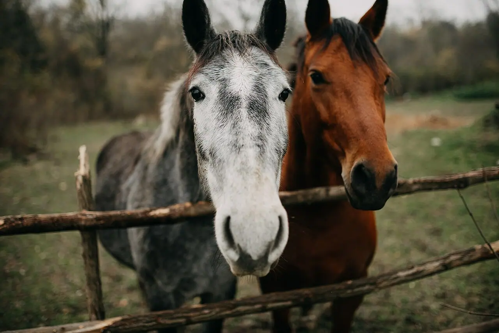

Horses standing near a wooden fence in a rural area - Flickr - nenadstojkovicart.jpg — Nenad Stojkovic / [CC BY 2.0](https://creativecommons.org/licenses/by/2.0) / [原典](https://commons.wikimedia.org/wiki/File:Horses_standing_near_a_wooden_fence_in_a_rural_area_-_Flickr_-_nenadstojkovicart.jpg)

## 農家の庭先 — farmyards

制作で見るところ：建物と道具の配置、泥・砂利・干し草

関連コード：`app/src/world/ranch-structures.js`

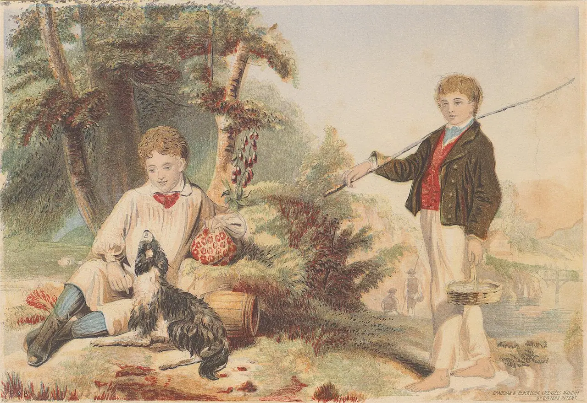

Bradshaw ^ Blacklock - The Farmer^s Boy ^ The Rustic Angler - B1977.14.10650 - Yale Center for British Art.jpg — Bradshaw & Blacklock / [CC0](https://creativecommons.org/publicdomain/zero/1.0/deed.en) / [原典](https://commons.wikimedia.org/wiki/File:Bradshaw_%5E_Blacklock_-_The_Farmer%5Es_Boy_%5E_The_Rustic_Angler_-_B1977.14.10650_-_Yale_Center_for_British_Art.jpg)

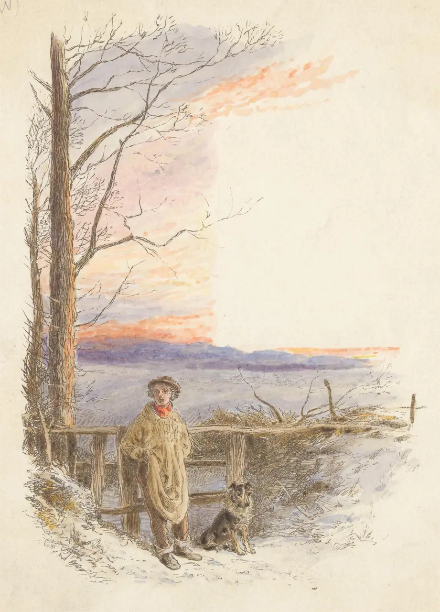

Alfred W Cooper - The Farmer^s Boy - B1977.14.20947 - Yale Center for British Art.jpg — Alfred W. Cooper / [CC0](https://creativecommons.org/publicdomain/zero/1.0/deed.en) / [原典](https://commons.wikimedia.org/wiki/File:Alfred_W_Cooper_-_The_Farmer%5Es_Boy_-_B1977.14.20947_-_Yale_Center_for_British_Art.jpg)

## 干し草と藁 — hay-and-straw

制作で見るところ：束の密度、干し草の表面と積み方

関連コード：`app/src/world/ranch-structures.js`、`app/src/world/textures.js`

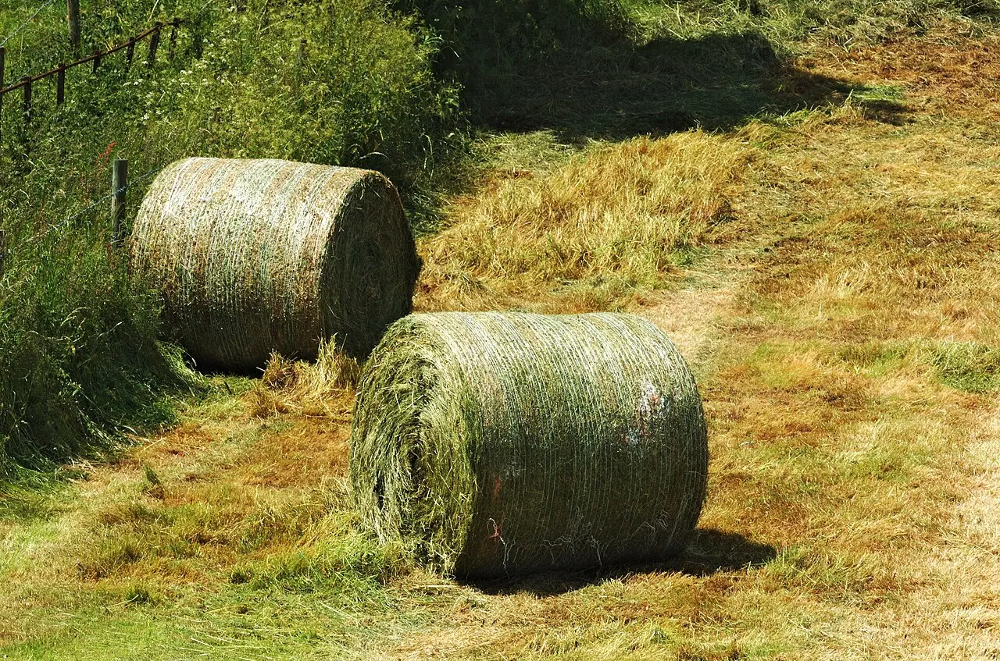

Hay-bales-Hertfordshire-20050613-030.jpg — Gary Houston / [CC0](https://creativecommons.org/publicdomain/zero/1.0/deed.en) / [原典](https://commons.wikimedia.org/wiki/File:Hay-bales-Hertfordshire-20050613-030.jpg)

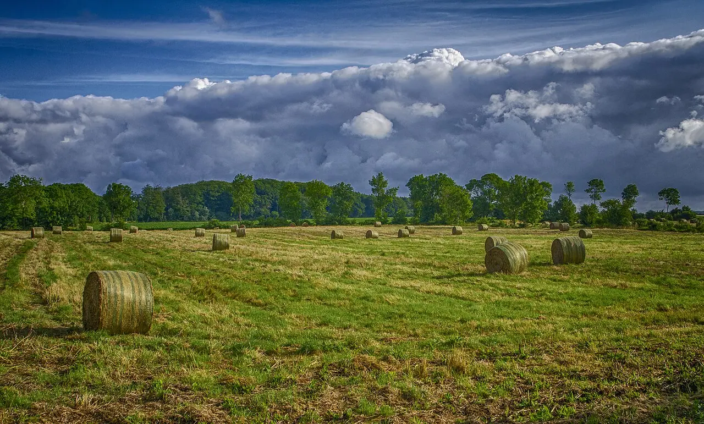

Hay bales on farm - Flickr - munchflemming.jpg — Flemming Munch / [CC BY 2.0](https://creativecommons.org/licenses/by/2.0) / [原典](https://commons.wikimedia.org/wiki/File:Hay_bales_on_farm_-_Flickr_-_munchflemming.jpg)

## 畑と野菜 — vegetable-fields

制作で見るところ：畝、株間、季節による葉・土の見え方

関連コード：`app/src/world/plant-meshes.js`、`app/src/world/farm-meshes.js`

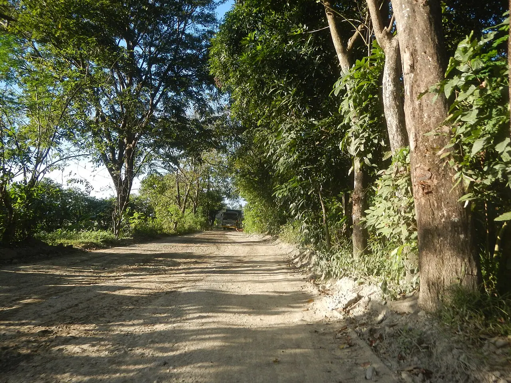

2137Grasslands, trees, paddy vegetable fields.jpg — Judgefloro / [CC0](https://creativecommons.org/publicdomain/zero/1.0/deed.en) / [原典](https://commons.wikimedia.org/wiki/File:2137Grasslands%2C_trees%2C_paddy_vegetable_fields.jpg)

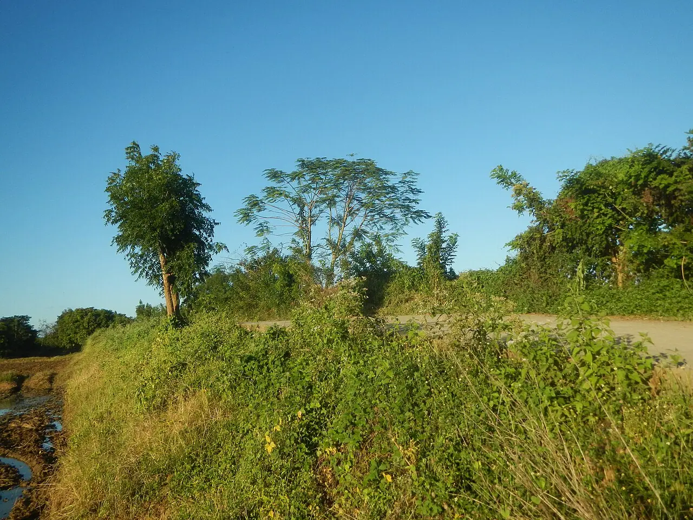

2442Grasslands, trees, paddy vegetable fields 01.jpg — Judgefloro / [CC0](https://creativecommons.org/publicdomain/zero/1.0/deed.en) / [原典](https://commons.wikimedia.org/wiki/File:2442Grasslands%2C_trees%2C_paddy_vegetable_fields_01.jpg)

## 水田 — rice-paddies

制作で見るところ：畦、水平な水面、稲の密度と高さ

関連コード：`app/src/world/road.js`

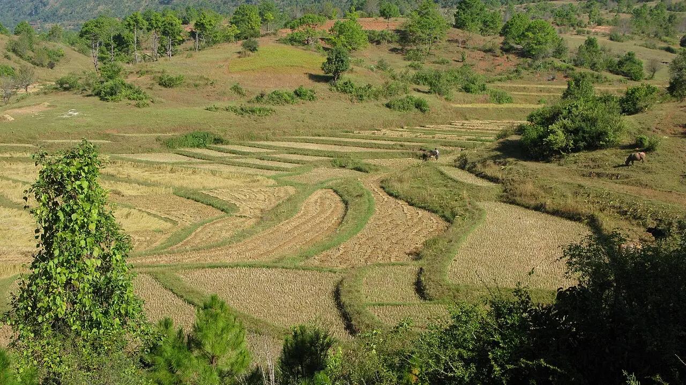

Shan Hills, Myanmar, Rice paddies in rural Myanmar between Inle lake and Kalaw mountain range.jpg — Vyacheslav Argenberg / [CC BY 4.0](https://creativecommons.org/licenses/by/4.0) / [原典](https://commons.wikimedia.org/wiki/File:Shan_Hills%2C_Myanmar%2C_Rice_paddies_in_rural_Myanmar_between_Inle_lake_and_Kalaw_mountain_range.jpg)

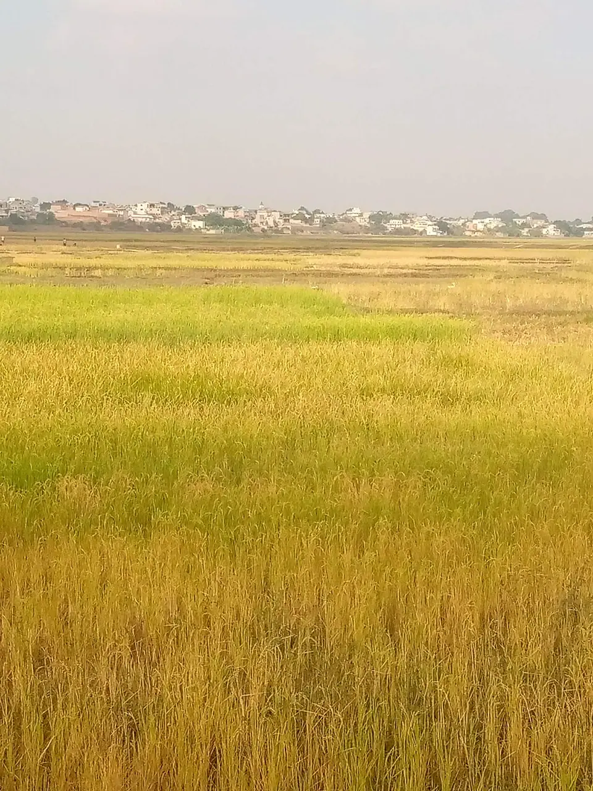

Rizieres et village à Madagascar.jpg — Mammysou17 / [CC0](https://creativecommons.org/publicdomain/zero/1.0/deed.en) / [原典](https://commons.wikimedia.org/wiki/File:Rizieres_et_village_%C3%A0_Madagascar.jpg)

## 温室と育苗 — greenhouses

制作で見るところ：骨組・透明素材の反射、内部の列

関連コード：`app/src/world/ranch-structures.js`

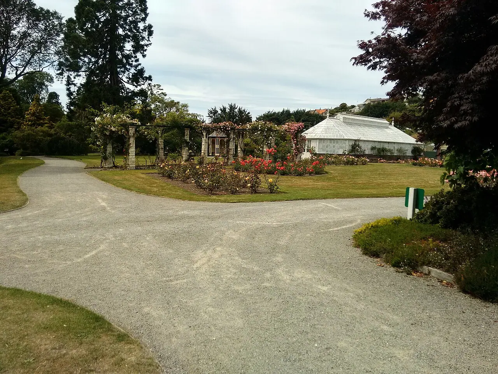

Oamaru Public Gardens - Display House.jpg — David Nind / [CC0](https://creativecommons.org/publicdomain/zero/1.0/deed.en) / [原典](https://commons.wikimedia.org/wiki/File:Oamaru_Public_Gardens_-_Display_House.jpg)

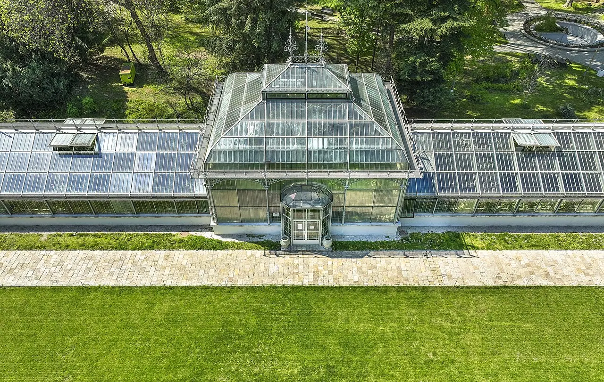

Стаклењак, Ботаничка башта Јевремовац (greenhouse Jevremovac Botanical Garden, Belgrade, Serbia).jpg — Petar Milošević / [CC BY-SA 4.0](https://creativecommons.org/licenses/by-sa/4.0) / [原典](https://commons.wikimedia.org/wiki/File:%D0%A1%D1%82%D0%B0%D0%BA%D0%BB%D0%B5%D1%9A%D0%B0%D0%BA%2C_%D0%91%D0%BE%D1%82%D0%B0%D0%BD%D0%B8%D1%87%D0%BA%D0%B0_%D0%B1%D0%B0%D1%88%D1%82%D0%B0_%D0%88%D0%B5%D0%B2%D1%80%D0%B5%D0%BC%D0%BE%D0%B2%D0%B0%D1%86_%28greenhouse_Jevremovac_Botanical_Garden%2C_Belgrade%2C_Serbia%29.jpg)

## 田舎の農家 — farmhouses

制作で見るところ：屋根形状と生活道具、庭と道の接続

関連コード：`app/src/world/road.js`、`app/src/world/house.js`

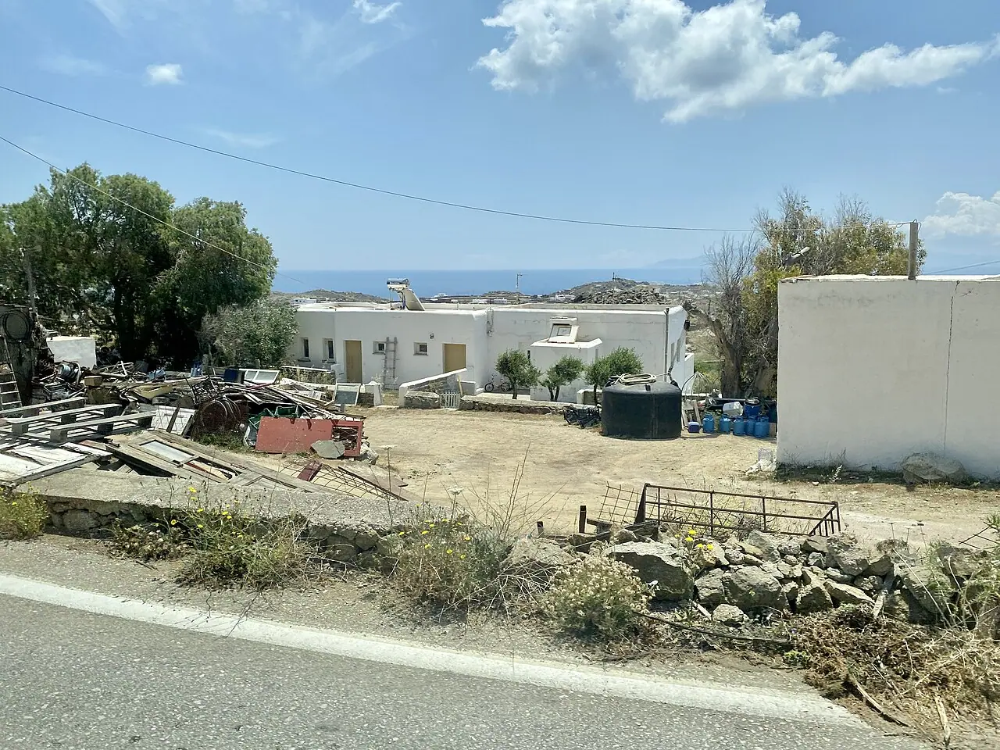

Rural Farmhouse, Mykonos, Greece (53496485676).jpg — Warren LeMay from Chicago, IL, United States / [CC BY-SA 2.0](https://creativecommons.org/licenses/by-sa/2.0) / [原典](https://commons.wikimedia.org/wiki/File:Rural_Farmhouse%2C_Mykonos%2C_Greece_%2853496485676%29.jpg)

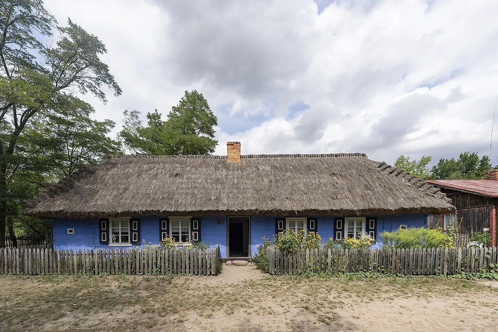

Skansen w Maurzycach, Łowicki Park Etnograficzny w Maurzycach, 2025, SOULinPIX, KsP 212.jpg — Krzysztof Popławski / [CC BY-SA 4.0](https://creativecommons.org/licenses/by-sa/4.0) / [原典](https://commons.wikimedia.org/wiki/File:Skansen_w_Maurzycach%2C_%C5%81owicki_Park_Etnograficzny_w_Maurzycach%2C_2025%2C_SOULinPIX%2C_KsP_212.jpg)

## 井戸と水汲み — water-pumps

制作で見るところ：水道具の大きさ、木桶や給水槽との関係

関連コード：`app/src/world/ranch-structures.js`

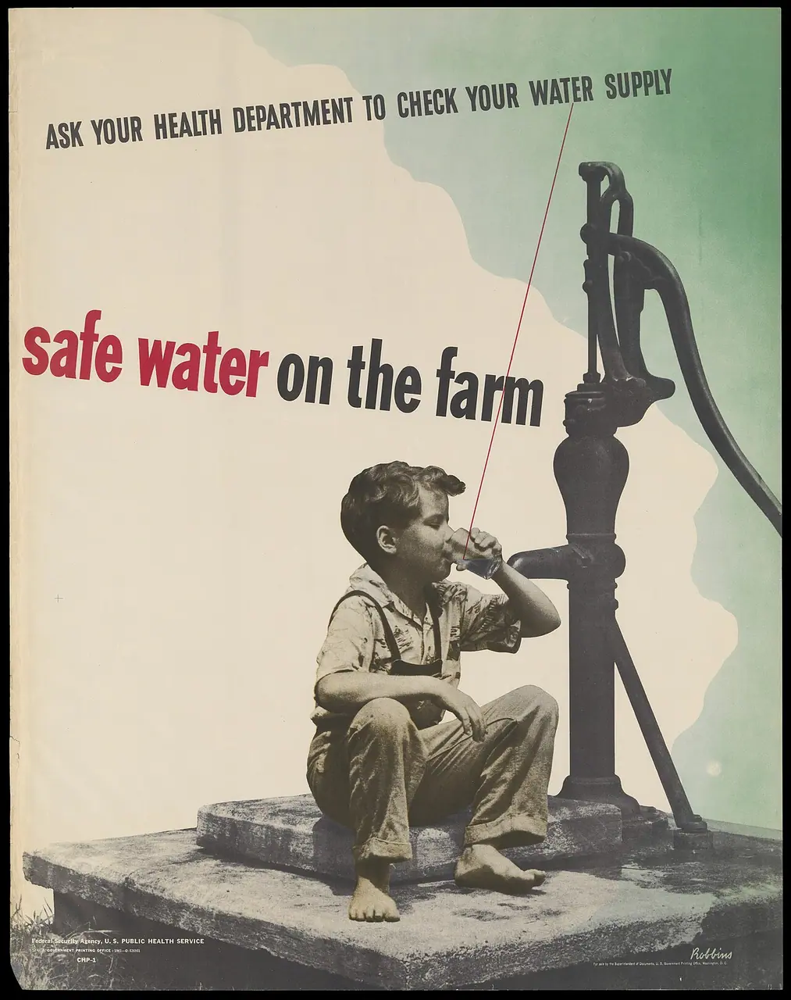

An American farm boy drinking unsafe water Wellcome L0069829.jpg — See source file page / [CC BY 4.0](https://creativecommons.org/licenses/by/4.0) / [原典](https://commons.wikimedia.org/wiki/File:An_American_farm_boy_drinking_unsafe_water_Wellcome_L0069829.jpg)

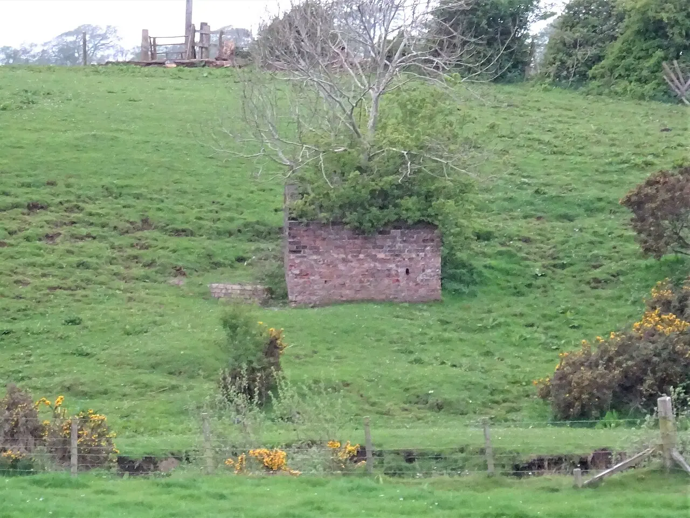

Rashillhouse Farm at Watermeetings. Old well and pump house. North Ayrshire.jpg — Rosser1954 / [CC BY-SA 4.0](https://creativecommons.org/licenses/by-sa/4.0) / [原典](https://commons.wikimedia.org/wiki/File:Rashillhouse_Farm_at_Watermeetings._Old_well_and_pump_house._North_Ayrshire.jpg)

