# forest-layout — reference photos

[← Gallery index](./README.md) | [Credits](../catalog/CREDITS.md)

## 空撮：樹冠のモザイク — aerial-canopy-mosaic

制作で見るところ：上空から高木の樹冠サイズ・輪郭・集団・木と木の隙間を比較する（正確な幹位置は別途調査）

関連コード：`app/src/world/nature.js`、`app/src/world/landscape.js`、`app/src/world/terrain-height.js`

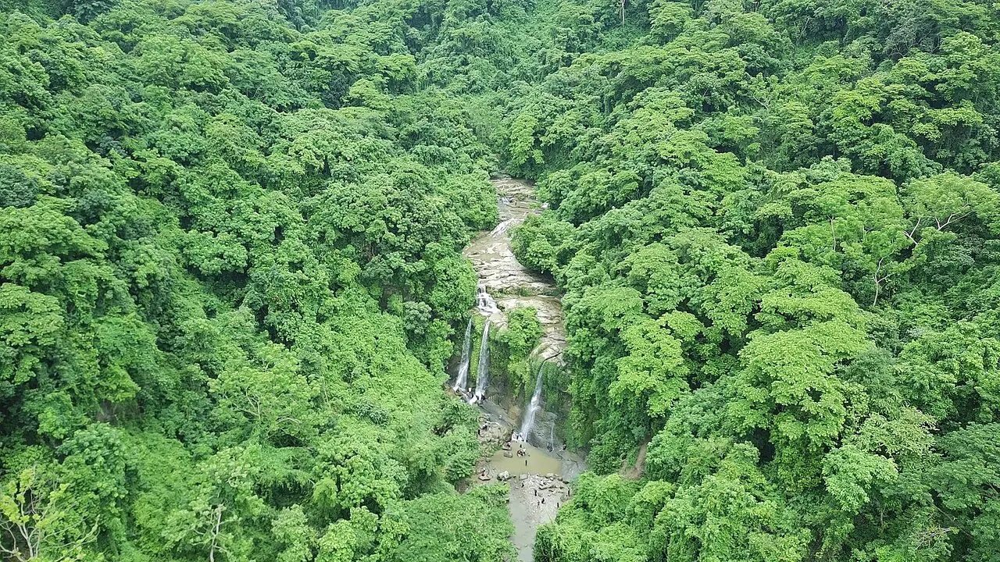

Aerial view of Sahasradhara Waterfall and forest canopy, Sitakunda Eco Park⁠.jpg — Sultan Sunnny / [CC BY-SA 4.0](https://creativecommons.org/licenses/by-sa/4.0) / [原典](https://commons.wikimedia.org/wiki/File:Aerial_view_of_Sahasradhara_Waterfall_and_forest_canopy%2C_Sitakunda_Eco_Park%E2%81%A0.jpg)

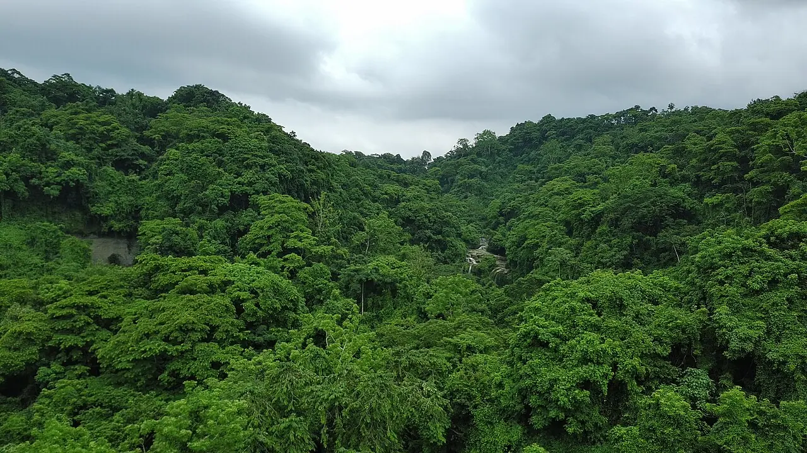

Aerial view of forest canopy and waterfall, Sitakunda Eco Park⁠.jpg — Sultan Sunnny / [CC BY-SA 4.0](https://creativecommons.org/licenses/by-sa/4.0) / [原典](https://commons.wikimedia.org/wiki/File:Aerial_view_of_forest_canopy_and_waterfall%2C_Sitakunda_Eco_Park%E2%81%A0.jpg)

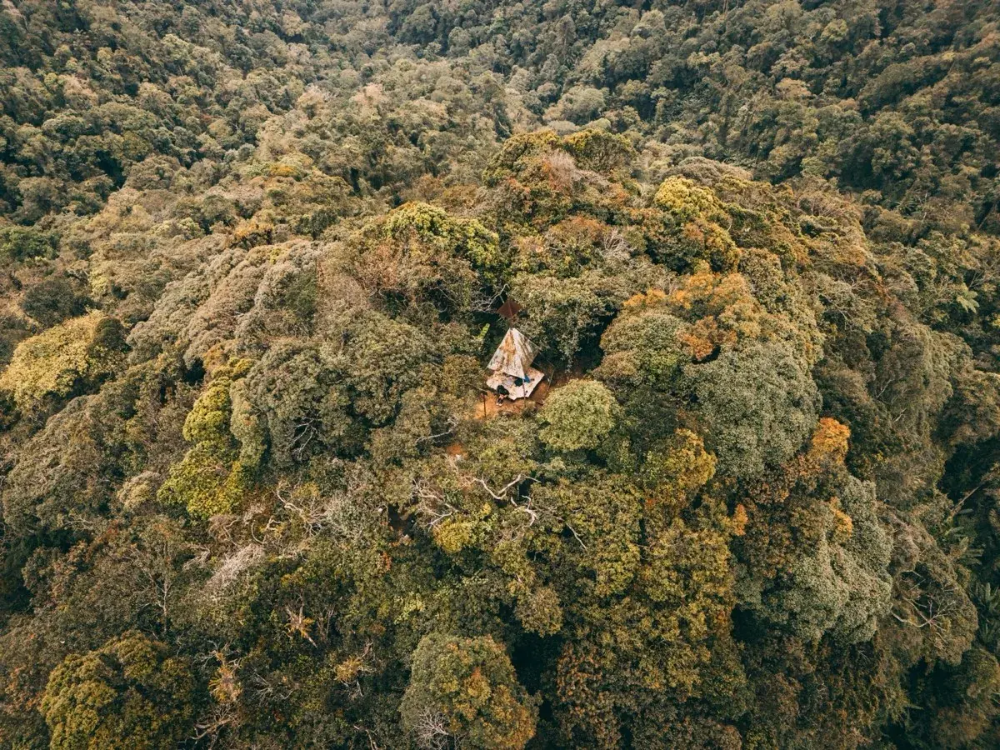

Gunung Nuang summit forest canopy aerial view.webp — Kay Du / [CC BY-SA 4.0](https://creativecommons.org/licenses/by-sa/4.0) / [原典](https://commons.wikimedia.org/wiki/File:Gunung_Nuang_summit_forest_canopy_aerial_view.webp)

## 空撮：林のかたまりと空間 — aerial-forest-clusters

制作で見るところ：林分の集団・非均一な密度・草地や水との境界・小さな開放域

関連コード：`app/src/world/nature.js`、`app/src/world/landscape.js`、`app/src/world/terrain-height.js`

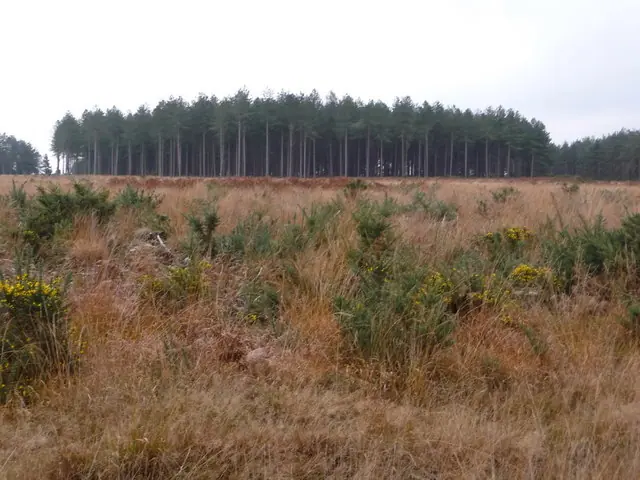

Alderholt, a clearing in Telegraph Plantation - geograph.org.uk - 1575171.jpg — Chris Downer / [CC BY-SA 2.0](https://creativecommons.org/licenses/by-sa/2.0) / [原典](https://commons.wikimedia.org/wiki/File:Alderholt%2C_a_clearing_in_Telegraph_Plantation_-_geograph.org.uk_-_1575171.jpg)

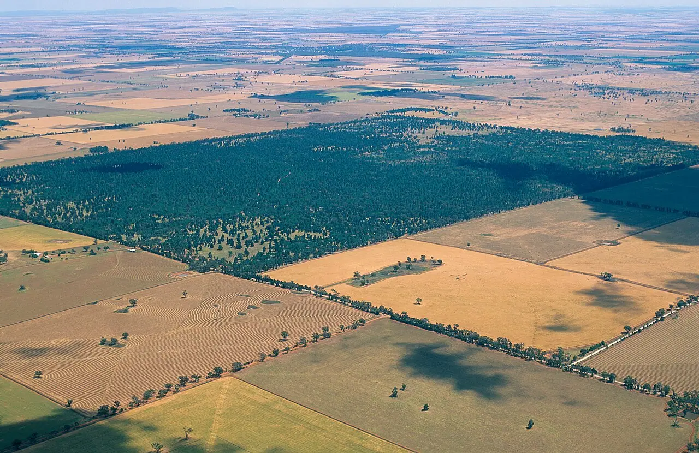

CSIRO ScienceImage 4703 Aerial view of Lester State Forest and wheat farms near Coolamon NSW 1999.jpg — Gregory Heath, CSIRO / [CC BY 3.0](https://creativecommons.org/licenses/by/3.0) / [原典](https://commons.wikimedia.org/wiki/File:CSIRO_ScienceImage_4703_Aerial_view_of_Lester_State_Forest_and_wheat_farms_near_Coolamon_NSW_1999.jpg)

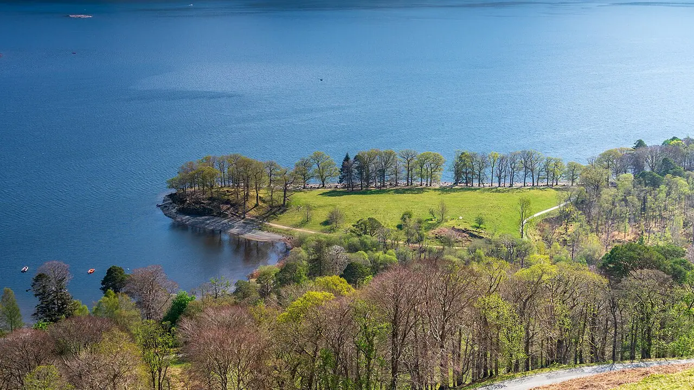

Brandelhow Point and Western Shoreline of Derwent Water from Catbells - May 2025.jpg — TXGemGem / [CC BY-SA 4.0](https://creativecommons.org/licenses/by-sa/4.0) / [原典](https://commons.wikimedia.org/wiki/File:Brandelhow_Point_and_Western_Shoreline_of_Derwent_Water_from_Catbells_-_May_2025.jpg)

## 樹冠の隙間と更新ギャップ — canopy-gaps

制作で見るところ：樹冠の欠損部分・そこに入る光・若い木・倒木の関係

関連コード：`app/src/world/nature.js`、`app/src/world/landscape.js`、`app/src/world/terrain-height.js`

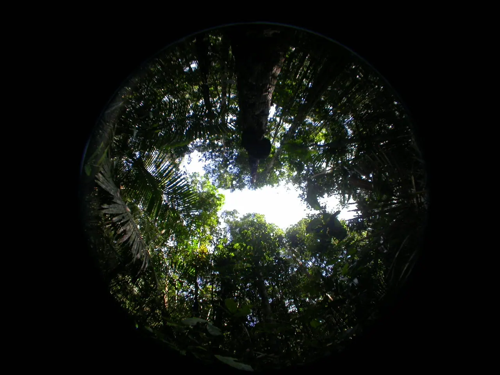

Small Forest Gap.JPG — Etwillia / [CC BY-SA 3.0](https://creativecommons.org/licenses/by-sa/3.0) / [原典](https://commons.wikimedia.org/wiki/File:Small_Forest_Gap.JPG)

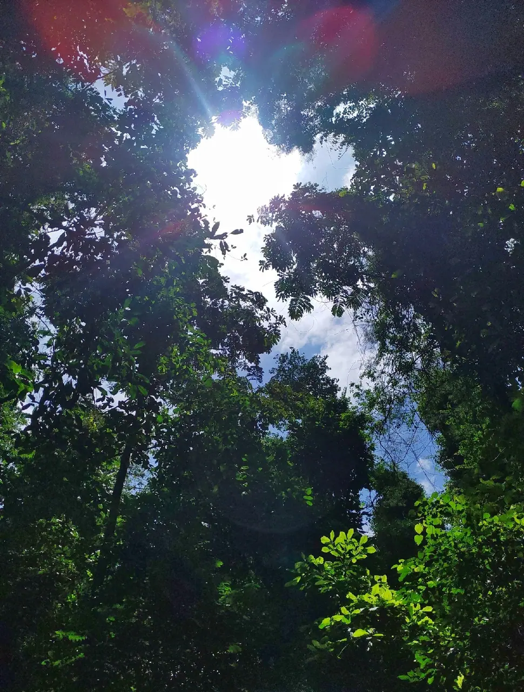

Tree gap.jpg — Dotun55 / [CC BY-SA 4.0](https://creativecommons.org/licenses/by-sa/4.0) / [原典](https://commons.wikimedia.org/wiki/File:Tree_gap.jpg)

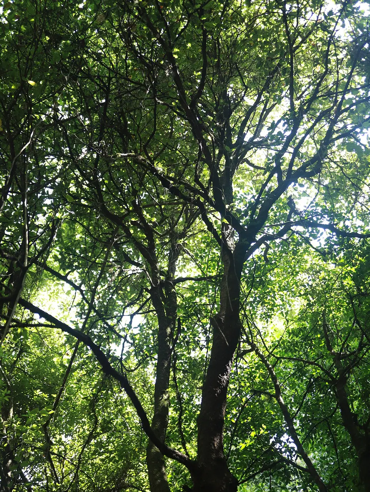

Looking up into a dense green forest canopy.jpg — Krishna k. sahh / [CC0](https://creativecommons.org/publicdomain/zero/1.0/deed.en) / [原典](https://commons.wikimedia.org/wiki/File:Looking_up_into_a_dense_green_forest_canopy.jpg)

## 太さと高さが異なる木の混在 — uneven-age-stands

制作で見るところ：高木・中木・若木が混じる自然林で、幹径と樹高のばらつきを観察

関連コード：`app/src/world/nature.js`、`app/src/world/landscape.js`、`app/src/world/terrain-height.js`

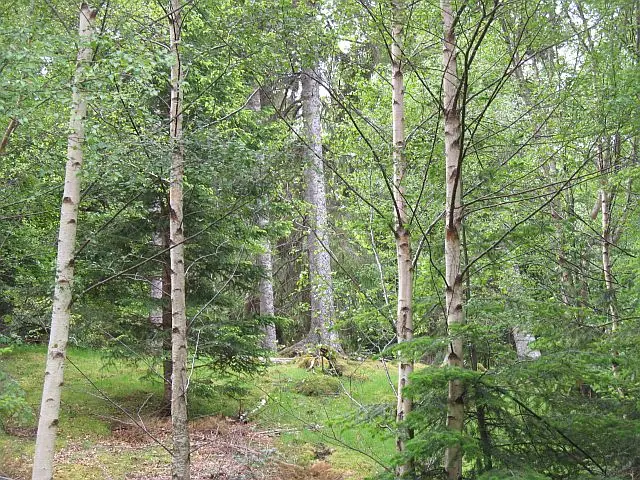

Mixed woodland - geograph.org.uk - 860591.jpg — Richard Webb / [CC BY-SA 2.0](https://creativecommons.org/licenses/by-sa/2.0) / [原典](https://commons.wikimedia.org/wiki/File:Mixed_woodland_-_geograph.org.uk_-_860591.jpg)

## 大木・若木・稚樹の距離 — giant-trees-and-saplings

制作で見るところ：大木の根元・樹陰・小さな稚樹が育つ位置と空白

関連コード：`app/src/world/nature.js`、`app/src/world/landscape.js`、`app/src/world/terrain-height.js`

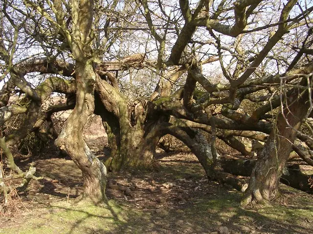

Disintegrating crab apple tree at Furzy Brow, New Forest - geograph.org.uk - 141960.jpg — Jim Champion / [CC BY-SA 2.0](https://creativecommons.org/licenses/by-sa/2.0) / [原典](https://commons.wikimedia.org/wiki/File:Disintegrating_crab_apple_tree_at_Furzy_Brow%2C_New_Forest_-_geograph.org.uk_-_141960.jpg)

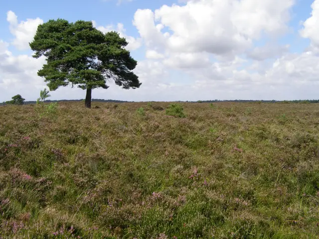

Isolated pine on Cranesmoor, New Forest - geograph.org.uk - 211587.jpg — Jim Champion / [CC BY-SA 2.0](https://creativecommons.org/licenses/by-sa/2.0) / [原典](https://commons.wikimedia.org/wiki/File:Isolated_pine_on_Cranesmoor%2C_New_Forest_-_geograph.org.uk_-_211587.jpg)

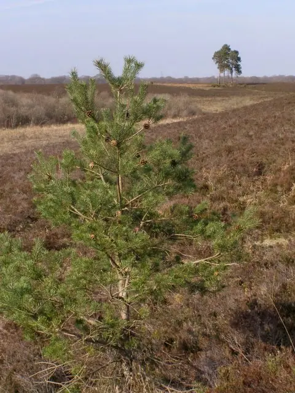

Scots pine sapling, Culverley Bottom, New Forest - geograph.org.uk - 390845.jpg — Jim Champion / [CC BY-SA 2.0](https://creativecommons.org/licenses/by-sa/2.0) / [原典](https://commons.wikimedia.org/wiki/File:Scots_pine_sapling%2C_Culverley_Bottom%2C_New_Forest_-_geograph.org.uk_-_390845.jpg)

## 高木・亜高木・低木の層 — layered-canopy

制作で見るところ：高さ方向の樹冠の重なり、日陰の階層、視界が抜ける場所

関連コード：`app/src/world/nature.js`、`app/src/world/landscape.js`、`app/src/world/terrain-height.js`

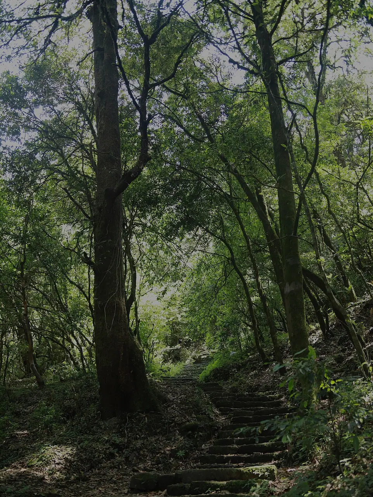

Tone stairs on an ascending trail in a dense broadleaf forest.jpg — Krishna k. sahh / [CC0](https://creativecommons.org/publicdomain/zero/1.0/deed.en) / [原典](https://commons.wikimedia.org/wiki/File:Tone_stairs_on_an_ascending_trail_in_a_dense_broadleaf_forest.jpg)

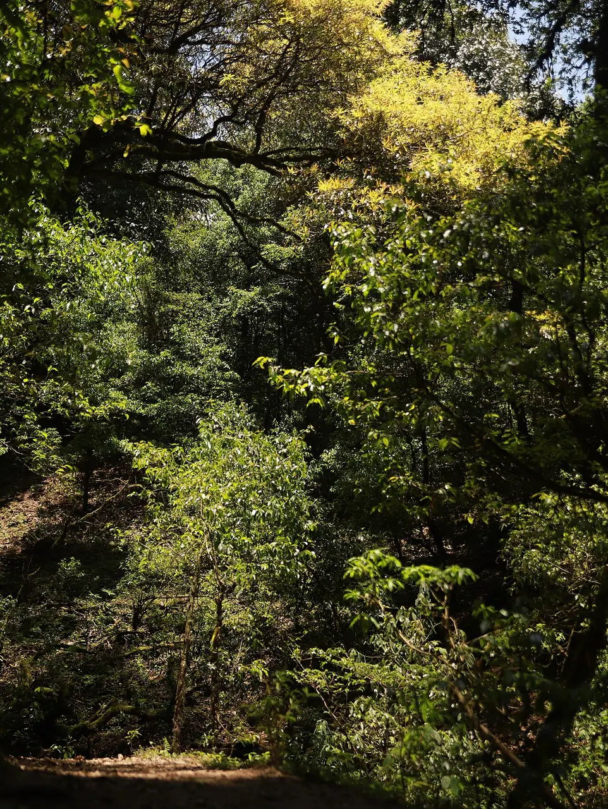

Dense forest canopy and understory at Shivapuri hills.jpg — Krishna k. sahh / [CC0](https://creativecommons.org/publicdomain/zero/1.0/deed.en) / [原典](https://commons.wikimedia.org/wiki/File:Dense_forest_canopy_and_understory_at_Shivapuri_hills.jpg)

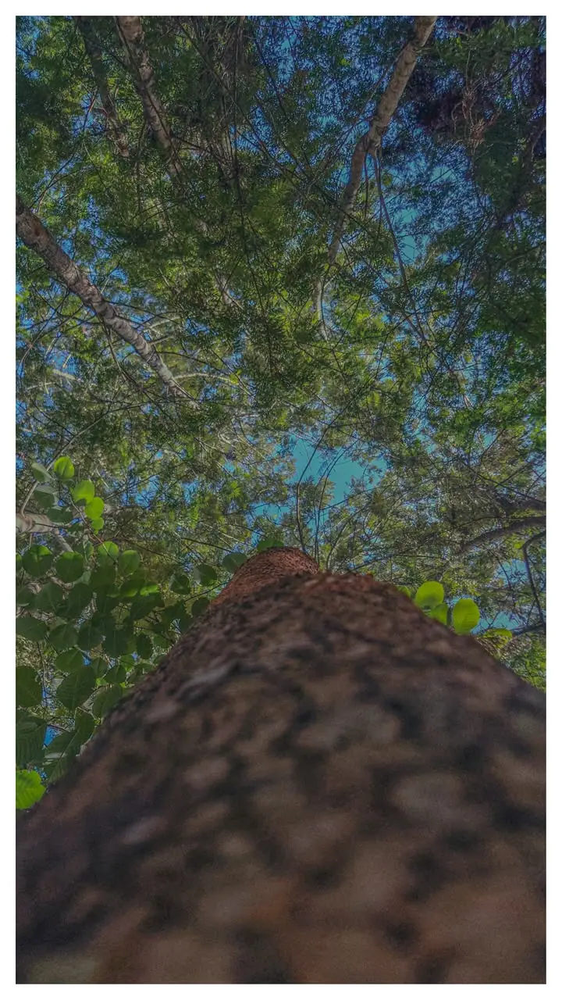

Forest canopy view from the base of a tree.jpg — Agness Abubakar Saidi / [CC0](https://creativecommons.org/publicdomain/zero/1.0/deed.en) / [原典](https://commons.wikimedia.org/wiki/File:Forest_canopy_view_from_the_base_of_a_tree.jpg)

## 自然な森の端の凸凹 — irregular-forest-edge

制作で見るところ：草地から低木、低い木、高い木へ移行する不規則な森林境界

関連コード：`app/src/world/nature.js`、`app/src/world/landscape.js`、`app/src/world/terrain-height.js`

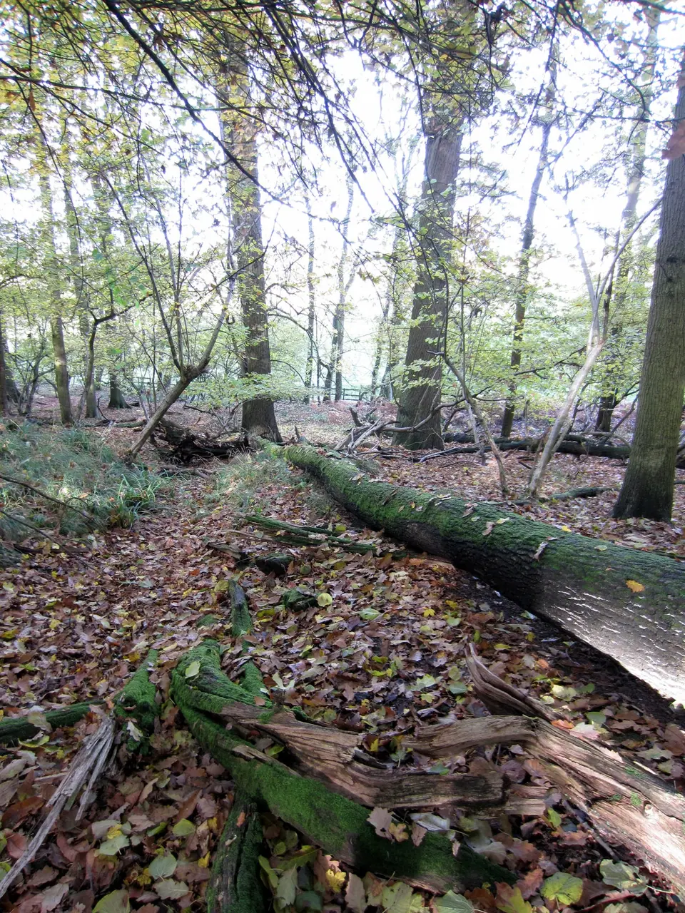

Fallen tree near the edge of Palmer's Shrubs - geograph.org.uk - 3222547.jpg — Philip Jeffrey / [CC BY-SA 2.0](https://creativecommons.org/licenses/by-sa/2.0) / [原典](https://commons.wikimedia.org/wiki/File:Fallen_tree_near_the_edge_of_Palmer%27s_Shrubs_-_geograph.org.uk_-_3222547.jpg)

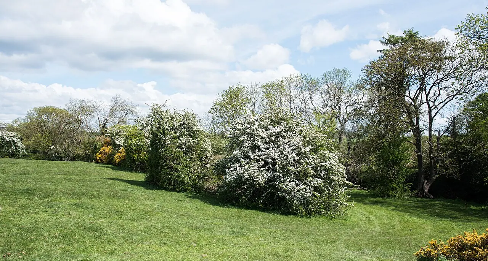

Bushes and trees at edge of field - geograph.org.uk - 6477075.jpg — Trevor Littlewood / [CC BY-SA 2.0](https://creativecommons.org/licenses/by-sa/2.0) / [原典](https://commons.wikimedia.org/wiki/File:Bushes_and_trees_at_edge_of_field_-_geograph.org.uk_-_6477075.jpg)

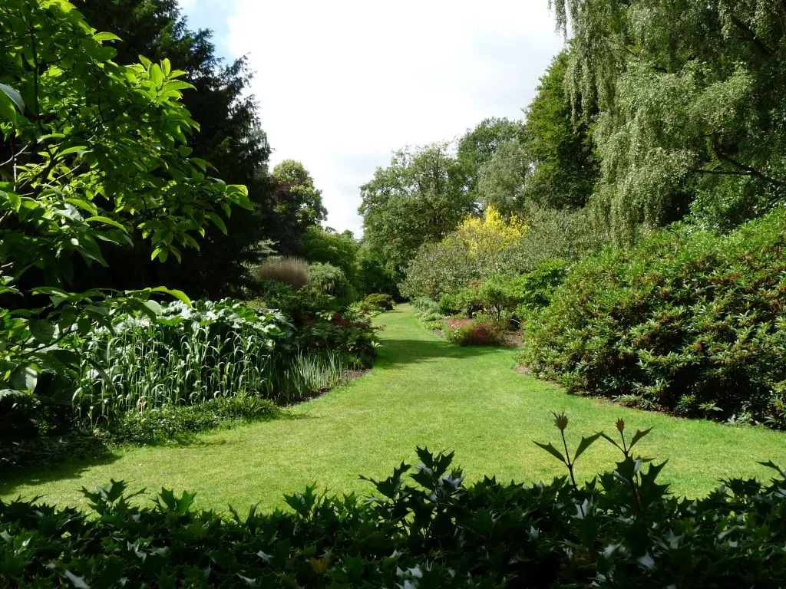

Grass path edged with trees and shrubs - geograph.org.uk - 7043881.jpg — Eric Marsh / [CC BY-SA 2.0](https://creativecommons.org/licenses/by-sa/2.0) / [原典](https://commons.wikimedia.org/wiki/File:Grass_path_edged_with_trees_and_shrubs_-_geograph.org.uk_-_7043881.jpg)

## 川沿いの木立と隙間 — riparian-tree-corridors

制作で見るところ：川の曲がり・氾濫原・水際・河岸の樹木配置と抜け

関連コード：`app/src/world/nature.js`、`app/src/world/landscape.js`、`app/src/world/terrain-height.js`

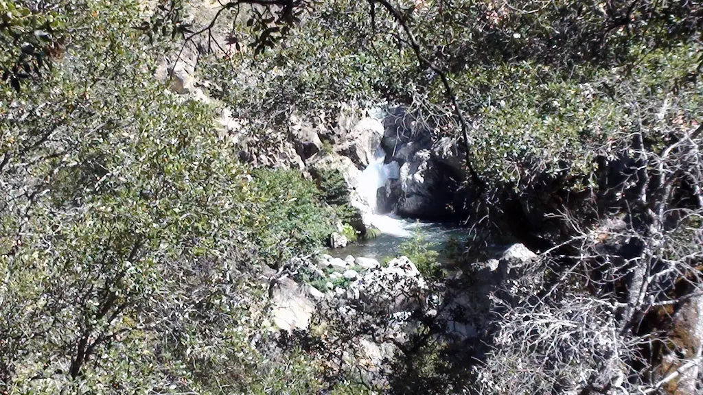

Lower Deer Creek Falls (18906360788).jpg — California Department of Fish and Wildlife from Sacramento, CA, USA / [CC BY 2.0](https://creativecommons.org/licenses/by/2.0) / [原典](https://commons.wikimedia.org/wiki/File:Lower_Deer_Creek_Falls_%2818906360788%29.jpg)

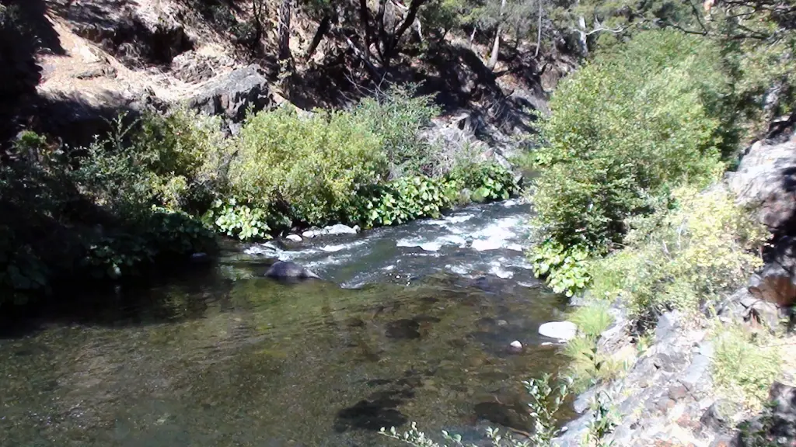

Deer Creek riparian habitat (18471487184).jpg — California Department of Fish and Wildlife from Sacramento, CA, USA / [CC BY 2.0](https://creativecommons.org/licenses/by/2.0) / [原典](https://commons.wikimedia.org/wiki/File:Deer_Creek_riparian_habitat_%2818471487184%29.jpg)

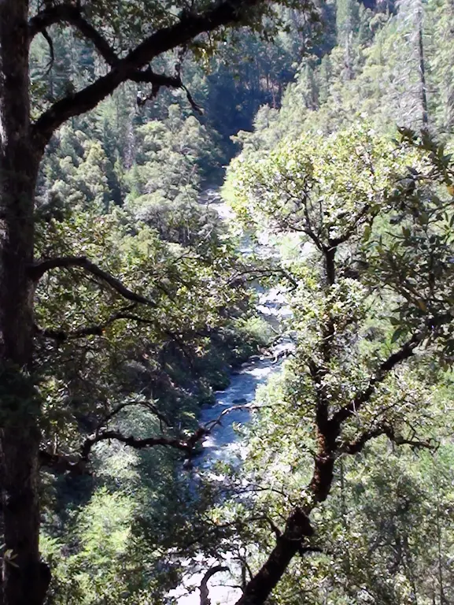

Deer Creek long shot (18471487494).jpg — California Department of Fish and Wildlife from Sacramento, CA, USA / [CC BY 2.0](https://creativecommons.org/licenses/by/2.0) / [原典](https://commons.wikimedia.org/wiki/File:Deer_Creek_long_shot_%2818471487494%29.jpg)

## 斜面の木々の分布 — slope-forest-spacing

制作で見るところ：斜面の勾配・露岩・尾根の陰影による生育場所と間隔の違い

関連コード：`app/src/world/nature.js`、`app/src/world/landscape.js`、`app/src/world/terrain-height.js`

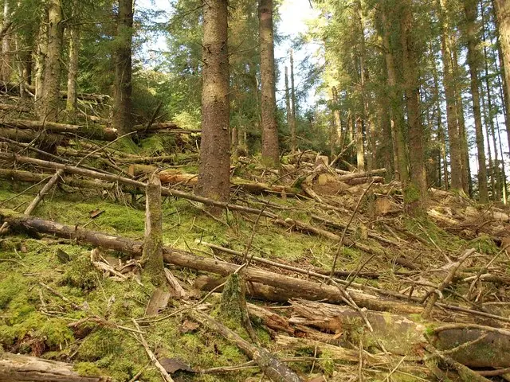

Slow progress in Fernworthy Forest - geograph.org.uk - 1711140.jpg — Derek Harper / [CC BY-SA 2.0](https://creativecommons.org/licenses/by-sa/2.0) / [原典](https://commons.wikimedia.org/wiki/File:Slow_progress_in_Fernworthy_Forest_-_geograph.org.uk_-_1711140.jpg)

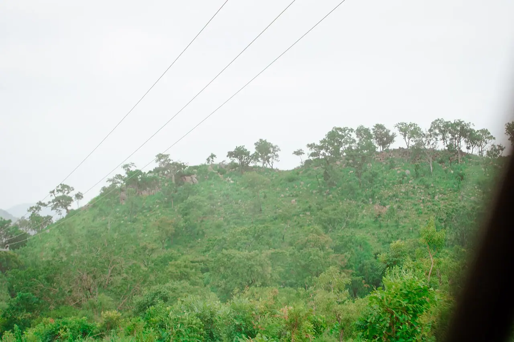

A dense forested hillside.jpg — Ibrahim Achiri / [CC BY-SA 4.0](https://creativecommons.org/licenses/by-sa/4.0) / [原典](https://commons.wikimedia.org/wiki/File:A_dense_forested_hillside.jpg)

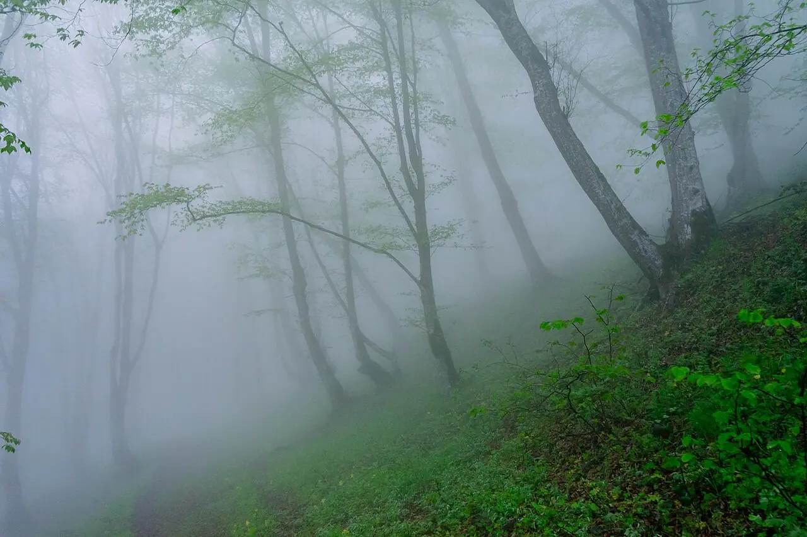

Foggy forest hillside.jpg — Mar Mkrtchyan / [CC0](https://creativecommons.org/publicdomain/zero/1.0/deed.en) / [原典](https://commons.wikimedia.org/wiki/File:Foggy_forest_hillside.jpg)

## 尾根の樹木と林冠 — ridge-tree-arrangement

制作で見るところ：尾根・稜線の植生と山腹側への変化、遠くから見える木の輪郭

関連コード：`app/src/world/nature.js`、`app/src/world/landscape.js`、`app/src/world/terrain-height.js`

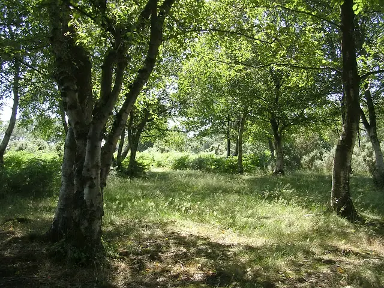

In the shade of the silver birch trees, Godshill ridge, New Forest - geograph.org.uk - 27274.jpg — Jim Champion / [CC BY-SA 2.0](https://creativecommons.org/licenses/by-sa/2.0) / [原典](https://commons.wikimedia.org/wiki/File:In_the_shade_of_the_silver_birch_trees%2C_Godshill_ridge%2C_New_Forest_-_geograph.org.uk_-_27274.jpg)

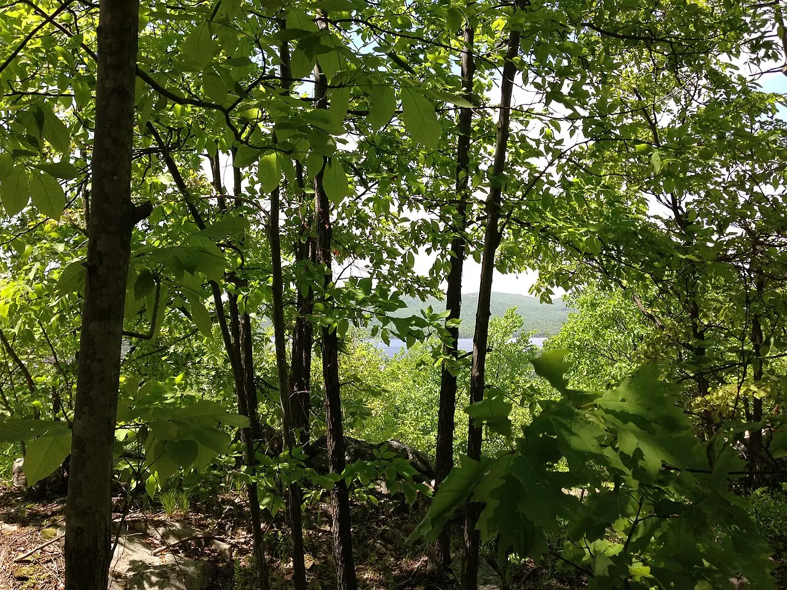

2013-05-12 13 21 17 View west through trees from the Wanaque Ridge Trail on the central section of Wanaque Ridge in Ramapo Mountain State Forest.jpg — Famartin / [CC BY-SA 3.0](https://creativecommons.org/licenses/by-sa/3.0) / [原典](https://commons.wikimedia.org/wiki/File:2013-05-12_13_21_17_View_west_through_trees_from_the_Wanaque_Ridge_Trail_on_the_central_section_of_Wanaque_Ridge_in_Ramapo_Mountain_State_Forest.jpg)

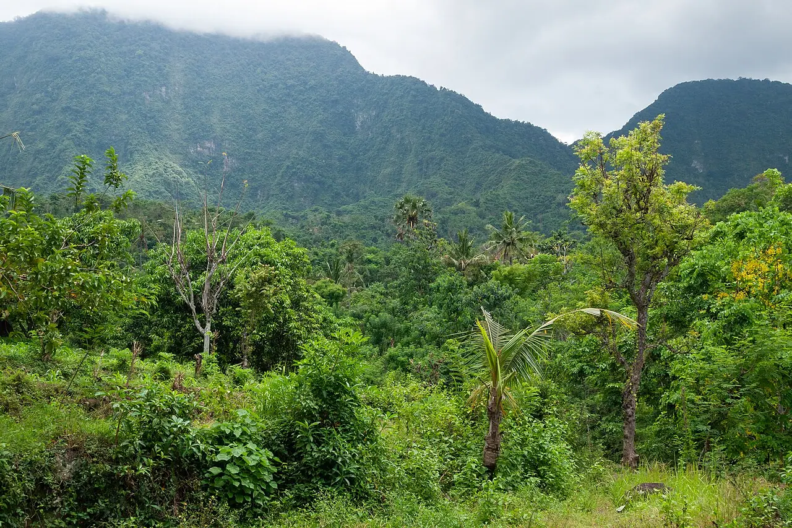

Bali, Forest, Trees, East Bali, Indonesia.jpg — Vyacheslav Argenberg / [CC BY 4.0](https://creativecommons.org/licenses/by/4.0) / [原典](https://commons.wikimedia.org/wiki/File:Bali%2C_Forest%2C_Trees%2C_East_Bali%2C_Indonesia.jpg)

## 森の中の空地と草本 — natural-clearings

制作で見るところ：空地の大きさ・境界の低木・光と小径の関係

関連コード：`app/src/world/nature.js`、`app/src/world/landscape.js`、`app/src/world/terrain-height.js`

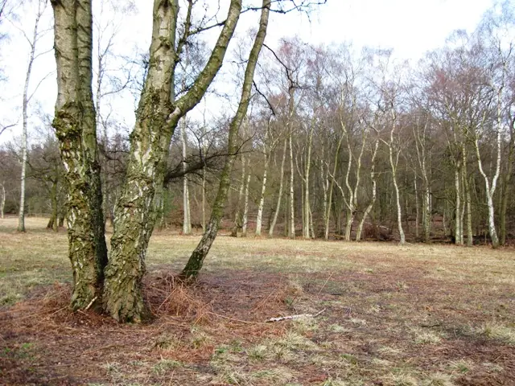

Clearing with Silver Birch on Pitstone Common - geograph.org.uk - 1185115.jpg — Chris Reynolds / [CC BY-SA 2.0](https://creativecommons.org/licenses/by-sa/2.0) / [原典](https://commons.wikimedia.org/wiki/File:Clearing_with_Silver_Birch_on_Pitstone_Common_-_geograph.org.uk_-_1185115.jpg)

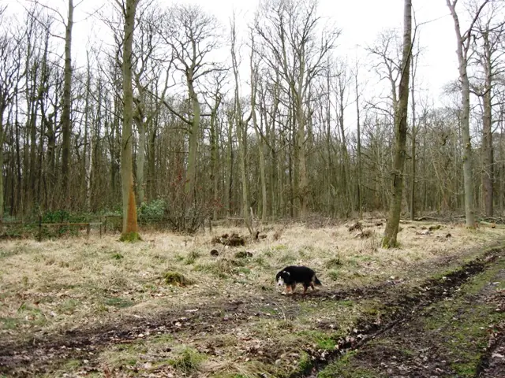

A Recently Created Woodland Clearing at Ashridge - geograph.org.uk - 1193794.jpg — Chris Reynolds / [CC BY-SA 2.0](https://creativecommons.org/licenses/by-sa/2.0) / [原典](https://commons.wikimedia.org/wiki/File:A_Recently_Created_Woodland_Clearing_at_Ashridge_-_geograph.org.uk_-_1193794.jpg)

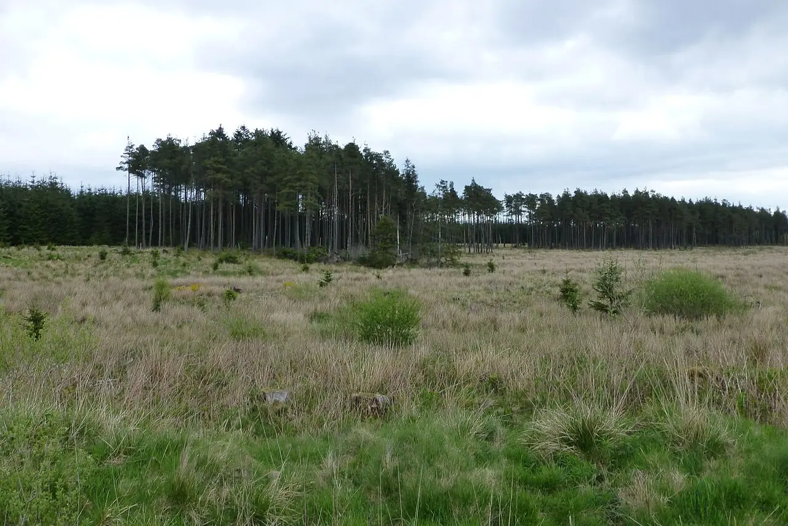

Natural clearing in the forest - geograph.org.uk - 5399292.jpg — Russel Wills / [CC BY-SA 2.0](https://creativecommons.org/licenses/by-sa/2.0) / [原典](https://commons.wikimedia.org/wiki/File:Natural_clearing_in_the_forest_-_geograph.org.uk_-_5399292.jpg)

## 倒木・枯木・切り株の配置 — deadwood-and-fallen-trees

制作で見るところ：倒木と稚樹・苔・土の相互関係、地面の不規則性

関連コード：`app/src/world/nature.js`、`app/src/world/landscape.js`、`app/src/world/terrain-height.js`

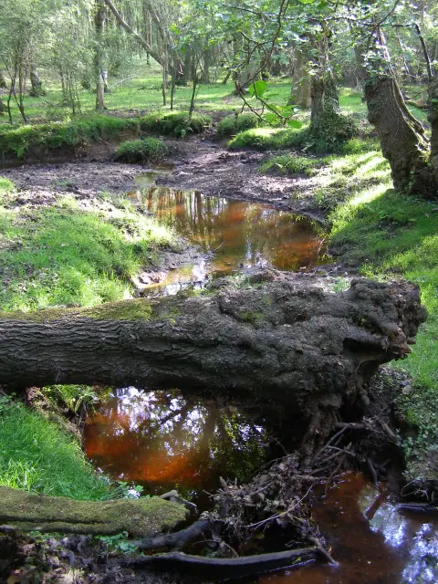

Fallen tree over the Beaulieu River, New Forest - geograph.org.uk - 179496.jpg — Jim Champion / [CC BY-SA 2.0](https://creativecommons.org/licenses/by-sa/2.0) / [原典](https://commons.wikimedia.org/wiki/File:Fallen_tree_over_the_Beaulieu_River%2C_New_Forest_-_geograph.org.uk_-_179496.jpg)

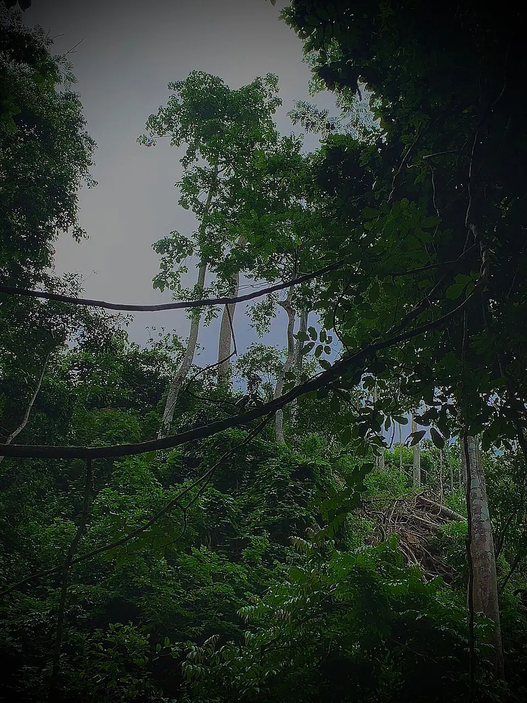

Overgrown Forest Path with Fallen Tree.jpg — Teame01 / [CC BY-SA 4.0](https://creativecommons.org/licenses/by-sa/4.0) / [原典](https://commons.wikimedia.org/wiki/File:Overgrown_Forest_Path_with_Fallen_Tree.jpg)

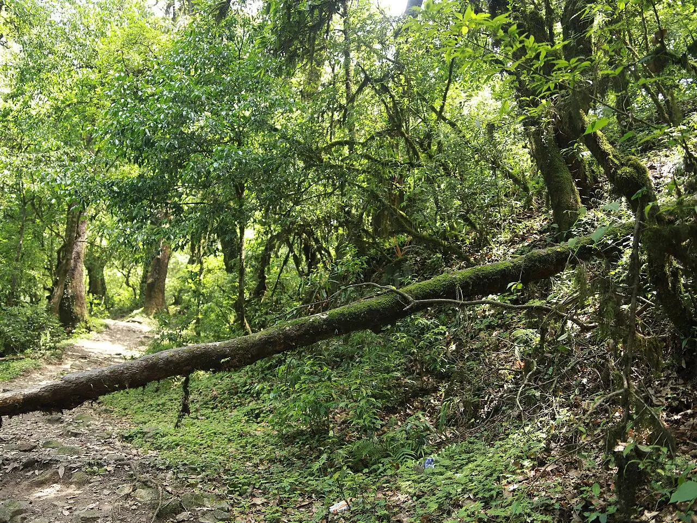

Fallen mossy tree trunk crossing a forest trail.jpg — Krishna k. sahh / [CC0](https://creativecommons.org/publicdomain/zero/1.0/deed.en) / [原典](https://commons.wikimedia.org/wiki/File:Fallen_mossy_tree_trunk_crossing_a_forest_trail.jpg)

## 下草と低木の疎密 — understory-patchiness

制作で見るところ：シダ・ササ・低木の斑状分布と日陰の変化

関連コード：`app/src/world/nature.js`、`app/src/world/landscape.js`、`app/src/world/terrain-height.js`

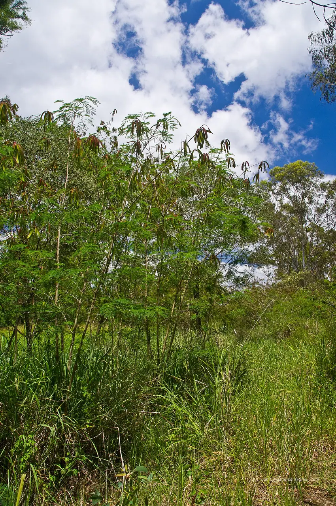

Leucaena leucocephala in open forest understory north riparian forest 7th Brigade Park Chermside IMGP2052.jpg — John Robert McPherson / [CC BY-SA 4.0](https://creativecommons.org/licenses/by-sa/4.0) / [原典](https://commons.wikimedia.org/wiki/File:Leucaena_leucocephala_in_open_forest_understory_north_riparian_forest_7th_Brigade_Park_Chermside_IMGP2052.jpg)

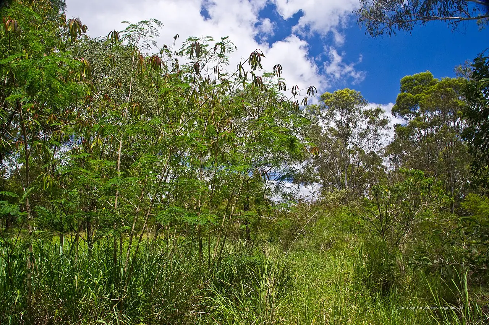

Leucaena leucocephala in open forest understory north riparian forest 7th Brigade Park Chermside IMGP2053.jpg — John Robert McPherson / [CC BY-SA 4.0](https://creativecommons.org/licenses/by-sa/4.0) / [原典](https://commons.wikimedia.org/wiki/File:Leucaena_leucocephala_in_open_forest_understory_north_riparian_forest_7th_Brigade_Park_Chermside_IMGP2053.jpg)

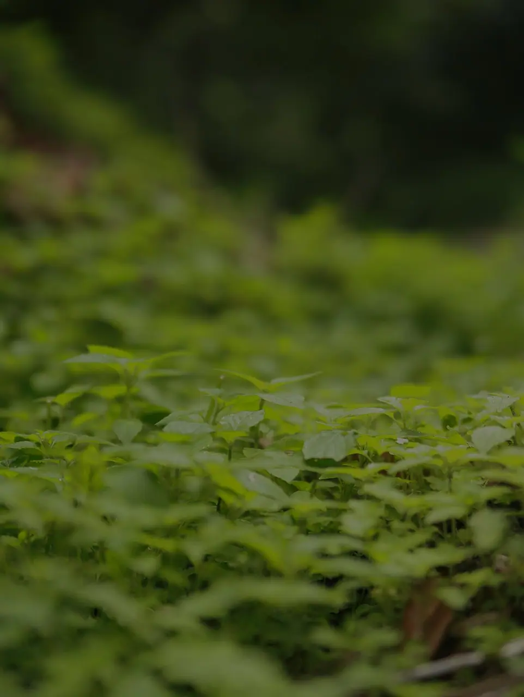

Close-up of low-growing herbaceous vegetation.jpg — Krishna k. sahh / [CC0](https://creativecommons.org/publicdomain/zero/1.0/deed.en) / [原典](https://commons.wikimedia.org/wiki/File:Close-up_of_low-growing_herbaceous_vegetation.jpg)

## 整列人工林と自然林の比較 — planted-vs-natural

制作で見るところ：植林地の規則的間隔と自然林の間隔・樹種・樹齢の多様性を区別する

関連コード：`app/src/world/nature.js`、`app/src/world/landscape.js`、`app/src/world/terrain-height.js`

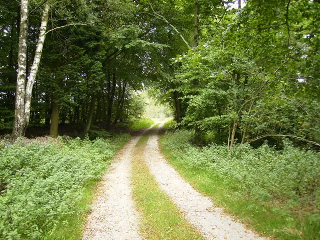

Deciduous trees in Sproxton Moor Plantation - geograph.org.uk - 553591.jpg — Phil Catterall / [CC BY-SA 2.0](https://creativecommons.org/licenses/by-sa/2.0) / [原典](https://commons.wikimedia.org/wiki/File:Deciduous_trees_in_Sproxton_Moor_Plantation_-_geograph.org.uk_-_553591.jpg)

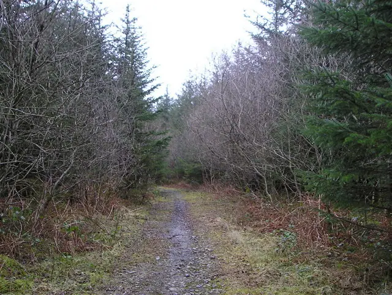

Forest Track - geograph.org.uk - 1171788.jpg — Marion Phillips / [CC BY-SA 2.0](https://creativecommons.org/licenses/by-sa/2.0) / [原典](https://commons.wikimedia.org/wiki/File:Forest_Track_-_geograph.org.uk_-_1171788.jpg)

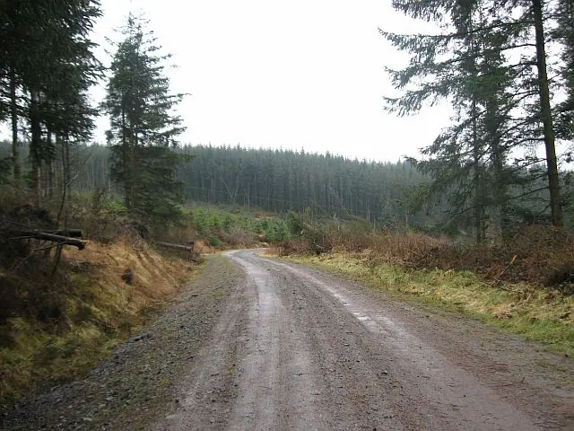

Spruce plantation - geograph.org.uk - 1779816.jpg — Colin Bell / [CC BY-SA 2.0](https://creativecommons.org/licenses/by-sa/2.0) / [原典](https://commons.wikimedia.org/wiki/File:Spruce_plantation_-_geograph.org.uk_-_1779816.jpg)

