# forest — reference photos

[← Gallery index](./README.md) | [Credits](../catalog/CREDITS.md)

## 森の小道・土の起伏 — forest-trails

制作で見るところ：木々の間隔、道幅、落葉、足元の連続性

関連コード：`app/src/world/nature.js`、`app/src/world/landscape.js`

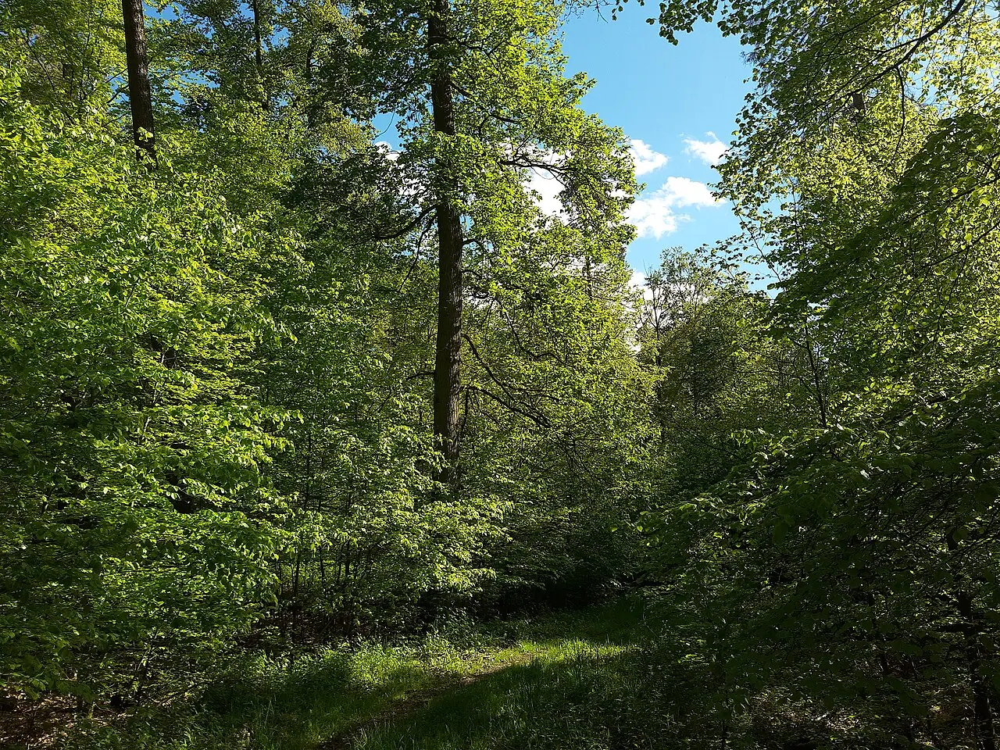

Trail in beech forest, Orlen.jpg — Gerda Arendt / [CC0](https://creativecommons.org/publicdomain/zero/1.0/deed.en) / [原典](https://commons.wikimedia.org/wiki/File:Trail_in_beech_forest%2C_Orlen.jpg)

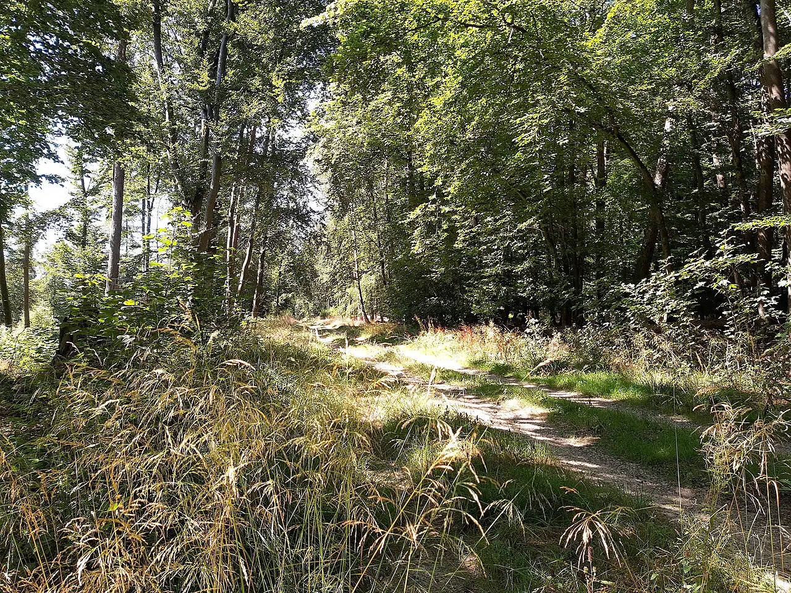

Forest trail, Oberlibbach.jpg — Gerda Arendt / [CC0](https://creativecommons.org/publicdomain/zero/1.0/deed.en) / [原典](https://commons.wikimedia.org/wiki/File:Forest_trail%2C_Oberlibbach.jpg)

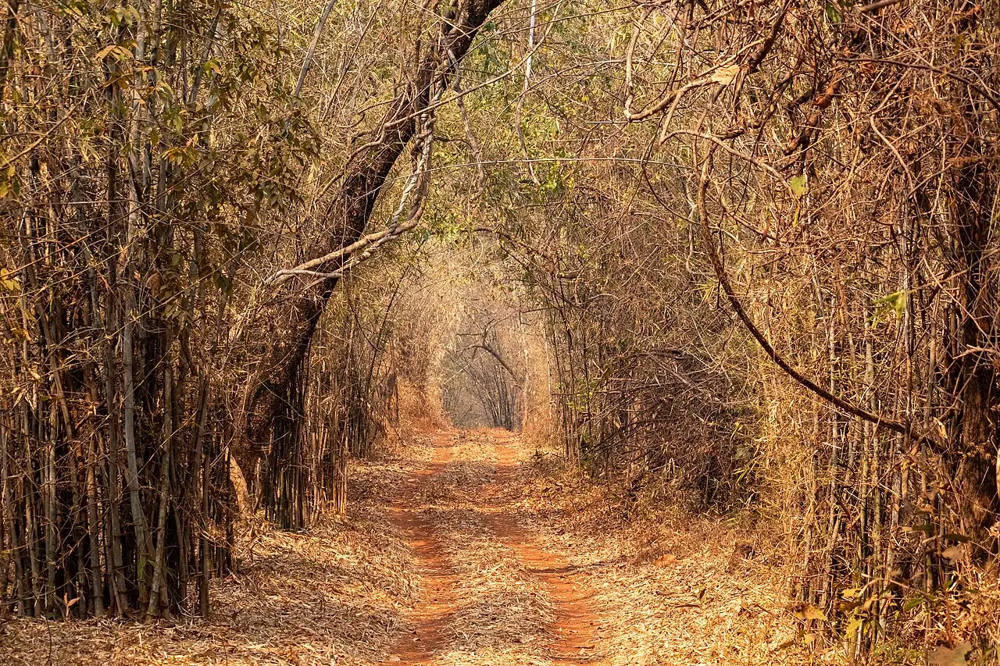

Bamboo-Lined Forest Trail in Tadoba Andhari National Park.jpg — Rohit Sharma / [CC BY-SA 4.0](https://creativecommons.org/licenses/by-sa/4.0) / [原典](https://commons.wikimedia.org/wiki/File:Bamboo-Lined_Forest_Trail_in_Tadoba_Andhari_National_Park.jpg)

## 樹冠・枝と葉の重なり — tree-canopies

制作で見るところ：樹冠の外形、葉群の隙間、枝の付き方

関連コード：`app/src/world/nature.js`、`app/src/lab/trees.js`

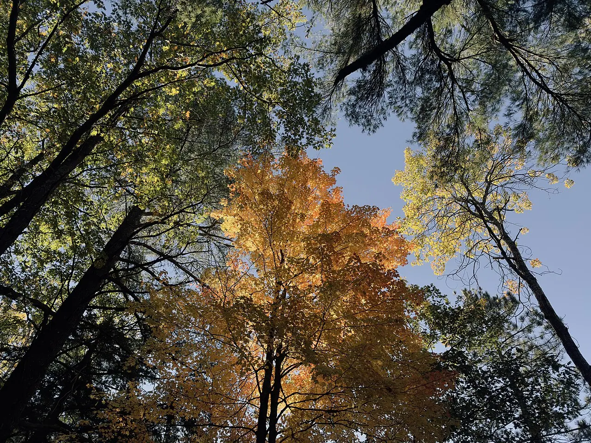

Huron National Forest Big Trees MI.jpg — Zapatosunidos / [CC BY 4.0](https://creativecommons.org/licenses/by/4.0) / [原典](https://commons.wikimedia.org/wiki/File:Huron_National_Forest_Big_Trees_MI.jpg)

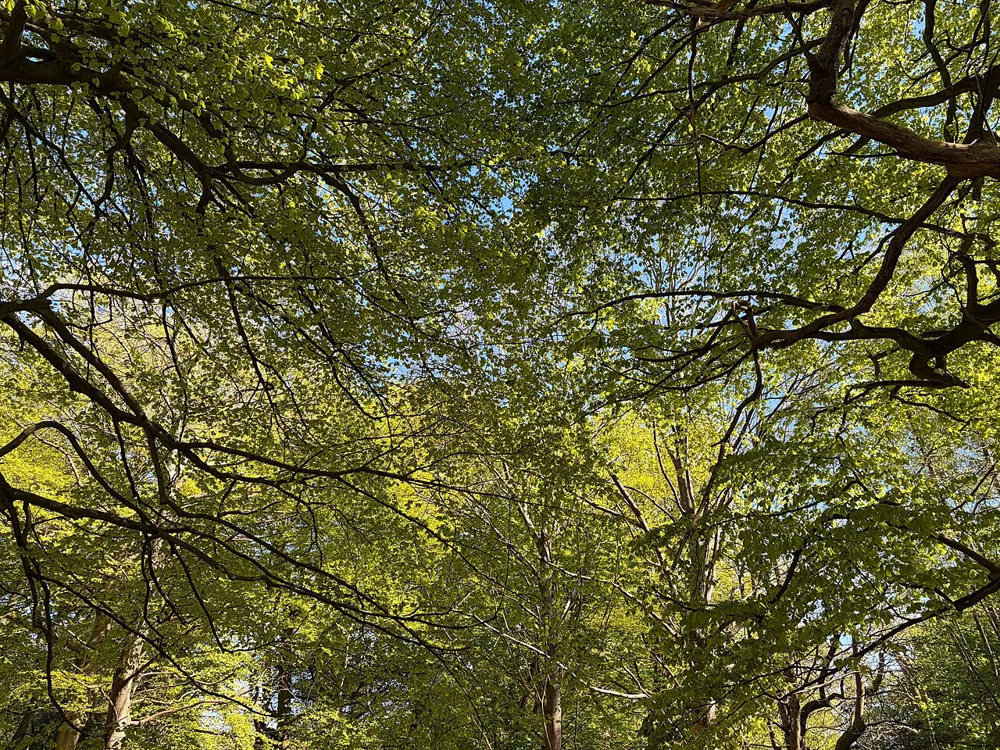

Deciduous tree canopy - geograph.org.uk - 8303760.jpg — Mr Ignavy / [CC BY-SA 2.0](https://creativecommons.org/licenses/by-sa/2.0) / [原典](https://commons.wikimedia.org/wiki/File:Deciduous_tree_canopy_-_geograph.org.uk_-_8303760.jpg)

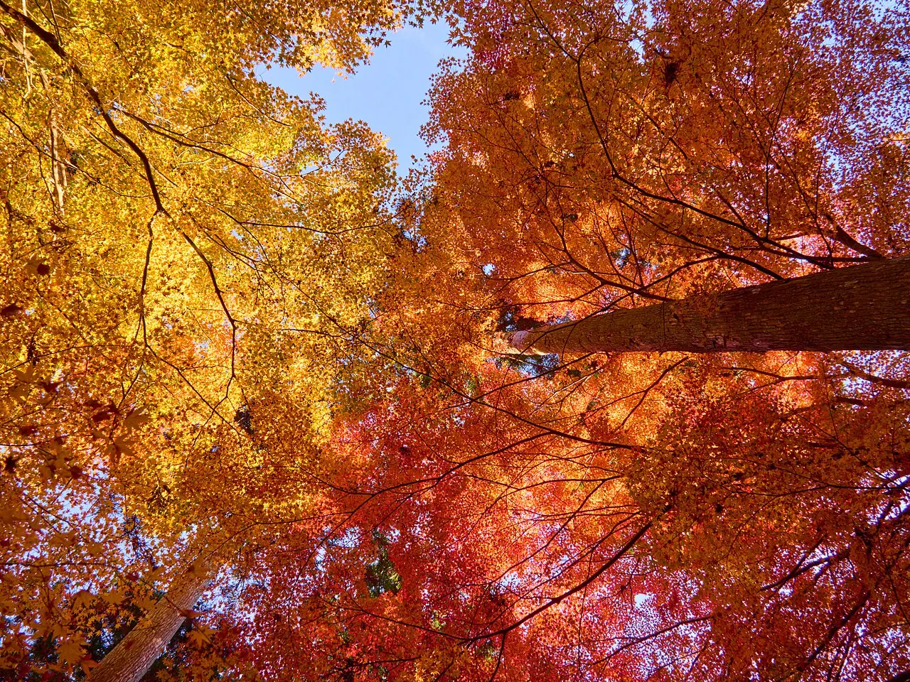

Ohara - Ohara6634.jpg — lumoplank / [CC0](https://creativecommons.org/publicdomain/zero/1.0/deed.en) / [原典](https://commons.wikimedia.org/wiki/File:Ohara_-_Ohara6634.jpg)

## 樹皮と根 — bark-and-roots

制作で見るところ：樹皮の縦方向の凹凸、地表に出る根

関連コード：`app/src/world/nature.js`、`app/src/world/textures.js`

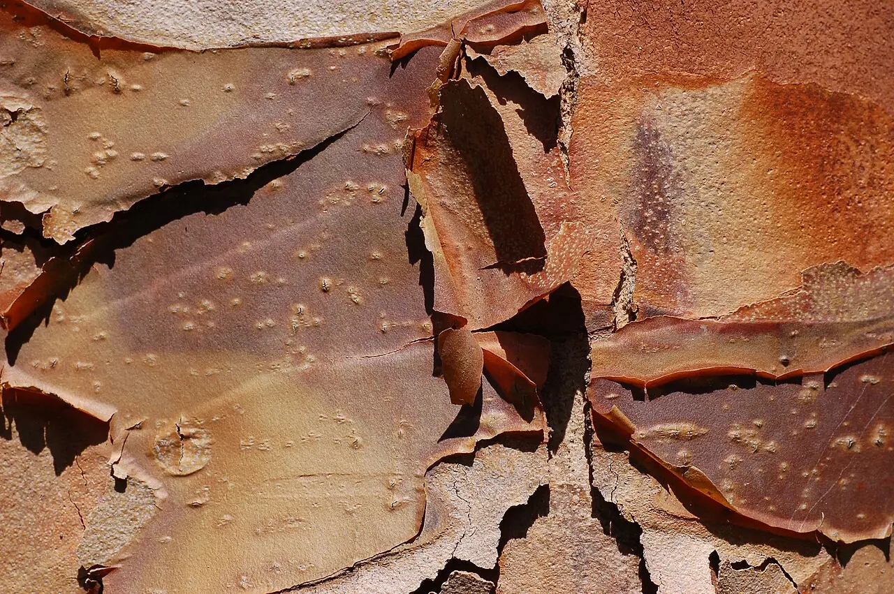

Paperbark Maple Acer griseum Bark Closeup 3008px.jpg — Photo by and (c)2007 Derek Ramsey (Ram-Man). Co-attribution must be given to the Chanticleer Garden. / [CC BY-SA 3.0](https://creativecommons.org/licenses/by-sa/3.0/) / [原典](https://commons.wikimedia.org/wiki/File:Paperbark_Maple_Acer_griseum_Bark_Closeup_3008px.jpg)

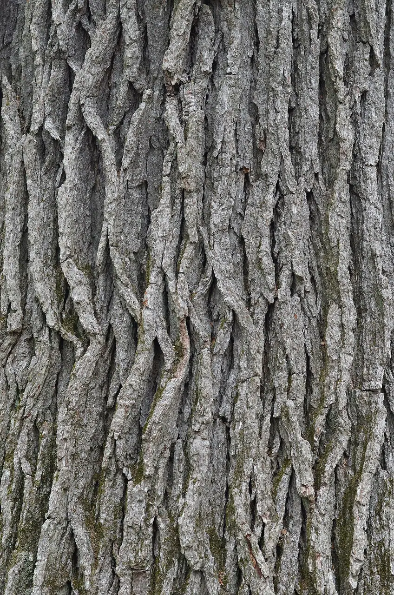

Swamp White Oak Quercus bicolor Bark Closeup Vertical.JPG — Photo by and (c)2016 Derek Ramsey (Ram-Man) / [CC BY-SA 4.0](https://creativecommons.org/licenses/by-sa/4.0) / [原典](https://commons.wikimedia.org/wiki/File:Swamp_White_Oak_Quercus_bicolor_Bark_Closeup_Vertical.JPG)

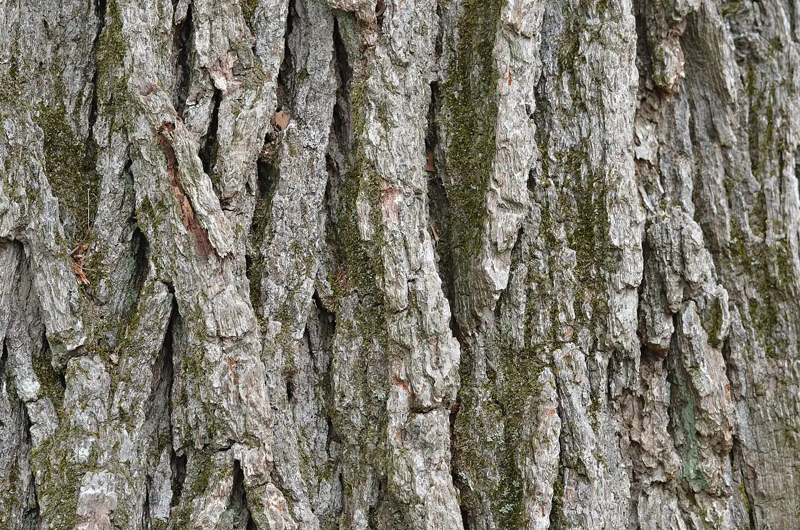

Swamp White Oak Quercus bicolor Bark Closeup Horizontal.JPG — Photo by and (c)2016 Derek Ramsey (Ram-Man) / [CC BY-SA 4.0](https://creativecommons.org/licenses/by-sa/4.0) / [原典](https://commons.wikimedia.org/wiki/File:Swamp_White_Oak_Quercus_bicolor_Bark_Closeup_Horizontal.JPG)

## 苔とシダ — moss-and-ferns

制作で見るところ：低層植生の密度と葉の重なり

関連コード：`app/src/world/nature.js`

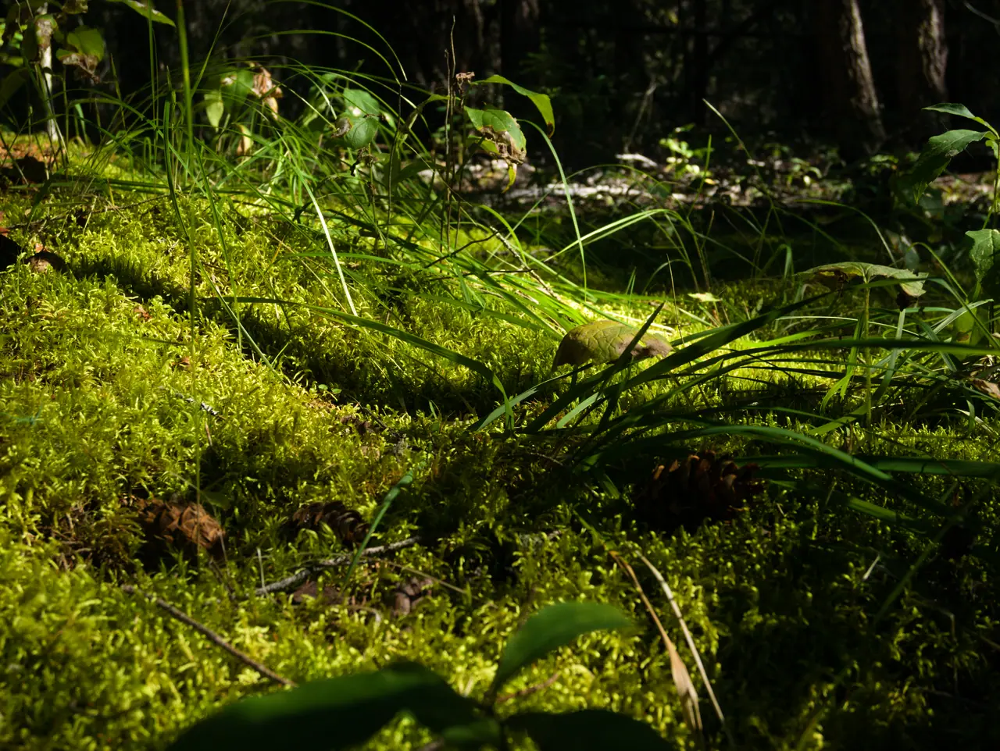

Mosses, Lichens, and Grasses sparkle on the forest floor in Lac La Hache Provincial Park.png — Extemporalist / [CC0](https://creativecommons.org/publicdomain/zero/1.0/deed.en) / [原典](https://commons.wikimedia.org/wiki/File:Mosses%2C_Lichens%2C_and_Grasses_sparkle_on_the_forest_floor_in_Lac_La_Hache_Provincial_Park.png)

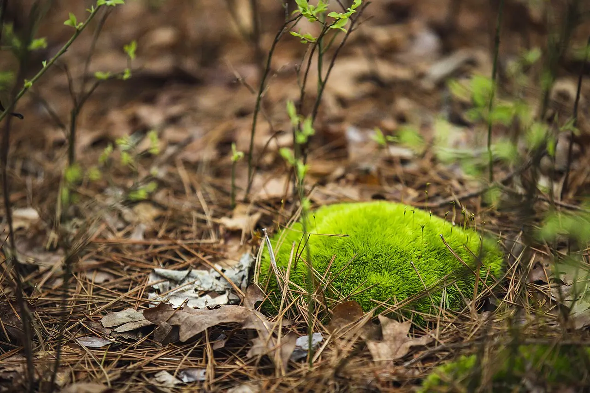

Moss (Bryophyta) on the forest floor in Broken Bow, Oklahoma.jpg — Matthew T Rader / [CC BY-SA 4.0](https://creativecommons.org/licenses/by-sa/4.0) / [原典](https://commons.wikimedia.org/wiki/File:Moss_%28Bryophyta%29_on_the_forest_floor_in_Broken_Bow%2C_Oklahoma.jpg)

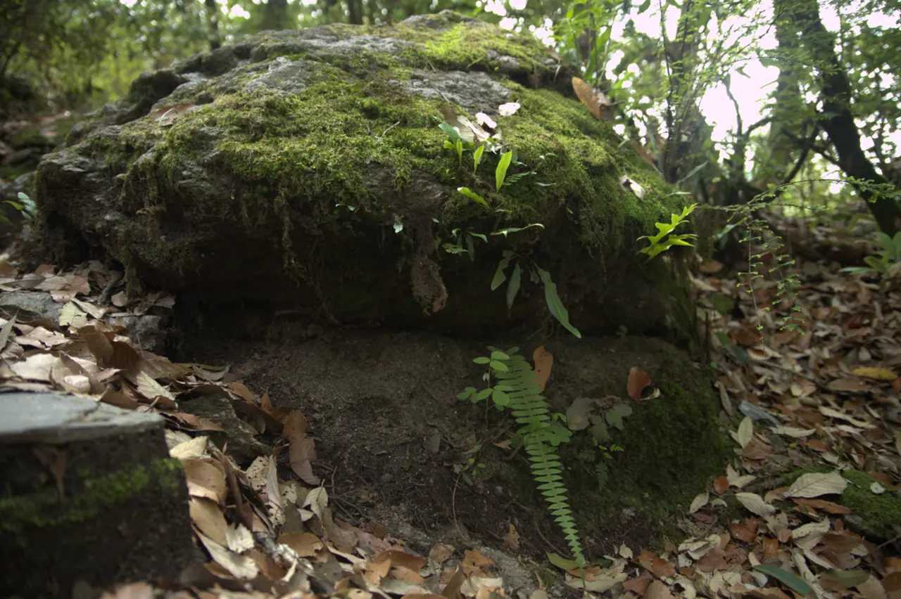

Moss-covered boulder and ferns on a forest floor.png — Krishna k. sahh / [CC0](https://creativecommons.org/publicdomain/zero/1.0/deed.en) / [原典](https://commons.wikimedia.org/wiki/File:Moss-covered_boulder_and_ferns_on_a_forest_floor.png)

## 竹林 — bamboo-groves

制作で見るところ：節と幹の細さ、葉群、林内の光

関連コード：`app/src/world/nature.js`、`app/src/world/ranch-structures.js`

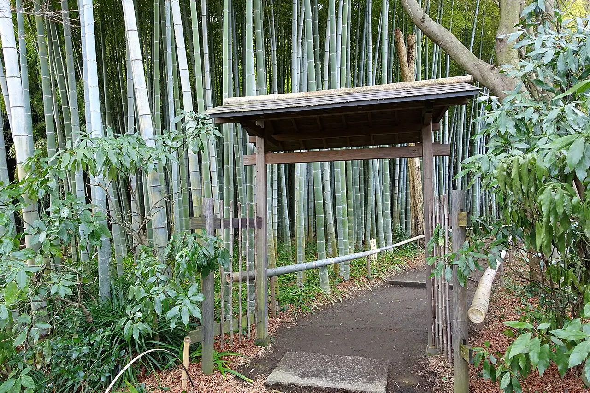

Bamboo grove - Eishō-ji - Kamakura, Kanagawa, Japan - DSC08147.JPG — Daderot / [CC0](https://creativecommons.org/publicdomain/zero/1.0/deed.en) / [原典](https://commons.wikimedia.org/wiki/File:Bamboo_grove_-_Eish%C5%8D-ji_-_Kamakura%2C_Kanagawa%2C_Japan_-_DSC08147.JPG)

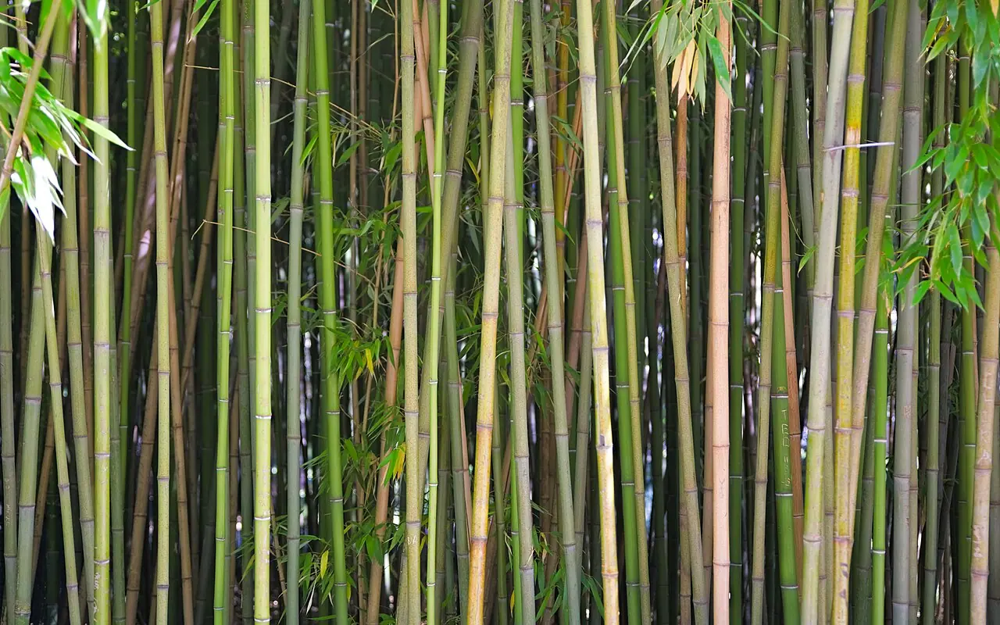

Bamboo grove (phyllostachys viridiglaucescens) in the Botanical Garden of the University of Vienna in Vienna, Austria-stems PNr°1051.jpg — D-Kuru / [CC BY-SA 4.0](https://creativecommons.org/licenses/by-sa/4.0) / [原典](https://commons.wikimedia.org/wiki/File:Bamboo_grove_%28phyllostachys_viridiglaucescens%29_in_the_Botanical_Garden_of_the_University_of_Vienna_in_Vienna%2C_Austria-stems_PNr%C2%B01051.jpg)

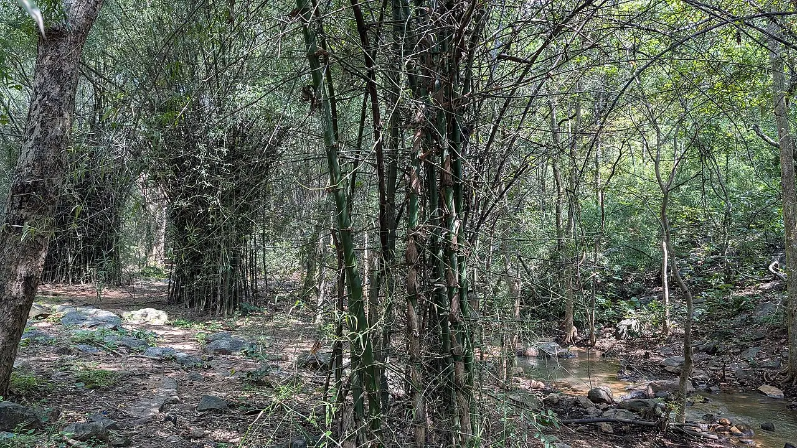

Bamboo Grove Image.jpg — Anonymous0006 / [CC0](https://creativecommons.org/publicdomain/zero/1.0/deed.en) / [原典](https://commons.wikimedia.org/wiki/File:Bamboo_Grove_Image.jpg)

## 森と草原の境目 — forest-edge

制作で見るところ：樹木密度の遷移、低木と草の階層

関連コード：`app/src/world/nature.js`、`app/src/world/meadow.js`

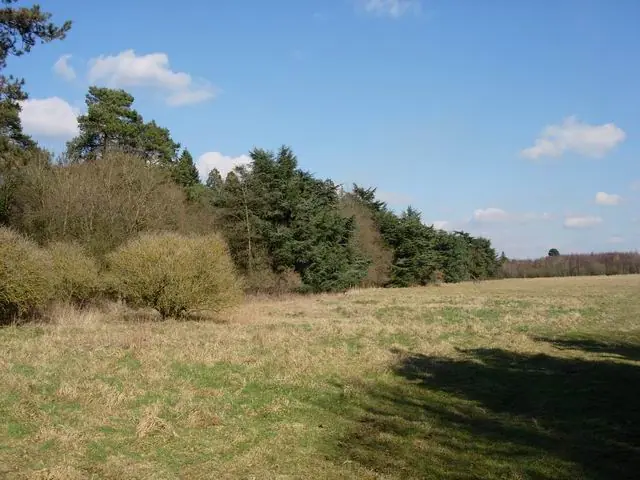

Edge of Meadow Close Copse - geograph.org.uk - 132018.jpg — Footprints / [CC BY-SA 2.0](https://creativecommons.org/licenses/by-sa/2.0) / [原典](https://commons.wikimedia.org/wiki/File:Edge_of_Meadow_Close_Copse_-_geograph.org.uk_-_132018.jpg)

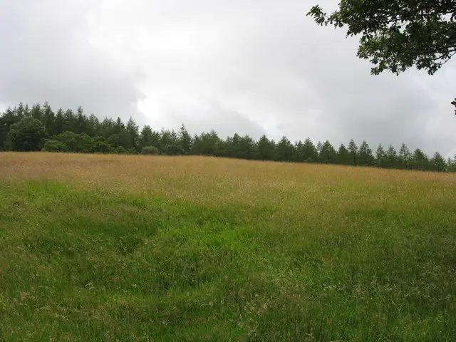

Hay meadow and forest edge above Dol-frwynog - geograph.org.uk - 501208.jpg — Eric Jones / [CC BY-SA 2.0](https://creativecommons.org/licenses/by-sa/2.0) / [原典](https://commons.wikimedia.org/wiki/File:Hay_meadow_and_forest_edge_above_Dol-frwynog_-_geograph.org.uk_-_501208.jpg)

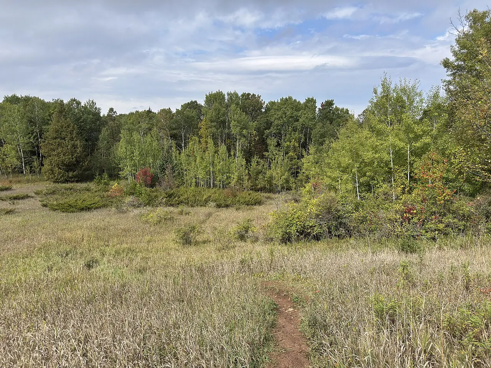

Footpath through a grassy meadow toward the forest edge, Potawatomi State Park, Wisconsin.jpg — Z3lvs / [CC0](https://creativecommons.org/publicdomain/zero/1.0/deed.en) / [原典](https://commons.wikimedia.org/wiki/File:Footpath_through_a_grassy_meadow_toward_the_forest_edge%2C_Potawatomi_State_Park%2C_Wisconsin.jpg)

## 生垣と低木 — hedges-and-shrubs

制作で見るところ：剪定形と自然形、葉の密集・透け

関連コード：`app/src/world/nature.js`、`app/src/world/town.js`

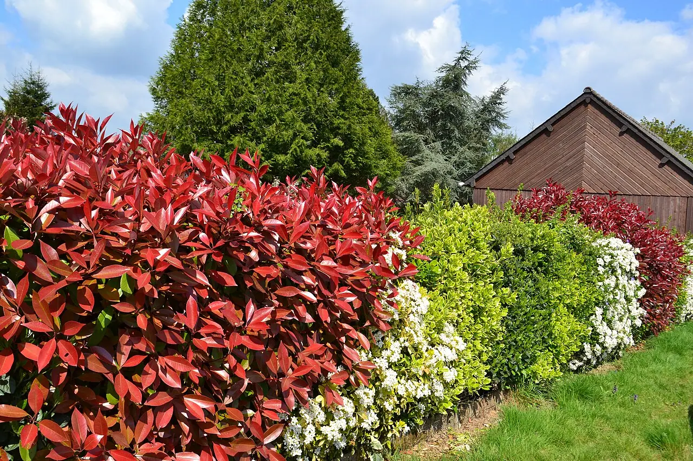

Hedge-891354 1920.jpg — juliacasado1 / [CC0](https://creativecommons.org/publicdomain/zero/1.0/deed.en) / [原典](https://commons.wikimedia.org/wiki/File:Hedge-891354_1920.jpg)

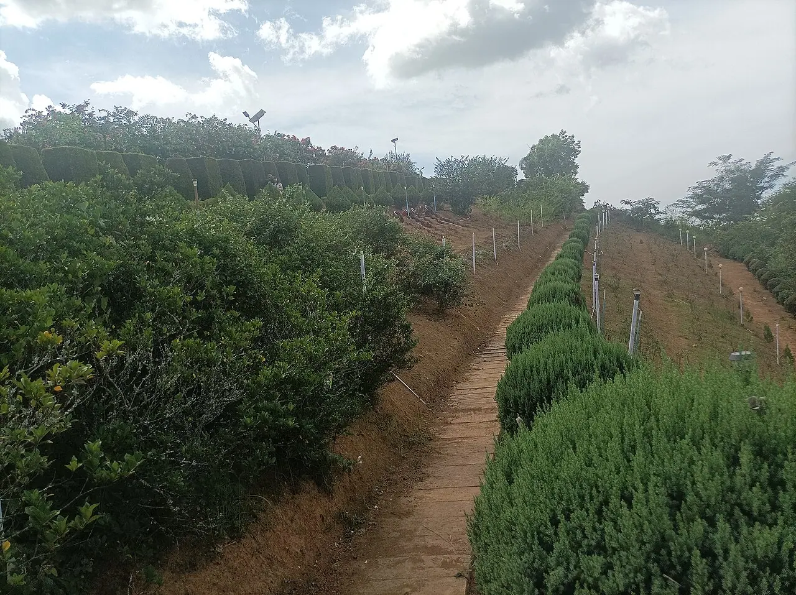

Lush row of bushes in the Kakching Garden in Kangleipak.jpg — Haoreima / [CC BY 4.0](https://creativecommons.org/licenses/by/4.0) / [原典](https://commons.wikimedia.org/wiki/File:Lush_row_of_bushes_in_the_Kakching_Garden_in_Kangleipak.jpg)

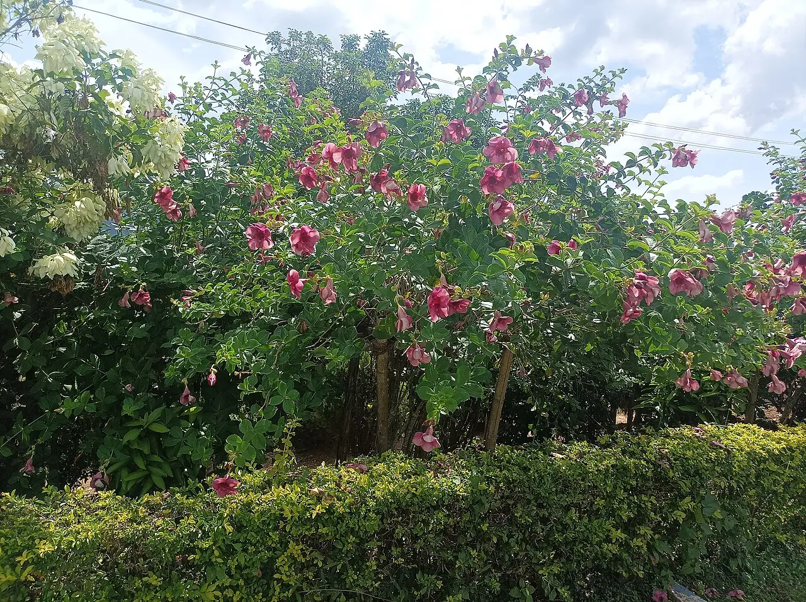

Duranta hedge shrubs and other flowering plants in Kakching Garden, Uyok Ching hills, Kakching district, Kangleipak.jpg — Haoreima / [CC BY 4.0](https://creativecommons.org/licenses/by/4.0) / [原典](https://commons.wikimedia.org/wiki/File:Duranta_hedge_shrubs_and_other_flowering_plants_in_Kakching_Garden%2C_Uyok_Ching_hills%2C_Kakching_district%2C_Kangleipak.jpg)

## 秋の木々 — autumn-trees

制作で見るところ：樹種ごとの落葉と紅葉の偏り

関連コード：`app/src/world/nature.js`、`app/src/lab/seasons.js`

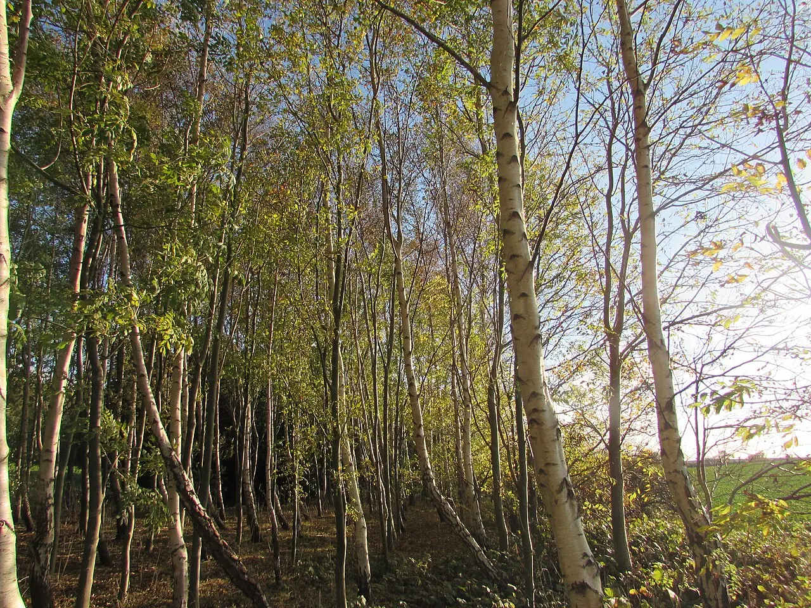

Silver Birch Woodland in Autumn.jpg — Zakhx150 / [CC BY-SA 4.0](https://creativecommons.org/licenses/by-sa/4.0) / [原典](https://commons.wikimedia.org/wiki/File:Silver_Birch_Woodland_in_Autumn.jpg)

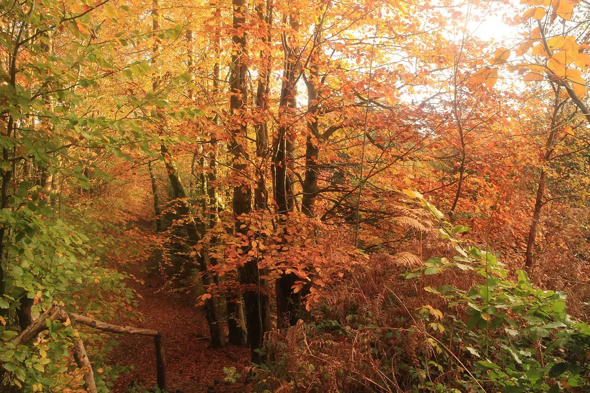

Blaen Bran Woodland Autumn.jpg — WelshDave / [CC BY 4.0](https://creativecommons.org/licenses/by/4.0) / [原典](https://commons.wikimedia.org/wiki/File:Blaen_Bran_Woodland_Autumn.jpg)

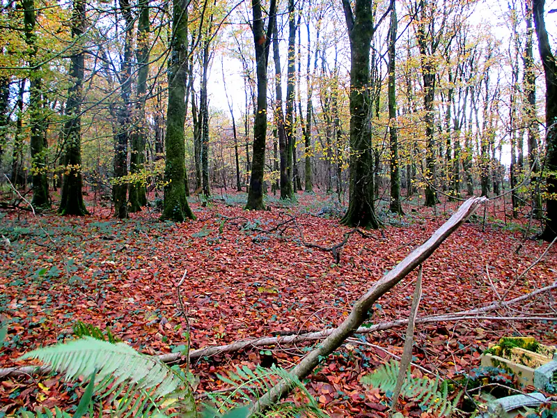

Autumn Woodland - geograph.org.uk - 7017805.jpg — kevin higgins / [CC BY-SA 2.0](https://creativecommons.org/licenses/by-sa/2.0) / [原典](https://commons.wikimedia.org/wiki/File:Autumn_Woodland_-_geograph.org.uk_-_7017805.jpg)

## 冬の樹形 — winter-trees

制作で見るところ：葉が落ちた枝の分岐・雪の乗り方

関連コード：`app/src/world/nature.js`、`app/src/lab/seasons.js`

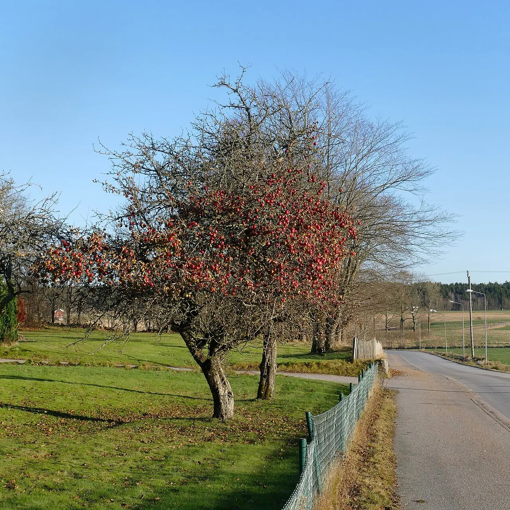

Winter apples on a bare tree.jpg — W.carter / [CC BY-SA 4.0](https://creativecommons.org/licenses/by-sa/4.0) / [原典](https://commons.wikimedia.org/wiki/File:Winter_apples_on_a_bare_tree.jpg)

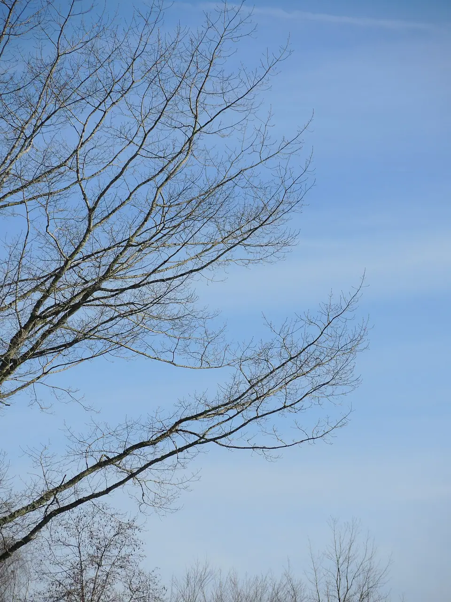

Bare tree in Kent, WA (2025) - 0010.jpg — Roc0ast3r / [CC0](https://creativecommons.org/publicdomain/zero/1.0/deed.en) / [原典](https://commons.wikimedia.org/wiki/File:Bare_tree_in_Kent%2C_WA_%282025%29_-_0010.jpg)

