# japan-landscape — reference photos

[← Gallery index](./README.md) | [Credits](../catalog/CREDITS.md)

## 日本：里山の雑木林 — satoyama-woods

制作で見るところ：広葉樹と人の道、落葉層、境界の草と低木、親しみある林内

関連コード：`app/src/world/nature.js`、`app/src/world/road.js`、`app/src/world/town.js`

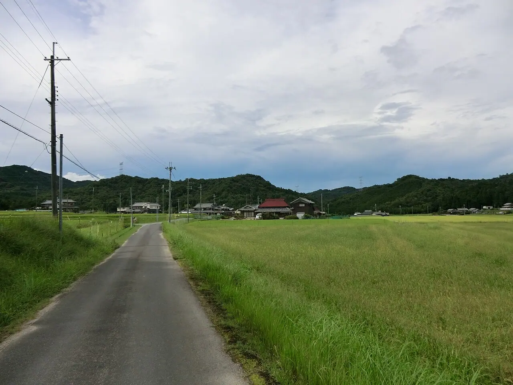

Sugitani Shinden01.jpg — Motokoka / [CC BY-SA 4.0](https://creativecommons.org/licenses/by-sa/4.0) / [原典](https://commons.wikimedia.org/wiki/File:Sugitani_Shinden01.jpg)

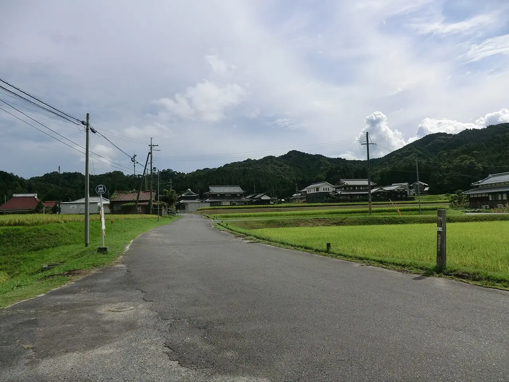

Sugitani Shinden02.jpg — Motokoka / [CC BY-SA 4.0](https://creativecommons.org/licenses/by-sa/4.0) / [原典](https://commons.wikimedia.org/wiki/File:Sugitani_Shinden02.jpg)

## 日本：スギ・ヒノキ林 — sugi-hinoki-forest

制作で見るところ：真直ぐな幹・人工林の間隔・枝下高と葉層、自然林と混同しない

関連コード：`app/src/world/nature.js`、`app/src/world/road.js`、`app/src/world/town.js`

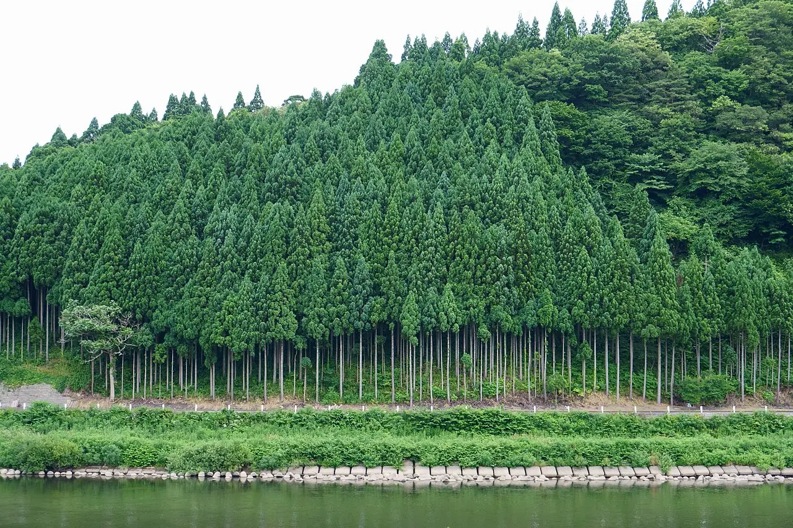

Sugi plantation along the Yoneshiro River, Akita Pref, Japan.jpg — 掬茶 / [CC BY-SA 4.0](https://creativecommons.org/licenses/by-sa/4.0) / [原典](https://commons.wikimedia.org/wiki/File:Sugi_plantation_along_the_Yoneshiro_River%2C_Akita_Pref%2C_Japan.jpg)

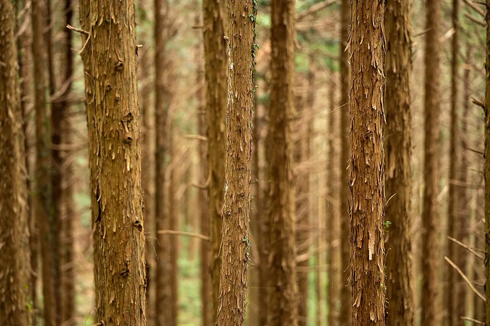

Tsukuba's cedar forest (53667839474).jpg — Raita Futo from Tokyo, Japan / [CC BY 2.0](https://creativecommons.org/licenses/by/2.0) / [原典](https://commons.wikimedia.org/wiki/File:Tsukuba%27s_cedar_forest_%2853667839474%29.jpg)

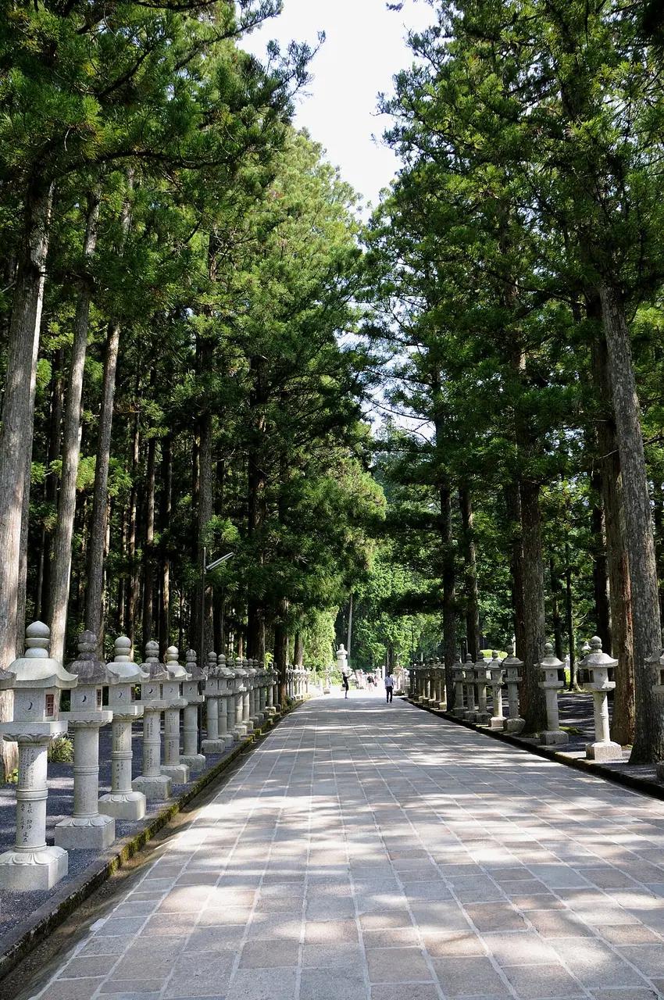

OKU - Main approach through cedar forest at Okunoin, Koyasan, Japan, 2015.jpg — Josep M. Gracia / [CC BY-SA 4.0](https://creativecommons.org/licenses/by-sa/4.0) / [原典](https://commons.wikimedia.org/wiki/File:OKU_-_Main_approach_through_cedar_forest_at_Okunoin%2C_Koyasan%2C_Japan%2C_2015.jpg)

## 日本：ブナとカエデの森 — beech-maple-forest

制作で見るところ：太い幹・根元・広葉樹の枝ぶりと季節

関連コード：`app/src/world/nature.js`、`app/src/world/road.js`、`app/src/world/town.js`

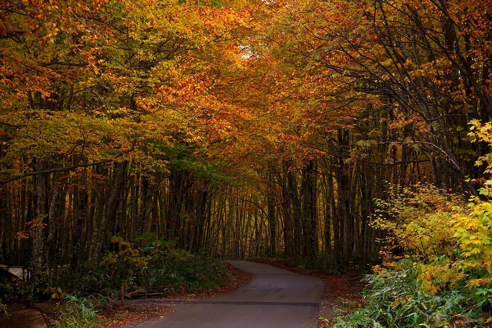

Beech forest in Nyuto Onsenkyo (1).jpg — 掬茶 / [CC BY-SA 4.0](https://creativecommons.org/licenses/by-sa/4.0) / [原典](https://commons.wikimedia.org/wiki/File:Beech_forest_in_Nyuto_Onsenkyo_%281%29.jpg)

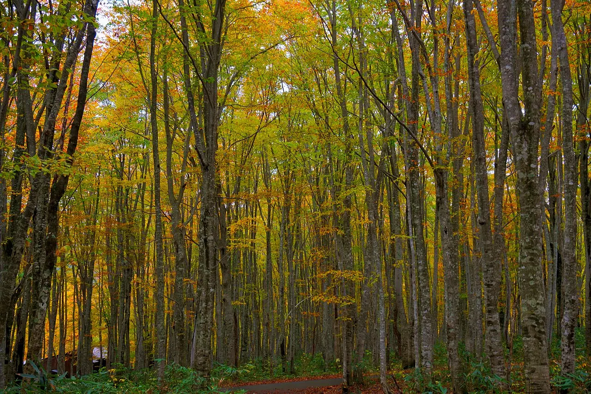

Beech forest in Nyuto Onsenkyo (3).jpg — 掬茶 / [CC BY-SA 4.0](https://creativecommons.org/licenses/by-sa/4.0) / [原典](https://commons.wikimedia.org/wiki/File:Beech_forest_in_Nyuto_Onsenkyo_%283%29.jpg)

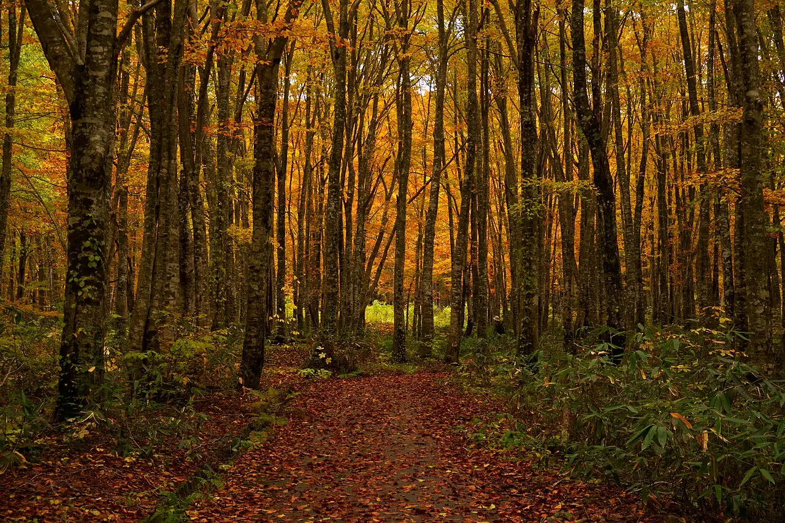

Beech forest in Nyuto Onsenkyo (2).jpg — 掬茶 / [CC BY-SA 4.0](https://creativecommons.org/licenses/by-sa/4.0) / [原典](https://commons.wikimedia.org/wiki/File:Beech_forest_in_Nyuto_Onsenkyo_%282%29.jpg)

## 日本：苔と湿った森 — mossy-japanese-forest

制作で見るところ：苔のつく岩・倒木・石段・湿度の高い陰影

関連コード：`app/src/world/nature.js`、`app/src/world/road.js`、`app/src/world/town.js`

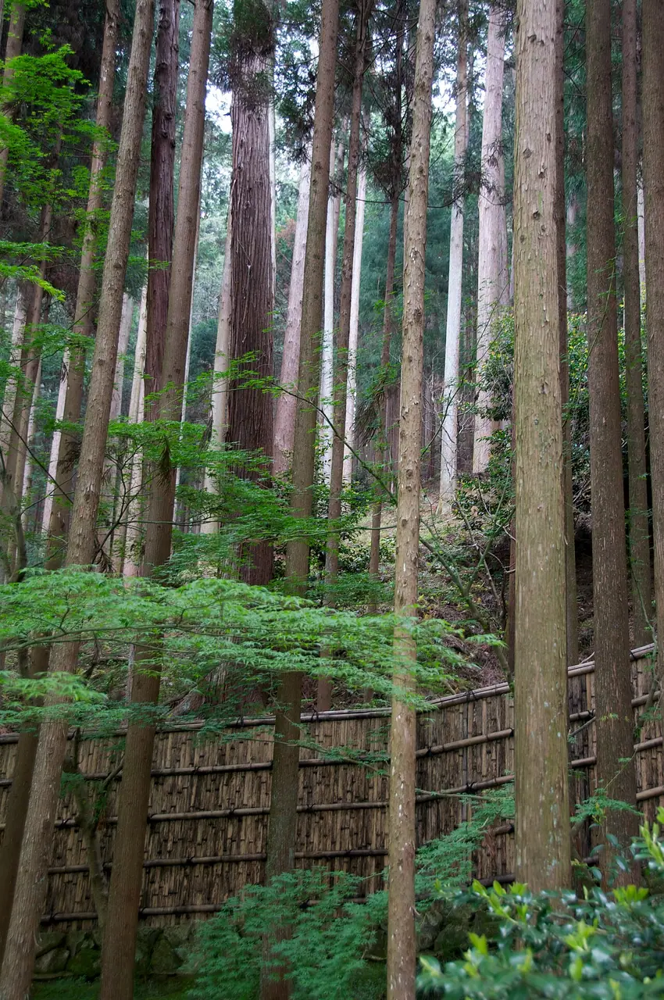

Moss forest above Ginkaku-Ji (7005740444).jpg — BriYYZ from Toronto, Canada / [CC BY-SA 2.0](https://creativecommons.org/licenses/by-sa/2.0) / [原典](https://commons.wikimedia.org/wiki/File:Moss_forest_above_Ginkaku-Ji_%287005740444%29.jpg)

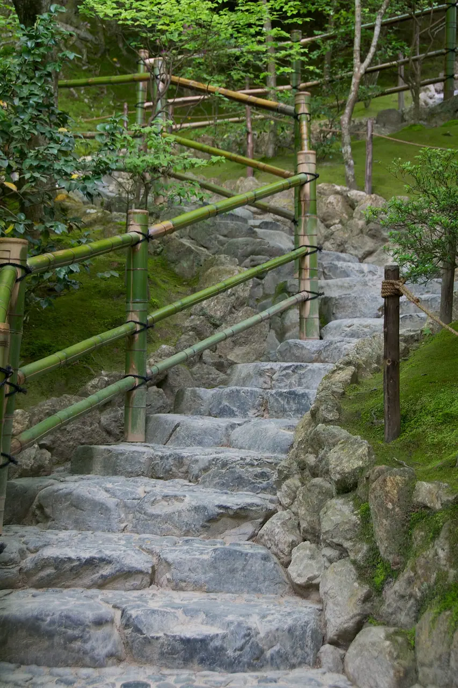

Ginkaku-Ji Temple moss forest walkway (7151830689) (2).jpg — BriYYZ from Toronto, Canada / [CC BY-SA 2.0](https://creativecommons.org/licenses/by-sa/2.0) / [原典](https://commons.wikimedia.org/wiki/File:Ginkaku-Ji_Temple_moss_forest_walkway_%287151830689%29_%282%29.jpg)

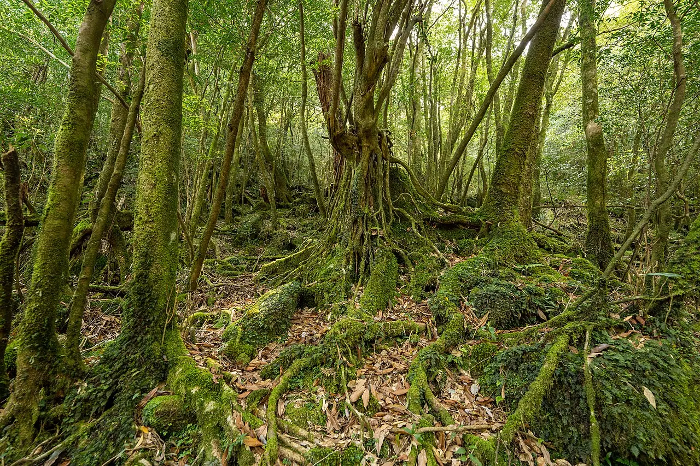

Green moss forest (52930618402).jpg — Raita Futo from Tokyo, Japan / [CC BY 2.0](https://creativecommons.org/licenses/by/2.0) / [原典](https://commons.wikimedia.org/wiki/File:Green_moss_forest_%2852930618402%29.jpg)

## 日本：渓流と木立 — japanese-forest-stream

制作で見るところ：自然な蛇行・岸の石と根・シダや落葉・橋や小道

関連コード：`app/src/world/nature.js`、`app/src/world/road.js`、`app/src/world/town.js`

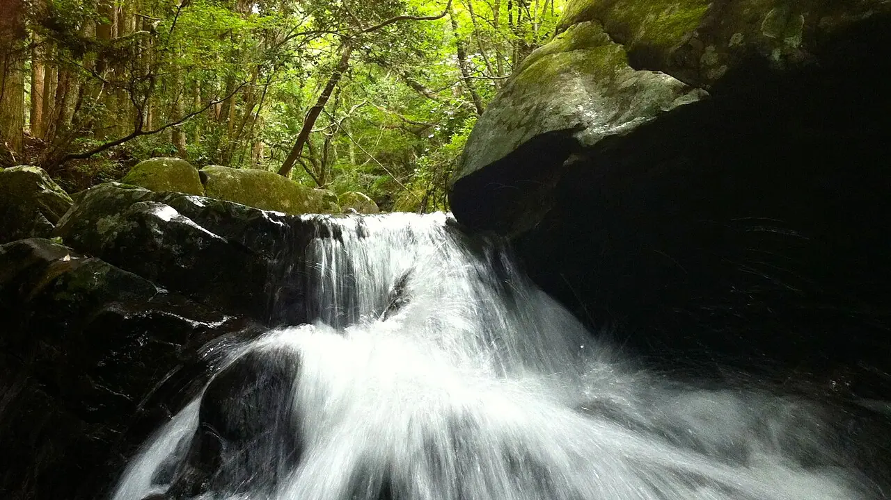

Falling Forest Stream (6088660112).jpg — rumpleteaser from Nagoya, Japan / [CC BY 2.0](https://creativecommons.org/licenses/by/2.0) / [原典](https://commons.wikimedia.org/wiki/File:Falling_Forest_Stream_%286088660112%29.jpg)

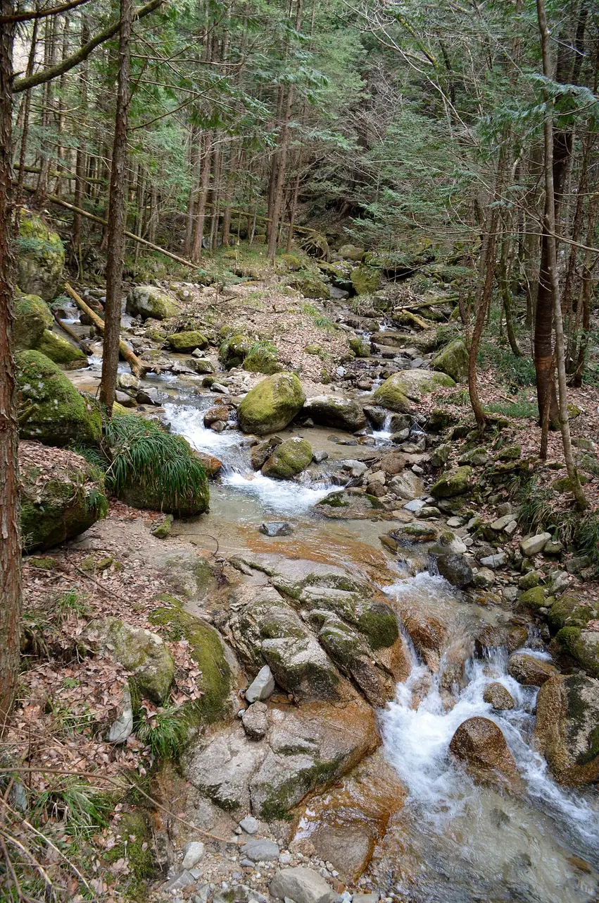

Forest stream, Tsumago-juku, Nagiso, 2016.jpg — DimiTalen / [CC0](https://creativecommons.org/publicdomain/zero/1.0/deed.en) / [原典](https://commons.wikimedia.org/wiki/File:Forest_stream%2C_Tsumago-juku%2C_Nagiso%2C_2016.jpg)

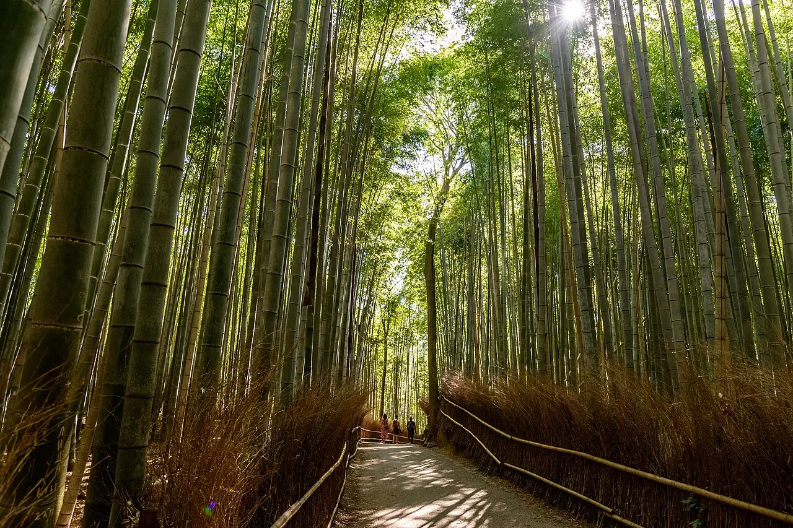

Arashiyama - Bamboo Forest, Kyoto, Japan10.jpg — dconvertini / [CC BY-SA 2.0](https://creativecommons.org/licenses/by-sa/2.0) / [原典](https://commons.wikimedia.org/wiki/File:Arashiyama_-_Bamboo_Forest%2C_Kyoto%2C_Japan10.jpg)

## 日本：山あいの集落 — japanese-village-hills

制作で見るところ：山と家並みの距離、道・畑・樹木の接続、里山の遠景

関連コード：`app/src/world/nature.js`、`app/src/world/road.js`、`app/src/world/town.js`

現時点でライセンス・画像条件を満たす写真なし（今後の収集対象）。

## 日本：田舎の小道と木々 — japanese-country-lanes

制作で見るところ：舗装・土道・生垣・庭木・電柱・水路が混じる生活感

関連コード：`app/src/world/nature.js`、`app/src/world/road.js`、`app/src/world/town.js`

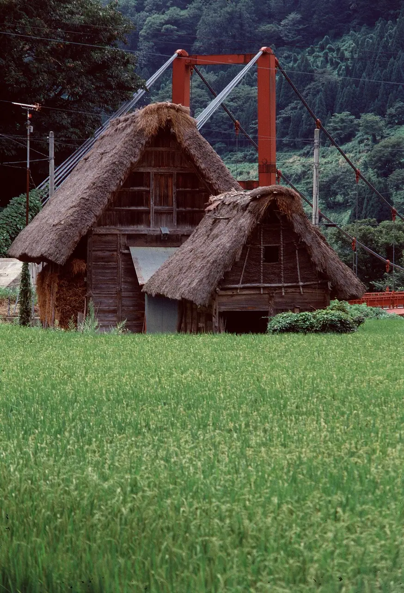

Japan, countryside north of Kyoto.jpg — Marie-Sophie Mejan / [CC BY 4.0](https://creativecommons.org/licenses/by/4.0) / [原典](https://commons.wikimedia.org/wiki/File:Japan%2C_countryside_north_of_Kyoto.jpg)

## 日本：棚田と斜面の緑 — japanese-rice-terraces

制作で見るところ：田の段差・水面・畦・林と家屋の位置関係

関連コード：`app/src/world/nature.js`、`app/src/world/road.js`、`app/src/world/town.js`

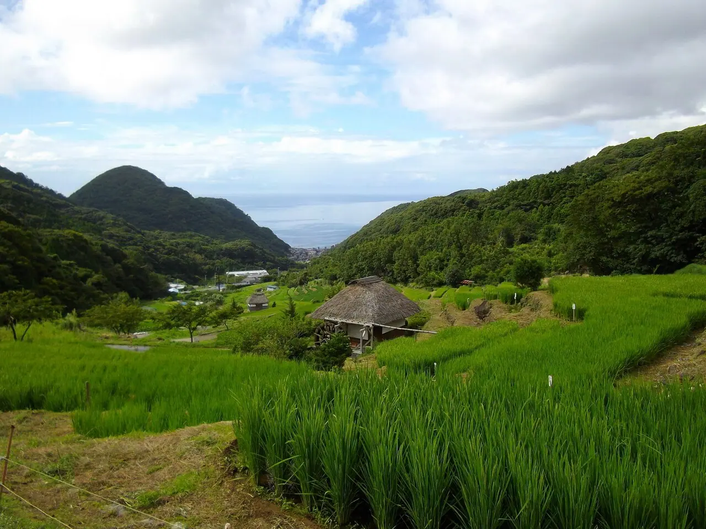

Terraced Rice Fields in Ishibu, august 2011 (14745069091).jpg — Izu navi from Kyoto, Japan / [CC BY 2.0](https://creativecommons.org/licenses/by/2.0) / [原典](https://commons.wikimedia.org/wiki/File:Terraced_Rice_Fields_in_Ishibu%2C_august_2011_%2814745069091%29.jpg)

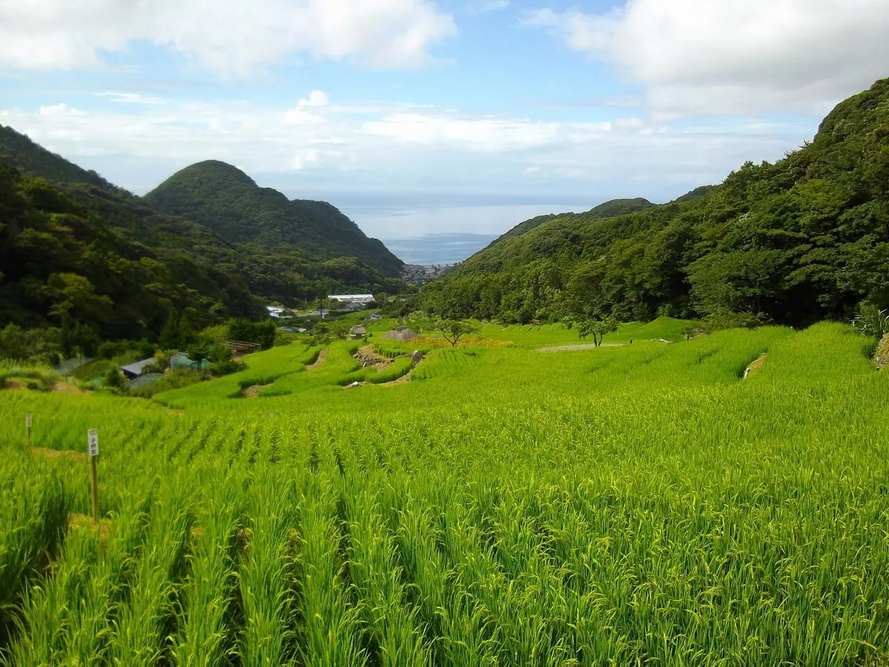

Terraced Rice Fields in Ishibu, august 2011 (14561787557).jpg — Izu navi from Kyoto, Japan / [CC BY 2.0](https://creativecommons.org/licenses/by/2.0) / [原典](https://commons.wikimedia.org/wiki/File:Terraced_Rice_Fields_in_Ishibu%2C_august_2011_%2814561787557%29.jpg)

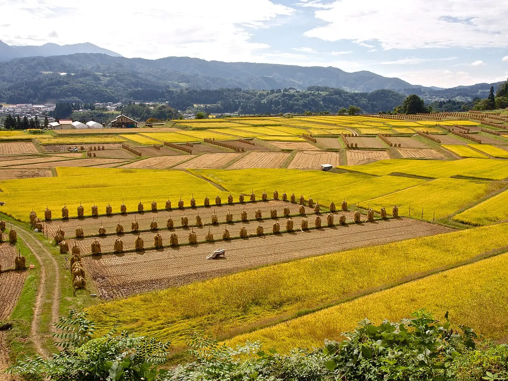

Terraced rice-fields (10154564834).jpg — Syuzo Tsushima from Akita, Japan / [CC BY 2.0](https://creativecommons.org/licenses/by/2.0) / [原典](https://commons.wikimedia.org/wiki/File:Terraced_rice-fields_%2810154564834%29.jpg)

