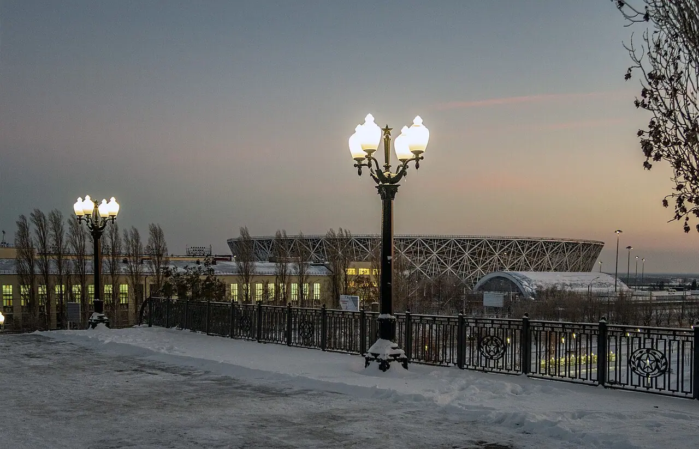

# light — reference photos

[← Gallery index](./README.md) | [Credits](../catalog/CREDITS.md)

## 木漏れ日 — forest-sunbeams

制作で見るところ：影の輪郭、葉群による光の切れ方

関連コード：`app/src/lab/light.js`、`app/src/world/materials.js`

Heselerwald, 'In The Forest' (184176211).jpg — Uwe Jelting / [CC0](https://creativecommons.org/publicdomain/zero/1.0/deed.en) / [原典](https://commons.wikimedia.org/wiki/File:Heselerwald%2C_%27In_The_Forest%27_%28184176211%29.jpg)

Autumn Trees (184183749).jpeg — Uwe Jelting / [CC0](https://creativecommons.org/publicdomain/zero/1.0/deed.en) / [原典](https://commons.wikimedia.org/wiki/File:Autumn_Trees_%28184183749%29.jpeg)

## 朝靄 — morning-mist

制作で見るところ：奥行きの消え方、低い位置の霧

関連コード：`app/src/world/sky.js`、`app/src/world/landscape.js`

Morning Mist (11567824906).jpg — Steve Wilson - over 6 million views Thanks !! from Chester, UK / [CC BY 2.0](https://creativecommons.org/licenses/by/2.0) / [原典](https://commons.wikimedia.org/wiki/File:Morning_Mist_%2811567824906%29.jpg)

Autumn morning - panoramio (3).jpg — Zdeněk Vondra / [CC BY 3.0](https://creativecommons.org/licenses/by/3.0) / [原典](https://commons.wikimedia.org/wiki/File:Autumn_morning_-_panoramio_%283%29.jpg)

## 夕暮れの色 — golden-hour

制作で見るところ：低い太陽、暖色の縁、長い影

関連コード：`app/src/world/sky.js`、`app/src/lab/light.js`

Oley Township, Pennsylvania, Countryside.jpg — Sarah Samoraj / [CC BY 4.0](https://creativecommons.org/licenses/by/4.0) / [原典](https://commons.wikimedia.org/wiki/File:Oley_Township%2C_Pennsylvania%2C_Countryside.jpg)

Golden Hour in the Countryside.jpg — Mohanapriya Mariyamal / [CC BY 4.0](https://creativecommons.org/licenses/by/4.0) / [原典](https://commons.wikimedia.org/wiki/File:Golden_Hour_in_the_Countryside.jpg)

## 雨上がりの街 — rainy-streets

制作で見るところ：濡れた路面の反射・空気色

関連コード：`app/src/world/town.js`、`app/src/lab/light.js`

Walk down the Strøget (2760265707).jpg — Kenny Louie from Vancouver, Canada / [CC BY 2.0](https://creativecommons.org/licenses/by/2.0) / [原典](https://commons.wikimedia.org/wiki/File:Walk_down_the_Str%C3%B8get_%282760265707%29.jpg)

Rainy day at Merchant's Arch, Temple Bar, Dublin.jpg — David Kernan / [CC BY 4.0](https://creativecommons.org/licenses/by/4.0) / [原典](https://commons.wikimedia.org/wiki/File:Rainy_day_at_Merchant%27s_Arch%2C_Temple_Bar%2C_Dublin.jpg)

## 雲と空 — cloud-skies

制作で見るところ：雲層、地平線近くの明るさ、陰影

関連コード：`app/src/world/sky.js`、`app/src/world/sky-restaurant.js`

Landscape, road, clouds.jpg — Digitura / [CC0](https://creativecommons.org/publicdomain/zero/1.0/deed.en) / [原典](https://commons.wikimedia.org/wiki/File:Landscape%2C_road%2C_clouds.jpg)

## 夜のあかり — night-lanterns

制作で見るところ：光源周囲の減衰、窓明かり、静けさ

関連コード：`app/src/world/town.js`、`app/src/world/sky-restaurant.js`

Volgograd Arena in winter evening (January 2021).jpg — Bestalex / [CC0](https://creativecommons.org/publicdomain/zero/1.0/deed.en) / [原典](https://commons.wikimedia.org/wiki/File:Volgograd_Arena_in_winter_evening_%28January_2021%29.jpg)

Yokohama Chinatown Narrow Street 01.jpg — Tokyo538 / [CC0](https://creativecommons.org/publicdomain/zero/1.0/deed.en) / [原典](https://commons.wikimedia.org/wiki/File:Yokohama_Chinatown_Narrow_Street_01.jpg)

## 雪の町 — snow-village

制作で見るところ：屋根・塀・道の積雪と薄い反射光

関連コード：`app/src/world/town.js`、`app/src/lab/seasons.js`

Snow-covered Méribel-Centre.jpg — DimiTalen / [CC0](https://creativecommons.org/publicdomain/zero/1.0/deed.en) / [原典](https://commons.wikimedia.org/wiki/File:Snow-covered_M%C3%A9ribel-Centre.jpg)

View of snow-covered Village des Eucherts, La Rosière, 2024.jpg — DimiTalen / [CC0](https://creativecommons.org/publicdomain/zero/1.0/deed.en) / [原典](https://commons.wikimedia.org/wiki/File:View_of_snow-covered_Village_des_Eucherts%2C_La_Rosi%C3%A8re%2C_2024.jpg)

