# light — reference photos

[← Gallery index](./README.md) | [Credits](../catalog/CREDITS.md)

## 木漏れ日 — forest-sunbeams

制作で見るところ：影の輪郭、葉群による光の切れ方

関連コード：`app/src/lab/light.js`、`app/src/world/materials.js`

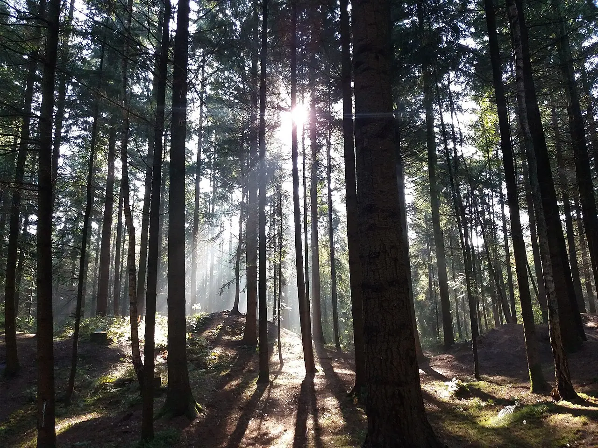

Heselerwald, 'In The Forest' (184176211).jpg — Uwe Jelting / [CC0](https://creativecommons.org/publicdomain/zero/1.0/deed.en) / [原典](https://commons.wikimedia.org/wiki/File:Heselerwald%2C_%27In_The_Forest%27_%28184176211%29.jpg)

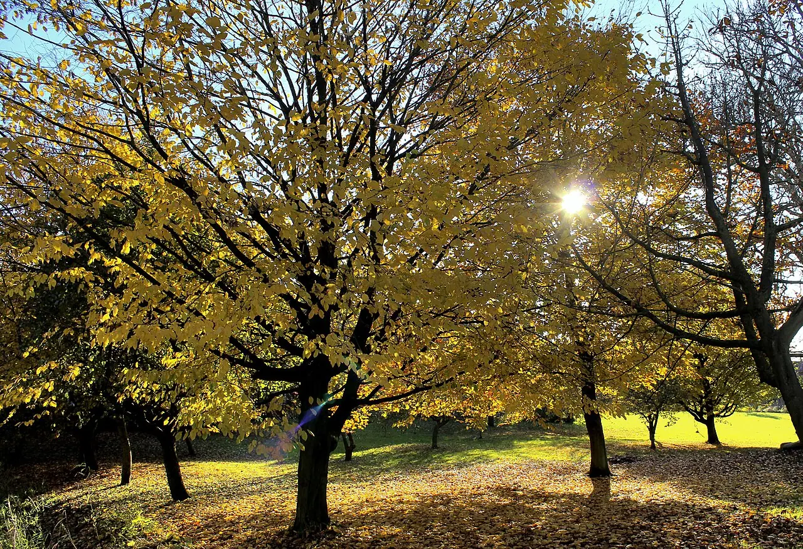

Autumn Trees (184183749).jpeg — Uwe Jelting / [CC0](https://creativecommons.org/publicdomain/zero/1.0/deed.en) / [原典](https://commons.wikimedia.org/wiki/File:Autumn_Trees_%28184183749%29.jpeg)

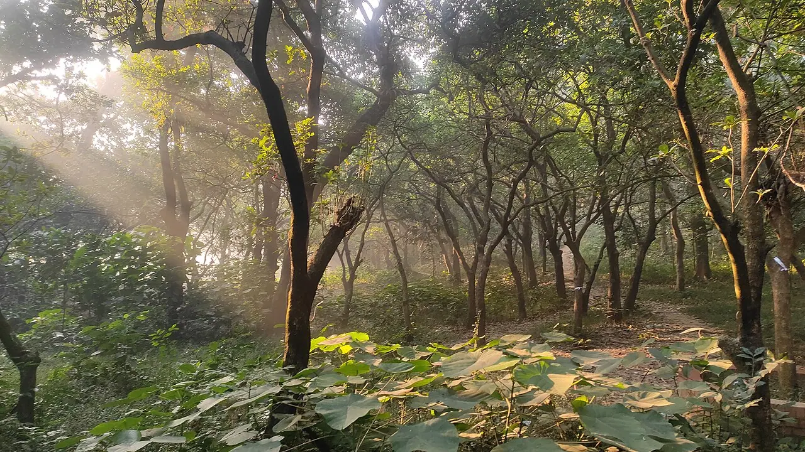

Sunbeams Filtering Through the Forest Canopy at National Botanical Garden, Bangladesh.jpg — Mahbub Hasan Mreedul / [CC BY-SA 4.0](https://creativecommons.org/licenses/by-sa/4.0) / [原典](https://commons.wikimedia.org/wiki/File:Sunbeams_Filtering_Through_the_Forest_Canopy_at_National_Botanical_Garden%2C_Bangladesh.jpg)

## 朝靄 — morning-mist

制作で見るところ：奥行きの消え方、低い位置の霧

関連コード：`app/src/world/sky.js`、`app/src/world/landscape.js`

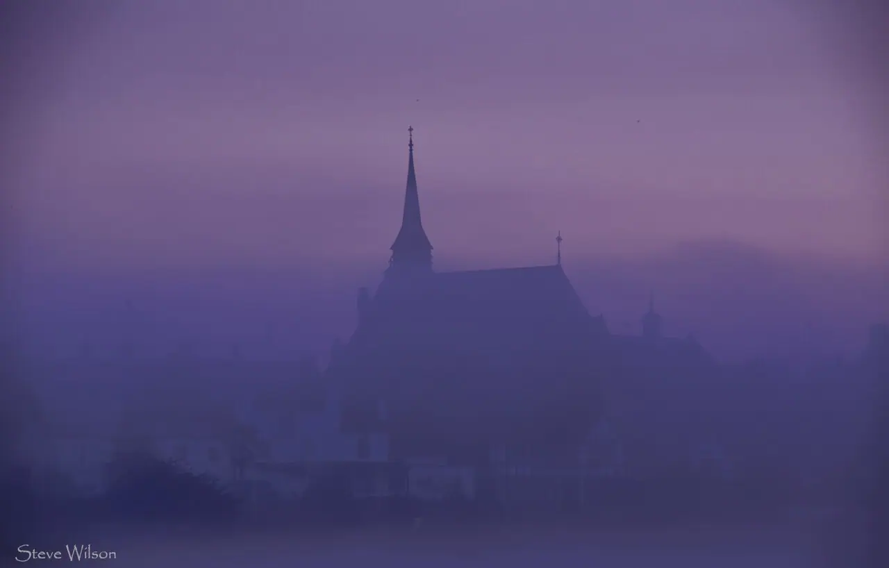

Morning Mist (11567824906).jpg — Steve Wilson - over 6 million views Thanks !! from Chester, UK / [CC BY 2.0](https://creativecommons.org/licenses/by/2.0) / [原典](https://commons.wikimedia.org/wiki/File:Morning_Mist_%2811567824906%29.jpg)

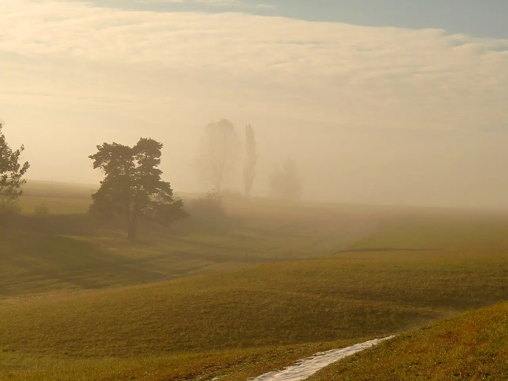

Autumn morning - panoramio (3).jpg — Zdeněk Vondra / [CC BY 3.0](https://creativecommons.org/licenses/by/3.0) / [原典](https://commons.wikimedia.org/wiki/File:Autumn_morning_-_panoramio_%283%29.jpg)

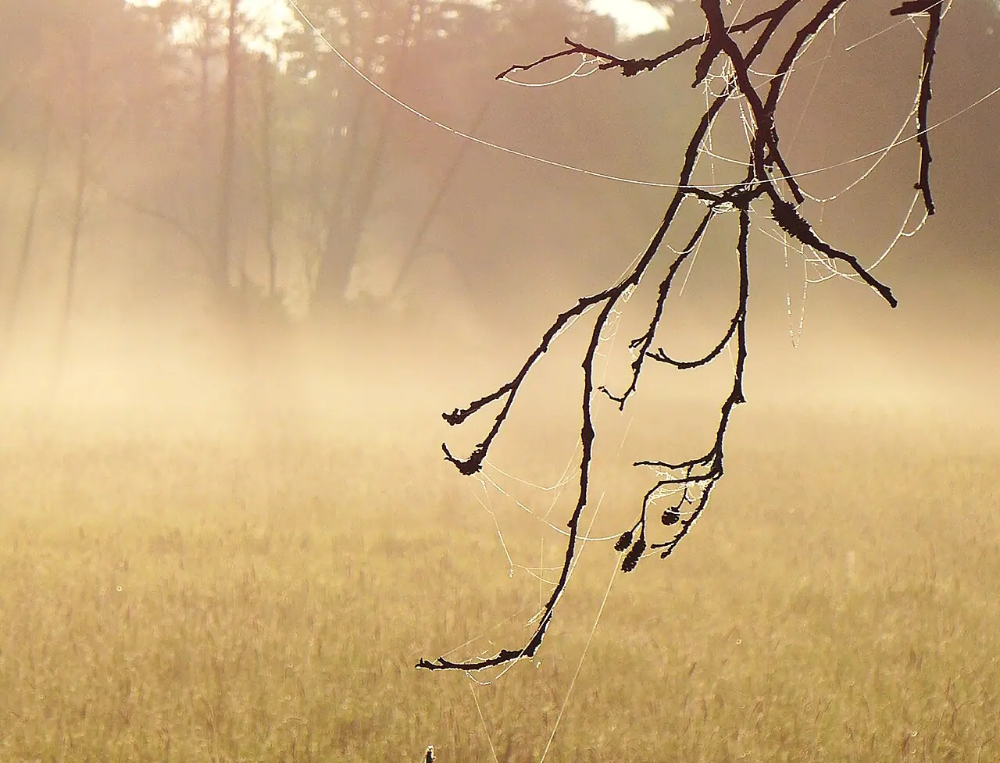

Fog over the meadow.jpg — BogTar201213 / [CC BY-SA 4.0](https://creativecommons.org/licenses/by-sa/4.0) / [原典](https://commons.wikimedia.org/wiki/File:Fog_over_the_meadow.jpg)

## 夕暮れの色 — golden-hour

制作で見るところ：低い太陽、暖色の縁、長い影

関連コード：`app/src/world/sky.js`、`app/src/lab/light.js`

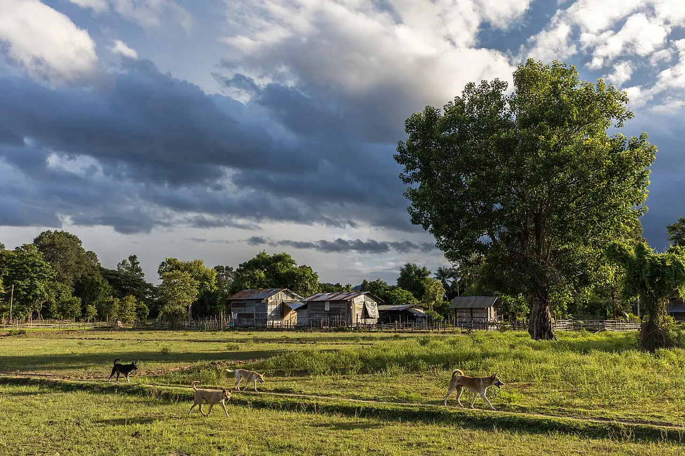

Four dogs running at golden hour in the countryside of Don Det Laos.jpg — Basile Morin / [CC BY-SA 4.0](https://creativecommons.org/licenses/by-sa/4.0) / [原典](https://commons.wikimedia.org/wiki/File:Four_dogs_running_at_golden_hour_in_the_countryside_of_Don_Det_Laos.jpg)

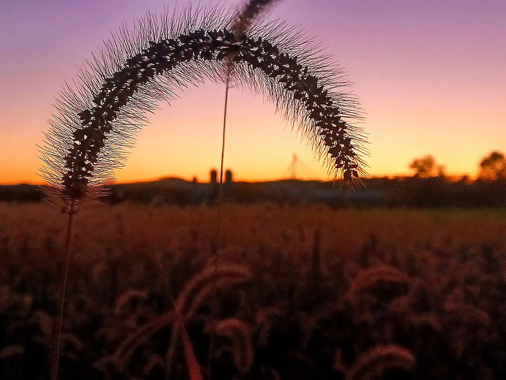

Oley Township, Pennsylvania, Countryside.jpg — Sarah Samoraj / [CC BY 4.0](https://creativecommons.org/licenses/by/4.0) / [原典](https://commons.wikimedia.org/wiki/File:Oley_Township%2C_Pennsylvania%2C_Countryside.jpg)

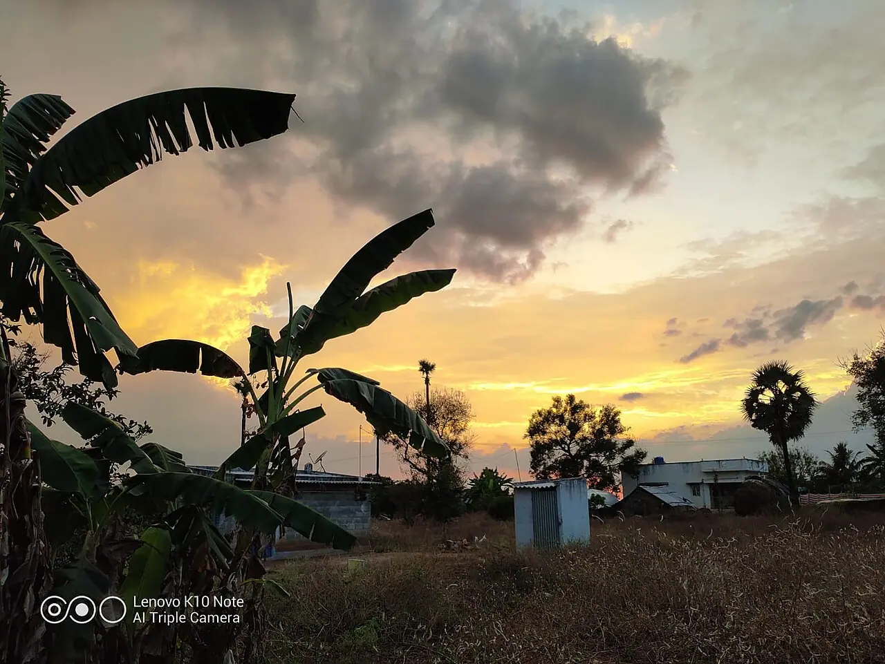

Golden Hour in the Countryside.jpg — Mohanapriya Mariyamal / [CC BY 4.0](https://creativecommons.org/licenses/by/4.0) / [原典](https://commons.wikimedia.org/wiki/File:Golden_Hour_in_the_Countryside.jpg)

## 雨上がりの街 — rainy-streets

制作で見るところ：濡れた路面の反射・空気色

関連コード：`app/src/world/town.js`、`app/src/lab/light.js`

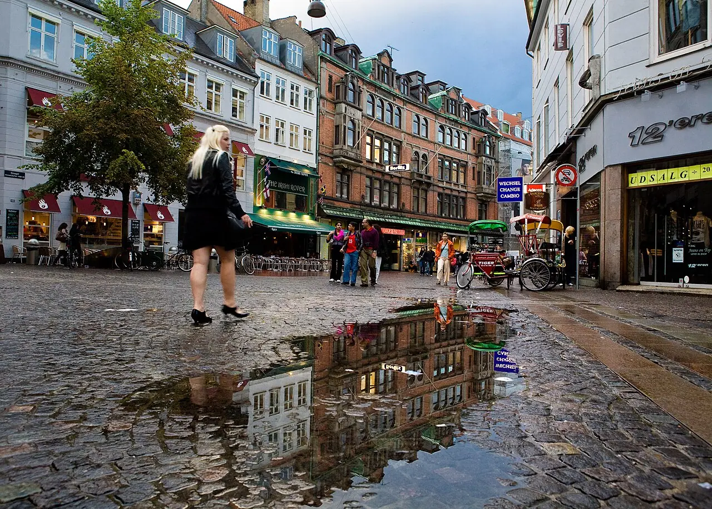

Walk down the Strøget (2760265707).jpg — Kenny Louie from Vancouver, Canada / [CC BY 2.0](https://creativecommons.org/licenses/by/2.0) / [原典](https://commons.wikimedia.org/wiki/File:Walk_down_the_Str%C3%B8get_%282760265707%29.jpg)

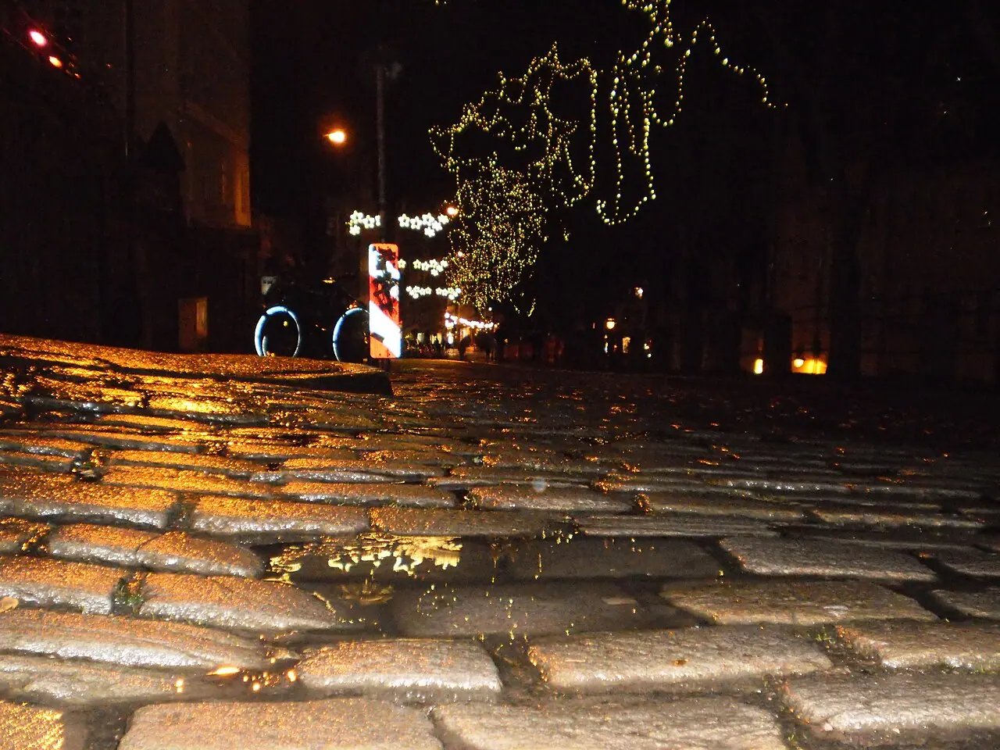

After rain in the evening, wet cobblestone street Steinweg Marburg (Germany) with bicycle and stars in a puddle 2017-01-04.jpg — LudwigSebastianMicheler / [CC BY-SA 4.0](https://creativecommons.org/licenses/by-sa/4.0) / [原典](https://commons.wikimedia.org/wiki/File:After_rain_in_the_evening%2C_wet_cobblestone_street_Steinweg_Marburg_%28Germany%29_with_bicycle_and_stars_in_a_puddle_2017-01-04.jpg)

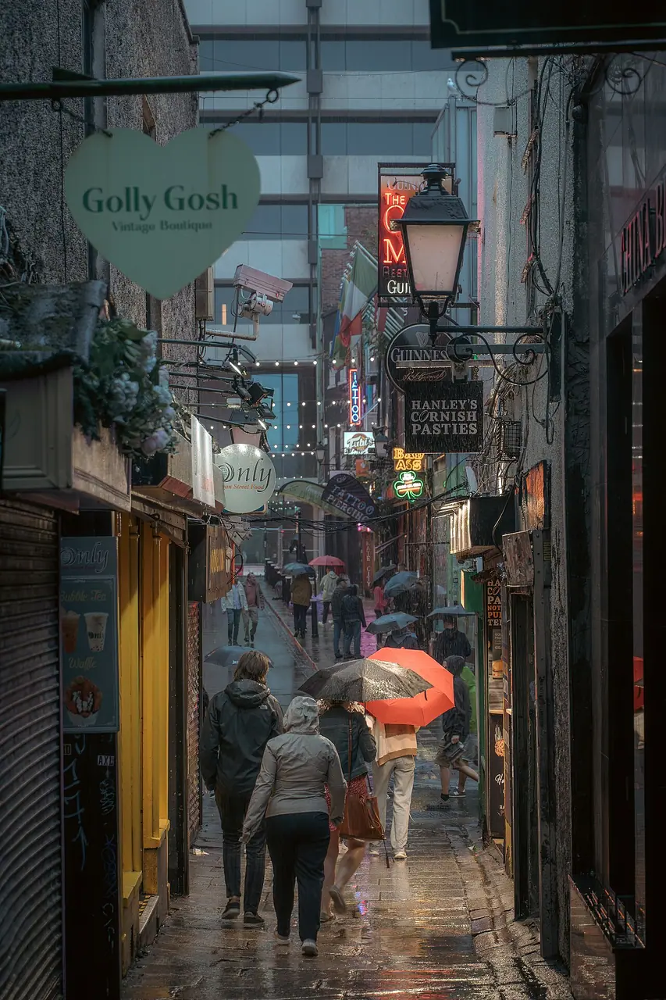

Rainy day at Merchant's Arch, Temple Bar, Dublin.jpg — David Kernan / [CC BY 4.0](https://creativecommons.org/licenses/by/4.0) / [原典](https://commons.wikimedia.org/wiki/File:Rainy_day_at_Merchant%27s_Arch%2C_Temple_Bar%2C_Dublin.jpg)

## 雲と空 — cloud-skies

制作で見るところ：雲層、地平線近くの明るさ、陰影

関連コード：`app/src/world/sky.js`、`app/src/world/sky-restaurant.js`

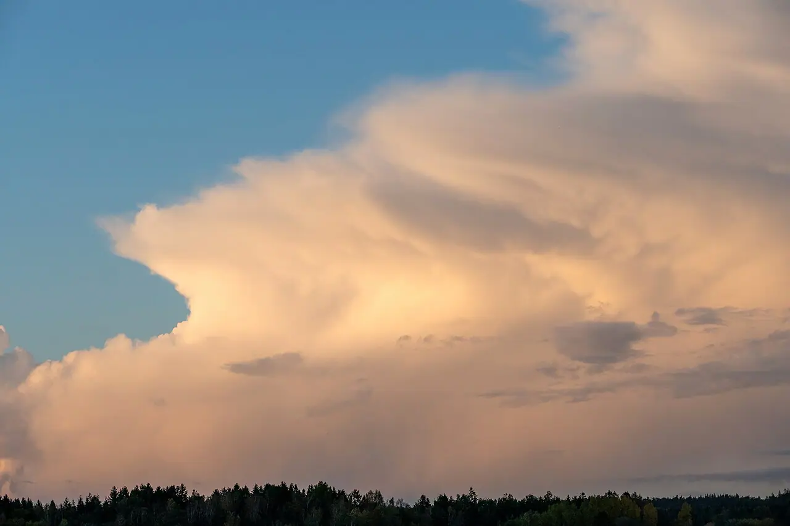

Cumulus clouds at sunset over the fields in Brastad 3.jpg — W.carter / [CC BY-SA 4.0](https://creativecommons.org/licenses/by-sa/4.0) / [原典](https://commons.wikimedia.org/wiki/File:Cumulus_clouds_at_sunset_over_the_fields_in_Brastad_3.jpg)

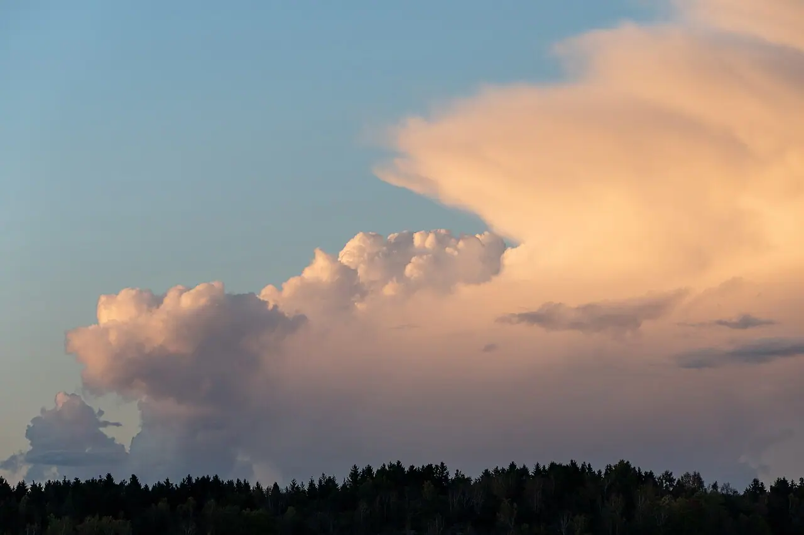

Cumulus clouds at sunset over the fields in Brastad 8.jpg — W.carter / [CC BY-SA 4.0](https://creativecommons.org/licenses/by-sa/4.0) / [原典](https://commons.wikimedia.org/wiki/File:Cumulus_clouds_at_sunset_over_the_fields_in_Brastad_8.jpg)

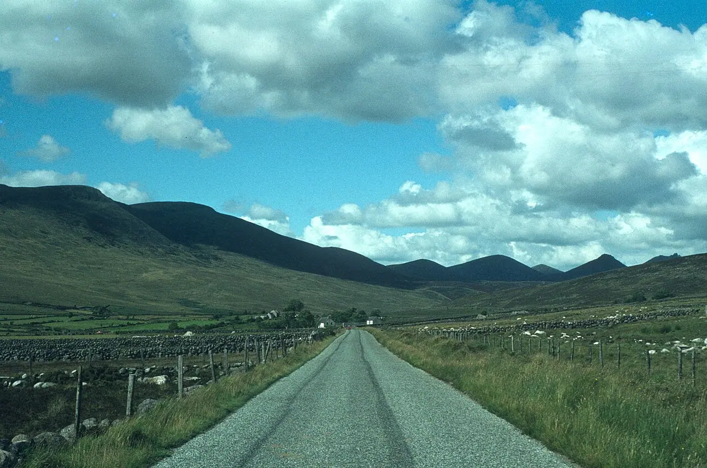

Landscape, road, clouds.jpg — Digitura / [CC0](https://creativecommons.org/publicdomain/zero/1.0/deed.en) / [原典](https://commons.wikimedia.org/wiki/File:Landscape%2C_road%2C_clouds.jpg)

## 夜のあかり — night-lanterns

制作で見るところ：光源周囲の減衰、窓明かり、静けさ

関連コード：`app/src/world/town.js`、`app/src/world/sky-restaurant.js`

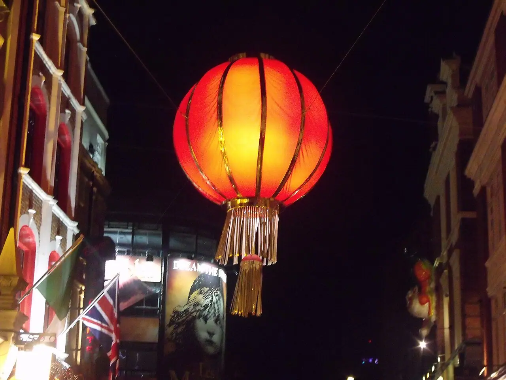

Chinatown, London - Wardour Street - big Chinese lanterns - at night (6437981483).jpg — Elliott Brown from Birmingham, United Kingdom / [CC BY 2.0](https://creativecommons.org/licenses/by/2.0) / [原典](https://commons.wikimedia.org/wiki/File:Chinatown%2C_London_-_Wardour_Street_-_big_Chinese_lanterns_-_at_night_%286437981483%29.jpg)

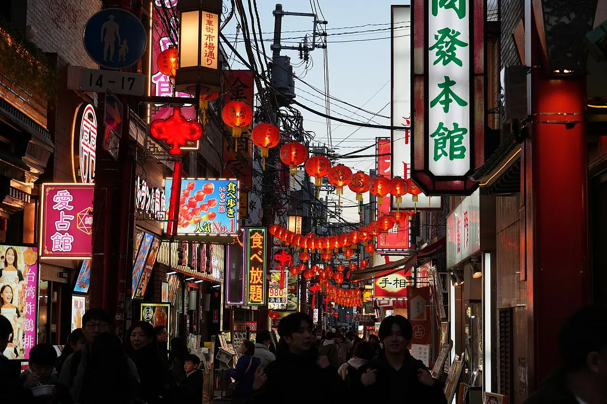

Yokohama Chinatown Narrow Street 01.jpg — Tokyo538 / [CC0](https://creativecommons.org/publicdomain/zero/1.0/deed.en) / [原典](https://commons.wikimedia.org/wiki/File:Yokohama_Chinatown_Narrow_Street_01.jpg)

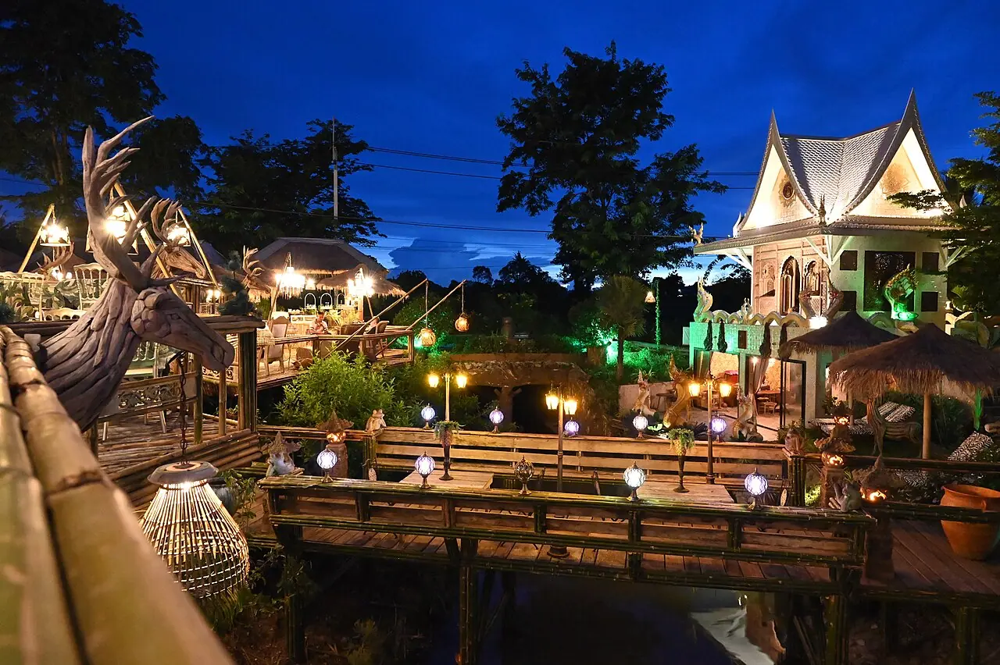

DSC 3303- Twilight at a charming riverside village, lantern-lit wooden walkways, ornate pavilion, and cozy huts glow warmly against the deep blue evening sky.jpg — Pattaya Patrol / [CC BY-SA 4.0](https://creativecommons.org/licenses/by-sa/4.0) / [原典](https://commons.wikimedia.org/wiki/File:DSC_3303-_Twilight_at_a_charming_riverside_village%2C_lantern-lit_wooden_walkways%2C_ornate_pavilion%2C_and_cozy_huts_glow_warmly_against_the_deep_blue_evening_sky.jpg)

## 雪の町 — snow-village

制作で見るところ：屋根・塀・道の積雪と薄い反射光

関連コード：`app/src/world/town.js`、`app/src/lab/seasons.js`

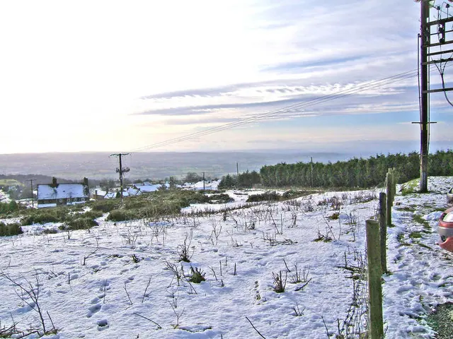

Snow covered countryside - geograph.org.uk - 656317.jpg — P L Chadwick / [CC BY-SA 2.0](https://creativecommons.org/licenses/by-sa/2.0) / [原典](https://commons.wikimedia.org/wiki/File:Snow_covered_countryside_-_geograph.org.uk_-_656317.jpg)

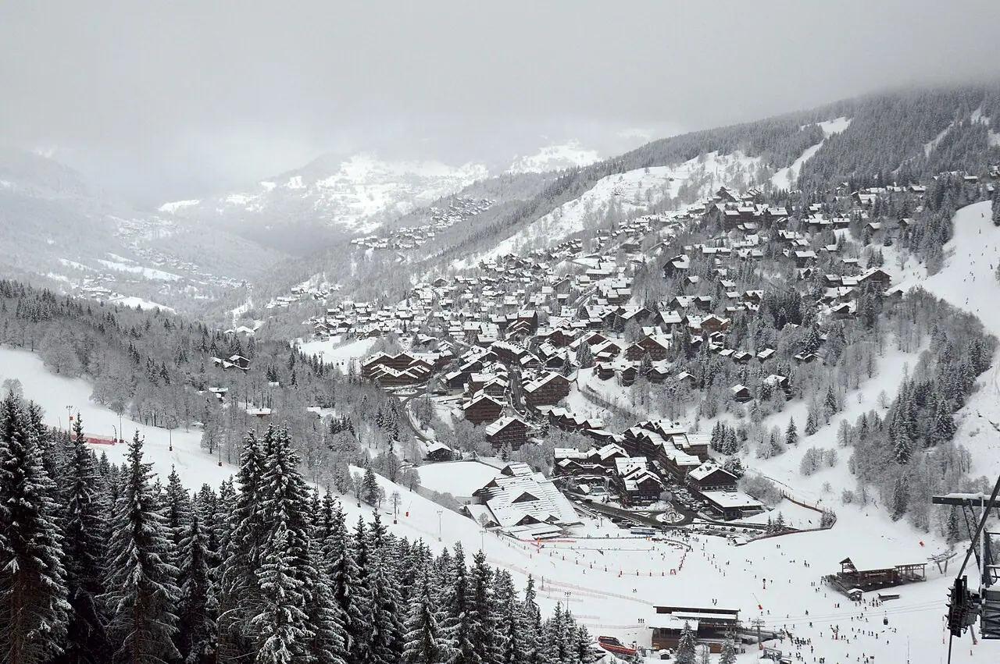

Snow-covered Méribel-Centre.jpg — DimiTalen / [CC0](https://creativecommons.org/publicdomain/zero/1.0/deed.en) / [原典](https://commons.wikimedia.org/wiki/File:Snow-covered_M%C3%A9ribel-Centre.jpg)

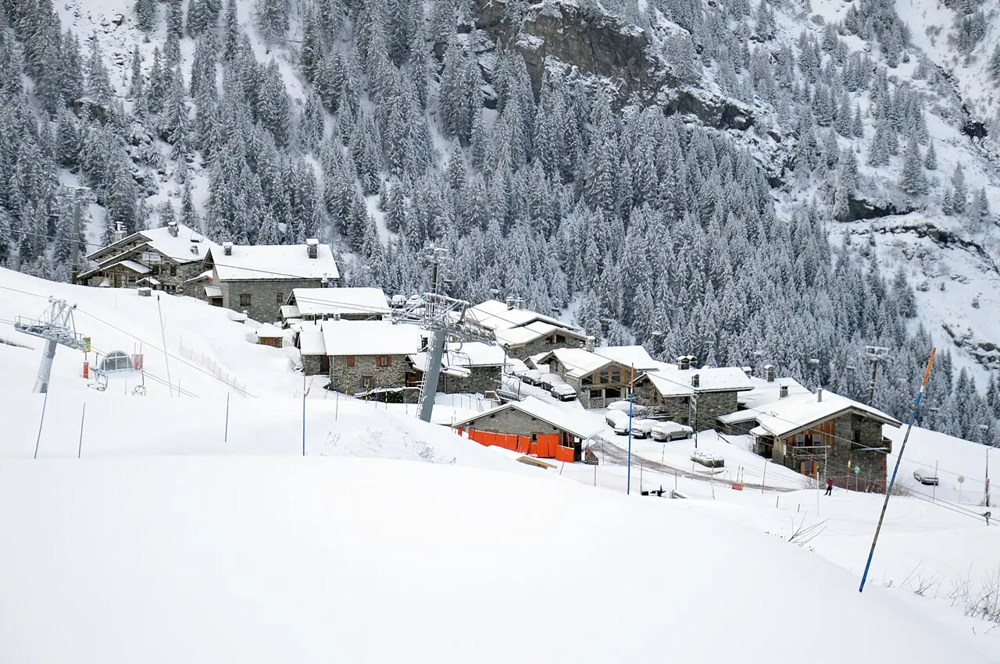

View of snow-covered Village des Eucherts, La Rosière, 2024.jpg — DimiTalen / [CC0](https://creativecommons.org/publicdomain/zero/1.0/deed.en) / [原典](https://commons.wikimedia.org/wiki/File:View_of_snow-covered_Village_des_Eucherts%2C_La_Rosi%C3%A8re%2C_2024.jpg)

## 薄暮と青い時間 — twilight

制作で見るところ：温かい窓明かりと青い空気色の釣り合い

関連コード：`app/src/world/sky.js`、`app/src/lab/light.js`

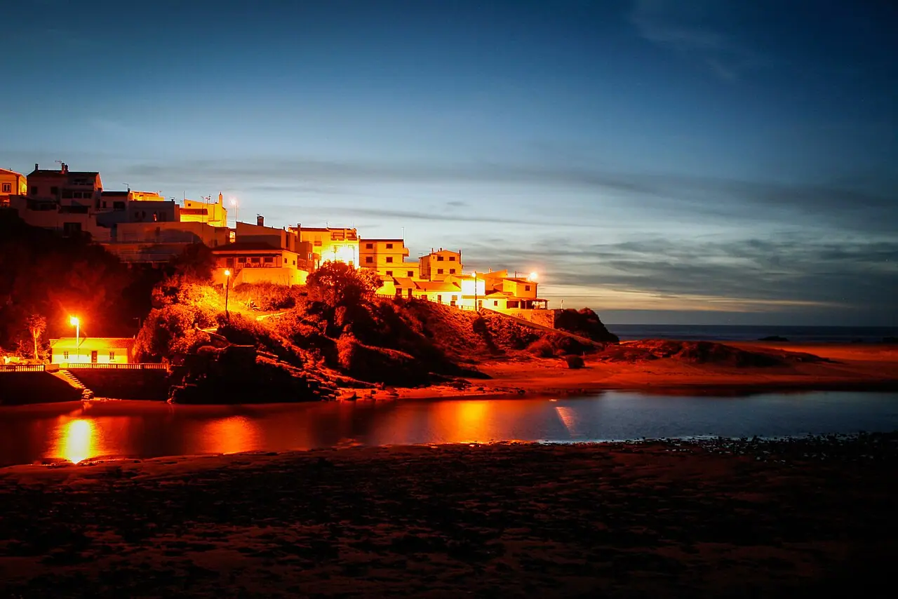

Blue Hour (180032429).jpeg — Jakob / [CC BY 3.0](https://creativecommons.org/licenses/by/3.0) / [原典](https://commons.wikimedia.org/wiki/File:Blue_Hour_%28180032429%29.jpeg)

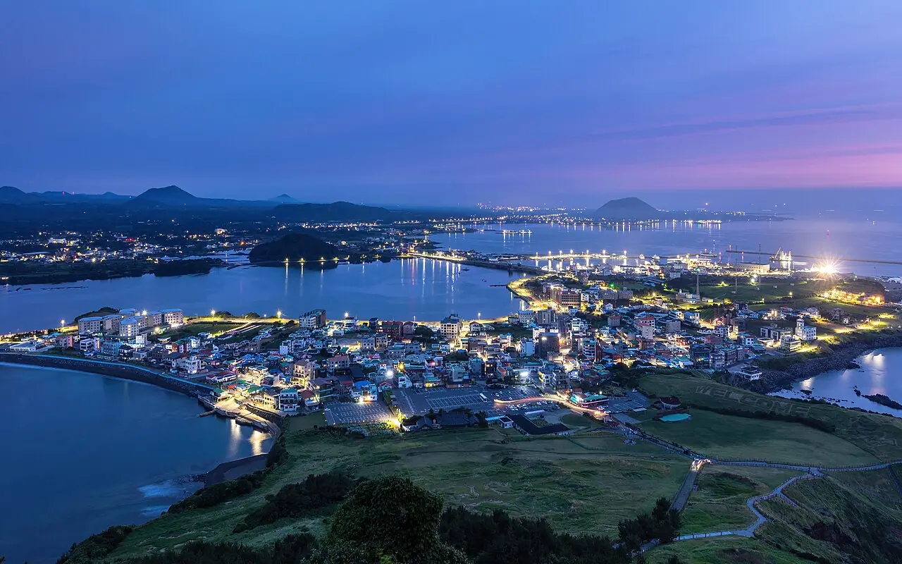

Seongsan-ri town at blue hour seen from Seongsan Ilchulbong volcano Jeju Island South Korea.jpg — Basile Morin / [CC BY-SA 4.0](https://creativecommons.org/licenses/by-sa/4.0) / [原典](https://commons.wikimedia.org/wiki/File:Seongsan-ri_town_at_blue_hour_seen_from_Seongsan_Ilchulbong_volcano_Jeju_Island_South_Korea.jpg)

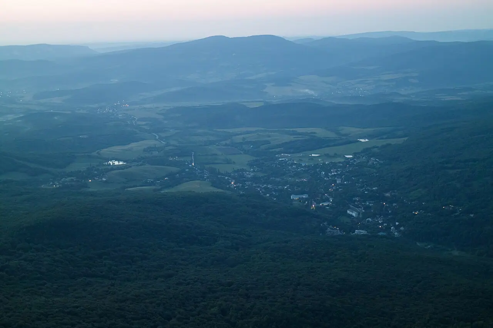

Belbek Valley, Dusk, Blue hour, Crimea.jpg — Vyacheslav Argenberg / [CC BY 4.0](https://creativecommons.org/licenses/by/4.0) / [原典](https://commons.wikimedia.org/wiki/File:Belbek_Valley%2C_Dusk%2C_Blue_hour%2C_Crimea.jpg)

