# materials — reference photos

[← Gallery index](./README.md) | [Credits](../catalog/CREDITS.md)

## 木材の経年変化 — weathered-wood

制作で見るところ：木目・節・塗装の剥がれと風雨

関連コード：`app/src/world/textures.js`、`app/src/lab/surface.js`

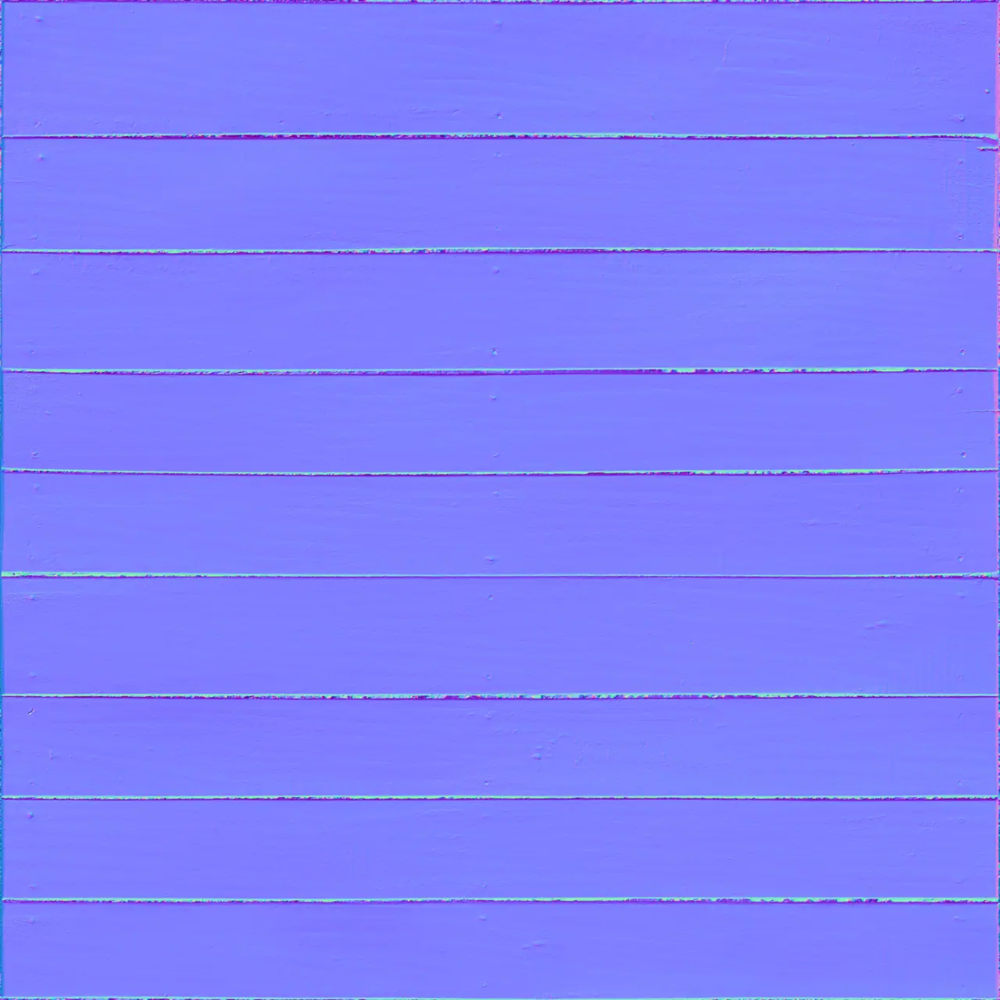

Wood planks nor dx 8k (Amal Kumar via Poly Haven).png — Amal Kumar (https://polyhaven.com/all?a=Amal%20Kumar / https://web.archive.org/web/20230902205408/https://polyhaven.com/all?a=Amal%20Kumar) via Poly Haven / [CC0](https://creativecommons.org/publicdomain/zero/1.0/deed.en) / [原典](https://commons.wikimedia.org/wiki/File:Wood_planks_nor_dx_8k_%28Amal_Kumar_via_Poly_Haven%29.png)

Wood planks rough 8k (Amal Kumar via Poly Haven).png — Amal Kumar (https://polyhaven.com/all?a=Amal%20Kumar / https://web.archive.org/web/20230902205408/https://polyhaven.com/all?a=Amal%20Kumar) via Poly Haven / [CC0](https://creativecommons.org/publicdomain/zero/1.0/deed.en) / [原典](https://commons.wikimedia.org/wiki/File:Wood_planks_rough_8k_%28Amal_Kumar_via_Poly_Haven%29.png)

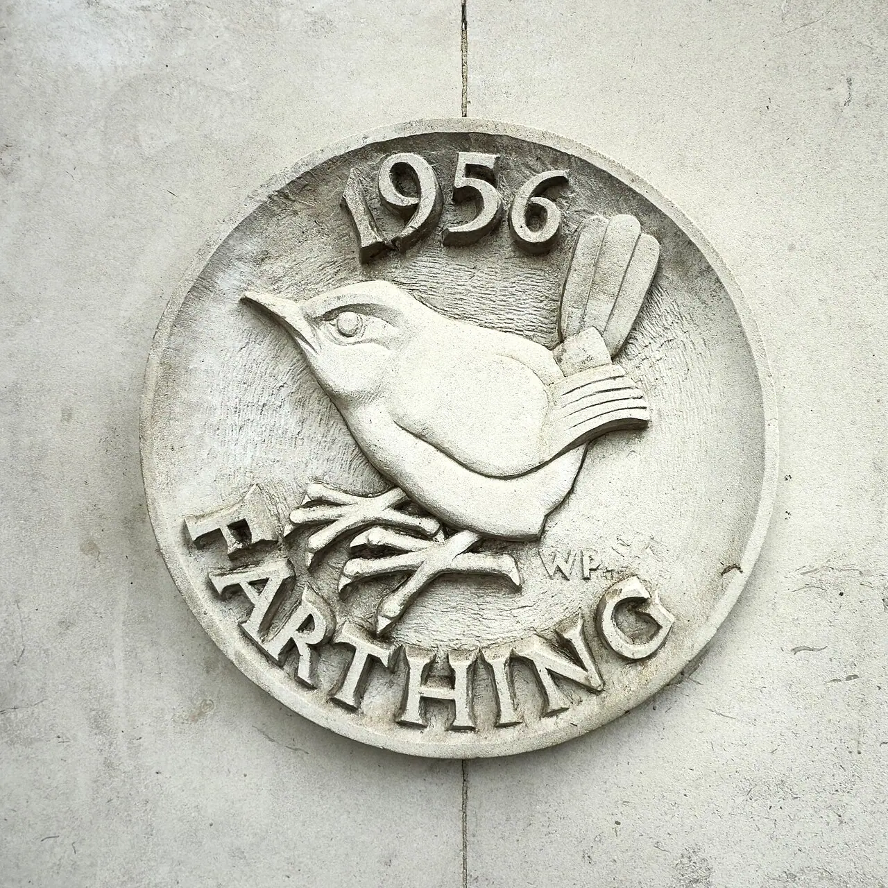

A large decorative stone coin. The old Barclays Bank Building in Maidstone.jpg — John K Thorne / [CC BY 4.0](https://creativecommons.org/licenses/by/4.0) / [原典](https://commons.wikimedia.org/wiki/File:A_large_decorative_stone_coin._The_old_Barclays_Bank_Building_in_Maidstone.jpg)

## 岩と石の質感 — stone-surfaces

制作で見るところ：割れ目・層・苔の定着

関連コード：`app/src/world/textures.js`、`app/src/lab/surface.js`

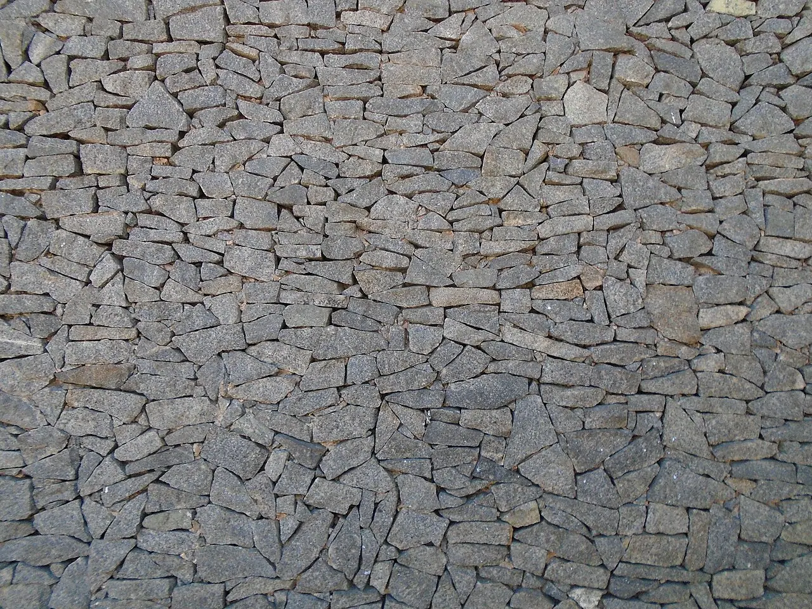

Granite stone textures.jpg — Eugenio Hansen, OFS / [CC BY-SA 4.0](https://creativecommons.org/licenses/by-sa/4.0) / [原典](https://commons.wikimedia.org/wiki/File:Granite_stone_textures.jpg)

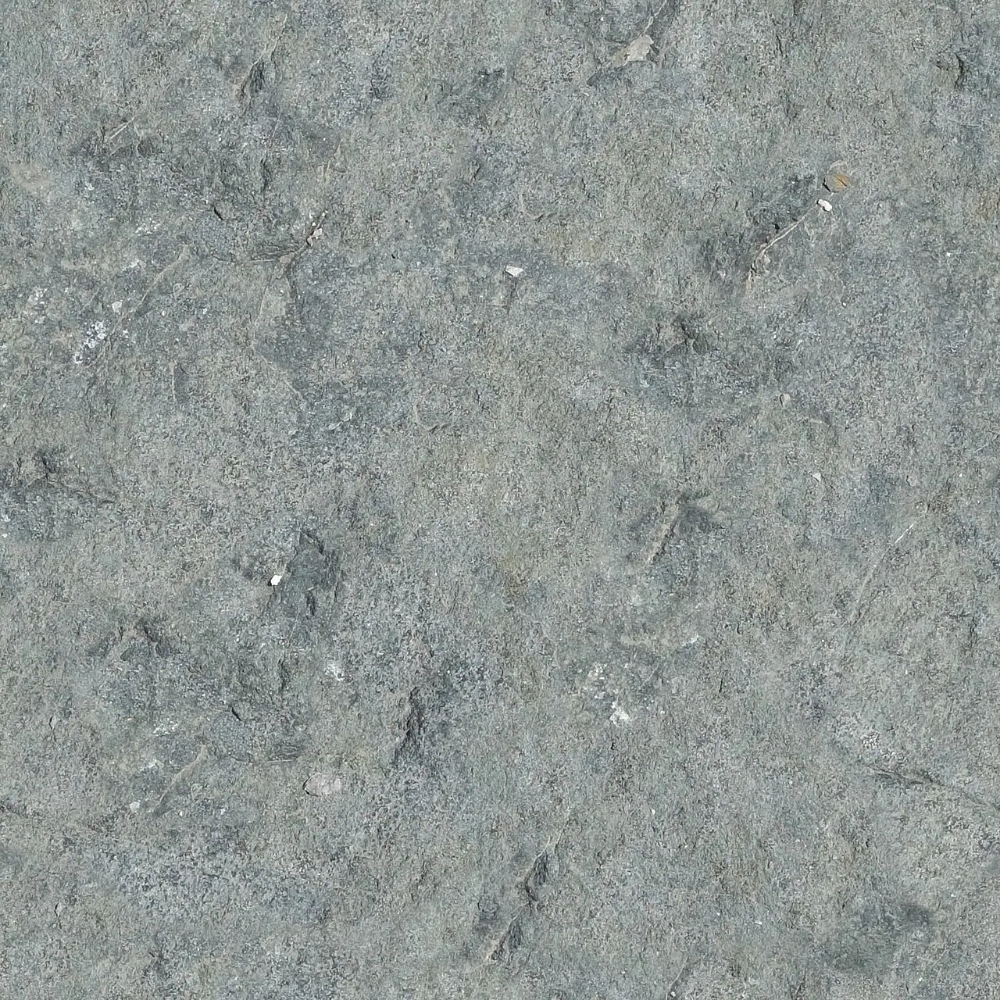

Light grey granite rock seamless stone surface texture.jpg — Sisters.seamless / [CC0](https://creativecommons.org/publicdomain/zero/1.0/deed.en) / [原典](https://commons.wikimedia.org/wiki/File:Light_grey_granite_rock_seamless_stone_surface_texture.jpg)

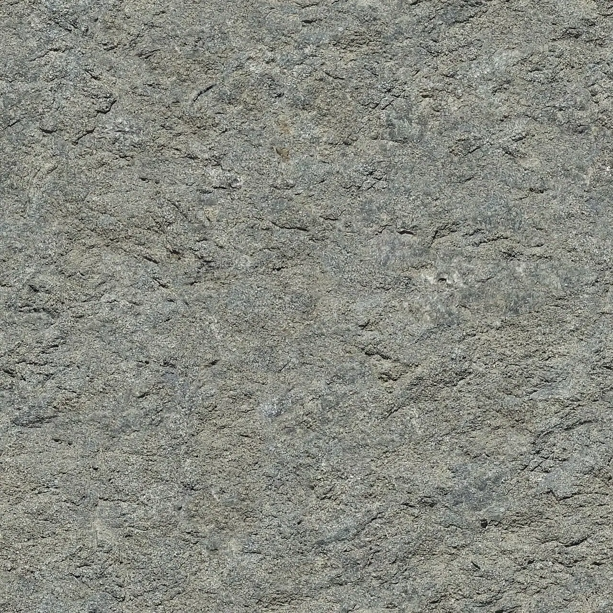

Grey granite boulder seamless stone surface texture.jpg — Sisters.seamless / [CC0](https://creativecommons.org/publicdomain/zero/1.0/deed.en) / [原典](https://commons.wikimedia.org/wiki/File:Grey_granite_boulder_seamless_stone_surface_texture.jpg)

## 瓦と屋根材 — roof-materials

制作で見るところ：連続模様・重なり・端部の納まり

関連コード：`app/src/world/textures.js`、`app/src/world/house.js`

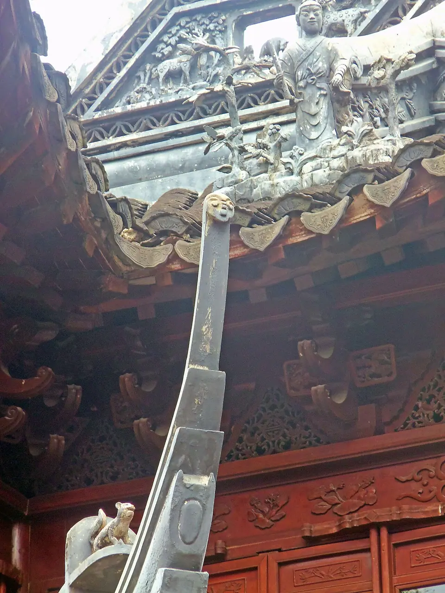

Architecrtural detail closeup at Yuyuan Gardens.jpg — Daniel Case / [CC BY-SA 3.0](https://creativecommons.org/licenses/by-sa/3.0) / [原典](https://commons.wikimedia.org/wiki/File:Architecrtural_detail_closeup_at_Yuyuan_Gardens.jpg)

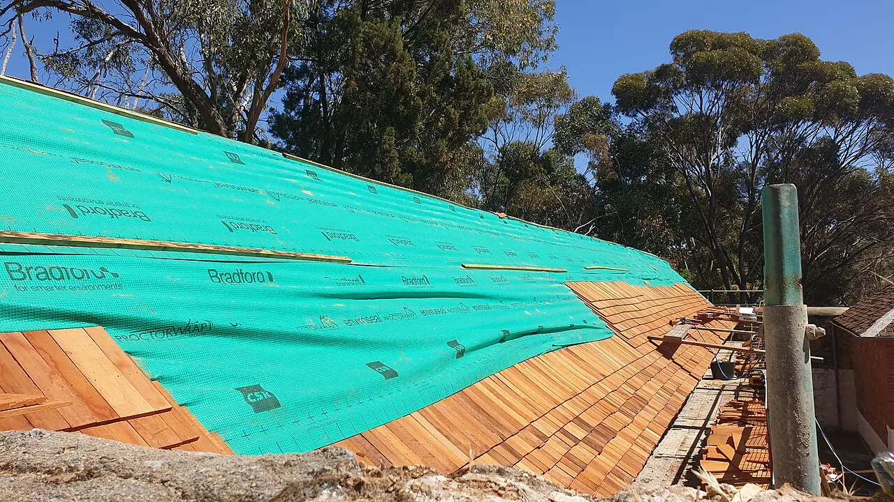

Closeup of shingles partially laid over Newcastle Gaol Museum cell wing, Toodyay October 2019.jpg — Elrebe56 / [CC BY-SA 4.0](https://creativecommons.org/licenses/by-sa/4.0) / [原典](https://commons.wikimedia.org/wiki/File:Closeup_of_shingles_partially_laid_over_Newcastle_Gaol_Museum_cell_wing%2C_Toodyay_October_2019.jpg)

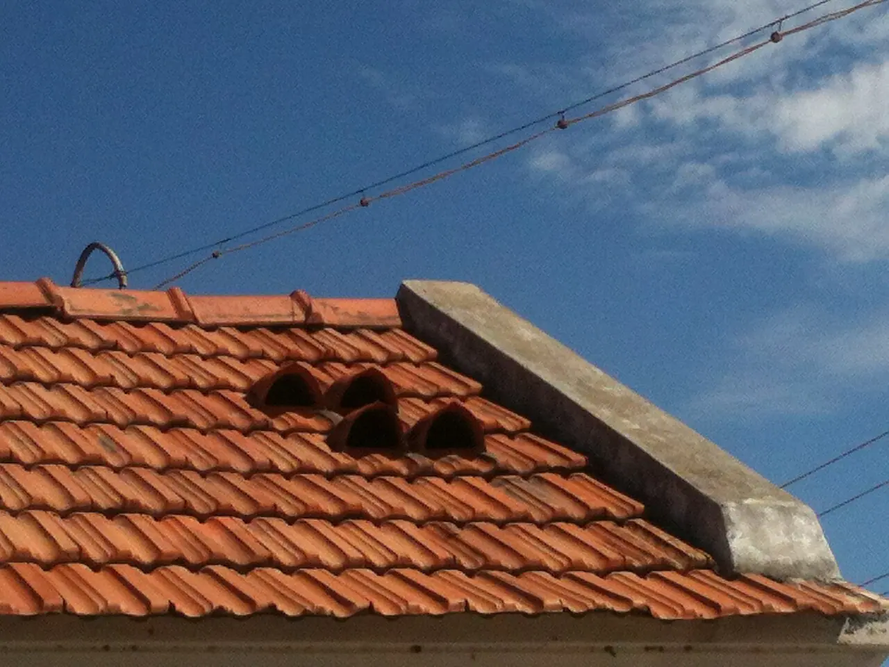

Mangalore tiles closeup view.jpg — SnapMeUp / [CC BY-SA 4.0](https://creativecommons.org/licenses/by-sa/4.0) / [原典](https://commons.wikimedia.org/wiki/File:Mangalore_tiles_closeup_view.jpg)

## 漆喰と土壁 — plaster-and-clay

制作で見るところ：コテ跡・表面ムラ・角の欠け

関連コード：`app/src/world/textures.js`、`app/src/world/house.js`

Painted plaster wall rough 16k (Amal Kumar via Poly Haven).png — Amal Kumar (https://polyhaven.com/all?a=Amal%20Kumar / https://web.archive.org/web/20230902205408/https://polyhaven.com/all?a=Amal%20Kumar) via Poly Haven / [CC0](https://creativecommons.org/publicdomain/zero/1.0/deed.en) / [原典](https://commons.wikimedia.org/wiki/File:Painted_plaster_wall_rough_16k_%28Amal_Kumar_via_Poly_Haven%29.png)

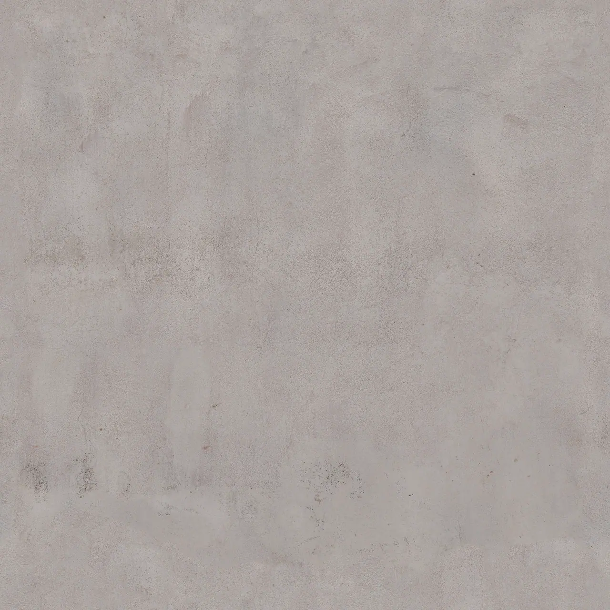

Painted plaster wall diff 16k (Amal Kumar via Poly Haven).png — Amal Kumar (https://polyhaven.com/all?a=Amal%20Kumar / https://web.archive.org/web/20230902205408/https://polyhaven.com/all?a=Amal%20Kumar) via Poly Haven / [CC0](https://creativecommons.org/publicdomain/zero/1.0/deed.en) / [原典](https://commons.wikimedia.org/wiki/File:Painted_plaster_wall_diff_16k_%28Amal_Kumar_via_Poly_Haven%29.png)

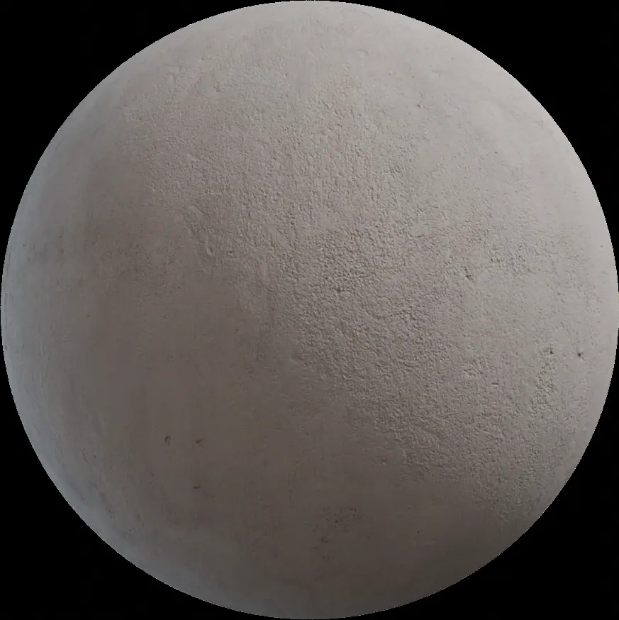

Painted plaster wall - Preview (Amal Kumar via Poly Haven).png — Amal Kumar (https://polyhaven.com/all?a=Amal%20Kumar / https://web.archive.org/web/20230902205408/https://polyhaven.com/all?a=Amal%20Kumar) via Poly Haven / [CC0](https://creativecommons.org/publicdomain/zero/1.0/deed.en) / [原典](https://commons.wikimedia.org/wiki/File:Painted_plaster_wall_-_Preview_%28Amal_Kumar_via_Poly_Haven%29.png)

## 茅葺きと藁葺き — thatch

制作で見るところ：茅の層・軒先の厚み・耐候の色

関連コード：`app/src/world/road.js`

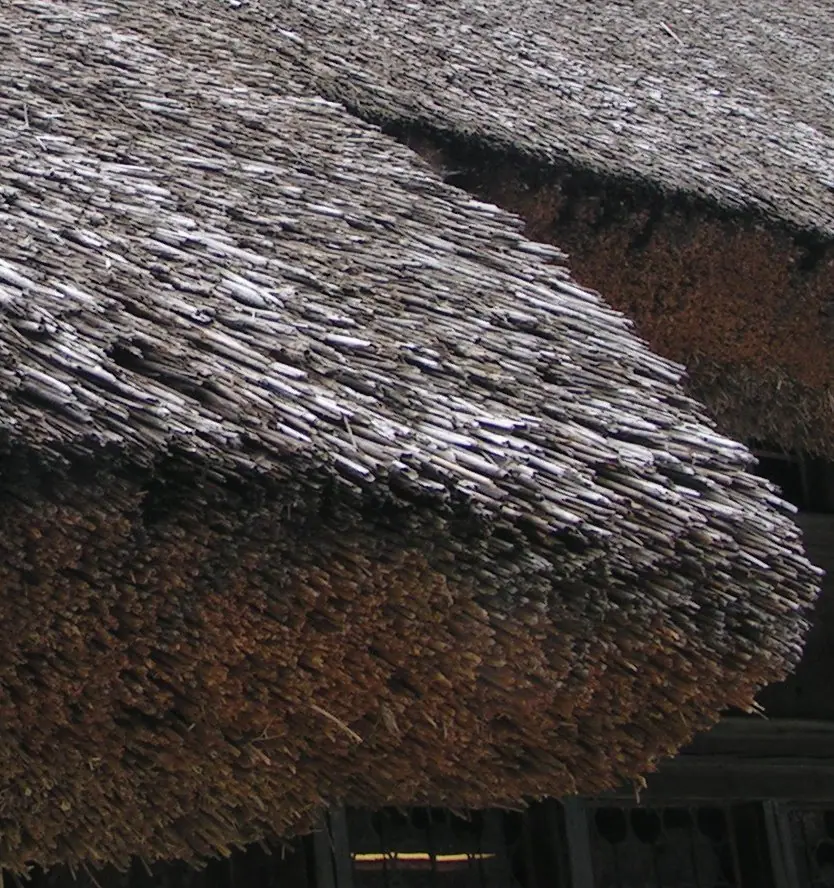

Closeup of thatching Ben W Bell 31 7 2005.jpg — Ben W Bell / [CC BY-SA 3.0](https://creativecommons.org/licenses/by-sa/3.0/) / [原典](https://commons.wikimedia.org/wiki/File:Closeup_of_thatching_Ben_W_Bell_31_7_2005.jpg)

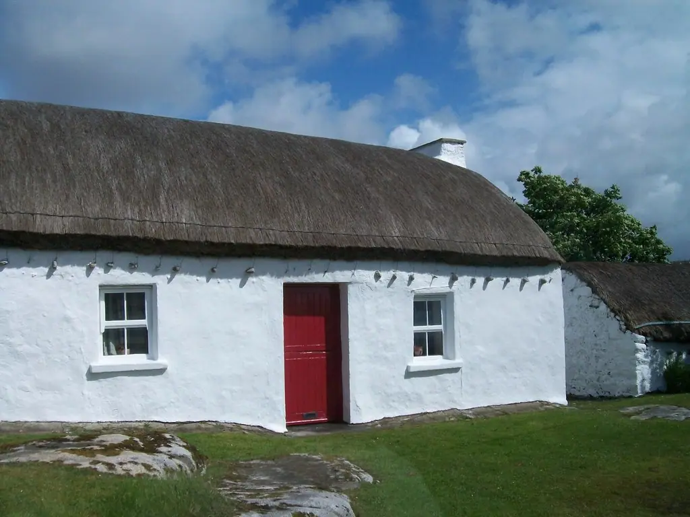

Traditional thatched cottage at Derrydruel - geograph.org.uk - 3254874.jpg — Eric Jones / [CC BY-SA 2.0](https://creativecommons.org/licenses/by-sa/2.0) / [原典](https://commons.wikimedia.org/wiki/File:Traditional_thatched_cottage_at_Derrydruel_-_geograph.org.uk_-_3254874.jpg)

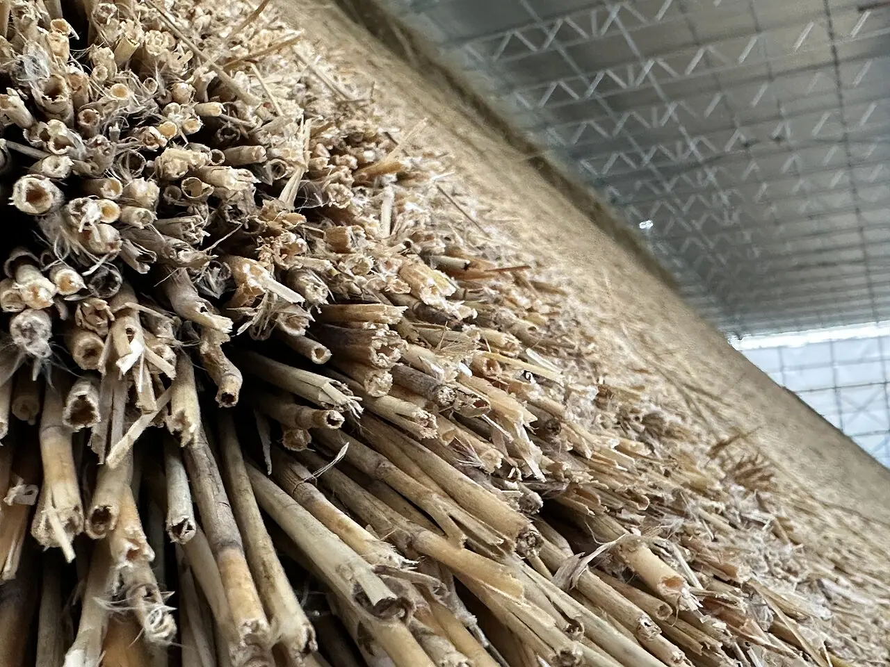

Thatched roof closeup Upminster Tithe Barn 2025-01-28.jpg — Matt Brown / [CC BY 2.0](https://creativecommons.org/licenses/by/2.0) / [原典](https://commons.wikimedia.org/wiki/File:Thatched_roof_closeup_Upminster_Tithe_Barn_2025-01-28.jpg)

## 小石と砂利 — pebbles-and-gravel

制作で見るところ：粒度分布・土との混ざり・踏み跡

関連コード：`app/src/world/landscape.js`、`app/src/world/textures.js`

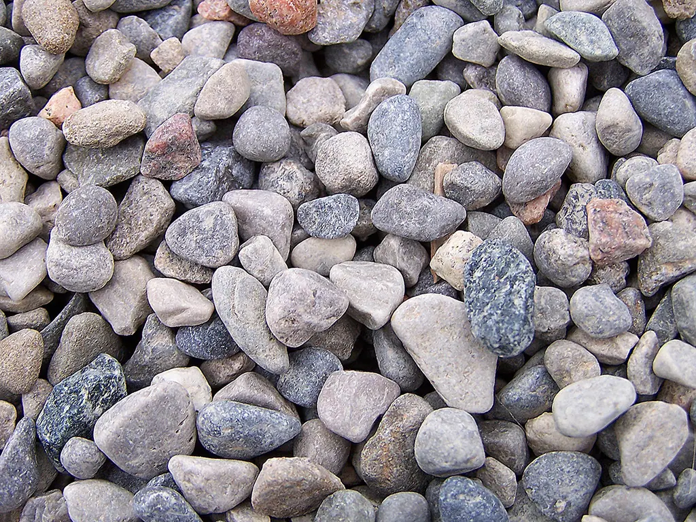

Pebbles on Kew Beach, Toronto 2005-10-11.jpg — Diego Torres Silvestre from Sao Paulo, Brazil / [CC BY 2.0](https://creativecommons.org/licenses/by/2.0) / [原典](https://commons.wikimedia.org/wiki/File:Pebbles_on_Kew_Beach%2C_Toronto_2005-10-11.jpg)

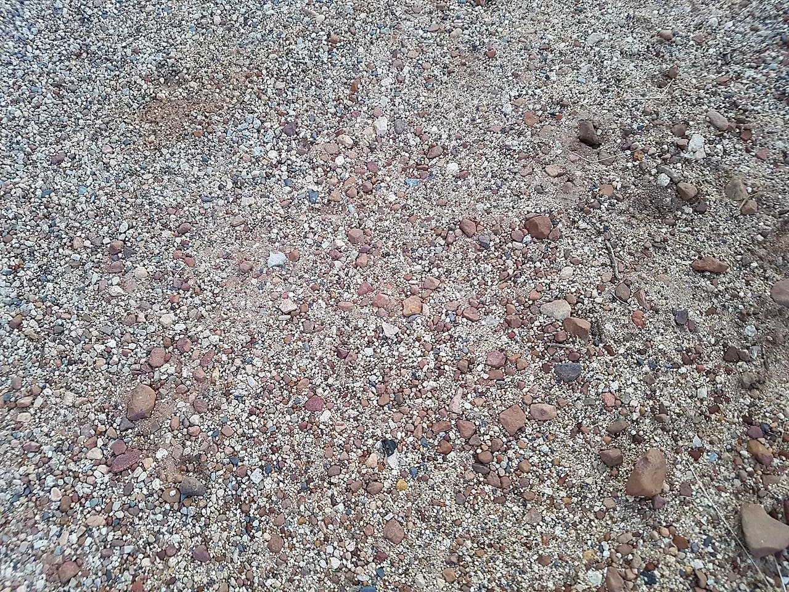

Pebbles on the ground on table mountain.jpg — Netha Hussain / [CC0](https://creativecommons.org/publicdomain/zero/1.0/deed.en) / [原典](https://commons.wikimedia.org/wiki/File:Pebbles_on_the_ground_on_table_mountain.jpg)

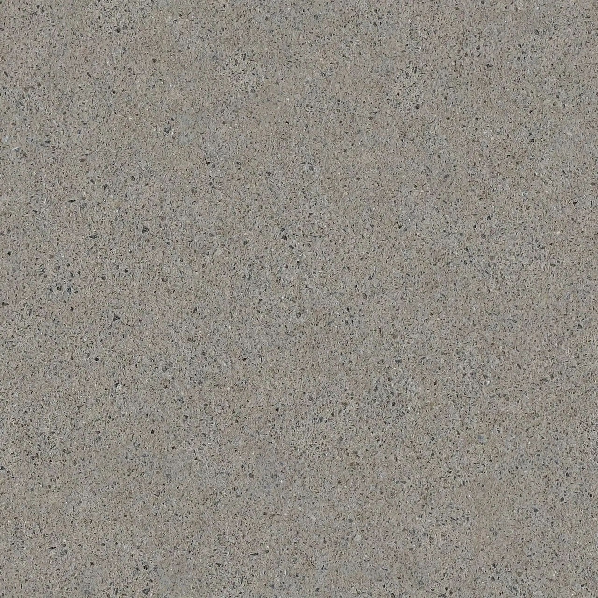

Tan speckled pebble stone concreate ground seamless floor texture.jpg — Sisters.seamless / [CC0](https://creativecommons.org/publicdomain/zero/1.0/deed.en) / [原典](https://commons.wikimedia.org/wiki/File:Tan_speckled_pebble_stone_concreate_ground_seamless_floor_texture.jpg)

