# meadow — reference photos

[← Gallery index](./README.md) | [Credits](../catalog/CREDITS.md)

## 草原と風 — grassland

制作で見るところ：草丈・群落の斑・風向の見え方

関連コード：`app/src/world/meadow.js`、`app/src/world/nature.js`

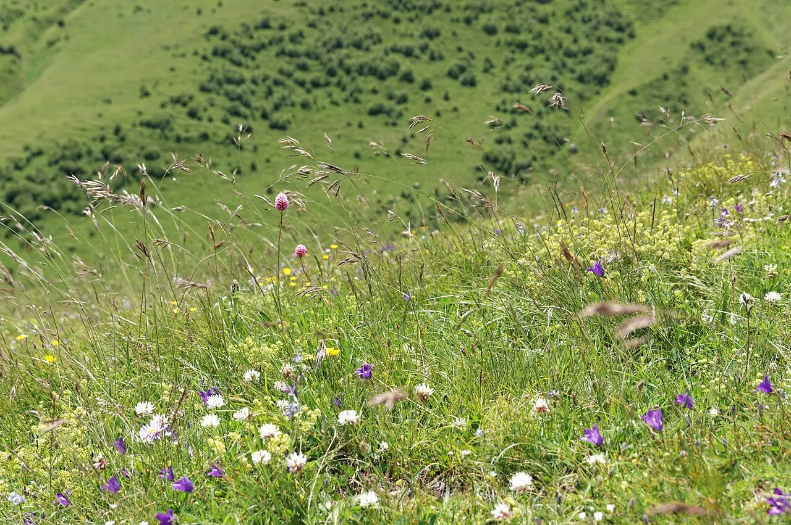

Alpine meadows, Grassland, Georgia.jpg — Vyacheslav Argenberg / [CC BY 4.0](https://creativecommons.org/licenses/by/4.0) / [原典](https://commons.wikimedia.org/wiki/File:Alpine_meadows%2C_Grassland%2C_Georgia.jpg)

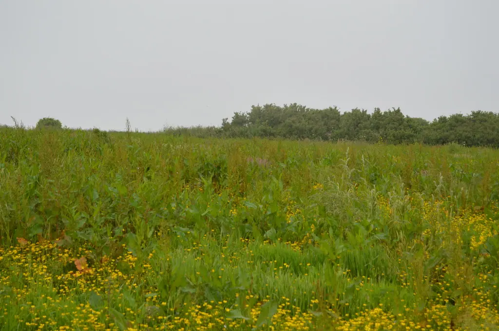

Wild meadow - geograph.org.uk - 5919410.jpg — N Chadwick / [CC BY-SA 2.0](https://creativecommons.org/licenses/by-sa/2.0) / [原典](https://commons.wikimedia.org/wiki/File:Wild_meadow_-_geograph.org.uk_-_5919410.jpg)

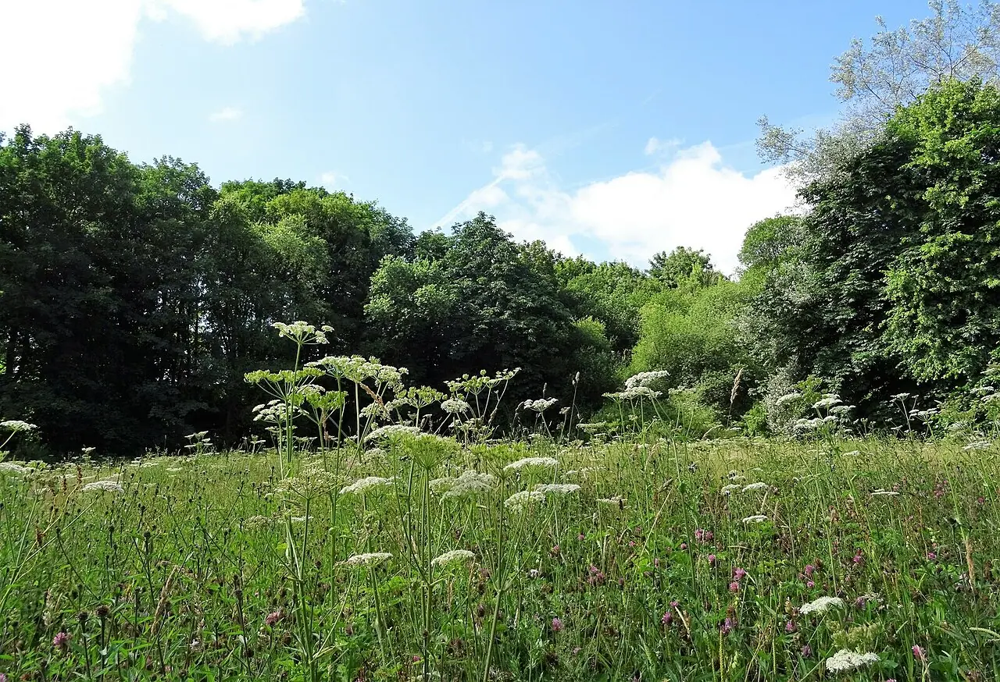

Wild flower meadow - geograph.org.uk - 6898865.jpg — philandju / [CC BY-SA 2.0](https://creativecommons.org/licenses/by-sa/2.0) / [原典](https://commons.wikimedia.org/wiki/File:Wild_flower_meadow_-_geograph.org.uk_-_6898865.jpg)

## 野花の群生 — wildflowers

制作で見るところ：色の偏り・株間・開花高さ

関連コード：`app/src/world/plant-meshes.js`、`app/src/world/meadow.js`

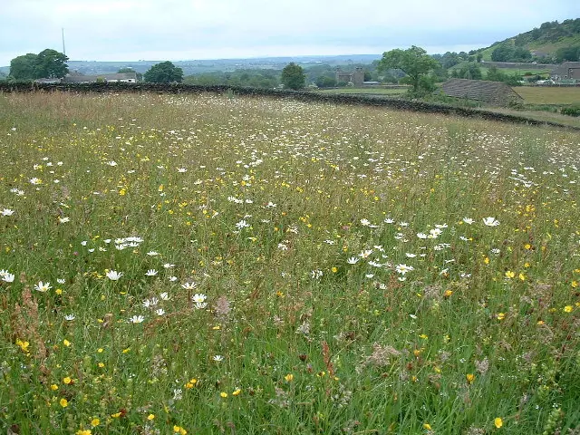

Wildflower Meadow - geograph.org.uk - 81827.jpg — Nigel Homer / [CC BY-SA 2.0](https://creativecommons.org/licenses/by-sa/2.0) / [原典](https://commons.wikimedia.org/wiki/File:Wildflower_Meadow_-_geograph.org.uk_-_81827.jpg)

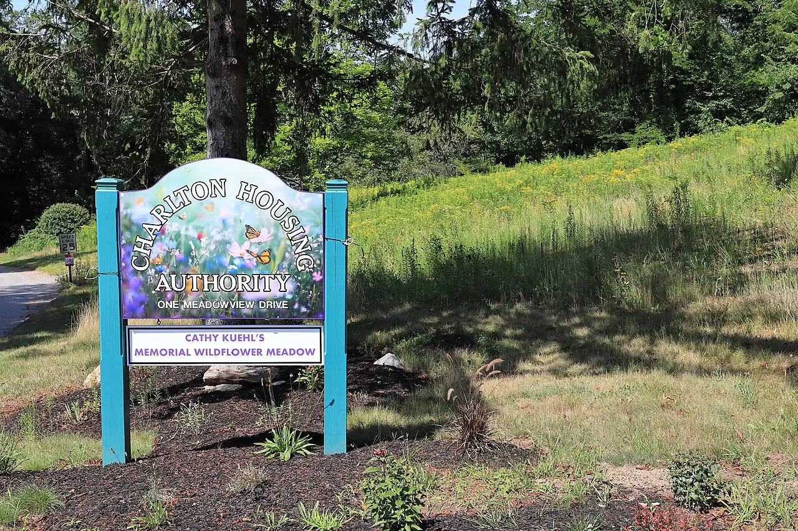

Cathleen Kuehl Memorial Wildflower Meadow 2026-08-01.jpg — Peter Cooper Jr. / [CC0](https://creativecommons.org/publicdomain/zero/1.0/deed.en) / [原典](https://commons.wikimedia.org/wiki/File:Cathleen_Kuehl_Memorial_Wildflower_Meadow_2026-08-01.jpg)

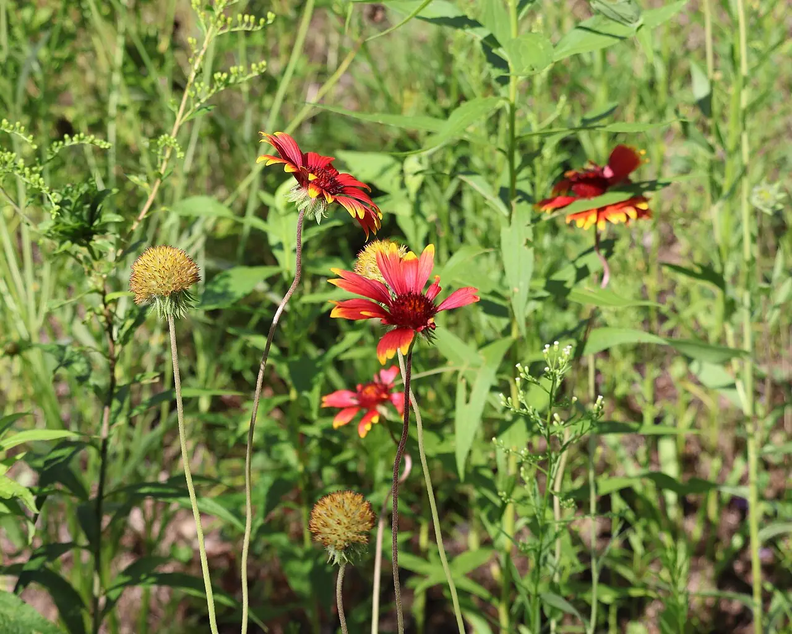

Blanket flowers, Cathleen Kuehl Memorial Wildflower Meadow 2026-08-01.jpg — Peter Cooper Jr. / [CC0](https://creativecommons.org/publicdomain/zero/1.0/deed.en) / [原典](https://commons.wikimedia.org/wiki/File:Blanket_flowers%2C_Cathleen_Kuehl_Memorial_Wildflower_Meadow_2026-08-01.jpg)

## 庭の花壇 — garden-beds

制作で見るところ：植え分け、道端の小花、土との境界

関連コード：`app/src/world/plant-meshes.js`、`app/src/systems/garden-view.js`

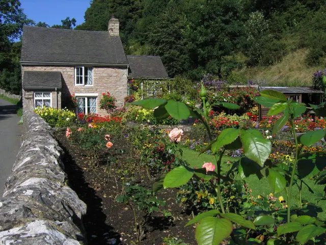

Cottage and Flower Garden Milldale - geograph.org.uk - 1570291.jpg — John Proctor / [CC BY-SA 2.0](https://creativecommons.org/licenses/by-sa/2.0) / [原典](https://commons.wikimedia.org/wiki/File:Cottage_and_Flower_Garden_Milldale_-_geograph.org.uk_-_1570291.jpg)

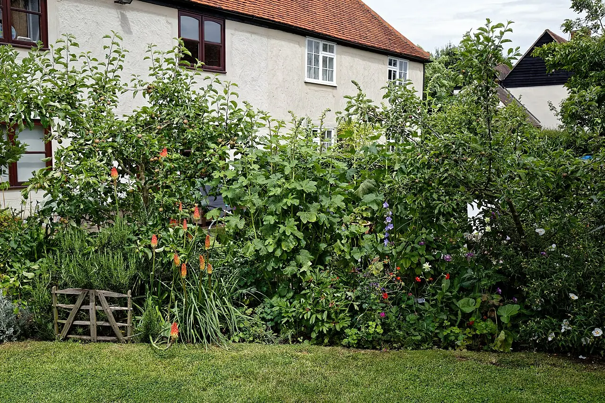

Cottage garden border at Boreham, Essex, England.jpg — Acabashi / [CC BY-SA 4.0](https://creativecommons.org/licenses/by-sa/4.0) / [原典](https://commons.wikimedia.org/wiki/File:Cottage_garden_border_at_Boreham%2C_Essex%2C_England.jpg)

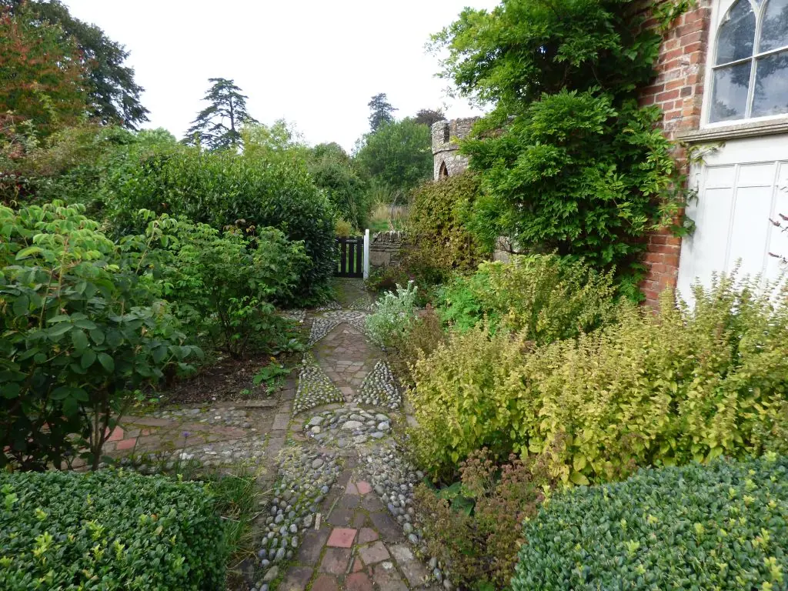

Flower beds in front of a cottage by the Walled garden - geograph.org.uk - 7063892.jpg — Eric Marsh / [CC BY-SA 2.0](https://creativecommons.org/licenses/by-sa/2.0) / [原典](https://commons.wikimedia.org/wiki/File:Flower_beds_in_front_of_a_cottage_by_the_Walled_garden_-_geograph.org.uk_-_7063892.jpg)

## 果樹園 — orchards

制作で見るところ：樹間、幹の高さ、花・実の位置

関連コード：`app/src/world/road.js`、`app/src/world/farm-meshes.js`

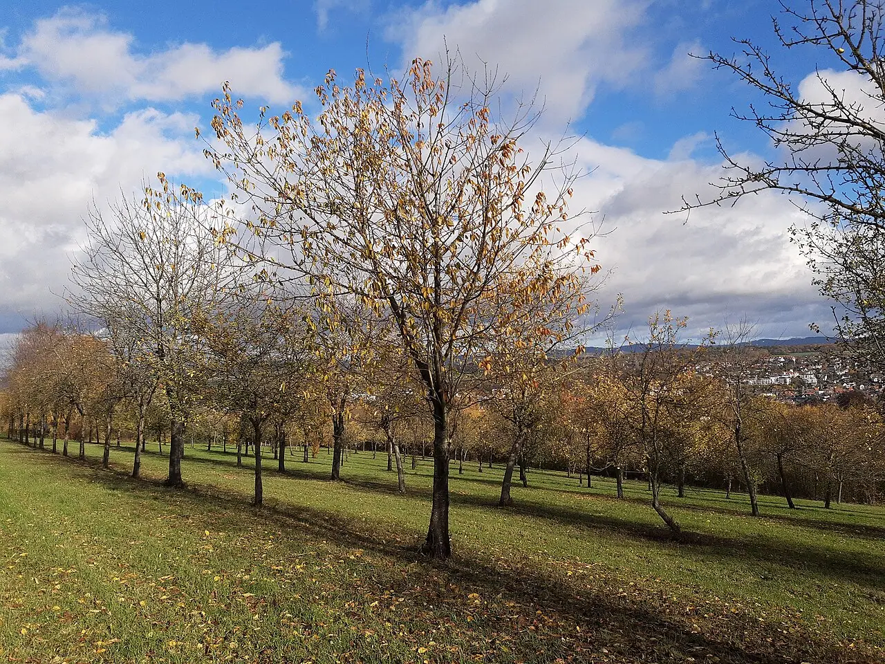

Apple orchard overlooking Idstein.jpg — Gerda Arendt / [CC0](https://creativecommons.org/publicdomain/zero/1.0/deed.en) / [原典](https://commons.wikimedia.org/wiki/File:Apple_orchard_overlooking_Idstein.jpg)

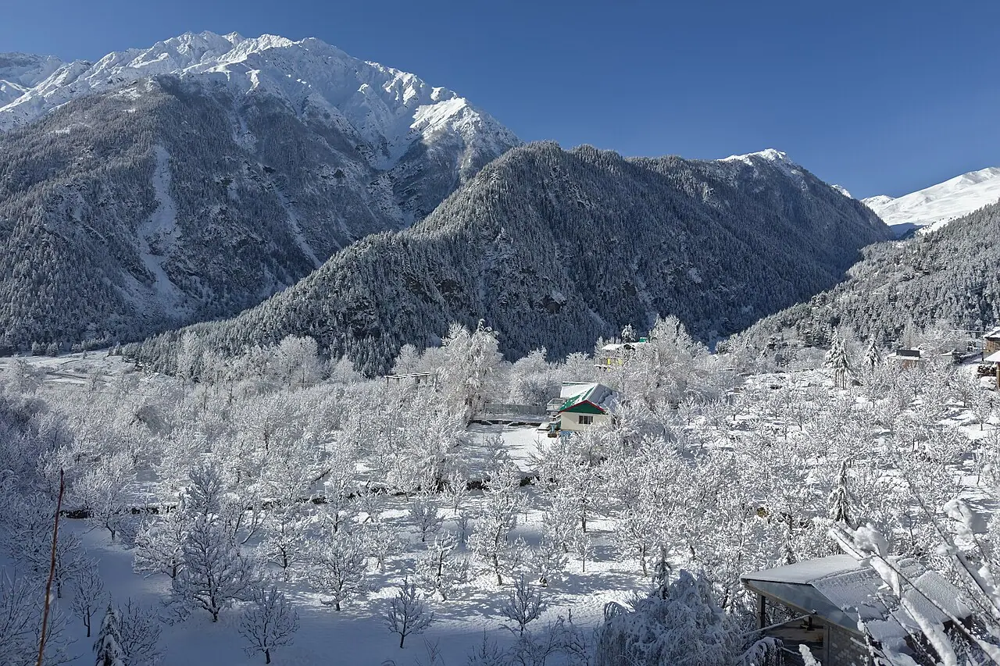

Orchards in snow, Sangla, Himachal Pradesh, India.jpg — UnpetitproleX / [CC BY-SA 4.0](https://creativecommons.org/licenses/by-sa/4.0) / [原典](https://commons.wikimedia.org/wiki/File:Orchards_in_snow%2C_Sangla%2C_Himachal_Pradesh%2C_India.jpg)

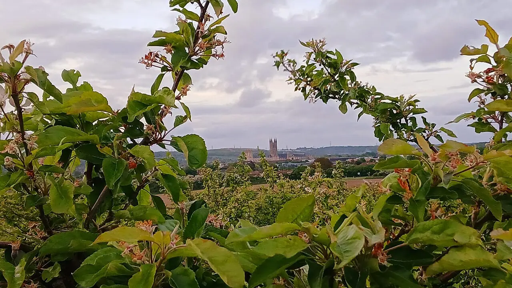

Apple Orchards with a view of Canterbury Cathedral.jpg — Digihum / [CC0](https://creativecommons.org/publicdomain/zero/1.0/deed.en) / [原典](https://commons.wikimedia.org/wiki/File:Apple_Orchards_with_a_view_of_Canterbury_Cathedral.jpg)

