# terrain — reference photos

[← Gallery index](./README.md) | [Credits](../catalog/CREDITS.md)

## 丘と谷 — rolling-hills

制作で見るところ：尾根のうねり、斜面の植生・遠景

関連コード：`app/src/world/terrain-height.js`、`app/src/world/road.js`

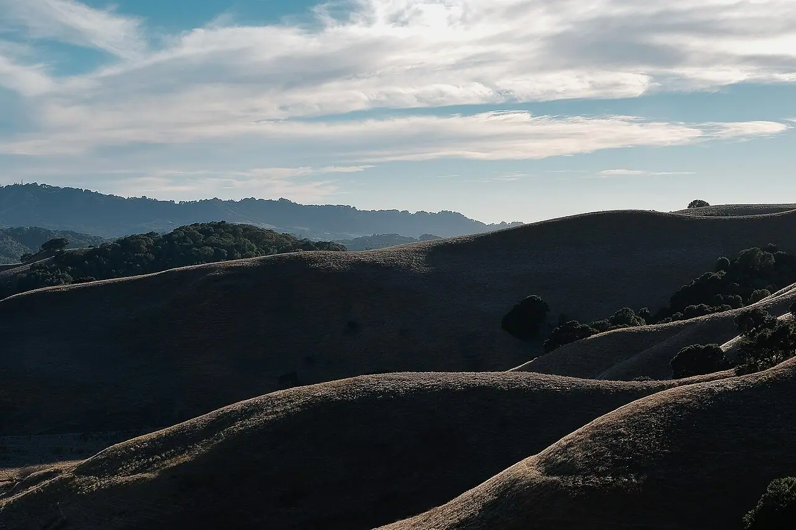

Rolling hills in Briones (Unsplash).jpg — Emmanuel Maceda bochie / [CC0](https://creativecommons.org/publicdomain/zero/1.0/deed.en) / [原典](https://commons.wikimedia.org/wiki/File:Rolling_hills_in_Briones_%28Unsplash%29.jpg)

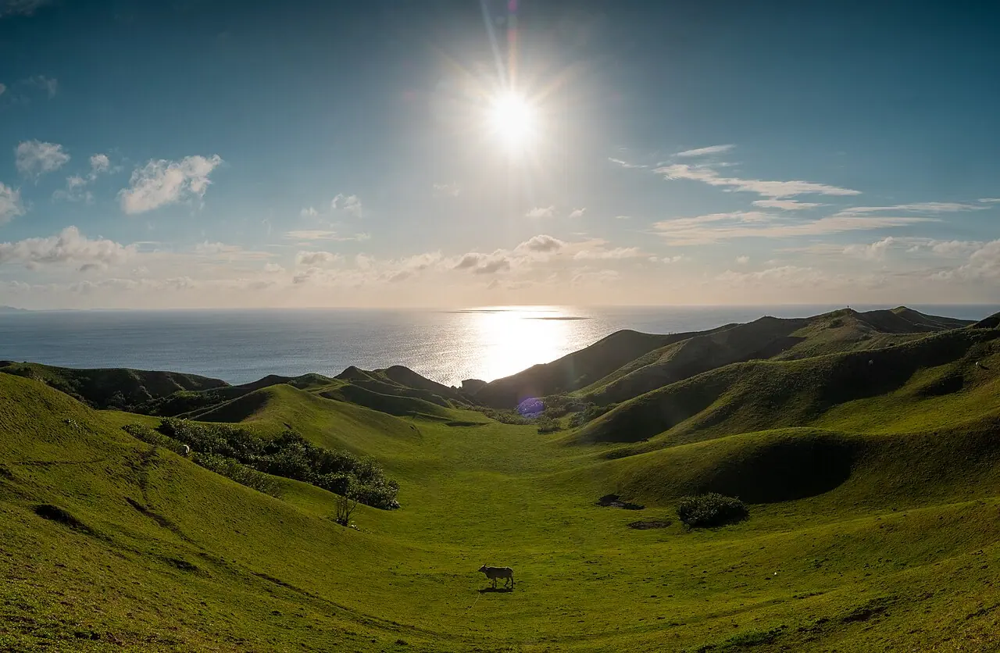

Panoramic shot of Vayang Rolling Hills.jpg — Bien02 / [CC BY 4.0](https://creativecommons.org/licenses/by/4.0) / [原典](https://commons.wikimedia.org/wiki/File:Panoramic_shot_of_Vayang_Rolling_Hills.jpg)

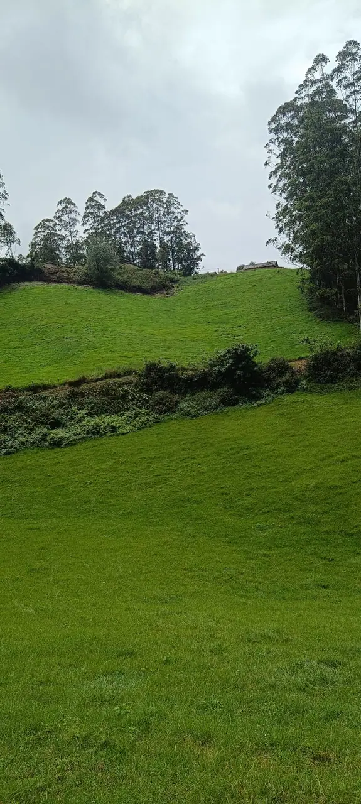

ROLLING GREEN HILLS.jpg — Nandhini Subramaniyan / [CC BY 4.0](https://creativecommons.org/licenses/by/4.0) / [原典](https://commons.wikimedia.org/wiki/File:ROLLING_GREEN_HILLS.jpg)

## 山並みと遠景 — distant-mountains

制作で見るところ：山の重なりと空気遠近法

関連コード：`app/src/world/terrain-height.js`、`app/src/world/sky-restaurant.js`

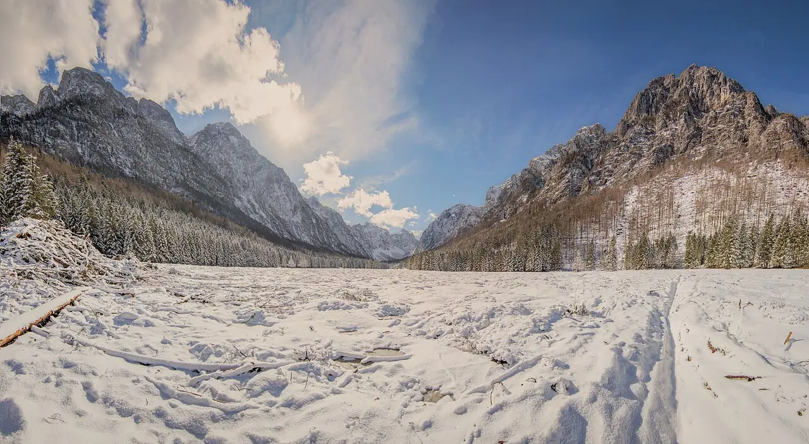

Panorama of the valley of the Triglav mountain massif.jpg — otrow_photography / [CC0](https://creativecommons.org/publicdomain/zero/1.0/deed.en) / [原典](https://commons.wikimedia.org/wiki/File:Panorama_of_the_valley_of_the_Triglav_mountain_massif.jpg)

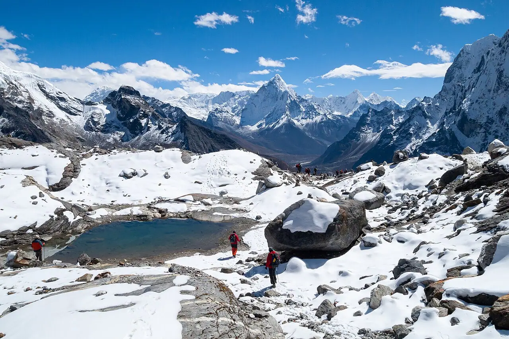

Mountains in snow, Mountain lake, Chola Valley, Nepal, Himalayas.jpg — Vyacheslav Argenberg / [CC BY 4.0](https://creativecommons.org/licenses/by/4.0) / [原典](https://commons.wikimedia.org/wiki/File:Mountains_in_snow%2C_Mountain_lake%2C_Chola_Valley%2C_Nepal%2C_Himalayas.jpg)

## 苔のある岩 — mossy-rocks

制作で見るところ：岩の割れ方、苔の付く面、地面への埋まり

関連コード：`app/src/world/nature.js`

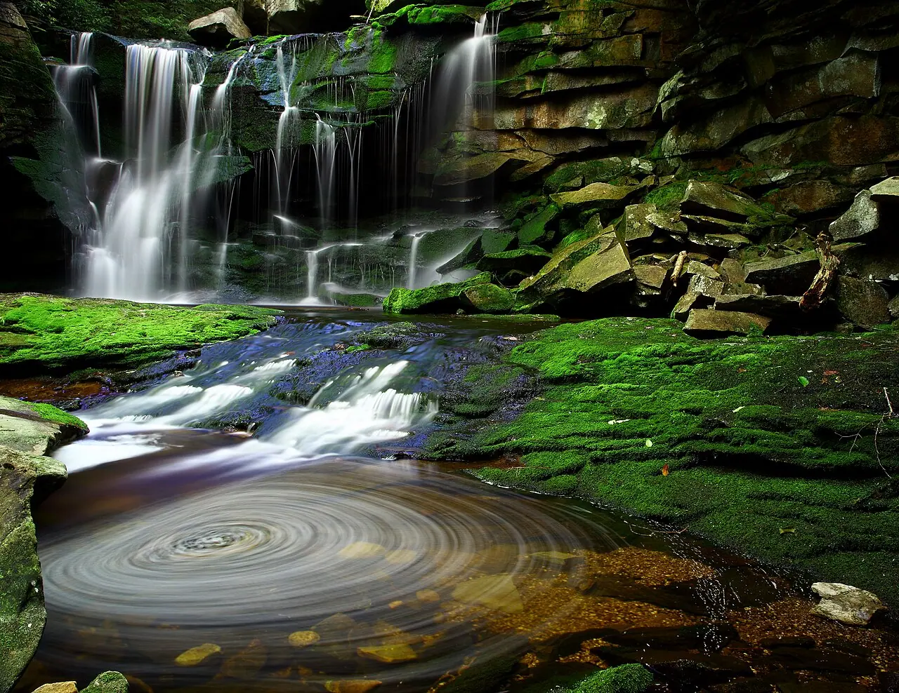

Elakala Waterfalls Swirling Pool Mossy Rocks.jpg — Forest Wander from Cross Lanes / [CC BY-SA 2.0](https://creativecommons.org/licenses/by-sa/2.0) / [原典](https://commons.wikimedia.org/wiki/File:Elakala_Waterfalls_Swirling_Pool_Mossy_Rocks.jpg)

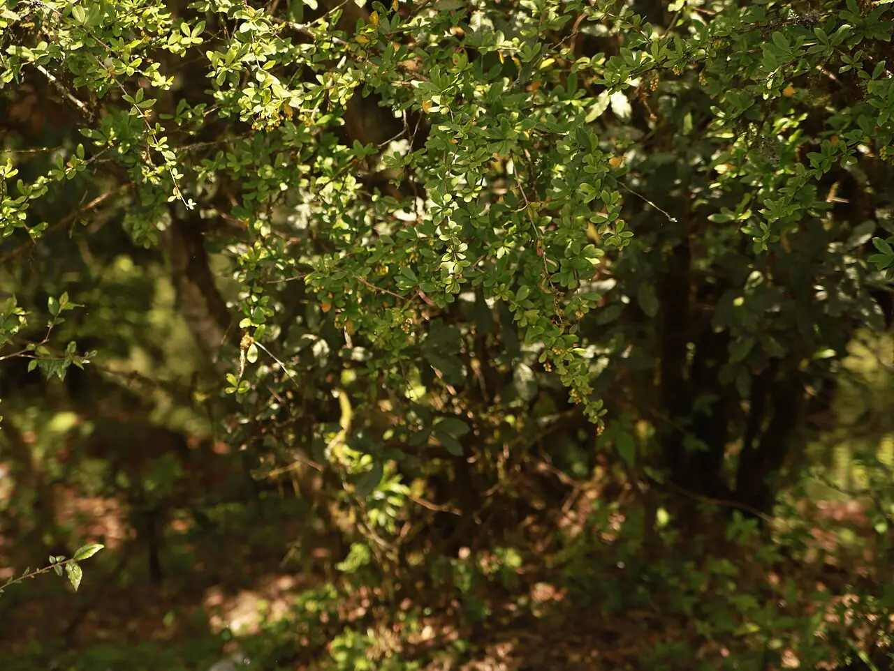

Sunlit ravine and mossy forest floor.jpg — Krishna k. sahh / [CC0](https://creativecommons.org/publicdomain/zero/1.0/deed.en) / [原典](https://commons.wikimedia.org/wiki/File:Sunlit_ravine_and_mossy_forest_floor.jpg)

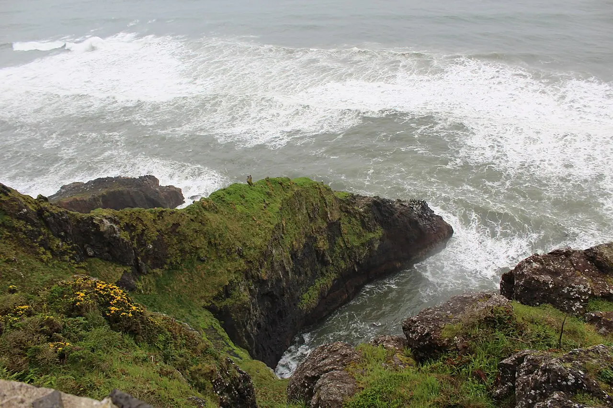

Mossy rocks and breaking surf near Heceta Head, Lane County, Oregon.jpg — Z3lvs / [CC0](https://creativecommons.org/publicdomain/zero/1.0/deed.en) / [原典](https://commons.wikimedia.org/wiki/File:Mossy_rocks_and_breaking_surf_near_Heceta_Head%2C_Lane_County%2C_Oregon.jpg)

## 土道と砂利 — earth-paths

制作で見るところ：踏み固め、轍、水はけ、端の草

関連コード：`app/src/world/landscape.js`、`app/src/world/road.js`

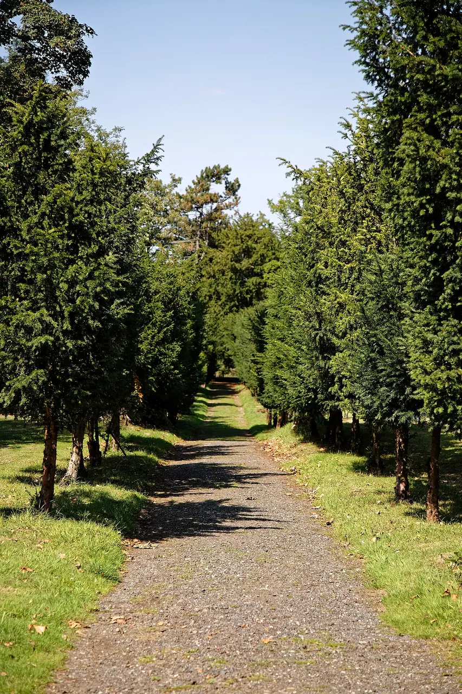

Avenue path Copped Hall Garden, Epping, Essex, England 1.jpg — Acabashi / [CC BY-SA 4.0](https://creativecommons.org/licenses/by-sa/4.0) / [原典](https://commons.wikimedia.org/wiki/File:Avenue_path_Copped_Hall_Garden%2C_Epping%2C_Essex%2C_England_1.jpg)

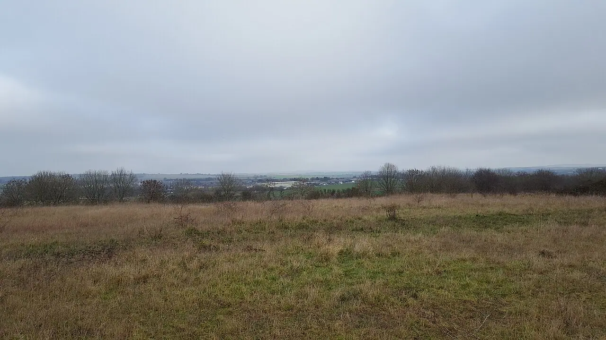

Castle Hill Country Park, Salisbury.jpg — Richard Avery / [CC BY-SA 4.0](https://creativecommons.org/licenses/by-sa/4.0) / [原典](https://commons.wikimedia.org/wiki/File:Castle_Hill_Country_Park%2C_Salisbury.jpg)

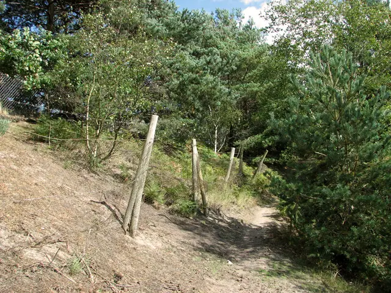

Path past the gravel works, Bawsey Country Park - geograph.org.uk - 2588014.jpg — Evelyn Simak / [CC BY-SA 2.0](https://creativecommons.org/licenses/by-sa/2.0) / [原典](https://commons.wikimedia.org/wiki/File:Path_past_the_gravel_works%2C_Bawsey_Country_Park_-_geograph.org.uk_-_2588014.jpg)

