# town — reference photos

[← Gallery index](./README.md) | [Credits](../catalog/CREDITS.md)

## 集落の細道 — village-lanes

制作で見るところ：街路幅、敷地境界、家と自然の混在

関連コード：`app/src/world/town.js`、`app/src/world/road.js`

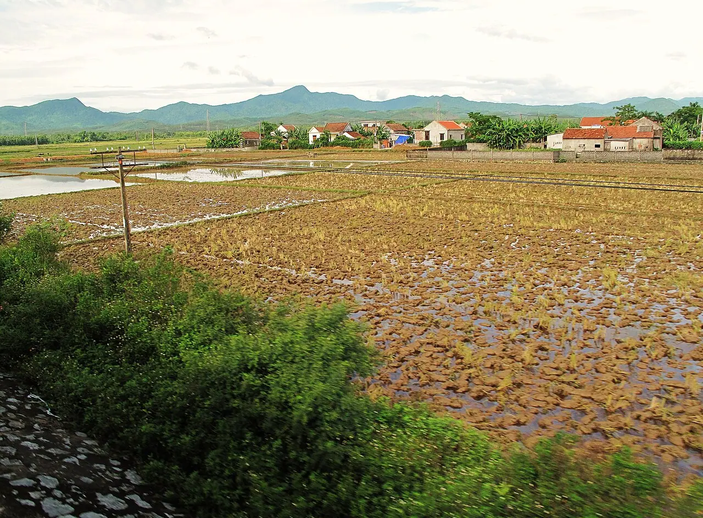

Rural village (7350513976).jpg — Francisco Anzola / [CC BY 2.0](https://creativecommons.org/licenses/by/2.0) / [原典](https://commons.wikimedia.org/wiki/File:Rural_village_%287350513976%29.jpg)

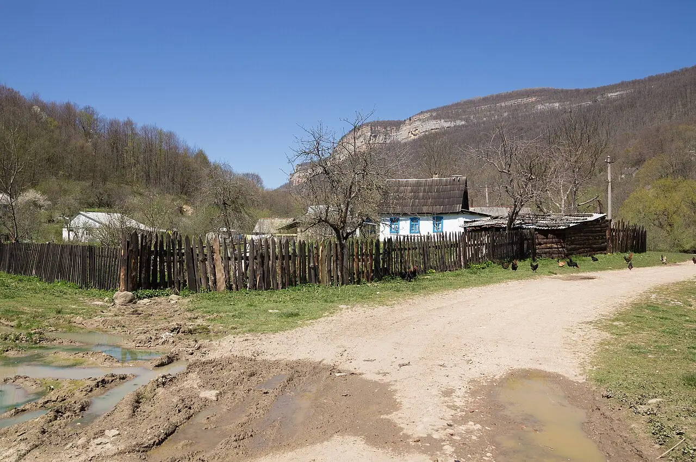

Mezmay, Village, Rural houses, Russia.jpg — Vyacheslav Argenberg / [CC BY 4.0](https://creativecommons.org/licenses/by/4.0) / [原典](https://commons.wikimedia.org/wiki/File:Mezmay%2C_Village%2C_Rural_houses%2C_Russia.jpg)

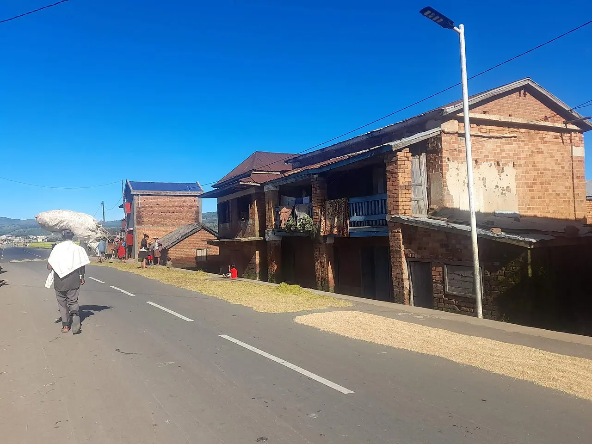

Village rural à Vakinankaratra Antsirabe.jpg — Anai171 / [CC BY-SA 4.0](https://creativecommons.org/licenses/by-sa/4.0) / [原典](https://commons.wikimedia.org/wiki/File:Village_rural_%C3%A0_Vakinankaratra_Antsirabe.jpg)

## 小さな家 — small-cottages

制作で見るところ：開口部比率・屋根勾配・庭とのつながり

関連コード：`app/src/world/cottage.js`、`app/src/world/house.js`

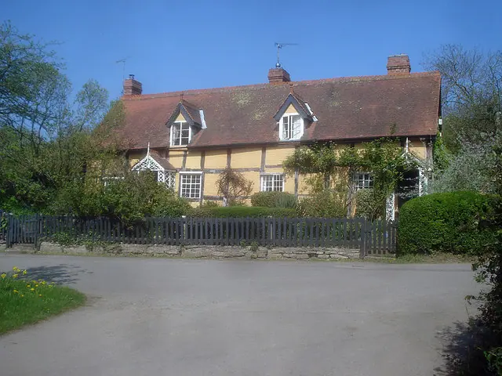

Timber framed cottage at Moreton - geograph.org.uk - 1277452.jpg — Trevor Rickard / [CC BY-SA 2.0](https://creativecommons.org/licenses/by-sa/2.0) / [原典](https://commons.wikimedia.org/wiki/File:Timber_framed_cottage_at_Moreton_-_geograph.org.uk_-_1277452.jpg)

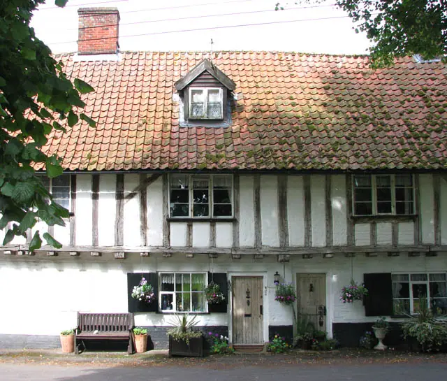

Timber-framed cottages - geograph.org.uk - 1408825.jpg — Evelyn Simak / [CC BY-SA 2.0](https://creativecommons.org/licenses/by-sa/2.0) / [原典](https://commons.wikimedia.org/wiki/File:Timber-framed_cottages_-_geograph.org.uk_-_1408825.jpg)

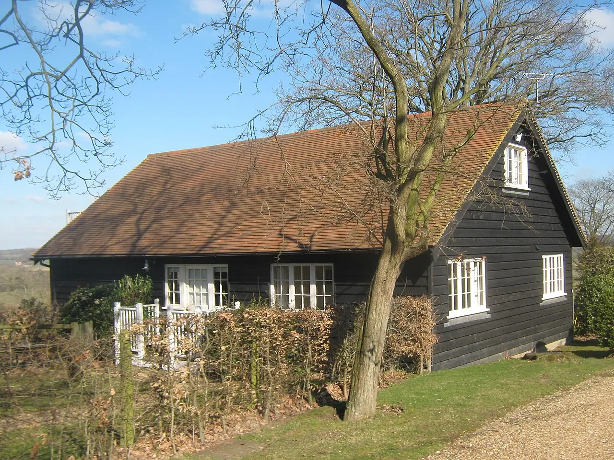

Timber cottage near Kingsgate Farm - geograph.org.uk - 1742981.jpg — David Anstiss / [CC BY-SA 2.0](https://creativecommons.org/licenses/by-sa/2.0) / [原典](https://commons.wikimedia.org/wiki/File:Timber_cottage_near_Kingsgate_Farm_-_geograph.org.uk_-_1742981.jpg)

## 木骨と漆喰の外壁 — timber-facades

制作で見るところ：柱・梁・窓の配置、素材の境界

関連コード：`app/src/world/house.js`、`app/src/world/town.js`

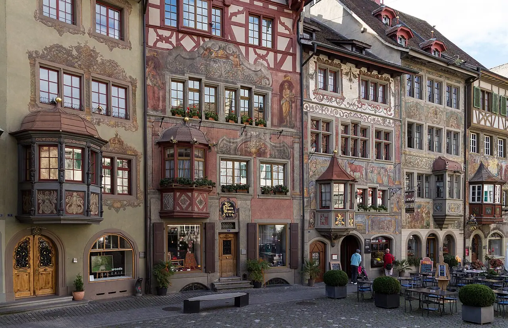

Rathausplatz 5, 7, 9, 11 und 13 in Stein am Rhein.jpg — JoachimKohler-HB / [CC BY-SA 4.0](https://creativecommons.org/licenses/by-sa/4.0) / [原典](https://commons.wikimedia.org/wiki/File:Rathausplatz_5%2C_7%2C_9%2C_11_und_13_in_Stein_am_Rhein.jpg)

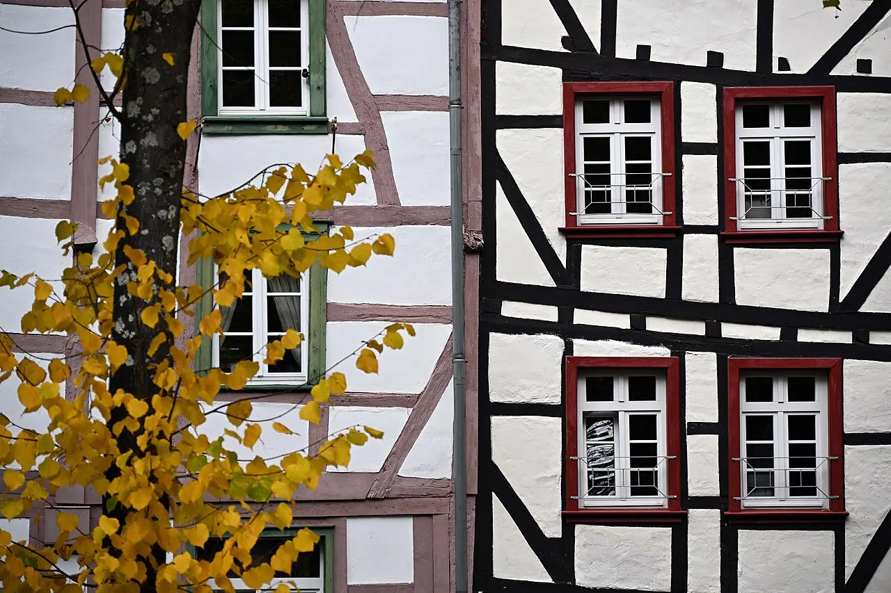

Half-timbered façades along the Rur in autumn, Monschau, 2025.jpg — DimiTalen / [CC0](https://creativecommons.org/publicdomain/zero/1.0/deed.en) / [原典](https://commons.wikimedia.org/wiki/File:Half-timbered_fa%C3%A7ades_along_the_Rur_in_autumn%2C_Monschau%2C_2025.jpg)

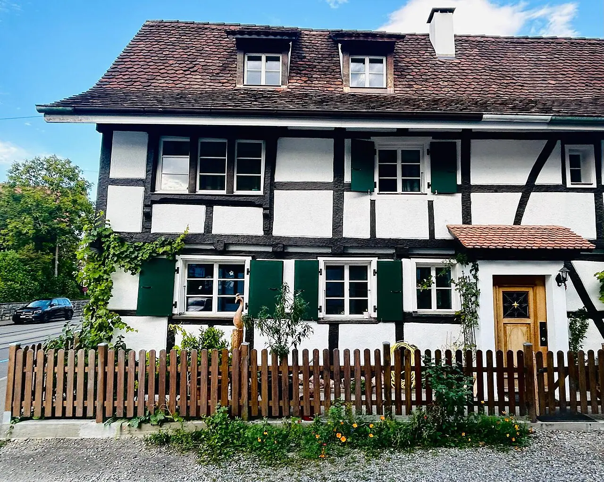

Historic-half-timbered-house-allschwil-basel-landschaft-switzerland-1680-1700.jpg — Stucki66 / [CC0](https://creativecommons.org/publicdomain/zero/1.0/deed.en) / [原典](https://commons.wikimedia.org/wiki/File:Historic-half-timbered-house-allschwil-basel-landschaft-switzerland-1680-1700.jpg)

## 商店の店先 — shopfronts

制作で見るところ：商品・日除け・看板・開口部の奥行き

関連コード：`app/src/world/town.js`

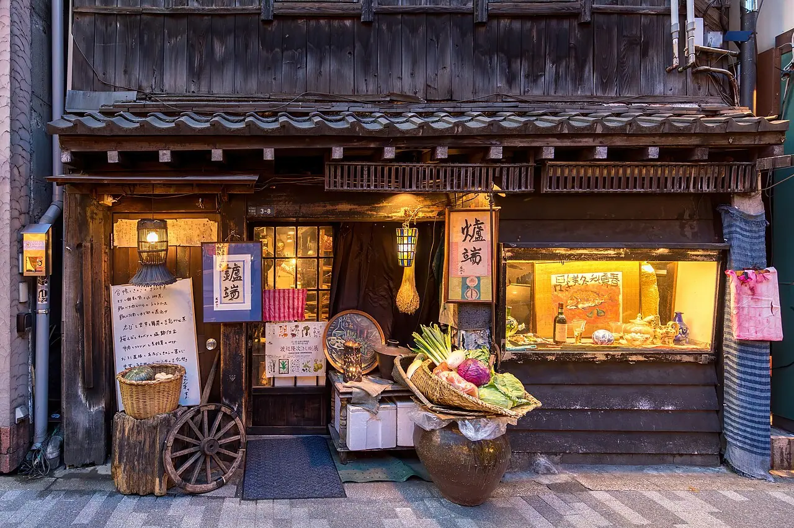

Illuminated facade of a restaurant serving traditional food with fresh vegetables in Chiyoda, Tokyo.jpg — Basile Morin / [CC BY-SA 4.0](https://creativecommons.org/licenses/by-sa/4.0) / [原典](https://commons.wikimedia.org/wiki/File:Illuminated_facade_of_a_restaurant_serving_traditional_food_with_fresh_vegetables_in_Chiyoda%2C_Tokyo.jpg)

## 花屋の店先 — flower-shops

制作で見るところ：鉢植え、花桶、歩道へのにじみ出し

関連コード：`app/src/world/town.js`

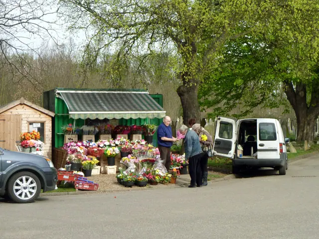

Cemetery flower seller - geograph.org.uk - 3240417.jpg — Robin Webster / [CC BY-SA 2.0](https://creativecommons.org/licenses/by-sa/2.0) / [原典](https://commons.wikimedia.org/wiki/File:Cemetery_flower_seller_-_geograph.org.uk_-_3240417.jpg)

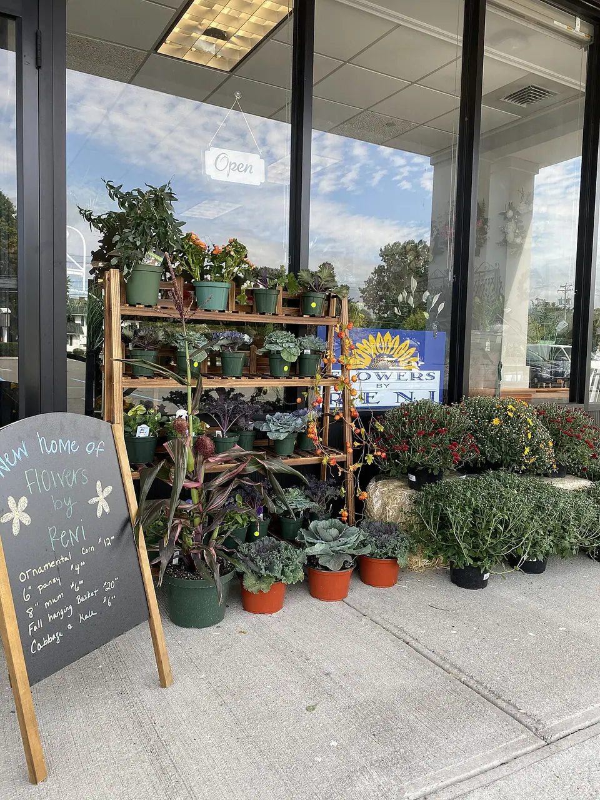

Flowers by Reni, currently Lovingly Flowers by Reni in Fishkill.jpg — Noel Brown Jr / [CC BY-SA 4.0](https://creativecommons.org/licenses/by-sa/4.0) / [原典](https://commons.wikimedia.org/wiki/File:Flowers_by_Reni%2C_currently_Lovingly_Flowers_by_Reni_in_Fishkill.jpg)

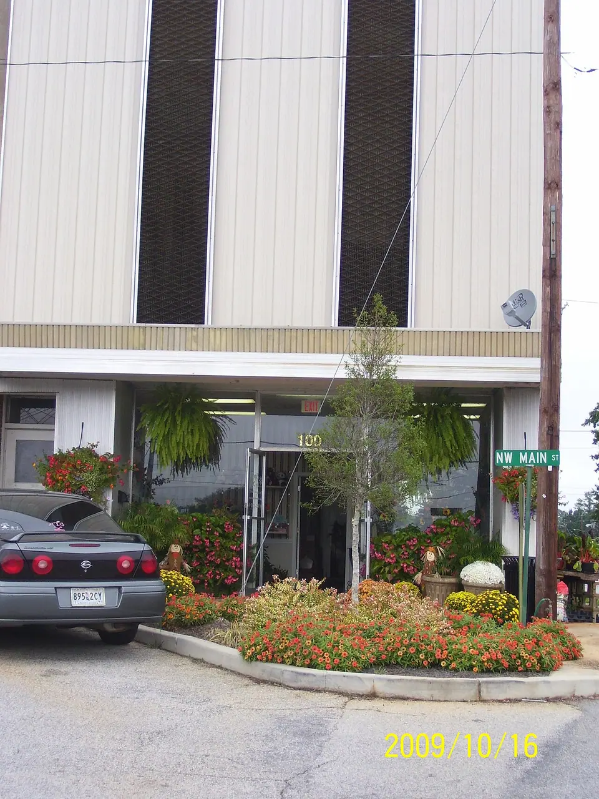

Flowers By D&L exterior.jpg — Donna Wells / [CC BY 4.0](https://creativecommons.org/licenses/by/4.0) / [原典](https://commons.wikimedia.org/wiki/File:Flowers_By_D%26L_exterior.jpg)

## 喫茶店とパン屋 — cafes-and-bakeries

制作で見るところ：日除け、ガラス窓、テラスと暖かな光

関連コード：`app/src/world/town.js`

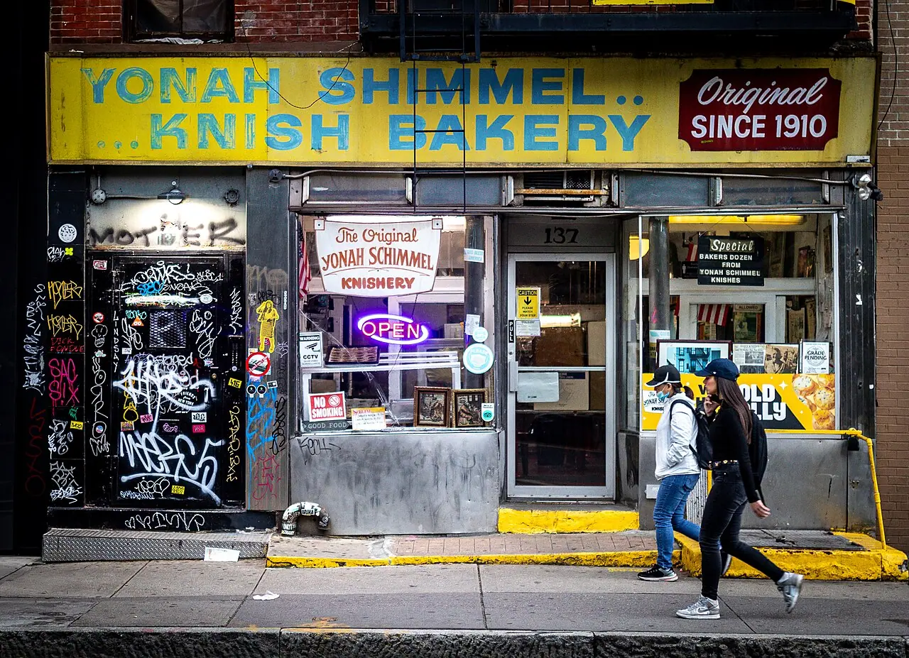

Yonah Schimmel's Knish Bakery Storefront.jpg — Tessa Bury / [CC BY-SA 4.0](https://creativecommons.org/licenses/by-sa/4.0) / [原典](https://commons.wikimedia.org/wiki/File:Yonah_Schimmel%27s_Knish_Bakery_Storefront.jpg)

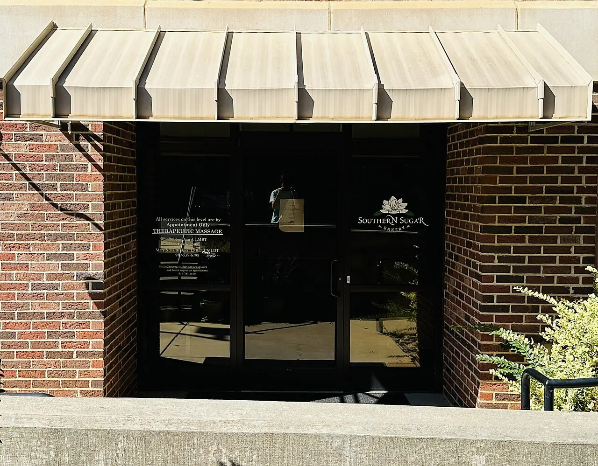

Southern Sugar Bakery storefront.jpg — Johnson524 / [CC0](https://creativecommons.org/publicdomain/zero/1.0/deed.en) / [原典](https://commons.wikimedia.org/wiki/File:Southern_Sugar_Bakery_storefront.jpg)

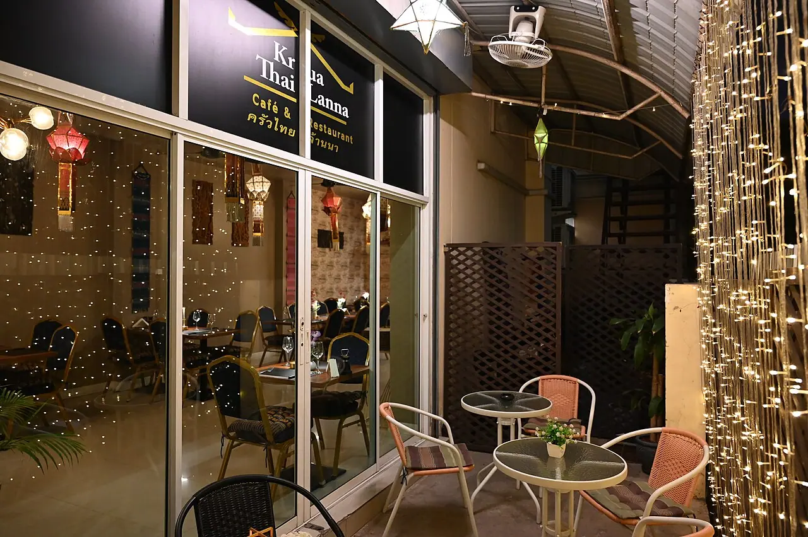

DZ6 2638 Cozy outdoor seating at a softly lit café twinkling lights and intimate tables inviting a relaxed evening.jpg — PattayaPatrol / [CC BY-SA 4.0](https://creativecommons.org/licenses/by-sa/4.0) / [原典](https://commons.wikimedia.org/wiki/File:DZ6_2638_Cozy_outdoor_seating_at_a_softly_lit_caf%C3%A9_twinkling_lights_and_intimate_tables_inviting_a_relaxed_evening.jpg)

## 町の広場 — town-plazas

制作で見るところ：噴水・樹木・ベンチと人の動線

関連コード：`app/src/world/town.js`

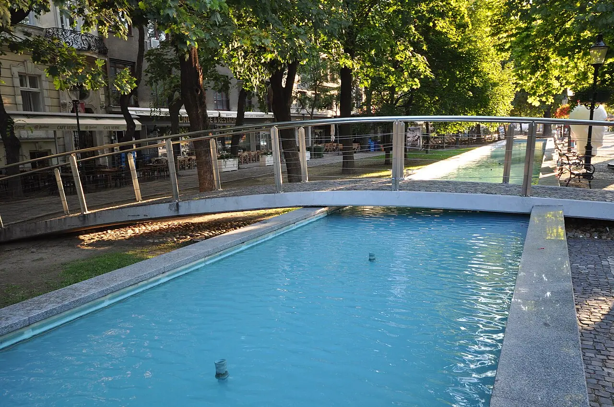

Hviezdoslavovo námestie fountain leading to the Old Slovak National Theater (10267371415).jpg — Jorge Láscar from Australia / [CC BY 2.0](https://creativecommons.org/licenses/by/2.0) / [原典](https://commons.wikimedia.org/wiki/File:Hviezdoslavovo_n%C3%A1mestie_fountain_leading_to_the_Old_Slovak_National_Theater_%2810267371415%29.jpg)

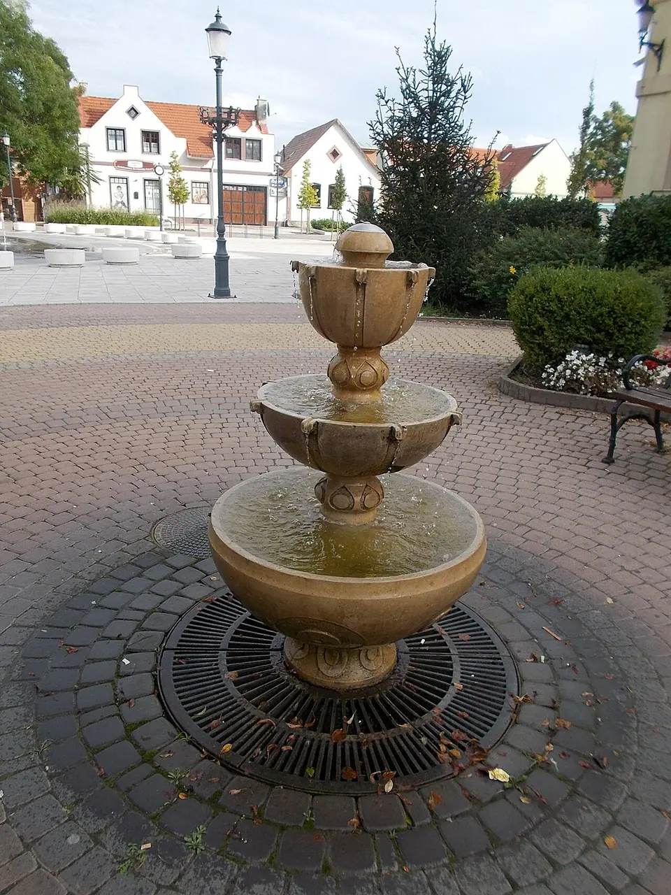

Small fountain at the Town Hall, 2016 Dunakeszi.jpg — Globetrotter19 / [CC BY-SA 3.0](https://creativecommons.org/licenses/by-sa/3.0) / [原典](https://commons.wikimedia.org/wiki/File:Small_fountain_at_the_Town_Hall%2C_2016_Dunakeszi.jpg)

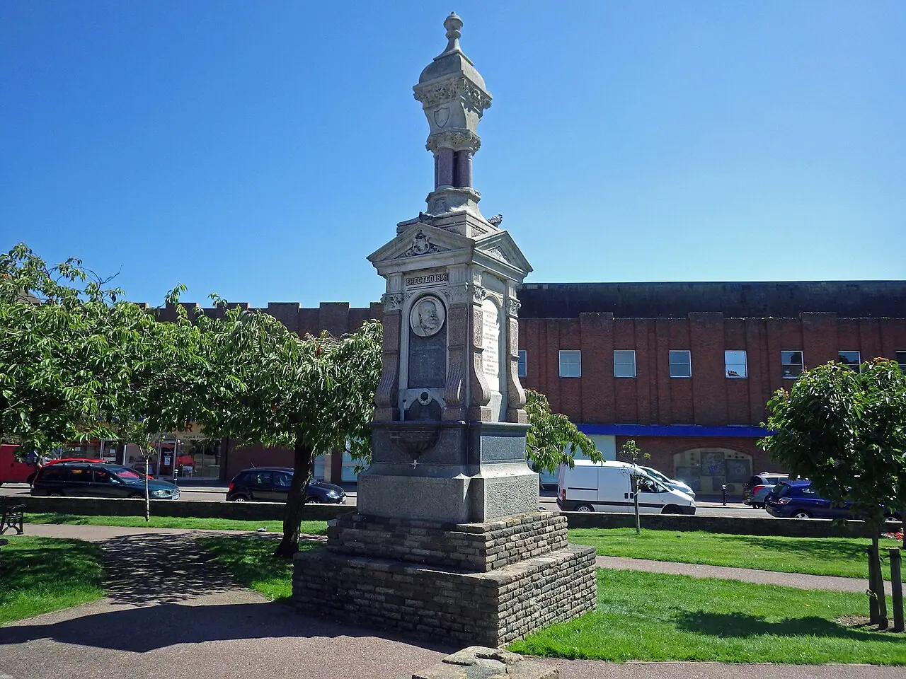

The Lane Memorial Fountain, Town Hall Square, Bexhill.jpg — Alexis Markwick / [CC0](https://creativecommons.org/publicdomain/zero/1.0/deed.en) / [原典](https://commons.wikimedia.org/wiki/File:The_Lane_Memorial_Fountain%2C_Town_Hall_Square%2C_Bexhill.jpg)

## 市と屋台 — market-stalls

制作で見るところ：屋根布の張り方、棚と通路、生活感

関連コード：`app/src/world/town.js`

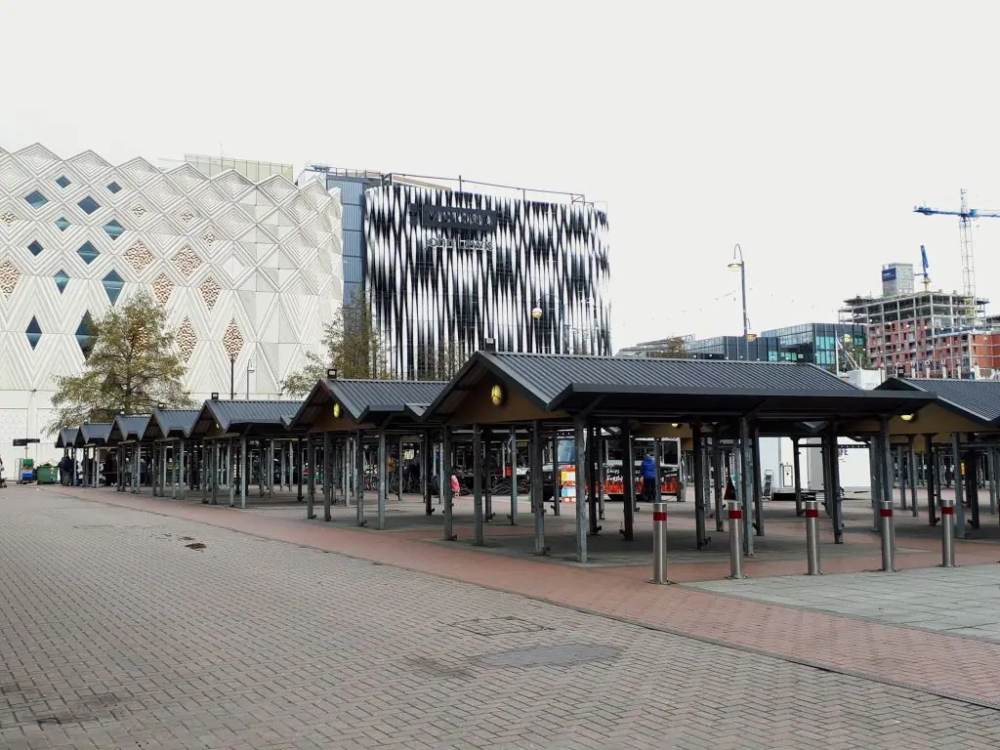

Kirkgate Market, Leeds - outdoor stalls (geograph 6777304).jpg — Stephen Craven / [CC BY-SA 2.0](https://creativecommons.org/licenses/by-sa/2.0) / [原典](https://commons.wikimedia.org/wiki/File:Kirkgate_Market%2C_Leeds_-_outdoor_stalls_%28geograph_6777304%29.jpg)

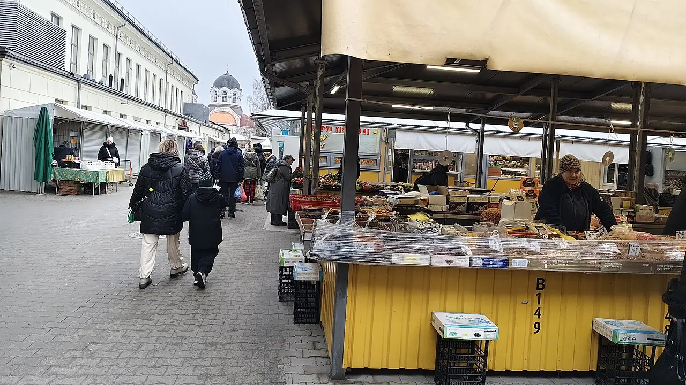

Outdoor Stalls Vilnius Market B.jpg — Mojmir Churavy / [CC0](https://creativecommons.org/publicdomain/zero/1.0/deed.en) / [原典](https://commons.wikimedia.org/wiki/File:Outdoor_Stalls_Vilnius_Market_B.jpg)

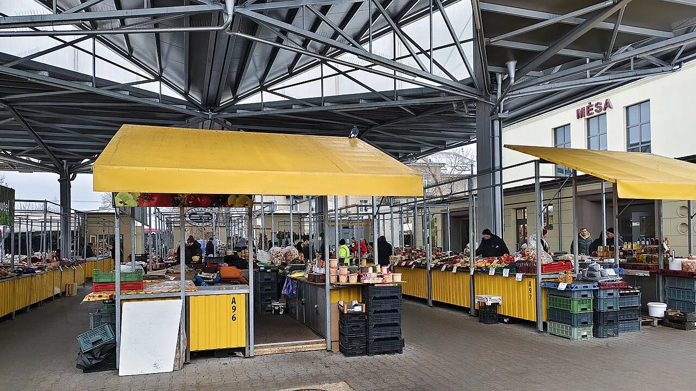

Outdoor Stalls Vilnius Market A.jpg — Mojmir Churavy / [CC0](https://creativecommons.org/publicdomain/zero/1.0/deed.en) / [原典](https://commons.wikimedia.org/wiki/File:Outdoor_Stalls_Vilnius_Market_A.jpg)

## バス停と待合所 — bus-stops

制作で見るところ：屋根・ベンチ・標識と道路の位置関係

関連コード：`app/src/world/bus-stop.js`、`app/src/world/road.js`

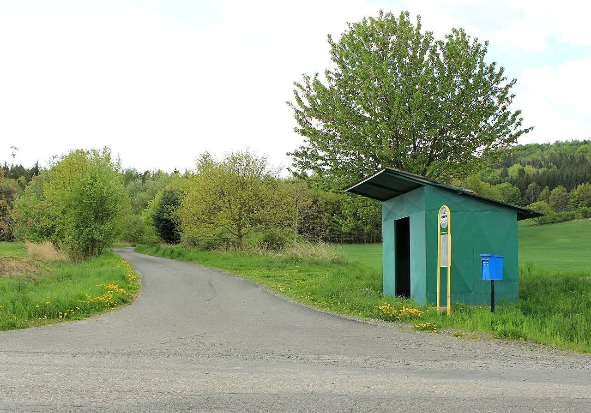

Sedlec-Prčice, road to Záhoří.jpg — This file is available under Creative Commons BY-SA license. Basically: You can use this picture for any purpose, provided that you attribute it to Pavel Hrdlička, Wikipedia. You may distribute the resulting work under the same license. / [CC BY-SA 3.0](https://creativecommons.org/licenses/by-sa/3.0) / [原典](https://commons.wikimedia.org/wiki/File:Sedlec-Pr%C4%8Dice%2C_road_to_Z%C3%A1ho%C5%99%C3%AD.jpg)

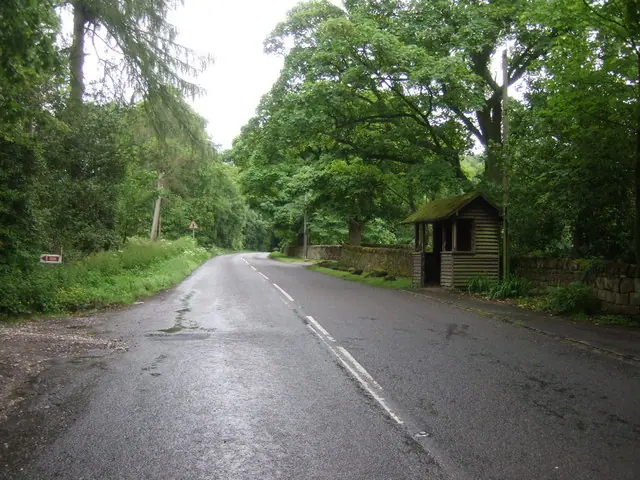

Rural bus stop and shelter - geograph.org.uk - 4533627.jpg — JThomas / [CC BY-SA 2.0](https://creativecommons.org/licenses/by-sa/2.0) / [原典](https://commons.wikimedia.org/wiki/File:Rural_bus_stop_and_shelter_-_geograph.org.uk_-_4533627.jpg)

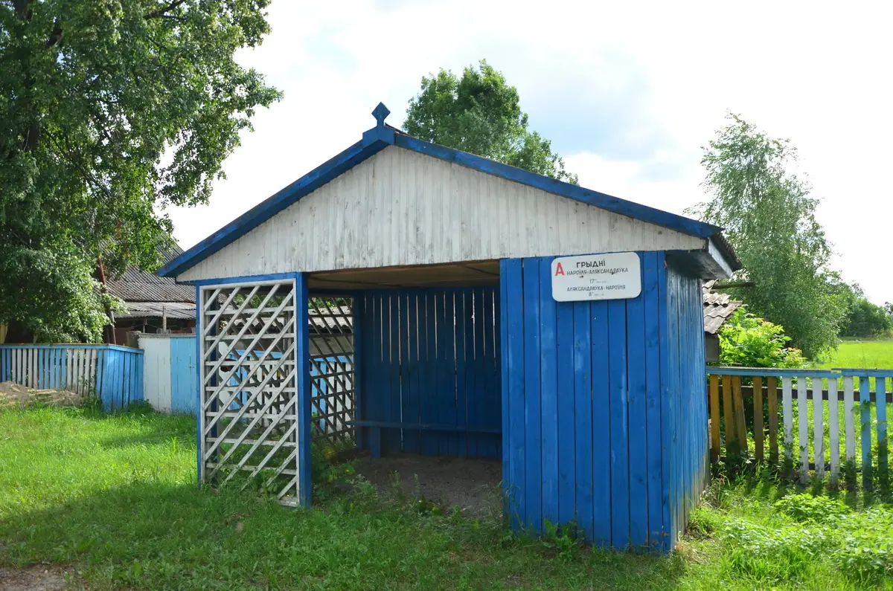

Belarus, Homjel, Narovlja - Hrydni WMID4178728.jpg — nebo / [CC BY-SA 3.0](https://creativecommons.org/licenses/by-sa/3.0) / [原典](https://commons.wikimedia.org/wiki/File:Belarus%2C_Homjel%2C_Narovlja_-_Hrydni_WMID4178728.jpg)

## 田舎のバス — country-buses

制作で見るところ：車体比率、窓の連続、道との大きさ関係

関連コード：`app/src/world/vehicles.js`、`app/src/systems/bus.js`

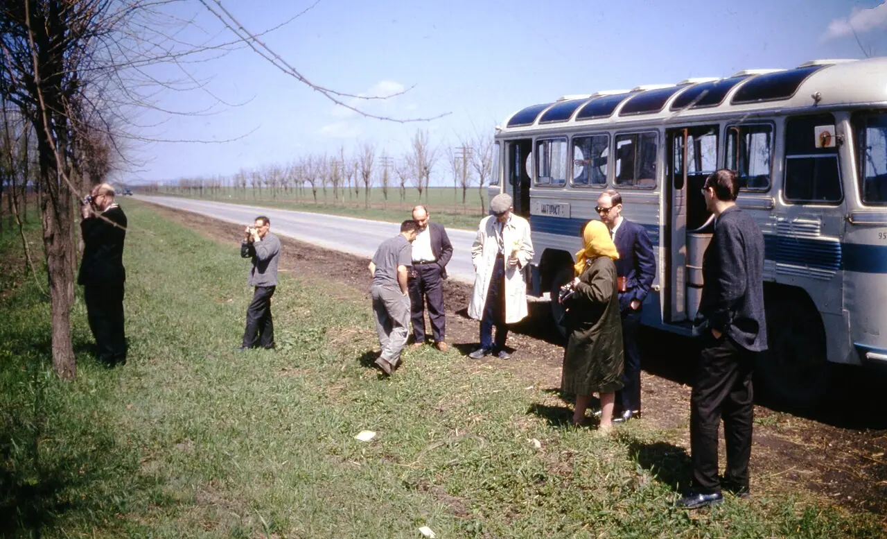

Stavropol Krai Countryside and Roadside with Bus.jpg — Thomas Taylor Hammond (1920-1993) / [CC BY-SA 4.0](https://creativecommons.org/licenses/by-sa/4.0) / [原典](https://commons.wikimedia.org/wiki/File:Stavropol_Krai_Countryside_and_Roadside_with_Bus.jpg)

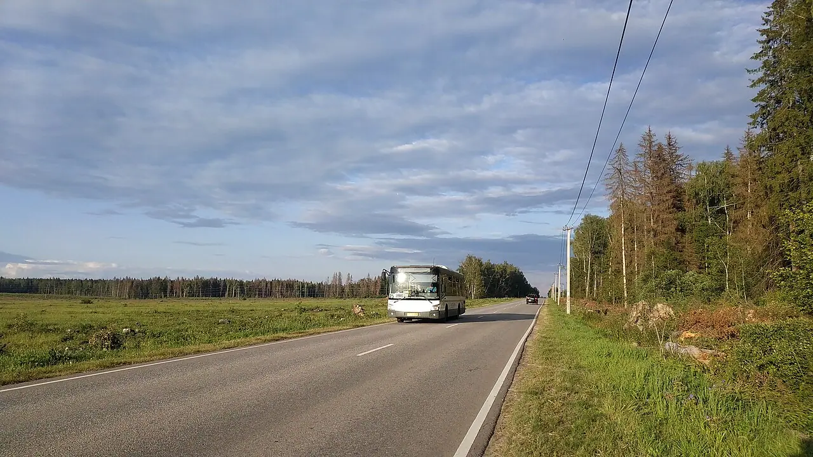

Bus Zvenigorod-Surmino 2019-07.jpg — Svetlov Artem / [CC0](https://creativecommons.org/publicdomain/zero/1.0/deed.en) / [原典](https://commons.wikimedia.org/wiki/File:Bus_Zvenigorod-Surmino_2019-07.jpg)

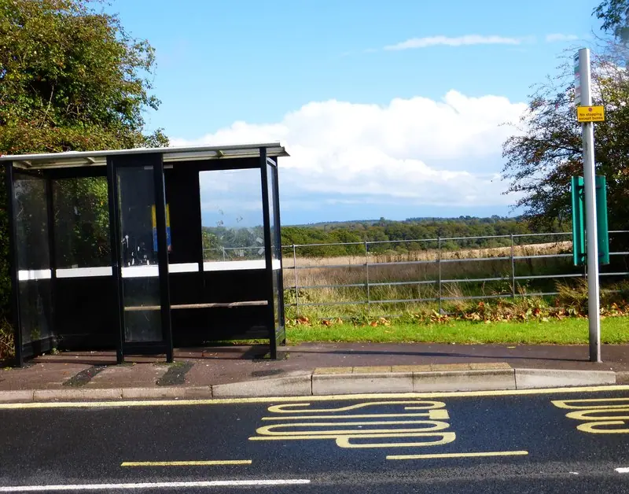

Bus stop on Swanmore Road with countryside behind - geograph.org.uk - 4202562.jpg — Shazz / [CC BY-SA 2.0](https://creativecommons.org/licenses/by-sa/2.0) / [原典](https://commons.wikimedia.org/wiki/File:Bus_stop_on_Swanmore_Road_with_countryside_behind_-_geograph.org.uk_-_4202562.jpg)

## 石橋 — stone-bridges

制作で見るところ：アーチ・欄干・橋台と川岸の接続

関連コード：`app/src/world/road.js`

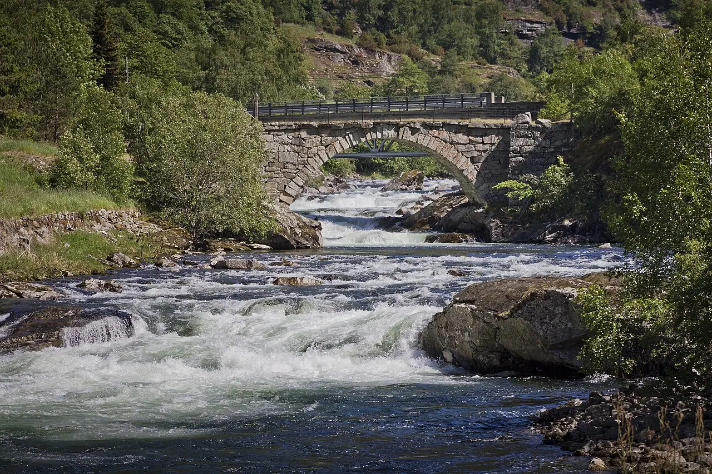

A stone arch bridge in Lærdalen, 2013 June.jpg — Ximonic (Simo Räsänen) / [CC BY-SA 3.0](https://creativecommons.org/licenses/by-sa/3.0) / [原典](https://commons.wikimedia.org/wiki/File:A_stone_arch_bridge_in_L%C3%A6rdalen%2C_2013_June.jpg)

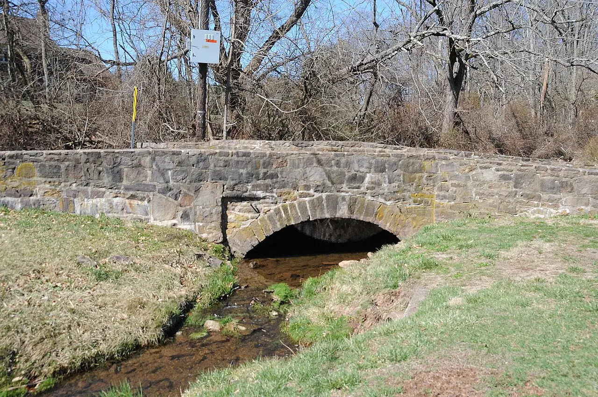

Sandbrook-Headquarters Road stone arch bridge; Hunterdon County NJ.jpg — KLOTZPLATE / [CC0](https://creativecommons.org/publicdomain/zero/1.0/deed.en) / [原典](https://commons.wikimedia.org/wiki/File:Sandbrook-Headquarters_Road_stone_arch_bridge%3B_Hunterdon_County_NJ.jpg)

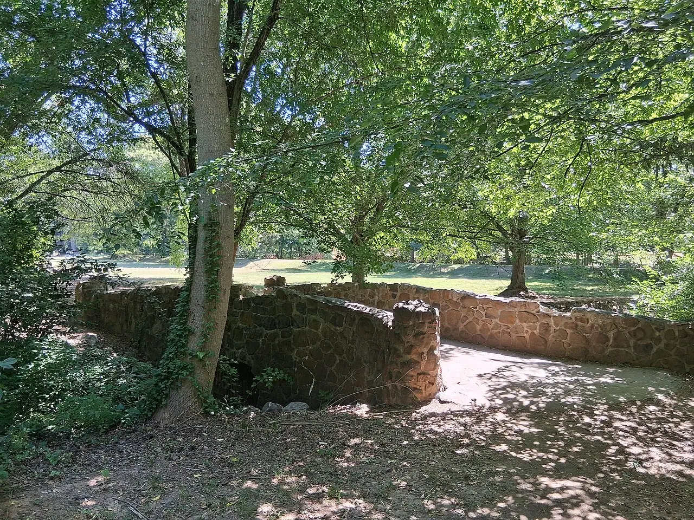

River Cobble Stone Arch Bridge, Hanes Park, 2026.jpg — RSMartinJr / [CC0](https://creativecommons.org/publicdomain/zero/1.0/deed.en) / [原典](https://commons.wikimedia.org/wiki/File:River_Cobble_Stone_Arch_Bridge%2C_Hanes_Park%2C_2026.jpg)

## 石畳の道 — cobblestone-streets

制作で見るところ：敷石の寸法、継ぎ目、色ムラ

関連コード：`app/src/world/town.js`、`app/src/world/textures.js`

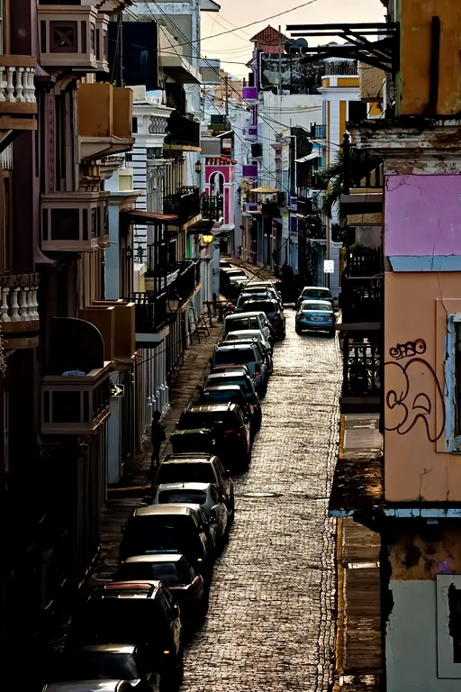

Homes, cars on cobblestone street in Old San Juan, Puerto Rico.jpg — R9 Studios FL (Thanks to all the fans!!!) / [CC BY 2.0](https://creativecommons.org/licenses/by/2.0) / [原典](https://commons.wikimedia.org/wiki/File:Homes%2C_cars_on_cobblestone_street_in_Old_San_Juan%2C_Puerto_Rico.jpg)

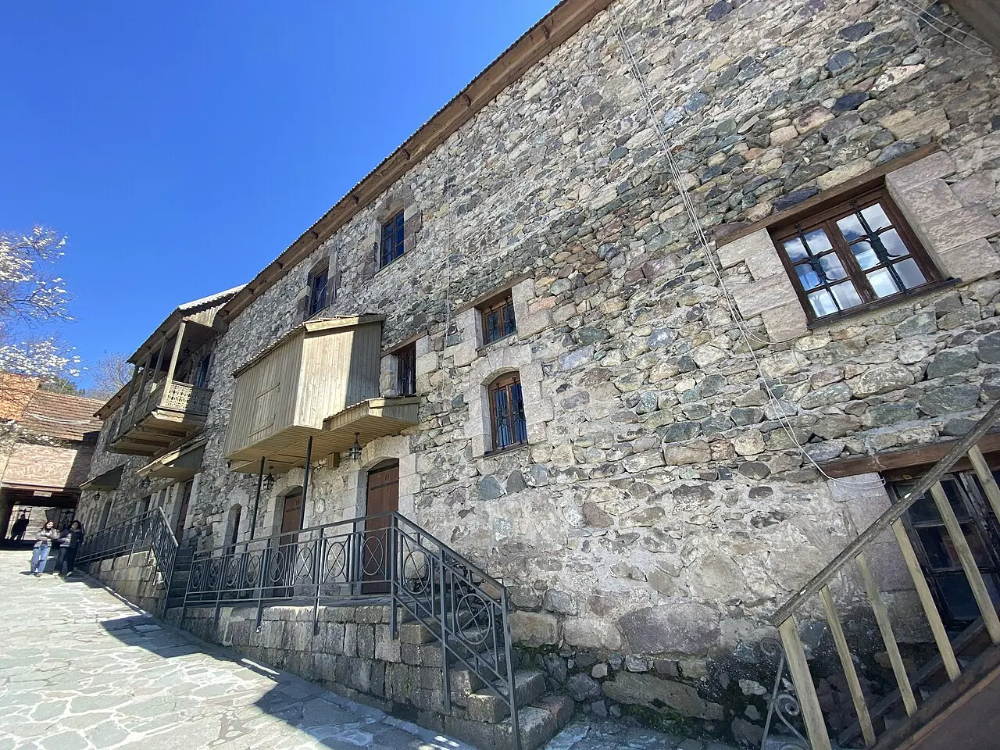

Old Dilijan, Sharambeyan Street, April 2026.jpg — Textfabrikant / [CC0](https://creativecommons.org/publicdomain/zero/1.0/deed.en) / [原典](https://commons.wikimedia.org/wiki/File:Old_Dilijan%2C_Sharambeyan_Street%2C_April_2026.jpg)

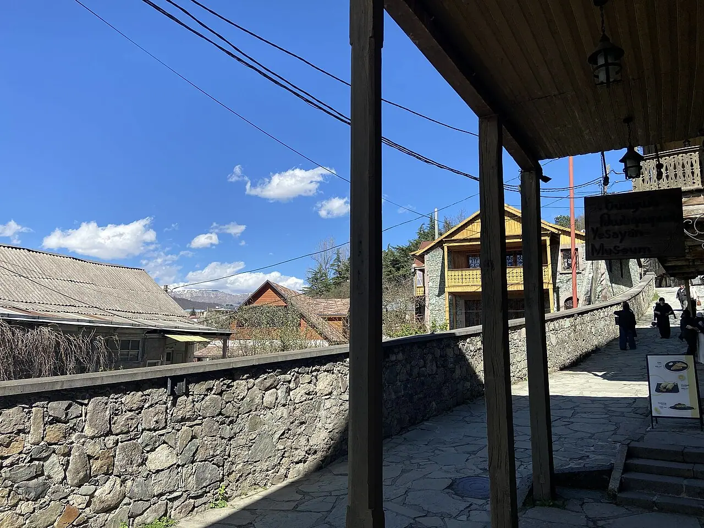

Old Dilijan, Sharambeyan Street, view into the street, April 2026.jpg — Textfabrikant / [CC0](https://creativecommons.org/publicdomain/zero/1.0/deed.en) / [原典](https://commons.wikimedia.org/wiki/File:Old_Dilijan%2C_Sharambeyan_Street%2C_view_into_the_street%2C_April_2026.jpg)

## 街灯と行灯 — street-lights

制作で見るところ：柱・灯具の比率、地面の明かり

関連コード：`app/src/world/town.js`

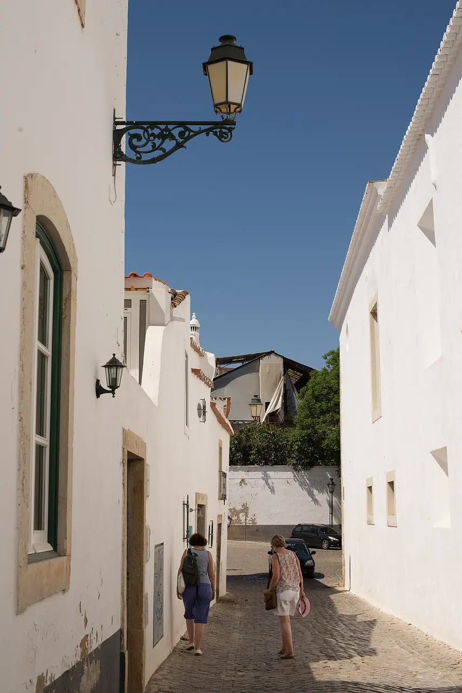

Side street in Faro, with old street lamp (28509279443).jpg — Winniepix from UK / [CC BY 2.0](https://creativecommons.org/licenses/by/2.0) / [原典](https://commons.wikimedia.org/wiki/File:Side_street_in_Faro%2C_with_old_street_lamp_%2828509279443%29.jpg)

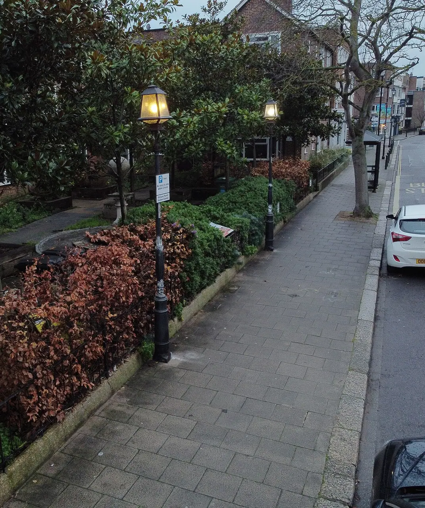

Former Gas Lamp Stands, Old Portsmouth.jpg — Tim Sheerman-Chase / [CC BY 2.0](https://creativecommons.org/licenses/by/2.0) / [原典](https://commons.wikimedia.org/wiki/File:Former_Gas_Lamp_Stands%2C_Old_Portsmouth.jpg)

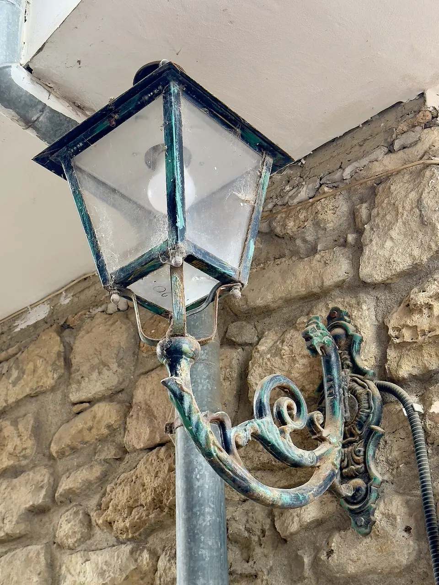

An old street lamp in Nesebar.jpg — Oleg Yunakov / [CC BY-SA 4.0](https://creativecommons.org/licenses/by-sa/4.0) / [原典](https://commons.wikimedia.org/wiki/File:An_old_street_lamp_in_Nesebar.jpg)

## 公園のベンチ — park-benches

制作で見るところ：木陰と休憩場所、低い柵・小径

関連コード：`app/src/world/park.js`、`app/src/world/town.js`

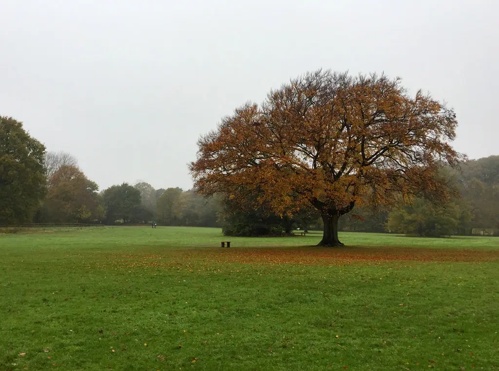

Bench and tree, Nonsuch Park - geograph.org.uk - 5605767.jpg — John Allan / [CC BY-SA 2.0](https://creativecommons.org/licenses/by-sa/2.0) / [原典](https://commons.wikimedia.org/wiki/File:Bench_and_tree%2C_Nonsuch_Park_-_geograph.org.uk_-_5605767.jpg)

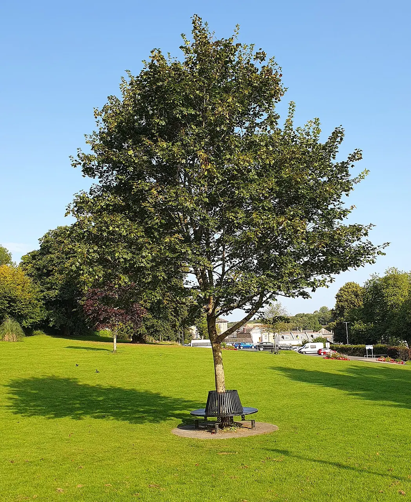

Tree and bench, Priory Park, Bodmin, Cornwall - August 2024.jpg — Mutney / [CC BY 4.0](https://creativecommons.org/licenses/by/4.0) / [原典](https://commons.wikimedia.org/wiki/File:Tree_and_bench%2C_Priory_Park%2C_Bodmin%2C_Cornwall_-_August_2024.jpg)

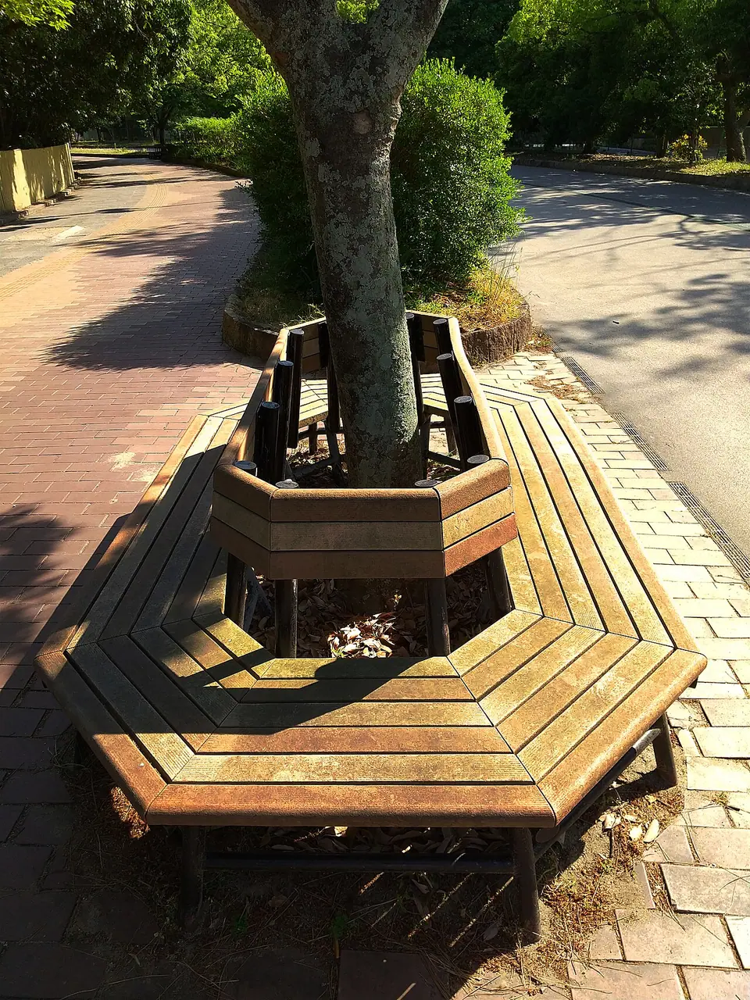

Ōhori Park The octagonal tree bench Ōhorikōen Chūō-ku Fukuoka 20260518 154120.jpg — Hirho / [CC BY 4.0](https://creativecommons.org/licenses/by/4.0) / [原典](https://commons.wikimedia.org/wiki/File:%C5%8Chori_Park_The_octagonal_tree_bench_%C5%8Chorik%C5%8Den_Ch%C5%AB%C5%8D-ku_Fukuoka_20260518_154120.jpg)

## 石積みと塀 — stone-walls

制作で見るところ：積み目・隙間の植生・高さの変化

関連コード：`app/src/world/road.js`、`app/src/world/town.js`

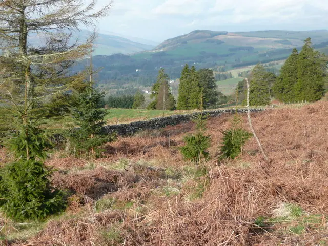

Boundary dry stone wall to Ballechin Wood - geograph.org.uk - 786368.jpg — Russel Wills / [CC BY-SA 2.0](https://creativecommons.org/licenses/by-sa/2.0) / [原典](https://commons.wikimedia.org/wiki/File:Boundary_dry_stone_wall_to_Ballechin_Wood_-_geograph.org.uk_-_786368.jpg)

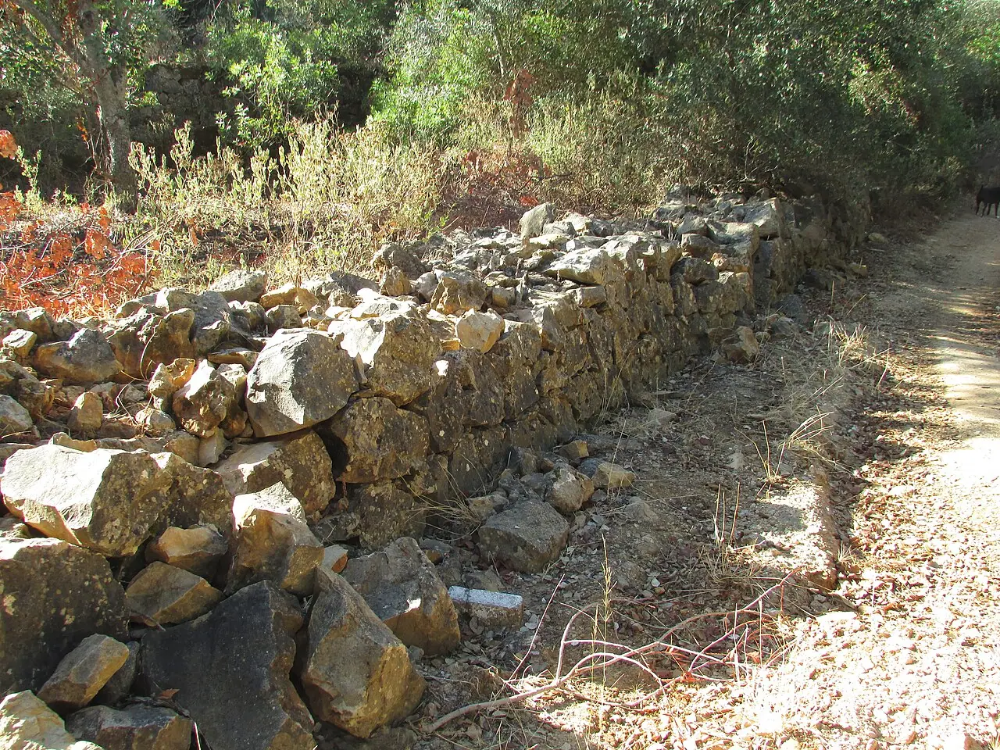

Countryside lane and dry stone wall in Mosqueira, 15 October 2016.JPG — Kolforn (Kolforn) I'd appreciate if you could mail me (Kolforn@gmail.com) if you want to use this picture out of the Wikimedia project scope. This file is licensed under the Creative Commons Attribution-Share Alike 4.0 International license. You are / [CC BY 3.0](https://creativecommons.org/licenses/by/3.0) / [原典](https://commons.wikimedia.org/wiki/File:Countryside_lane_and_dry_stone_wall_in_Mosqueira%2C_15_October_2016.JPG)

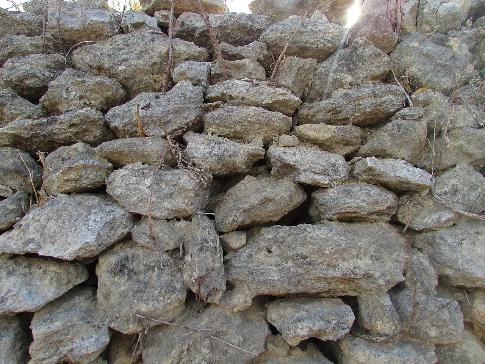

14-09-2017 Dry stone wall in Caliços, Albufeira.JPG — Kolforn (Kolforn) I'd appreciate if you could mail me (Kolforn@gmail.com) if you want to use this picture out of the Wikimedia project scope. This file is licensed under the Creative Commons Attribution-Share Alike 4.0 International license. You are / [CC BY-SA 4.0](https://creativecommons.org/licenses/by-sa/4.0) / [原典](https://commons.wikimedia.org/wiki/File:14-09-2017_Dry_stone_wall_in_Cali%C3%A7os%2C_Albufeira.JPG)

## 窓と扉 — windows-and-doors

制作で見るところ：枠の厚み、雨戸、庇、階段との取り合い

関連コード：`app/src/world/house.js`、`app/src/world/town.js`

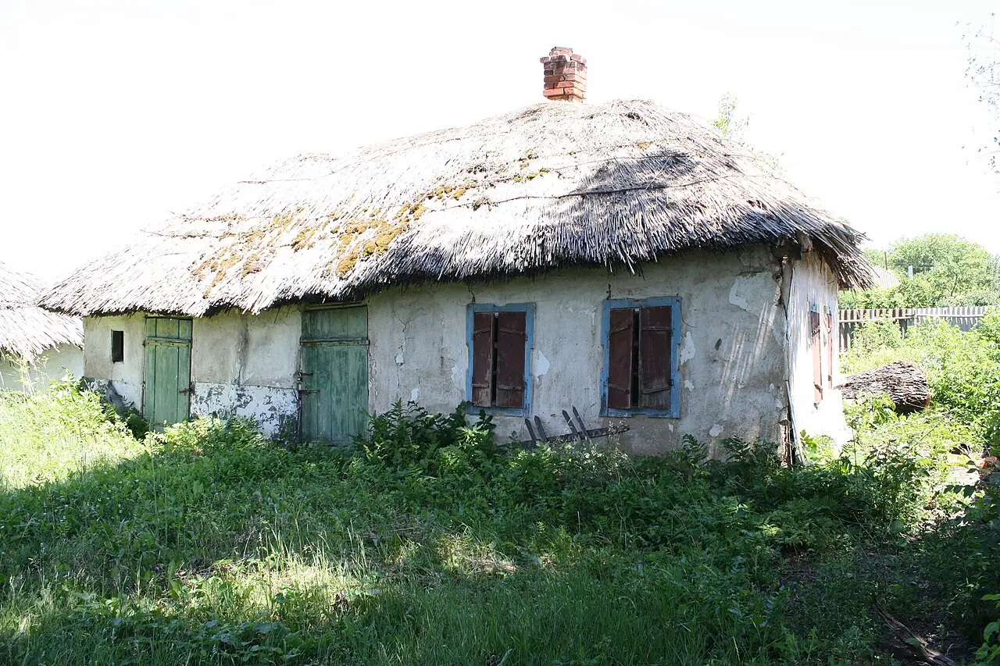

Kruhliakivka Khata.jpg — tarosys / [CC BY 3.0](https://creativecommons.org/licenses/by/3.0) / [原典](https://commons.wikimedia.org/wiki/File:Kruhliakivka_Khata.jpg)

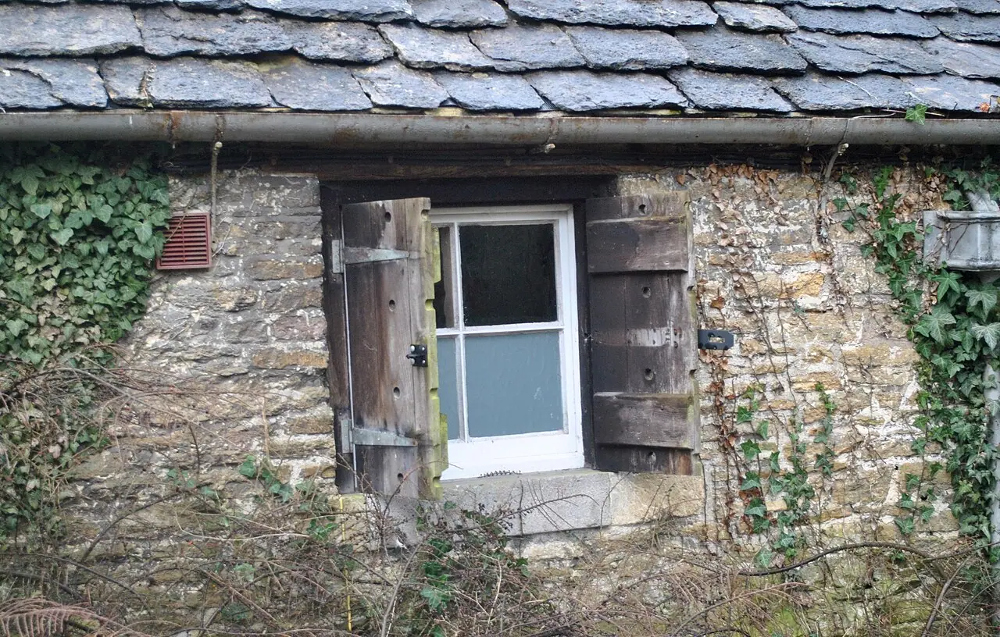

Wooden Window Shutters on Old Cottage, Easton Grey, Wiltshire 2015 (geograph 5817868).jpg — Ray Bird / [CC BY-SA 2.0](https://creativecommons.org/licenses/by-sa/2.0) / [原典](https://commons.wikimedia.org/wiki/File:Wooden_Window_Shutters_on_Old_Cottage%2C_Easton_Grey%2C_Wiltshire_2015_%28geograph_5817868%29.jpg)

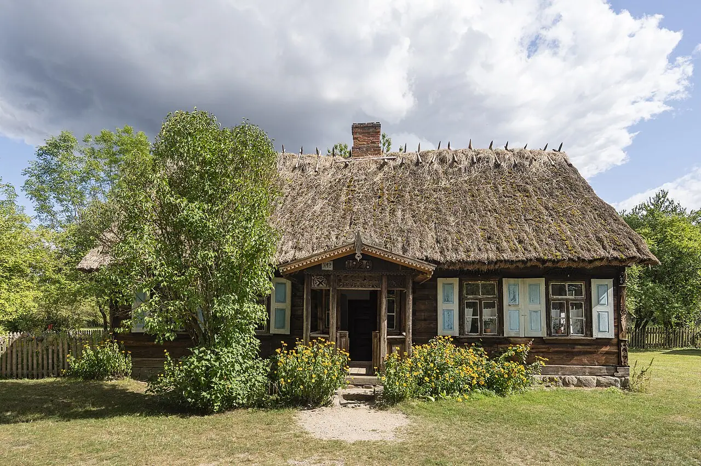

Chałupa z datą 1926 w Podlaskim Muzeum Kultury Ludowej.jpg — Krzysztof Popławski / [CC BY 4.0](https://creativecommons.org/licenses/by/4.0) / [原典](https://commons.wikimedia.org/wiki/File:Cha%C5%82upa_z_dat%C4%85_1926_w_Podlaskim_Muzeum_Kultury_Ludowej.jpg)

## 屋根と軒先 — roofs-and-eaves

制作で見るところ：勾配・軒の出・瓦や板の重なり

関連コード：`app/src/world/house.js`、`app/src/world/town.js`

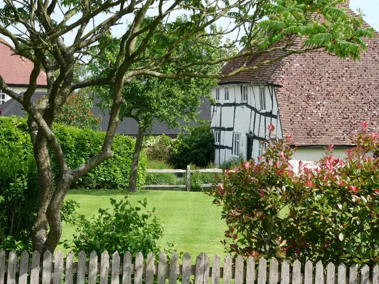

Hardham, cottage near the church - geograph.org.uk - 449479.jpg — Chris Gunns / [CC BY-SA 2.0](https://creativecommons.org/licenses/by-sa/2.0) / [原典](https://commons.wikimedia.org/wiki/File:Hardham%2C_cottage_near_the_church_-_geograph.org.uk_-_449479.jpg)

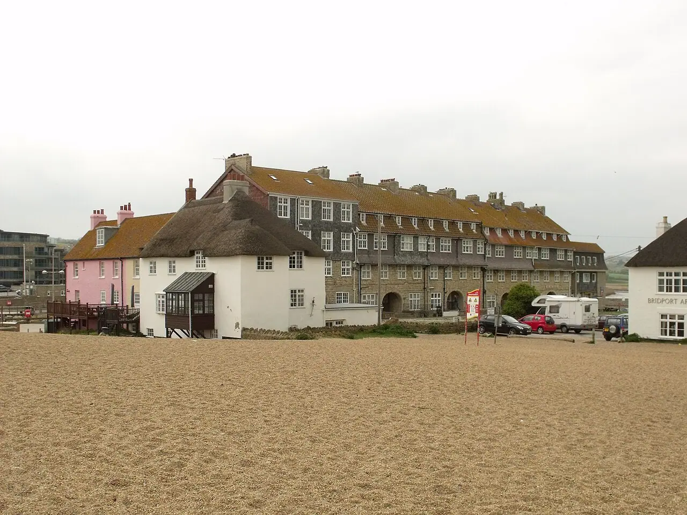

Ship Cottage and Pier Terrace 1-10 - West Bay (7257216206).jpg — Elliott Brown from Birmingham, United Kingdom / [CC BY 2.0](https://creativecommons.org/licenses/by/2.0) / [原典](https://commons.wikimedia.org/wiki/File:Ship_Cottage_and_Pier_Terrace_1-10_-_West_Bay_%287257216206%29.jpg)

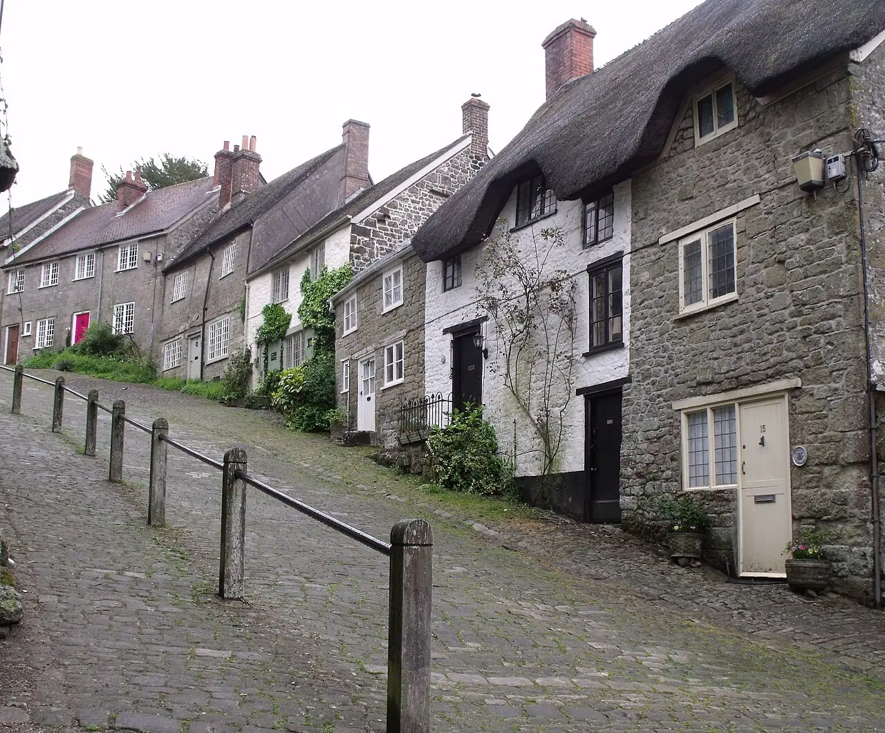

14 and 15 Gold Hill - Shaftesbury (7247927412) (cropped).jpg — Elliott Brown from Birmingham, United Kingdom / [CC BY 2.0](https://creativecommons.org/licenses/by/2.0) / [原典](https://commons.wikimedia.org/wiki/File:14_and_15_Gold_Hill_-_Shaftesbury_%287247927412%29_%28cropped%29.jpg)

## 海辺の町 — harbor-village

制作で見るところ：海岸と建物の高さ、道の終わり方

関連コード：`app/src/world/town.js`

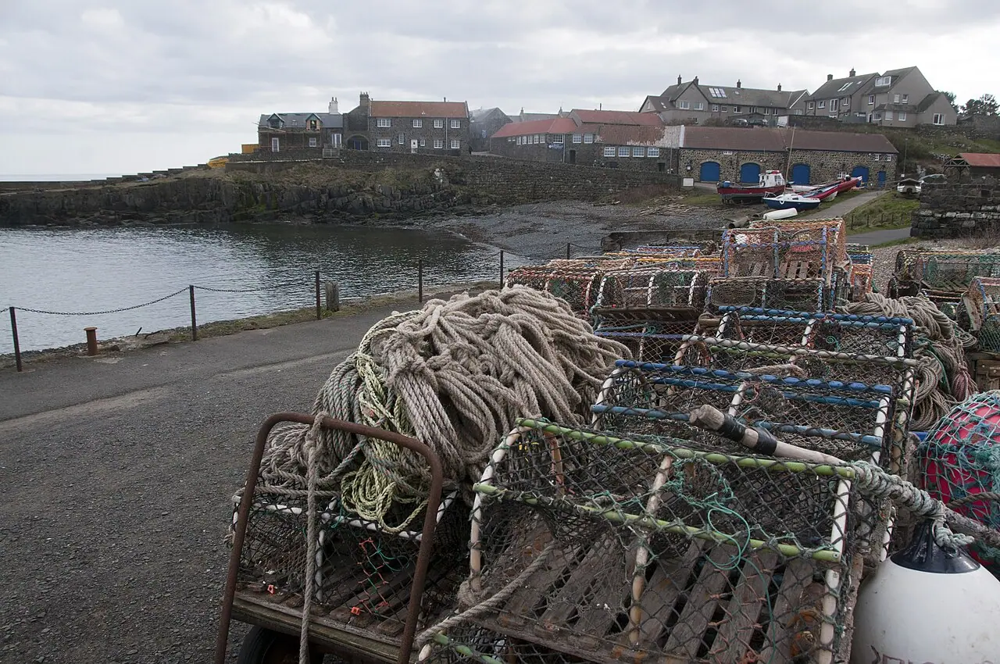

Craster is a small fishing village on the Northumbrian coast . It has a small harbour and offers a view northwards along the shore to the ruins of Dunstanburgh Castle. For many years, the village has (5562354698).jpg — Bryan Ledgard / [CC BY 2.0](https://creativecommons.org/licenses/by/2.0) / [原典](https://commons.wikimedia.org/wiki/File:Craster_is_a_small_fishing_village_on_the_Northumbrian_coast_._It_has_a_small_harbour_and_offers_a_view_northwards_along_the_shore_to_the_ruins_of_Dunstanburgh_Castle._For_many_years%2C_the_village_has_%285562354698%29.jpg)

Cobbled streets of Cascais (47956751563).jpg — Terry Kearney from liverpool, merseyside / [CC0](https://creativecommons.org/publicdomain/zero/1.0/deed.en) / [原典](https://commons.wikimedia.org/wiki/File:Cobbled_streets_of_Cascais_%2847956751563%29.jpg)

The B4417 east of the small coastal village of Pistyll - geograph.org.uk - 2120594.jpg — Eric Jones / [CC BY-SA 2.0](https://creativecommons.org/licenses/by-sa/2.0) / [原典](https://commons.wikimedia.org/wiki/File:The_B4417_east_of_the_small_coastal_village_of_Pistyll_-_geograph.org.uk_-_2120594.jpg)

## 店先の花鉢と窓辺 — flowerpots-and-balconies

制作で見るところ：生活の痕跡、外壁と植物の関係

関連コード：`app/src/world/town.js`

Many colorful flowerpots in front of Bulguksa temple in Gyeongju South Korea.jpg — Basile Morin / [CC BY-SA 4.0](https://creativecommons.org/licenses/by-sa/4.0) / [原典](https://commons.wikimedia.org/wiki/File:Many_colorful_flowerpots_in_front_of_Bulguksa_temple_in_Gyeongju_South_Korea.jpg)

## 自転車と路地 — bicycles-and-alleys

制作で見るところ：車輪と壁・道幅の尺度感、停め方

関連コード：`app/src/world/bicycle.js`、`app/src/world/town.js`

Tung Kok Wai 11.JPG — Underwaterbuffalo / [CC BY-SA 3.0](https://creativecommons.org/licenses/by-sa/3.0) / [原典](https://commons.wikimedia.org/wiki/File:Tung_Kok_Wai_11.JPG)

Rusty bicycle leaning against the wall of the Statarlängan house, Skansen, Stockholm, Sweden julesvernex2.jpg — Jules Verne Times Two / [CC BY-SA 4.0](https://creativecommons.org/licenses/by-sa/4.0) / [原典](https://commons.wikimedia.org/wiki/File:Rusty_bicycle_leaning_against_the_wall_of_the_Statarl%C3%A4ngan_house%2C_Skansen%2C_Stockholm%2C_Sweden_julesvernex2.jpg)

## 縁側・ポーチ — porches-and-verandas

制作で見るところ：床と地面の段差、柱・屋根、座る場所

関連コード：`app/src/world/house.js`、`app/src/world/town.js`

Oppdalsmuseet Bygdemuseum Skjørstad-stuggu Laft tømmerhus 17c.–19c. Log house cottage Tram Inngangsparti Porch Dør Door Solur Sundial Skifer Slate etc Oppdal Trøndelag Norway 2019-04-10 3415.jpg — Wolfmann / [CC BY-SA 4.0](https://creativecommons.org/licenses/by-sa/4.0) / [原典](https://commons.wikimedia.org/wiki/File:Oppdalsmuseet_Bygdemuseum_Skj%C3%B8rstad-stuggu_Laft_t%C3%B8mmerhus_17c.%E2%80%9319c._Log_house_cottage_Tram_Inngangsparti_Porch_D%C3%B8r_Door_Solur_Sundial_Skifer_Slate_etc_Oppdal_Tr%C3%B8ndelag_Norway_2019-04-10_3415.jpg)

Oppdalsmuseet Bygdemuseum Skjørstad-stuggu Laft tømmerhus 17c.–19c. Log house cottage Tram Inngangsparti Porch Dør Door Solur Sundial Skifer Slate Vår Spring etc Oppdal Trøndelag Norway 2019-04-25 5282.jpg — Wolfmann / [CC BY-SA 4.0](https://creativecommons.org/licenses/by-sa/4.0) / [原典](https://commons.wikimedia.org/wiki/File:Oppdalsmuseet_Bygdemuseum_Skj%C3%B8rstad-stuggu_Laft_t%C3%B8mmerhus_17c.%E2%80%9319c._Log_house_cottage_Tram_Inngangsparti_Porch_D%C3%B8r_Door_Solur_Sundial_Skifer_Slate_V%C3%A5r_Spring_etc_Oppdal_Tr%C3%B8ndelag_Norway_2019-04-25_5282.jpg)

Oppdalsmuseet Bygdemuseum Hoksengstuggu Laft tømmerhus Log cottage house Gammelt treverk kledning Old weathered wood planks Trapp tram Porch Skifer Slate stone Vår Spring etc Oppdal Norway 2019-04-25 3409.jpg — Wolfmann / [CC BY-SA 4.0](https://creativecommons.org/licenses/by-sa/4.0) / [原典](https://commons.wikimedia.org/wiki/File:Oppdalsmuseet_Bygdemuseum_Hoksengstuggu_Laft_t%C3%B8mmerhus_Log_cottage_house_Gammelt_treverk_kledning_Old_weathered_wood_planks_Trapp_tram_Porch_Skifer_Slate_stone_V%C3%A5r_Spring_etc_Oppdal_Norway_2019-04-25_3409.jpg)

## 石段と庭の小道 — stone-stairs

制作で見るところ：段差の寸法、石の欠けと植物の隙間

関連コード：`app/src/world/town.js`、`app/src/world/park.js`

Stone Steps - geograph.org.uk - 706766.jpg — Matthew Hatton / [CC BY-SA 2.0](https://creativecommons.org/licenses/by-sa/2.0) / [原典](https://commons.wikimedia.org/wiki/File:Stone_Steps_-_geograph.org.uk_-_706766.jpg)

Stone steps, Dawyck Botanic Garden - geograph.org.uk - 5789793.jpg — Jim Barton / [CC BY-SA 2.0](https://creativecommons.org/licenses/by-sa/2.0) / [原典](https://commons.wikimedia.org/wiki/File:Stone_steps%2C_Dawyck_Botanic_Garden_-_geograph.org.uk_-_5789793.jpg)

Garden steps Heyrons, High Easter Essex 01.jpg — Acabashi / [CC BY-SA 4.0](https://creativecommons.org/licenses/by-sa/4.0) / [原典](https://commons.wikimedia.org/wiki/File:Garden_steps_Heyrons%2C_High_Easter_Essex_01.jpg)

