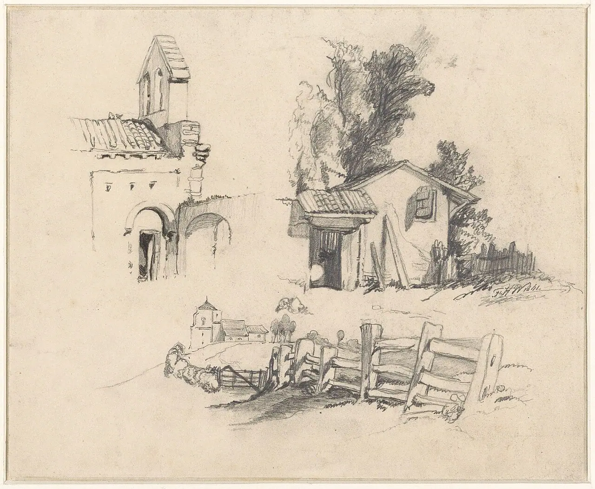
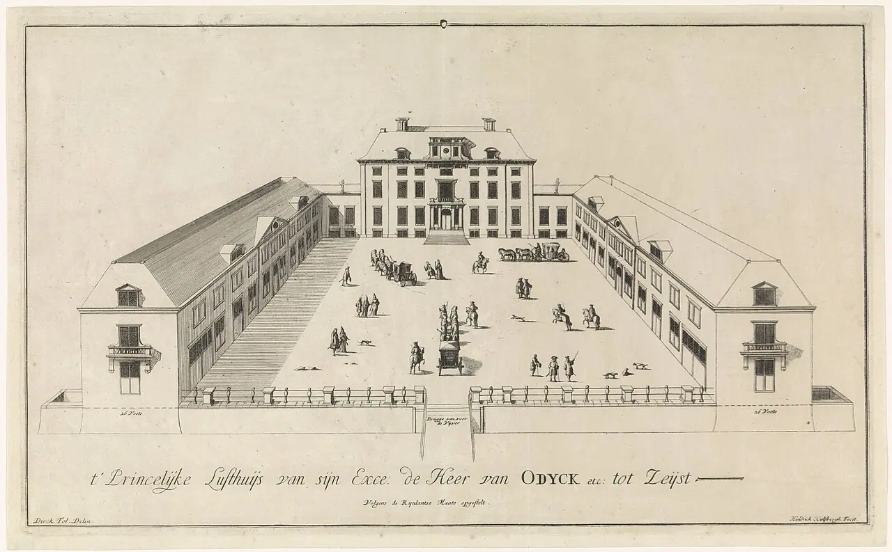
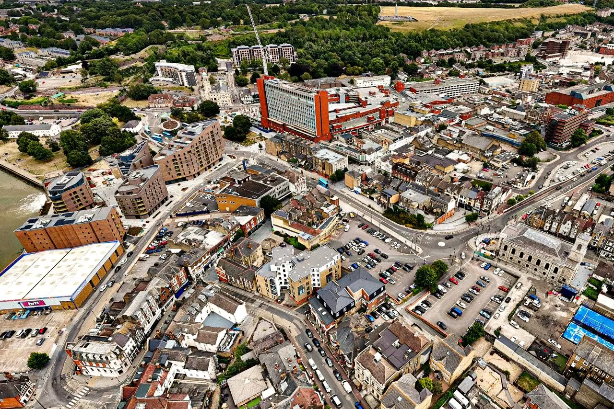
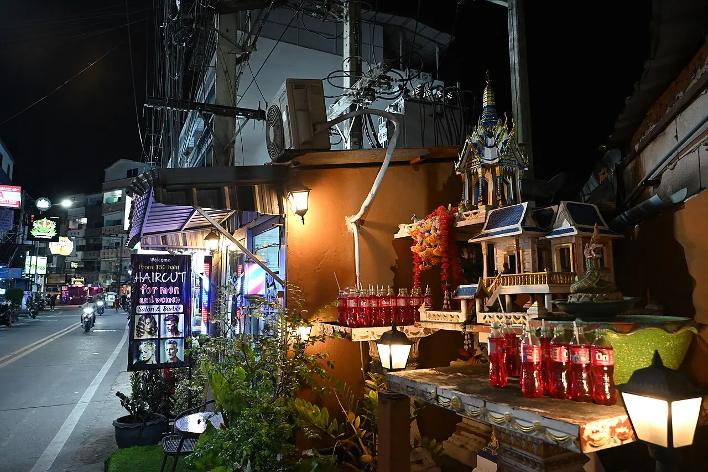
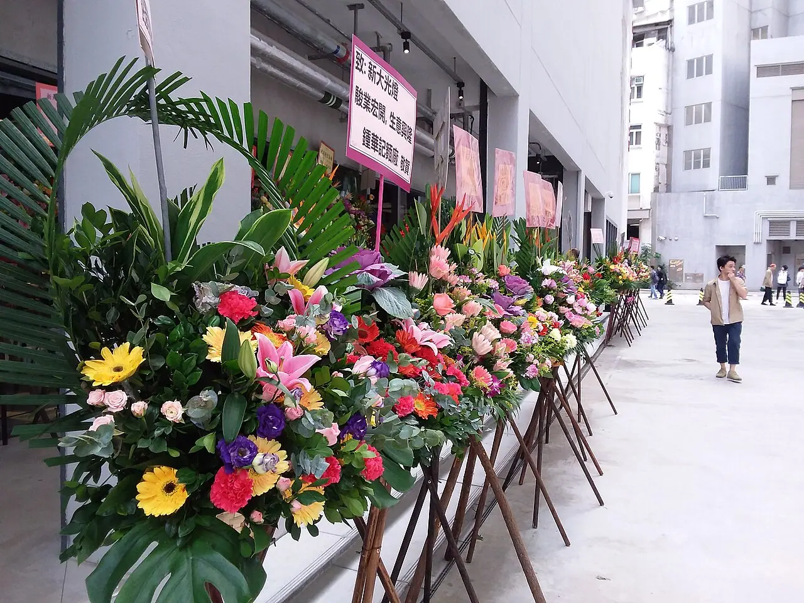
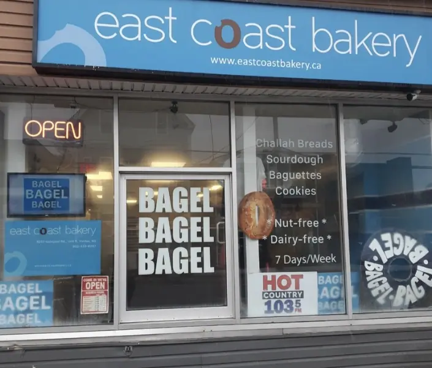
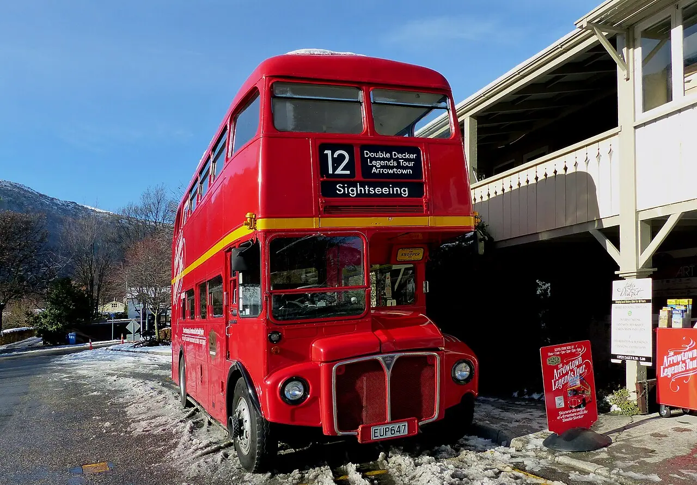

# town — reference photos

[← Gallery index](./README.md) | [Credits](../catalog/CREDITS.md)

## 集落の細道 — village-lanes

制作で見るところ：街路幅、敷地境界、家と自然の混在

関連コード：`app/src/world/town.js`、`app/src/world/road.js`

Rural village (7350513976).jpg — Francisco Anzola / [CC BY 2.0](https://creativecommons.org/licenses/by/2.0) / [原典](https://commons.wikimedia.org/wiki/File:Rural_village_%287350513976%29.jpg)

Mezmay, Village, Rural houses, Russia.jpg — Vyacheslav Argenberg / [CC BY 4.0](https://creativecommons.org/licenses/by/4.0) / [原典](https://commons.wikimedia.org/wiki/File:Mezmay%2C_Village%2C_Rural_houses%2C_Russia.jpg)

## 小さな家 — small-cottages

制作で見るところ：開口部比率・屋根勾配・庭とのつながり

関連コード：`app/src/world/cottage.js`、`app/src/world/house.js`

Drie studies van een kerk, huisje en hek, RP-T-1938-36.jpg — Rijksmuseum / [CC0](https://creativecommons.org/publicdomain/zero/1.0/deed.en) / [原典](https://commons.wikimedia.org/wiki/File:Drie_studies_van_een_kerk%2C_huisje_en_hek%2C_RP-T-1938-36.jpg)

Slot Zeist 't Princelijke Lusthuijs van sijn Exce. de Heer van Odijck etc tot Zeyst (titel op object), RP-P-1899-A-21468.jpg — Rijksmuseum / [CC0](https://creativecommons.org/publicdomain/zero/1.0/deed.en) / [原典](https://commons.wikimedia.org/wiki/File:Slot_Zeist_%27t_Princelijke_Lusthuijs_van_sijn_Exce._de_Heer_van_Odijck_etc_tot_Zeyst_%28titel_op_object%29%2C_RP-P-1899-A-21468.jpg)

## 木骨と漆喰の外壁 — timber-facades

制作で見るところ：柱・梁・窓の配置、素材の境界

関連コード：`app/src/world/house.js`、`app/src/world/town.js`

Half-timbered façades along the Rur in autumn, Monschau, 2025.jpg — DimiTalen / [CC0](https://creativecommons.org/publicdomain/zero/1.0/deed.en) / [原典](https://commons.wikimedia.org/wiki/File:Half-timbered_fa%C3%A7ades_along_the_Rur_in_autumn%2C_Monschau%2C_2025.jpg)

Historic-half-timbered-house-allschwil-basel-landschaft-switzerland-1680-1700.jpg — Stucki66 / [CC0](https://creativecommons.org/publicdomain/zero/1.0/deed.en) / [原典](https://commons.wikimedia.org/wiki/File:Historic-half-timbered-house-allschwil-basel-landschaft-switzerland-1680-1700.jpg)

## 商店の店先 — shopfronts

制作で見るところ：商品・日除け・看板・開口部の奥行き

関連コード：`app/src/world/town.js`

Aerial view of Chatham Town Centre (High Street).jpg — Stephen Kennard / [CC0](https://creativecommons.org/publicdomain/zero/1.0/deed.en) / [原典](https://commons.wikimedia.org/wiki/File:Aerial_view_of_Chatham_Town_Centre_%28High_Street%29.jpg)

DZ3 0946 Nighttime street shrine and offerings beside a lit shopfront in Nong Pla Lai Pattaya City.jpg — PattayaPatrol / [CC BY-SA 4.0](https://creativecommons.org/licenses/by-sa/4.0) / [原典](https://commons.wikimedia.org/wiki/File:DZ3_0946_Nighttime_street_shrine_and_offerings_beside_a_lit_shopfront_in_Nong_Pla_Lai_Pattaya_City.jpg)

## 花屋の店先 — flower-shops

制作で見るところ：鉢植え、花桶、歩道へのにじみ出し

関連コード：`app/src/world/town.js`

HK 荃灣 Tsuen Wan 白田壩街 45 Pak Tin Par Street 南豐紗廠 The Mills mall shop grand opening flower sign December 2018 SSG 10.jpg — Houiginetaim Ha / [CC BY-SA 4.0](https://creativecommons.org/licenses/by-sa/4.0) / [原典](https://commons.wikimedia.org/wiki/File:HK_%E8%8D%83%E7%81%A3_Tsuen_Wan_%E7%99%BD%E7%94%B0%E5%A3%A9%E8%A1%97_45_Pak_Tin_Par_Street_%E5%8D%97%E8%B1%90%E7%B4%97%E5%BB%A0_The_Mills_mall_shop_grand_opening_flower_sign_December_2018_SSG_10.jpg)

Flowers By D&L exterior.jpg — Donna Wells / [CC BY 4.0](https://creativecommons.org/licenses/by/4.0) / [原典](https://commons.wikimedia.org/wiki/File:Flowers_By_D%26L_exterior.jpg)

## 喫茶店とパン屋 — cafes-and-bakeries

制作で見るところ：日除け、ガラス窓、テラスと暖かな光

関連コード：`app/src/world/town.js`

Southern Sugar Bakery storefront.jpg — Johnson524 / [CC0](https://creativecommons.org/publicdomain/zero/1.0/deed.en) / [原典](https://commons.wikimedia.org/wiki/File:Southern_Sugar_Bakery_storefront.jpg)

ECB Storefront.jpg — BonkoSupreme / [CC0](https://creativecommons.org/publicdomain/zero/1.0/deed.en) / [原典](https://commons.wikimedia.org/wiki/File:ECB_Storefront.jpg)

## 町の広場 — town-plazas

制作で見るところ：噴水・樹木・ベンチと人の動線

関連コード：`app/src/world/town.js`

Hviezdoslavovo námestie fountain leading to the Old Slovak National Theater (10267371415).jpg — Jorge Láscar from Australia / [CC BY 2.0](https://creativecommons.org/licenses/by/2.0) / [原典](https://commons.wikimedia.org/wiki/File:Hviezdoslavovo_n%C3%A1mestie_fountain_leading_to_the_Old_Slovak_National_Theater_%2810267371415%29.jpg)

The Lane Memorial Fountain, Town Hall Square, Bexhill.jpg — Alexis Markwick / [CC0](https://creativecommons.org/publicdomain/zero/1.0/deed.en) / [原典](https://commons.wikimedia.org/wiki/File:The_Lane_Memorial_Fountain%2C_Town_Hall_Square%2C_Bexhill.jpg)

## 市と屋台 — market-stalls

制作で見るところ：屋根布の張り方、棚と通路、生活感

関連コード：`app/src/world/town.js`

Outdoor Stalls Vilnius Market B.jpg — Mojmir Churavy / [CC0](https://creativecommons.org/publicdomain/zero/1.0/deed.en) / [原典](https://commons.wikimedia.org/wiki/File:Outdoor_Stalls_Vilnius_Market_B.jpg)

Outdoor Stalls Vilnius Market A.jpg — Mojmir Churavy / [CC0](https://creativecommons.org/publicdomain/zero/1.0/deed.en) / [原典](https://commons.wikimedia.org/wiki/File:Outdoor_Stalls_Vilnius_Market_A.jpg)

## バス停と待合所 — bus-stops

制作で見るところ：屋根・ベンチ・標識と道路の位置関係

関連コード：`app/src/world/bus-stop.js`、`app/src/world/road.js`

Sedlec-Prčice, road to Záhoří.jpg — This file is available under Creative Commons BY-SA license. Basically: You can use this picture for any purpose, provided that you attribute it to Pavel Hrdlička, Wikipedia. You may distribute the resulting work under the same license. / [CC BY-SA 3.0](https://creativecommons.org/licenses/by-sa/3.0) / [原典](https://commons.wikimedia.org/wiki/File:Sedlec-Pr%C4%8Dice%2C_road_to_Z%C3%A1ho%C5%99%C3%AD.jpg)

Belarus, Homjel, Narovlja - Hrydni WMID4178728.jpg — nebo / [CC BY-SA 3.0](https://creativecommons.org/licenses/by-sa/3.0) / [原典](https://commons.wikimedia.org/wiki/File:Belarus%2C_Homjel%2C_Narovlja_-_Hrydni_WMID4178728.jpg)

## 田舎のバス — country-buses

制作で見るところ：車体比率、窓の連続、道との大きさ関係

関連コード：`app/src/world/vehicles.js`、`app/src/systems/bus.js`

Bus Zvenigorod-Surmino 2019-07.jpg — Svetlov Artem / [CC0](https://creativecommons.org/publicdomain/zero/1.0/deed.en) / [原典](https://commons.wikimedia.org/wiki/File:Bus_Zvenigorod-Surmino_2019-07.jpg)

The Routemaster Bus. (14124023507).jpg — Bernard Spragg. NZ from Christchurch, New Zealand / [CC0](https://creativecommons.org/publicdomain/zero/1.0/deed.en) / [原典](https://commons.wikimedia.org/wiki/File:The_Routemaster_Bus._%2814124023507%29.jpg)

## 石橋 — stone-bridges

制作で見るところ：アーチ・欄干・橋台と川岸の接続

関連コード：`app/src/world/road.js`

Sandbrook-Headquarters Road stone arch bridge; Hunterdon County NJ.jpg — KLOTZPLATE / [CC0](https://creativecommons.org/publicdomain/zero/1.0/deed.en) / [原典](https://commons.wikimedia.org/wiki/File:Sandbrook-Headquarters_Road_stone_arch_bridge%3B_Hunterdon_County_NJ.jpg)

River Cobble Stone Arch Bridge, Hanes Park, 2026.jpg — RSMartinJr / [CC0](https://creativecommons.org/publicdomain/zero/1.0/deed.en) / [原典](https://commons.wikimedia.org/wiki/File:River_Cobble_Stone_Arch_Bridge%2C_Hanes_Park%2C_2026.jpg)

## 石畳の道 — cobblestone-streets

制作で見るところ：敷石の寸法、継ぎ目、色ムラ

関連コード：`app/src/world/town.js`、`app/src/world/textures.js`

Old Dilijan, Sharambeyan Street, April 2026.jpg — Textfabrikant / [CC0](https://creativecommons.org/publicdomain/zero/1.0/deed.en) / [原典](https://commons.wikimedia.org/wiki/File:Old_Dilijan%2C_Sharambeyan_Street%2C_April_2026.jpg)

Old Dilijan, Sharambeyan Street, view into the street, April 2026.jpg — Textfabrikant / [CC0](https://creativecommons.org/publicdomain/zero/1.0/deed.en) / [原典](https://commons.wikimedia.org/wiki/File:Old_Dilijan%2C_Sharambeyan_Street%2C_view_into_the_street%2C_April_2026.jpg)

## 街灯と行灯 — street-lights

制作で見るところ：柱・灯具の比率、地面の明かり

関連コード：`app/src/world/town.js`

Side street in Faro, with old street lamp (28509279443).jpg — Winniepix from UK / [CC BY 2.0](https://creativecommons.org/licenses/by/2.0) / [原典](https://commons.wikimedia.org/wiki/File:Side_street_in_Faro%2C_with_old_street_lamp_%2828509279443%29.jpg)

Former Gas Lamp Stands, Old Portsmouth.jpg — Tim Sheerman-Chase / [CC BY 2.0](https://creativecommons.org/licenses/by/2.0) / [原典](https://commons.wikimedia.org/wiki/File:Former_Gas_Lamp_Stands%2C_Old_Portsmouth.jpg)

## 公園のベンチ — park-benches

制作で見るところ：木陰と休憩場所、低い柵・小径

関連コード：`app/src/world/park.js`、`app/src/world/town.js`

Tree and bench, Priory Park, Bodmin, Cornwall - August 2024.jpg — Mutney / [CC BY 4.0](https://creativecommons.org/licenses/by/4.0) / [原典](https://commons.wikimedia.org/wiki/File:Tree_and_bench%2C_Priory_Park%2C_Bodmin%2C_Cornwall_-_August_2024.jpg)

Ōhori Park The octagonal tree bench Ōhorikōen Chūō-ku Fukuoka 20260518 154120.jpg — Hirho / [CC BY 4.0](https://creativecommons.org/licenses/by/4.0) / [原典](https://commons.wikimedia.org/wiki/File:%C5%8Chori_Park_The_octagonal_tree_bench_%C5%8Chorik%C5%8Den_Ch%C5%AB%C5%8D-ku_Fukuoka_20260518_154120.jpg)

## 石積みと塀 — stone-walls

制作で見るところ：積み目・隙間の植生・高さの変化

関連コード：`app/src/world/road.js`、`app/src/world/town.js`

Countryside lane and dry stone wall in Mosqueira, 15 October 2016.JPG — Kolforn (Kolforn) I'd appreciate if you could mail me (Kolforn@gmail.com) if you want to use this picture out of the Wikimedia project scope. This file is licensed under the Creative Commons Attribution-Share Alike 4.0 International license. You are / [CC BY 3.0](https://creativecommons.org/licenses/by/3.0) / [原典](https://commons.wikimedia.org/wiki/File:Countryside_lane_and_dry_stone_wall_in_Mosqueira%2C_15_October_2016.JPG)

14-09-2017 Dry stone wall in Caliços, Albufeira.JPG — Kolforn (Kolforn) I'd appreciate if you could mail me (Kolforn@gmail.com) if you want to use this picture out of the Wikimedia project scope. This file is licensed under the Creative Commons Attribution-Share Alike 4.0 International license. You are / [CC BY-SA 4.0](https://creativecommons.org/licenses/by-sa/4.0) / [原典](https://commons.wikimedia.org/wiki/File:14-09-2017_Dry_stone_wall_in_Cali%C3%A7os%2C_Albufeira.JPG)

## 窓と扉 — windows-and-doors

制作で見るところ：枠の厚み、雨戸、庇、階段との取り合い

関連コード：`app/src/world/house.js`、`app/src/world/town.js`

Kruhliakivka Khata.jpg — tarosys / [CC BY 3.0](https://creativecommons.org/licenses/by/3.0) / [原典](https://commons.wikimedia.org/wiki/File:Kruhliakivka_Khata.jpg)

Chałupa z datą 1926 w Podlaskim Muzeum Kultury Ludowej.jpg — Krzysztof Popławski / [CC BY 4.0](https://creativecommons.org/licenses/by/4.0) / [原典](https://commons.wikimedia.org/wiki/File:Cha%C5%82upa_z_dat%C4%85_1926_w_Podlaskim_Muzeum_Kultury_Ludowej.jpg)

## 屋根と軒先 — roofs-and-eaves

制作で見るところ：勾配・軒の出・瓦や板の重なり

関連コード：`app/src/world/house.js`、`app/src/world/town.js`

Ship Cottage and Pier Terrace 1-10 - West Bay (7257216206).jpg — Elliott Brown from Birmingham, United Kingdom / [CC BY 2.0](https://creativecommons.org/licenses/by/2.0) / [原典](https://commons.wikimedia.org/wiki/File:Ship_Cottage_and_Pier_Terrace_1-10_-_West_Bay_%287257216206%29.jpg)

14 and 15 Gold Hill - Shaftesbury (7247927412) (cropped).jpg — Elliott Brown from Birmingham, United Kingdom / [CC BY 2.0](https://creativecommons.org/licenses/by/2.0) / [原典](https://commons.wikimedia.org/wiki/File:14_and_15_Gold_Hill_-_Shaftesbury_%287247927412%29_%28cropped%29.jpg)

## 海辺の町 — harbor-village

制作で見るところ：海岸と建物の高さ、道の終わり方

関連コード：`app/src/world/town.js`

Craster is a small fishing village on the Northumbrian coast . It has a small harbour and offers a view northwards along the shore to the ruins of Dunstanburgh Castle. For many years, the village has (5562354698).jpg — Bryan Ledgard / [CC BY 2.0](https://creativecommons.org/licenses/by/2.0) / [原典](https://commons.wikimedia.org/wiki/File:Craster_is_a_small_fishing_village_on_the_Northumbrian_coast_._It_has_a_small_harbour_and_offers_a_view_northwards_along_the_shore_to_the_ruins_of_Dunstanburgh_Castle._For_many_years%2C_the_village_has_%285562354698%29.jpg)

Cobbled streets of Cascais (47956751563).jpg — Terry Kearney from liverpool, merseyside / [CC0](https://creativecommons.org/publicdomain/zero/1.0/deed.en) / [原典](https://commons.wikimedia.org/wiki/File:Cobbled_streets_of_Cascais_%2847956751563%29.jpg)

