# water — reference photos

[← Gallery index](./README.md) | [Credits](../catalog/CREDITS.md)

## 小川と泉 — small-streams

制作で見るところ：水の透明度、曲がり、川縁の植生

関連コード：`app/src/world/landscape.js`、`app/src/lab/stream.js`

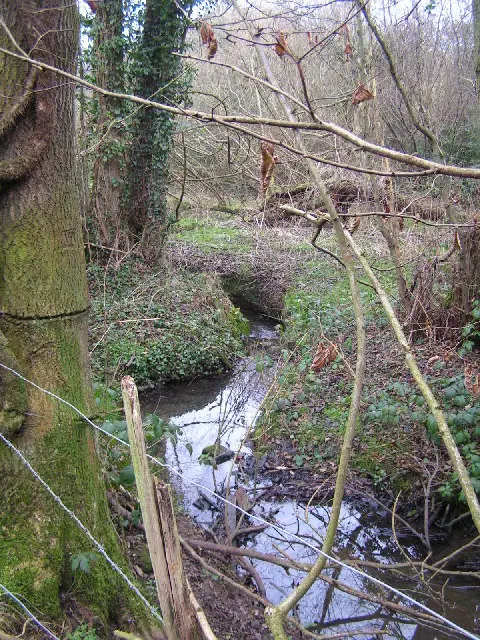

Small woodland stream - geograph.org.uk - 121892.jpg — Nigel Chadwick / [CC BY-SA 2.0](https://creativecommons.org/licenses/by-sa/2.0) / [原典](https://commons.wikimedia.org/wiki/File:Small_woodland_stream_-_geograph.org.uk_-_121892.jpg)

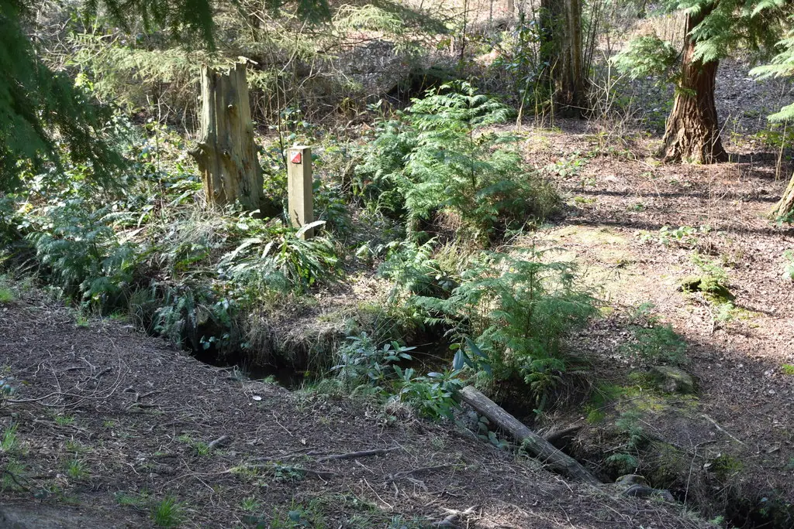

Small woodland stream - geograph.org.uk - 6509713.jpg — N Chadwick / [CC BY-SA 2.0](https://creativecommons.org/licenses/by-sa/2.0) / [原典](https://commons.wikimedia.org/wiki/File:Small_woodland_stream_-_geograph.org.uk_-_6509713.jpg)

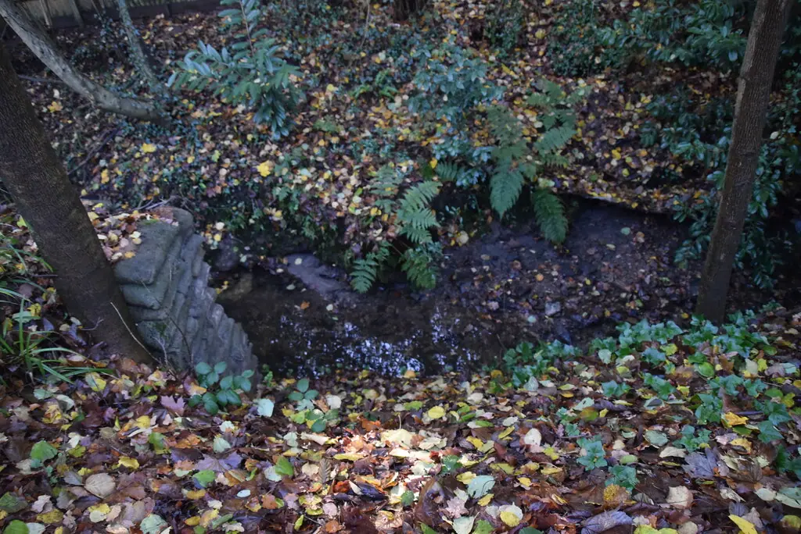

Small woodland stream - geograph.org.uk - 6729045.jpg — N Chadwick / [CC BY-SA 2.0](https://creativecommons.org/licenses/by-sa/2.0) / [原典](https://commons.wikimedia.org/wiki/File:Small_woodland_stream_-_geograph.org.uk_-_6729045.jpg)

## 河岸と水辺の草 — riverbanks

制作で見るところ：水位線、土の浸食、岸辺の草

関連コード：`app/src/world/landscape.js`、`app/src/world/road.js`

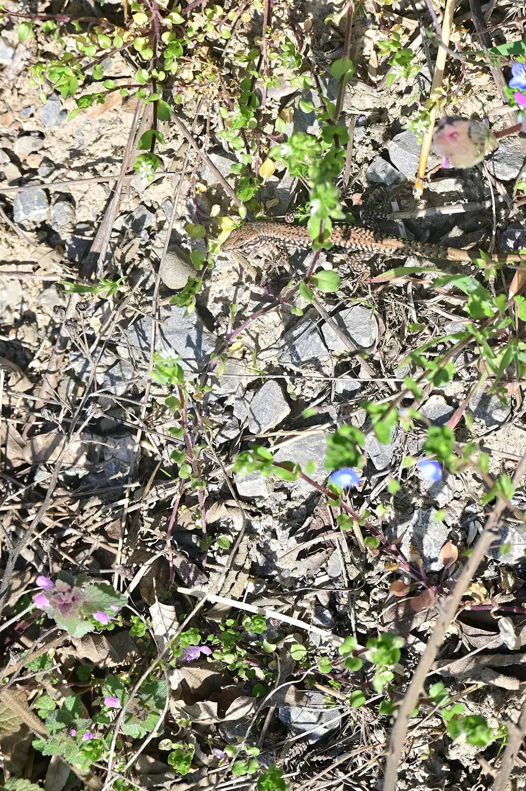

Low riverbank vegetation in Krupanj-March 2026.jpg — Ljiljana Krupanj / [CC BY 4.0](https://creativecommons.org/licenses/by/4.0) / [原典](https://commons.wikimedia.org/wiki/File:Low_riverbank_vegetation_in_Krupanj-March_2026.jpg)

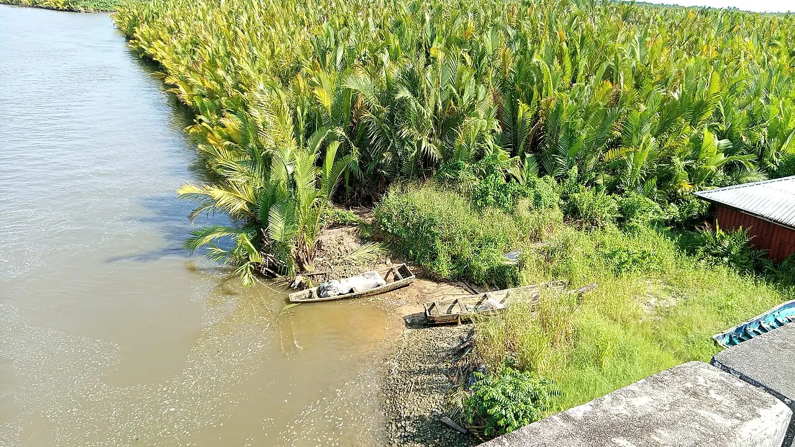

Riverbank with Palm Vegetation and Wooden Canoes, Okoroutip, Ibeno, Akwa Ibom Nigeria.jpg — GodswillSE / [CC BY 4.0](https://creativecommons.org/licenses/by/4.0) / [原典](https://commons.wikimedia.org/wiki/File:Riverbank_with_Palm_Vegetation_and_Wooden_Canoes%2C_Okoroutip%2C_Ibeno%2C_Akwa_Ibom_Nigeria.jpg)

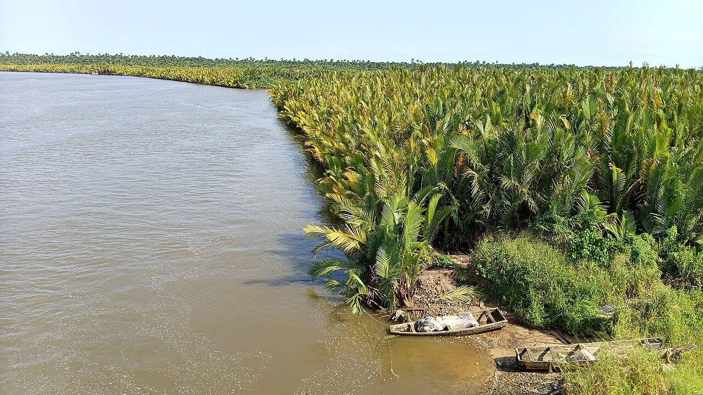

Riverbank with Palm Vegetation and Wooden Canoes in Ibeno, Akwa Ibom, Nigeria.jpg — GodswillSE / [CC BY 4.0](https://creativecommons.org/licenses/by/4.0) / [原典](https://commons.wikimedia.org/wiki/File:Riverbank_with_Palm_Vegetation_and_Wooden_Canoes_in_Ibeno%2C_Akwa_Ibom%2C_Nigeria.jpg)

## 川石と浅瀬 — river-stones

制作で見るところ：水中の石の丸さ、濡れた面の反射

関連コード：`app/src/world/landscape.js`、`app/src/world/nature.js`

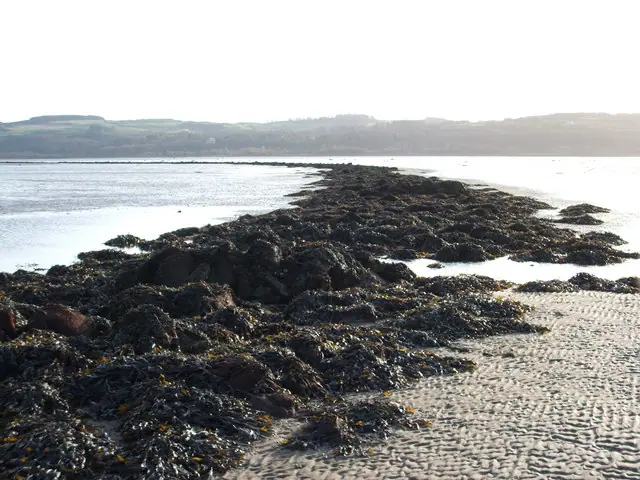

View south along an old fish yair - geograph.org.uk - 1055008.jpg — Lairich Rig / [CC BY-SA 2.0](https://creativecommons.org/licenses/by-sa/2.0) / [原典](https://commons.wikimedia.org/wiki/File:View_south_along_an_old_fish_yair_-_geograph.org.uk_-_1055008.jpg)

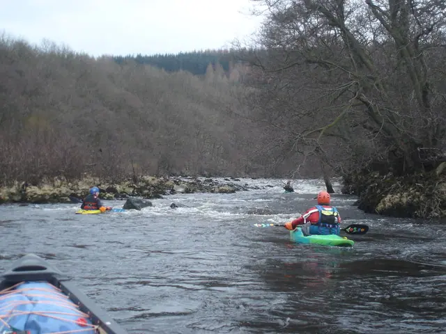

Low Wood Rapid on the Swale - geograph.org.uk - 1197106.jpg — Andy Waddington / [CC BY-SA 2.0](https://creativecommons.org/licenses/by-sa/2.0) / [原典](https://commons.wikimedia.org/wiki/File:Low_Wood_Rapid_on_the_Swale_-_geograph.org.uk_-_1197106.jpg)

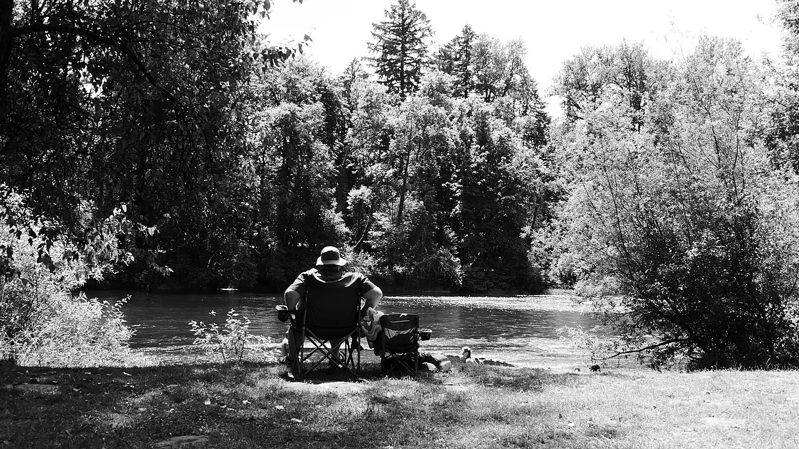

Watching the McKenzie River Flow.jpg — Rick Obst / [CC BY 2.0](https://creativecommons.org/licenses/by/2.0) / [原典](https://commons.wikimedia.org/wiki/File:Watching_the_McKenzie_River_Flow.jpg)

## 湖畔 — lake-shores

制作で見るところ：水面と岸の接続、葦・砂利・反射

関連コード：`app/src/world/road.js`

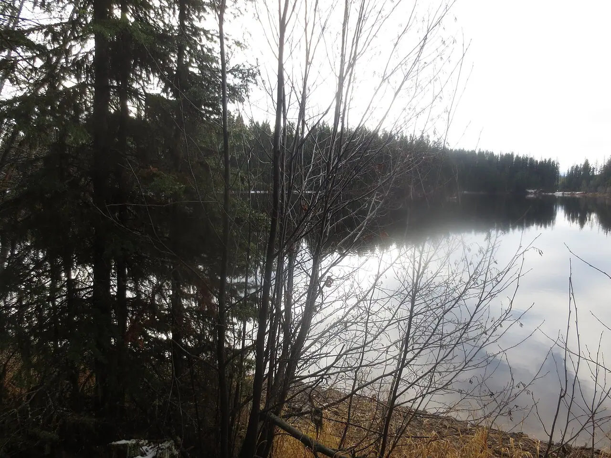

A Calm Rainy Morning in Late Autumn at Browne Lake Provincial Park.JPG — Extemporalist / [CC0](https://creativecommons.org/publicdomain/zero/1.0/deed.en) / [原典](https://commons.wikimedia.org/wiki/File:A_Calm_Rainy_Morning_in_Late_Autumn_at_Browne_Lake_Provincial_Park.JPG)

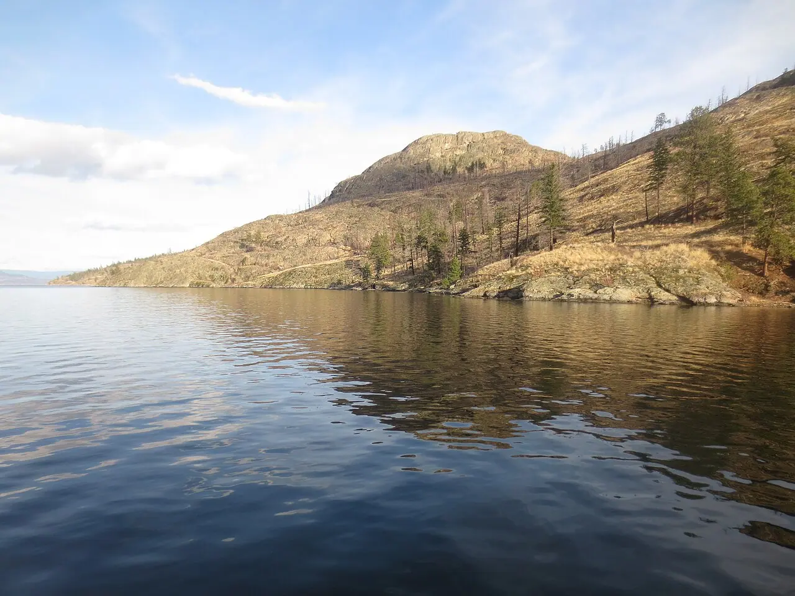

Calm Winter Afternoon at Okanagan Mountain Provincial Park.JPG — Extemporalist / [CC0](https://creativecommons.org/publicdomain/zero/1.0/deed.en) / [原典](https://commons.wikimedia.org/wiki/File:Calm_Winter_Afternoon_at_Okanagan_Mountain_Provincial_Park.JPG)

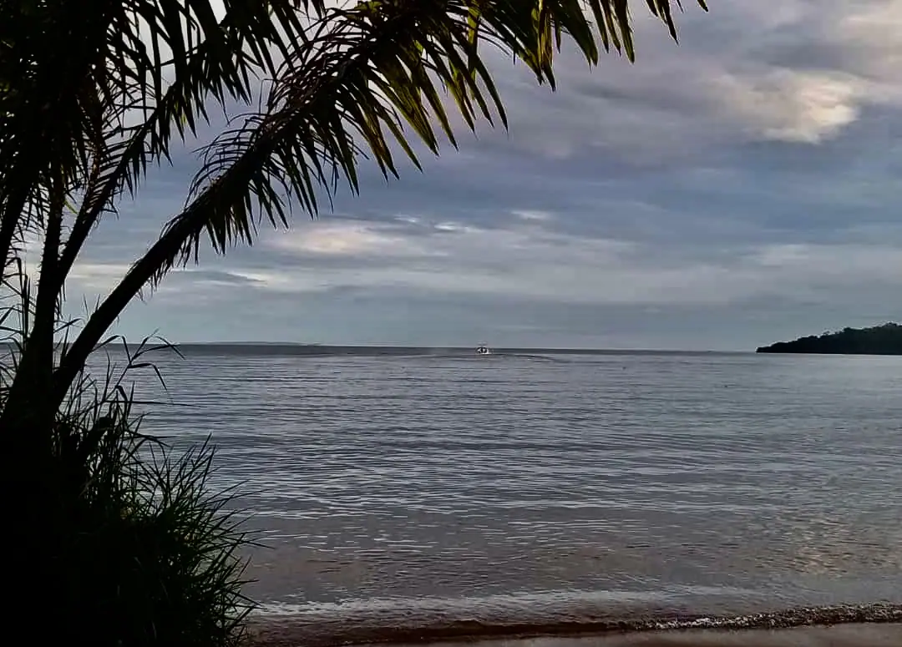

A calm lake side.jpg — Atyang344 / [CC BY-SA 4.0](https://creativecommons.org/licenses/by-sa/4.0) / [原典](https://commons.wikimedia.org/wiki/File:A_calm_lake_side.jpg)

## 滝と水しぶき — waterfalls

制作で見るところ：流れの分岐、岩との接触、霧

関連コード：`app/src/world/landscape.js`

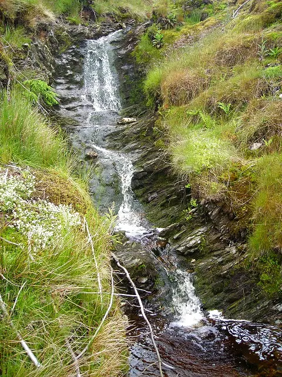

Small Waterfall in Strathyre Forest - geograph.org.uk - 866206.jpg — Iain Thompson / [CC BY-SA 2.0](https://creativecommons.org/licenses/by-sa/2.0) / [原典](https://commons.wikimedia.org/wiki/File:Small_Waterfall_in_Strathyre_Forest_-_geograph.org.uk_-_866206.jpg)

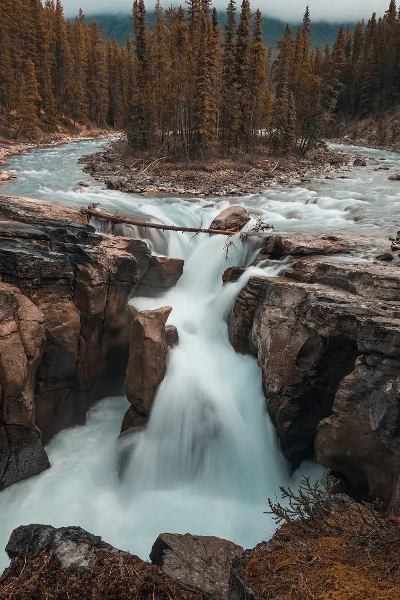

Small waterfall in a forest (Unsplash).jpg — Mark Basarab ignitedit / [CC0](https://creativecommons.org/publicdomain/zero/1.0/deed.en) / [原典](https://commons.wikimedia.org/wiki/File:Small_waterfall_in_a_forest_%28Unsplash%29.jpg)

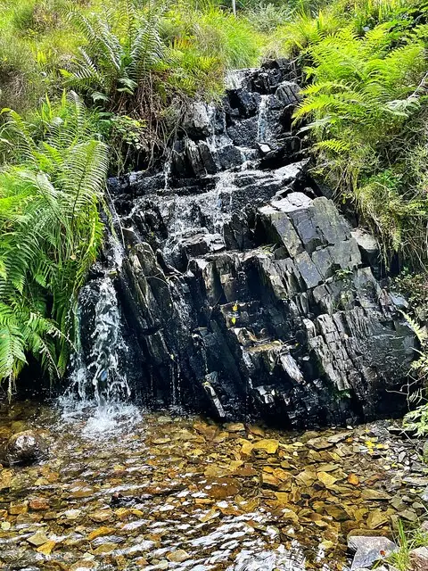

Small waterfall in Grizedale Forest - geograph.org.uk - 7567828.jpg — Graham Hogg / [CC BY-SA 2.0](https://creativecommons.org/licenses/by-sa/2.0) / [原典](https://commons.wikimedia.org/wiki/File:Small_waterfall_in_Grizedale_Forest_-_geograph.org.uk_-_7567828.jpg)

## 湿地と葦 — wetlands

制作で見るところ：水面の細分化、植物の密度

関連コード：`app/src/world/landscape.js`

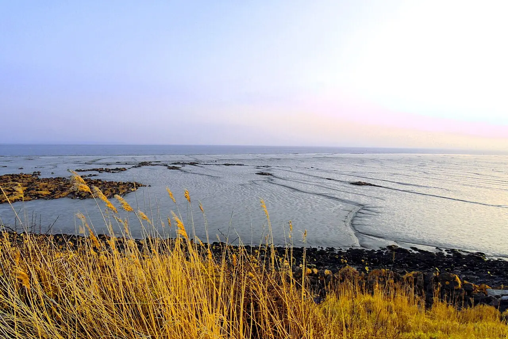

View of Severn Estuary Through Reeds From Newport Wetlands RSPB Reserve.JPG — Imagesincommons / [CC0](https://creativecommons.org/publicdomain/zero/1.0/deed.en) / [原典](https://commons.wikimedia.org/wiki/File:View_of_Severn_Estuary_Through_Reeds_From_Newport_Wetlands_RSPB_Reserve.JPG)

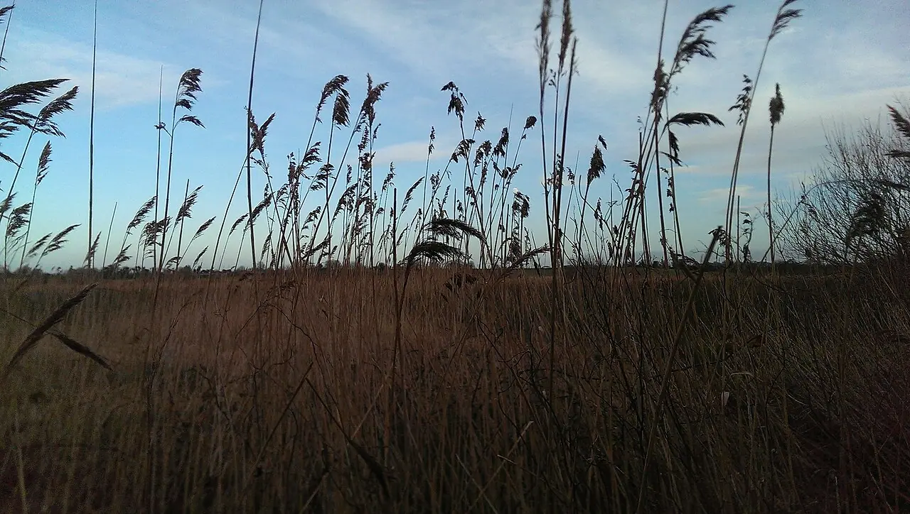

Common reeds at Pollardstown Fen.jpg — WillingCatSlave / [CC BY-SA 4.0](https://creativecommons.org/licenses/by-sa/4.0) / [原典](https://commons.wikimedia.org/wiki/File:Common_reeds_at_Pollardstown_Fen.jpg)

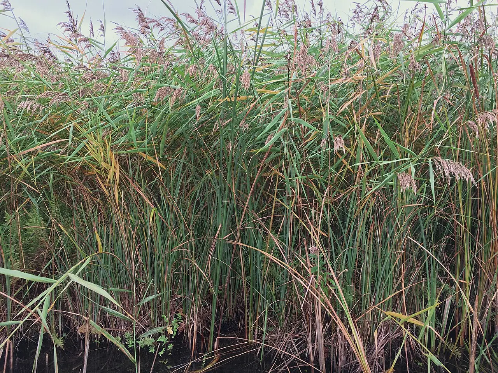

Reedbed of the subassociation Typho-Phragmitetum thelypteridetosum.jpg — Lendskaip / [CC0](https://creativecommons.org/publicdomain/zero/1.0/deed.en) / [原典](https://commons.wikimedia.org/wiki/File:Reedbed_of_the_subassociation_Typho-Phragmitetum_thelypteridetosum.jpg)

## 海岸と入り江 — seashores

制作で見るところ：砂・岩・水面、遠景の色の層

関連コード：`app/src/world/town.js`、`app/src/world/sky-restaurant.js`

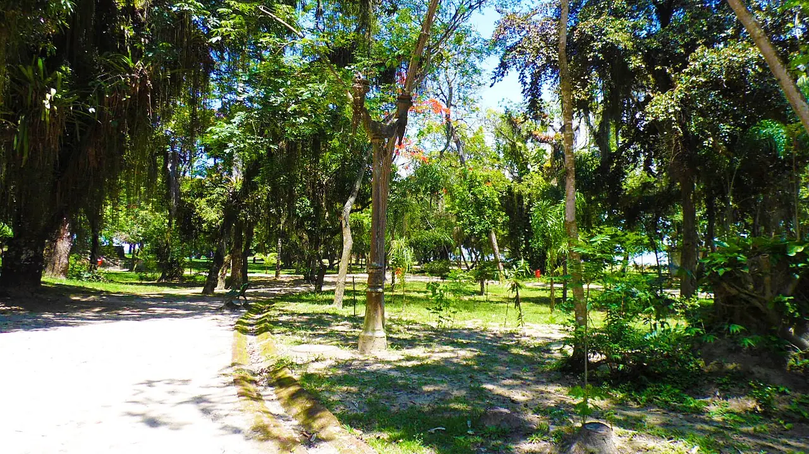

Ilha de Paquetá - Rio de Janeiro 07.JPG — VinyNeto / [CC BY-SA 3.0](https://creativecommons.org/licenses/by-sa/3.0) / [原典](https://commons.wikimedia.org/wiki/File:Ilha_de_Paquet%C3%A1_-_Rio_de_Janeiro_07.JPG)

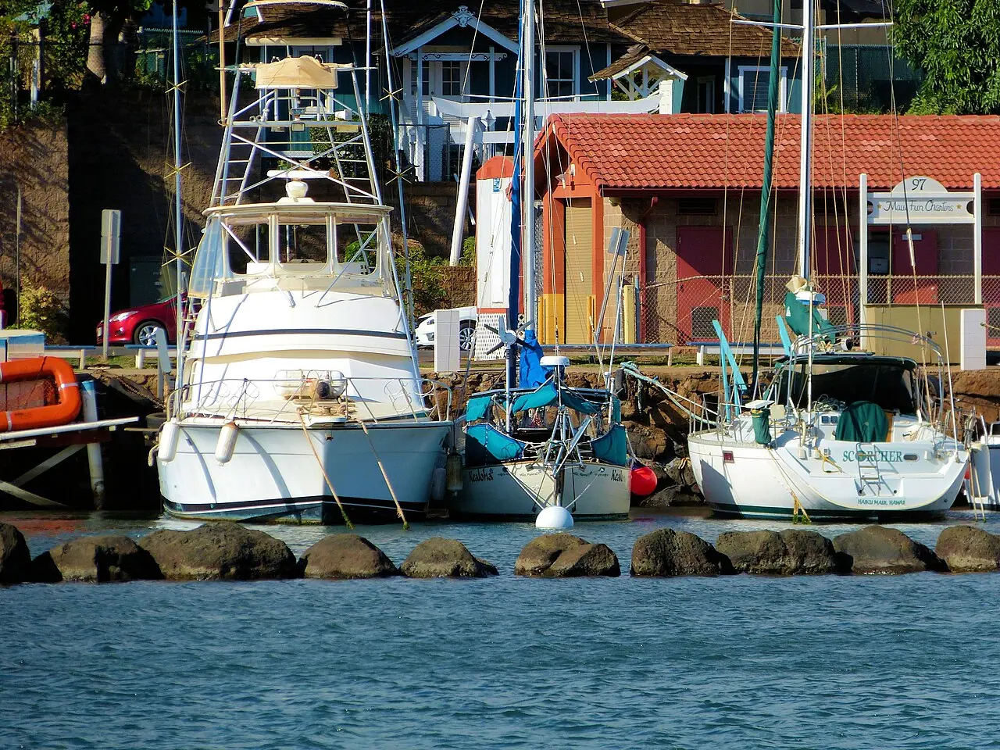

Maalaea Bay Harbor on Maui - James Brennan Molokai Hawaii - panoramio.jpg — James Brennan Moloka… / [CC BY 3.0](https://creativecommons.org/licenses/by/3.0) / [原典](https://commons.wikimedia.org/wiki/File:Maalaea_Bay_Harbor_on_Maui_-_James_Brennan_Molokai_Hawaii_-_panoramio.jpg)

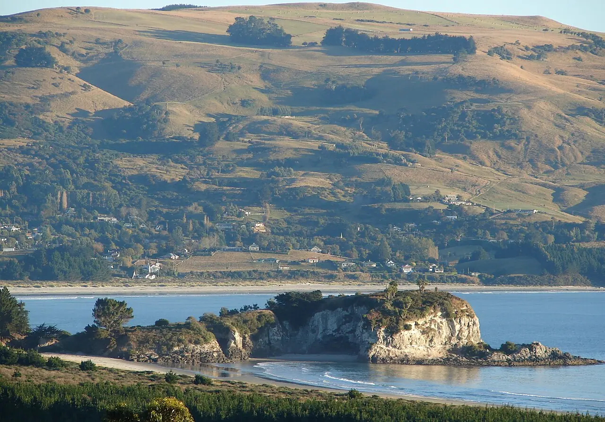

Mapoutahi Pa (Goat Island Blueskin Bay) (4506262890).jpg — Alistair Paterson from Dunedin, New Zealand / [CC BY-SA 2.0](https://creativecommons.org/licenses/by-sa/2.0) / [原典](https://commons.wikimedia.org/wiki/File:Mapoutahi_Pa_%28Goat_Island_Blueskin_Bay%29_%284506262890%29.jpg)

## 海面と波 — sea-surface

制作で見るところ：細かな波・遠景の反射、海色の層

関連コード：`app/src/world/sky.js`、`app/src/world/town.js`

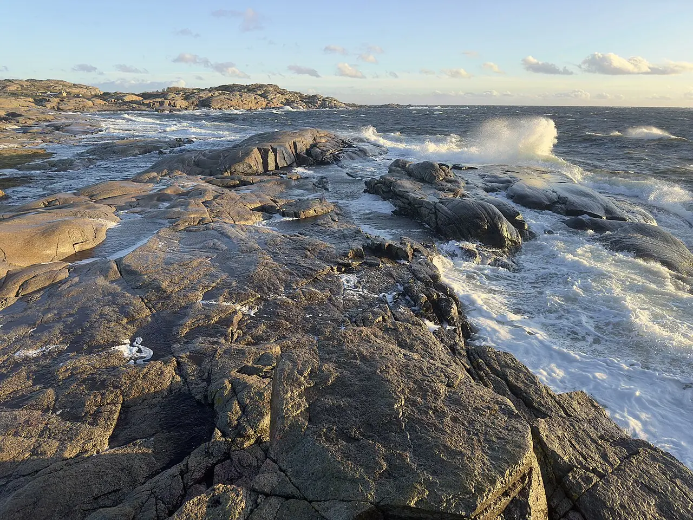

MOUTMARKA Færder nasjonalpark Tønsbergfjorden 2023-10-11 (Tjøme Oslofjorden Norway) Svaberg Fjære Hav Vind Bølger Sjøsprøyt Mot sør Kveldssol Skåetangen Oskjær (Rocky coastline Archipelago Wind Waves Turbulent Sea spray spla.jpg — Wolfmann / [CC BY-SA 4.0](https://creativecommons.org/licenses/by-sa/4.0) / [原典](https://commons.wikimedia.org/wiki/File:MOUTMARKA_F%C3%A6rder_nasjonalpark_T%C3%B8nsbergfjorden_2023-10-11_%28Tj%C3%B8me_Oslofjorden_Norway%29_Svaberg_Fj%C3%A6re_Hav_Vind_B%C3%B8lger_Sj%C3%B8spr%C3%B8yt_Mot_s%C3%B8r_Kveldssol_Sk%C3%A5etangen_Oskj%C3%A6r_%28Rocky_coastline_Archipelago_Wind_Waves_Turbulent_Sea_spray_spla.jpg)

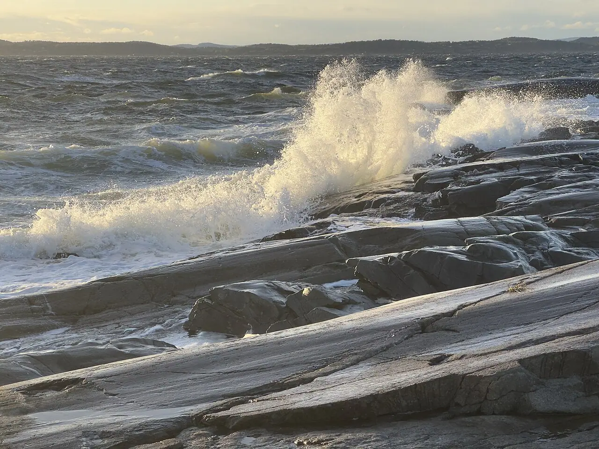

MOUTMARKA Færder nasjonalpark Tønsbergfjorden 2023-10-11 (Tjøme Oslofjorden Norway) Svaberg Fjære Hav Vind Bølger Sjøsprøyt Mot vest Kveldslys (Rocky coastline Archipelago Wind Waves Turbulent Sea spray splash Low sun) IMG 3150.jpg — Wolfmann / [CC BY-SA 4.0](https://creativecommons.org/licenses/by-sa/4.0) / [原典](https://commons.wikimedia.org/wiki/File:MOUTMARKA_F%C3%A6rder_nasjonalpark_T%C3%B8nsbergfjorden_2023-10-11_%28Tj%C3%B8me_Oslofjorden_Norway%29_Svaberg_Fj%C3%A6re_Hav_Vind_B%C3%B8lger_Sj%C3%B8spr%C3%B8yt_Mot_vest_Kveldslys_%28Rocky_coastline_Archipelago_Wind_Waves_Turbulent_Sea_spray_splash_Low_sun%29_IMG_3150.jpg)

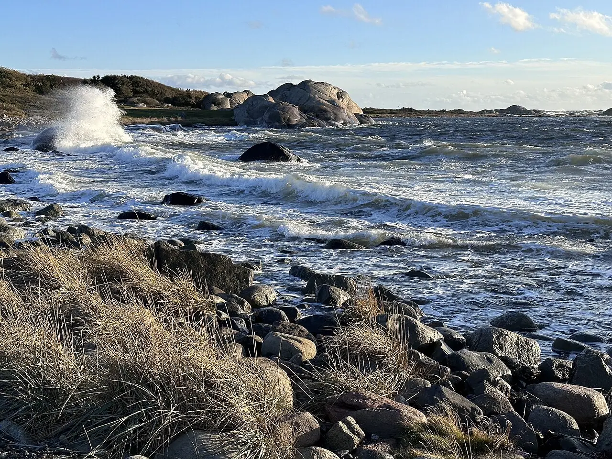

MOUTMARKA Færder nasjonalpark Tønsbergfjorden 2023-10-11 (Tjøme Oslofjorden Norway) Svaberg Fjære Hav Vind Bølger Sjøsprøyt eullesteinsstrand Mot sør Skåebukta (Rocky coastline Archipelago Wind Waves Turbulent Sea splash pebbl.jpg — Wolfmann / [CC BY-SA 4.0](https://creativecommons.org/licenses/by-sa/4.0) / [原典](https://commons.wikimedia.org/wiki/File:MOUTMARKA_F%C3%A6rder_nasjonalpark_T%C3%B8nsbergfjorden_2023-10-11_%28Tj%C3%B8me_Oslofjorden_Norway%29_Svaberg_Fj%C3%A6re_Hav_Vind_B%C3%B8lger_Sj%C3%B8spr%C3%B8yt_eullesteinsstrand_Mot_s%C3%B8r_Sk%C3%A5ebukta_%28Rocky_coastline_Archipelago_Wind_Waves_Turbulent_Sea_splash_pebbl.jpg)

