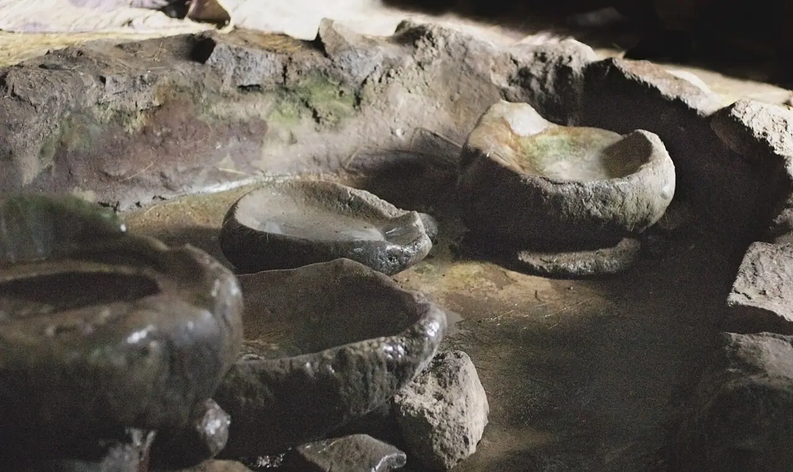
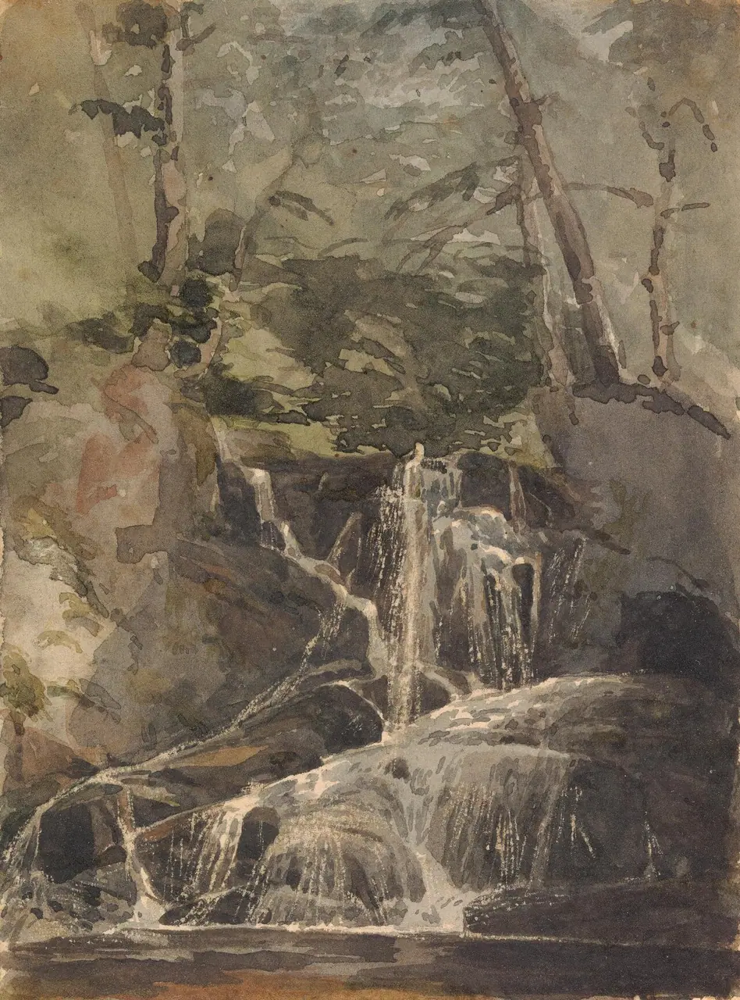

# water — reference photos

[← Gallery index](./README.md) | [Credits](../catalog/CREDITS.md)

## 小川と泉 — small-streams

制作で見るところ：水の透明度、曲がり、川縁の植生

関連コード：`app/src/world/landscape.js`、`app/src/lab/stream.js`

Small woodland stream - geograph.org.uk - 121892.jpg — Nigel Chadwick / [CC BY-SA 2.0](https://creativecommons.org/licenses/by-sa/2.0) / [原典](https://commons.wikimedia.org/wiki/File:Small_woodland_stream_-_geograph.org.uk_-_121892.jpg)

Small woodland stream - geograph.org.uk - 6729045.jpg — N Chadwick / [CC BY-SA 2.0](https://creativecommons.org/licenses/by-sa/2.0) / [原典](https://commons.wikimedia.org/wiki/File:Small_woodland_stream_-_geograph.org.uk_-_6729045.jpg)

## 河岸と水辺の草 — riverbanks

制作で見るところ：水位線、土の浸食、岸辺の草

関連コード：`app/src/world/landscape.js`、`app/src/world/road.js`

Low riverbank vegetation in Krupanj-March 2026.jpg — Ljiljana Krupanj / [CC BY 4.0](https://creativecommons.org/licenses/by/4.0) / [原典](https://commons.wikimedia.org/wiki/File:Low_riverbank_vegetation_in_Krupanj-March_2026.jpg)

Riverbank with Palm Vegetation and Wooden Canoes in Ibeno, Akwa Ibom, Nigeria.jpg — GodswillSE / [CC BY 4.0](https://creativecommons.org/licenses/by/4.0) / [原典](https://commons.wikimedia.org/wiki/File:Riverbank_with_Palm_Vegetation_and_Wooden_Canoes_in_Ibeno%2C_Akwa_Ibom%2C_Nigeria.jpg)

## 川石と浅瀬 — river-stones

制作で見るところ：水中の石の丸さ、濡れた面の反射

関連コード：`app/src/world/landscape.js`、`app/src/world/nature.js`

The Holy Water Collection Basin in the Church at the Monastery of Na’akuto La’ab (3422175620).jpg — A. Davey from Where I Live Now: Pacific Northwest / [CC BY 2.0](https://creativecommons.org/licenses/by/2.0) / [原典](https://commons.wikimedia.org/wiki/File:The_Holy_Water_Collection_Basin_in_the_Church_at_the_Monastery_of_Na%E2%80%99akuto_La%E2%80%99ab_%283422175620%29.jpg)

Watching the McKenzie River Flow.jpg — Rick Obst / [CC BY 2.0](https://creativecommons.org/licenses/by/2.0) / [原典](https://commons.wikimedia.org/wiki/File:Watching_the_McKenzie_River_Flow.jpg)

## 湖畔 — lake-shores

制作で見るところ：水面と岸の接続、葦・砂利・反射

関連コード：`app/src/world/road.js`

A Calm Rainy Morning in Late Autumn at Browne Lake Provincial Park.JPG — Extemporalist / [CC0](https://creativecommons.org/publicdomain/zero/1.0/deed.en) / [原典](https://commons.wikimedia.org/wiki/File:A_Calm_Rainy_Morning_in_Late_Autumn_at_Browne_Lake_Provincial_Park.JPG)

Calm Winter Afternoon at Okanagan Mountain Provincial Park.JPG — Extemporalist / [CC0](https://creativecommons.org/publicdomain/zero/1.0/deed.en) / [原典](https://commons.wikimedia.org/wiki/File:Calm_Winter_Afternoon_at_Okanagan_Mountain_Provincial_Park.JPG)

## 滝と水しぶき — waterfalls

制作で見るところ：流れの分岐、岩との接触、霧

関連コード：`app/src/world/landscape.js`

Small waterfall in a forest (Unsplash).jpg — Mark Basarab ignitedit / [CC0](https://creativecommons.org/publicdomain/zero/1.0/deed.en) / [原典](https://commons.wikimedia.org/wiki/File:Small_waterfall_in_a_forest_%28Unsplash%29.jpg)

Thomas Sully - Small Waterfall in Forest - B1981.25.2756 - Yale Center for British Art.jpg — Thomas Sully / [CC0](https://creativecommons.org/publicdomain/zero/1.0/deed.en) / [原典](https://commons.wikimedia.org/wiki/File:Thomas_Sully_-_Small_Waterfall_in_Forest_-_B1981.25.2756_-_Yale_Center_for_British_Art.jpg)

## 湿地と葦 — wetlands

制作で見るところ：水面の細分化、植物の密度

関連コード：`app/src/world/landscape.js`

View of Severn Estuary Through Reeds From Newport Wetlands RSPB Reserve.JPG — Imagesincommons / [CC0](https://creativecommons.org/publicdomain/zero/1.0/deed.en) / [原典](https://commons.wikimedia.org/wiki/File:View_of_Severn_Estuary_Through_Reeds_From_Newport_Wetlands_RSPB_Reserve.JPG)

Reedbed of the subassociation Typho-Phragmitetum thelypteridetosum.jpg — Lendskaip / [CC0](https://creativecommons.org/publicdomain/zero/1.0/deed.en) / [原典](https://commons.wikimedia.org/wiki/File:Reedbed_of_the_subassociation_Typho-Phragmitetum_thelypteridetosum.jpg)

## 海岸と入り江 — seashores

制作で見るところ：砂・岩・水面、遠景の色の層

関連コード：`app/src/world/town.js`、`app/src/world/sky-restaurant.js`

Ilha de Paquetá - Rio de Janeiro 07.JPG — VinyNeto / [CC BY-SA 3.0](https://creativecommons.org/licenses/by-sa/3.0) / [原典](https://commons.wikimedia.org/wiki/File:Ilha_de_Paquet%C3%A1_-_Rio_de_Janeiro_07.JPG)

Maalaea Bay Harbor on Maui - James Brennan Molokai Hawaii - panoramio.jpg — James Brennan Moloka… / [CC BY 3.0](https://creativecommons.org/licenses/by/3.0) / [原典](https://commons.wikimedia.org/wiki/File:Maalaea_Bay_Harbor_on_Maui_-_James_Brennan_Molokai_Hawaii_-_panoramio.jpg)

