# world-nature — reference photos

[← Gallery index](./README.md) | [Credits](../catalog/CREDITS.md)

## 海外自然：亜寒帯針葉樹林 — boreal-conifer-forest

制作で見るところ：針葉樹の樹冠密度・幹の間隔・苔と林床

関連コード：`app/src/world/nature.js`、`app/src/world/landscape.js`、`app/src/world/sky.js`

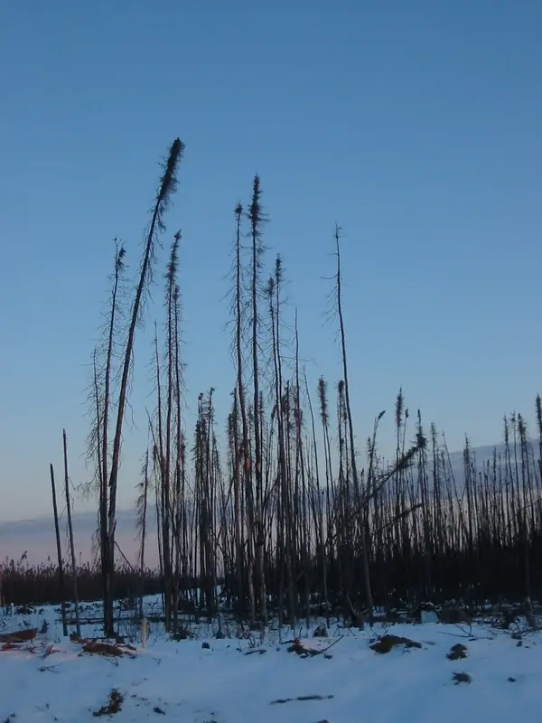

Blak spruce Muskeg.JPG — No machine-readable author provided. Qyd assumed (based on copyright claims). / [CC BY-SA 3.0](https://creativecommons.org/licenses/by-sa/3.0/) / [原典](https://commons.wikimedia.org/wiki/File:Blak_spruce_Muskeg.JPG)

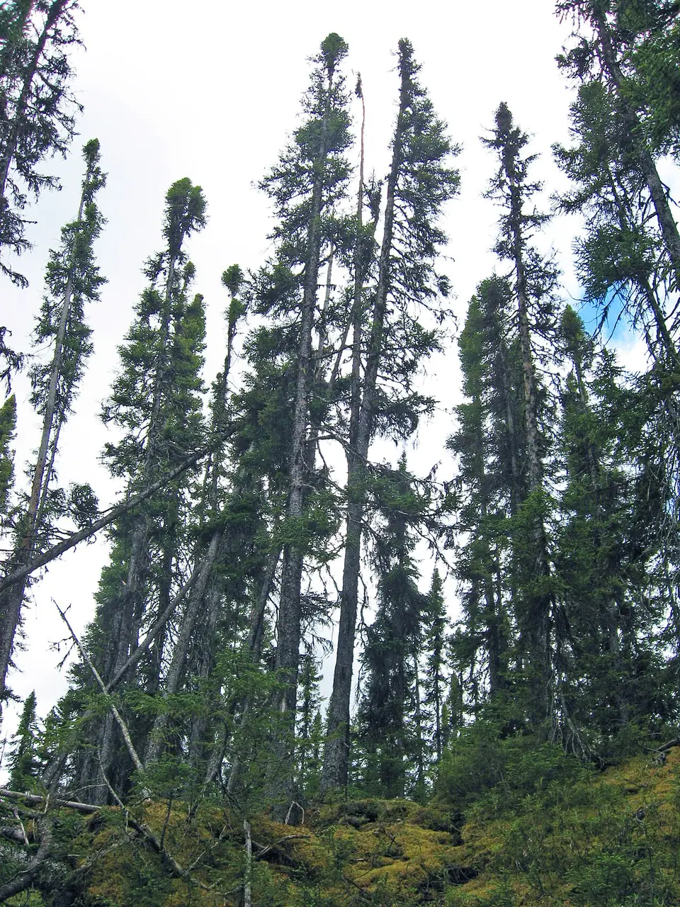

Boreal forest.JPG — Colocho / [CC BY-SA 3.0](https://creativecommons.org/licenses/by-sa/3.0) / [原典](https://commons.wikimedia.org/wiki/File:Boreal_forest.JPG)

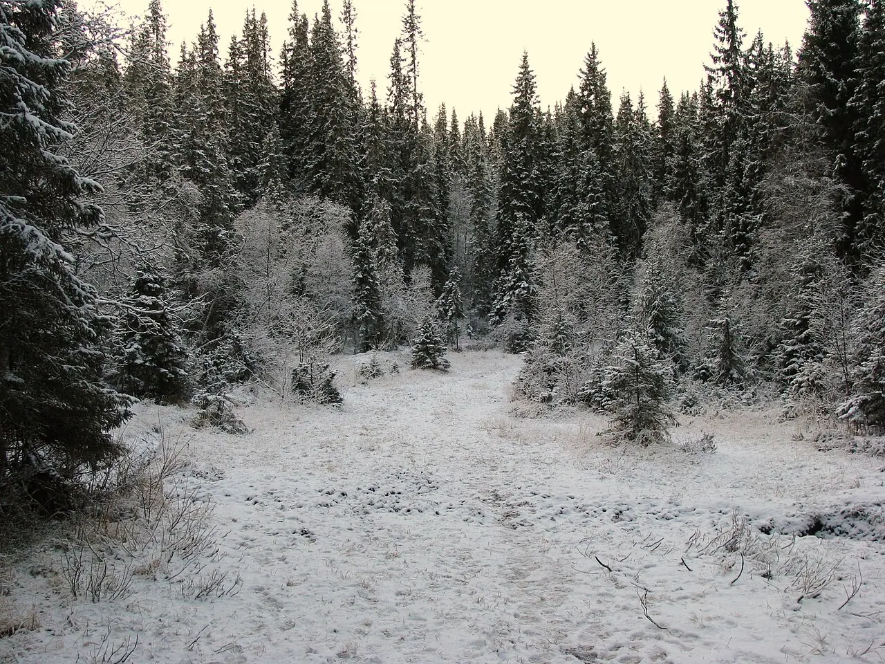

Winter-boreal-forest-Trondheim.jpg — Orcaborealis / [CC BY-SA 3.0](https://creativecommons.org/licenses/by-sa/3.0) / [原典](https://commons.wikimedia.org/wiki/File:Winter-boreal-forest-Trondheim.jpg)

## 海外自然：北欧の白樺林 — scandinavian-birch-forest

制作で見るところ：白い幹の間隔、林内の光と細い枝

関連コード：`app/src/world/nature.js`、`app/src/world/landscape.js`、`app/src/world/sky.js`

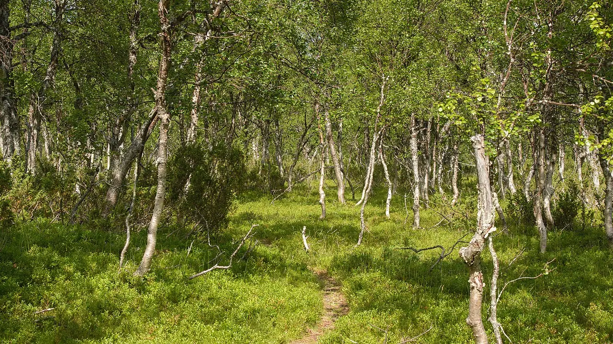

Ljungdalen July 2013 05.jpg — Arild Vågen / [CC BY-SA 3.0](https://creativecommons.org/licenses/by-sa/3.0) / [原典](https://commons.wikimedia.org/wiki/File:Ljungdalen_July_2013_05.jpg)

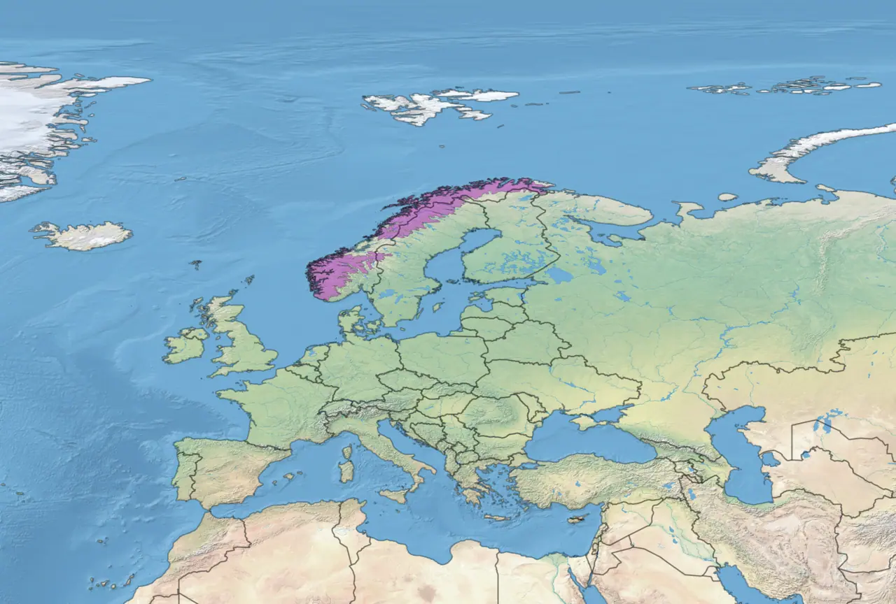

Scandinavian Birch & Coastal Conifer Forests Bioregion.png — Z3lvs / [CC BY-SA 4.0](https://creativecommons.org/licenses/by-sa/4.0) / [原典](https://commons.wikimedia.org/wiki/File:Scandinavian_Birch_%26_Coastal_Conifer_Forests_Bioregion.png)

## 海外自然：高山のカラマツ林 — alpine-larch-forest

制作で見るところ：標高・岩・木の密度・秋色・高い樹冠

関連コード：`app/src/world/nature.js`、`app/src/world/landscape.js`、`app/src/world/sky.js`

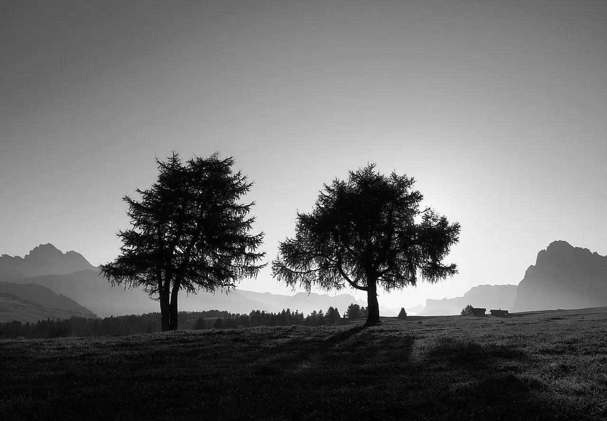

Alberi AlpediSiusi.JPG — Llorenzi / [CC BY-SA 3.0](https://creativecommons.org/licenses/by-sa/3.0/) / [原典](https://commons.wikimedia.org/wiki/File:Alberi_AlpediSiusi.JPG)

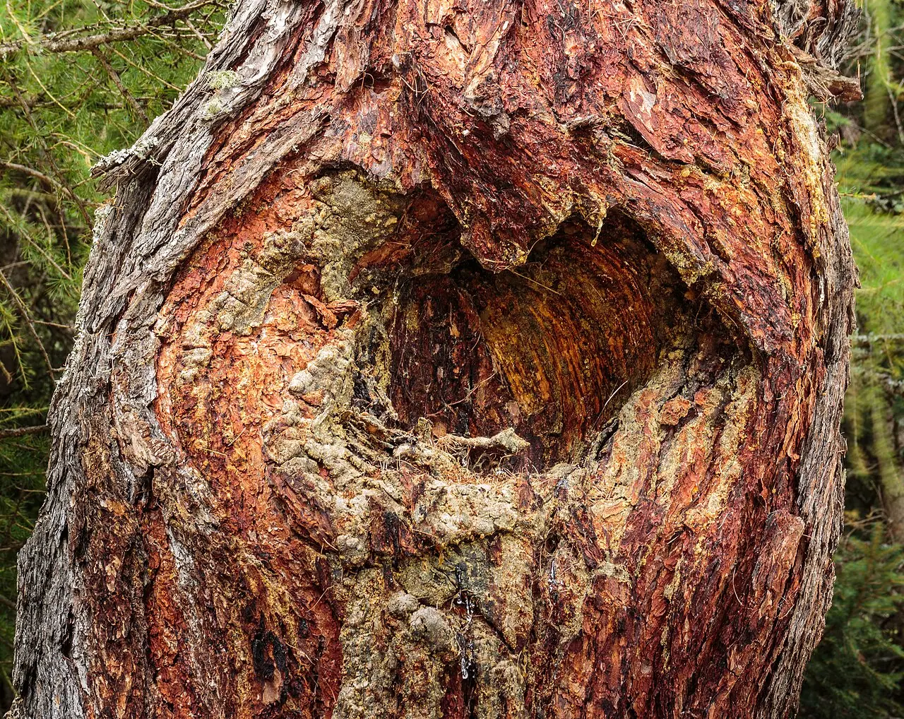

Bergtocht van Peio Paese naar Lago Covel in het Nationaal park Stelvio (Italië). Wond van een afgebroken tak. Europese larix (Larix decidua) 02.jpg — Dominicus Johannes Bergsma / [CC BY-SA 4.0](https://creativecommons.org/licenses/by-sa/4.0) / [原典](https://commons.wikimedia.org/wiki/File:Bergtocht_van_Peio_Paese_naar_Lago_Covel_in_het_Nationaal_park_Stelvio_%28Itali%C3%AB%29._Wond_van_een_afgebroken_tak._Europese_larix_%28Larix_decidua%29_02.jpg)

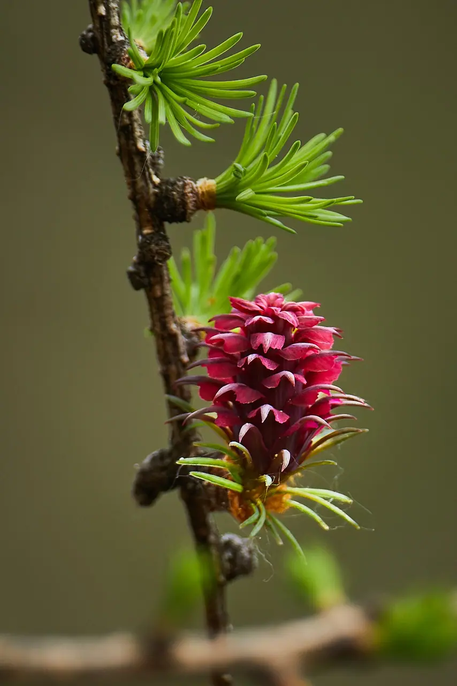

Alpine European Larch flowering - Larix decidua var. decidua.jpg — Thomas Fuhrmann / [CC BY-SA 4.0](https://creativecommons.org/licenses/by-sa/4.0) / [原典](https://commons.wikimedia.org/wiki/File:Alpine_European_Larch_flowering_-_Larix_decidua_var._decidua.jpg)

## 海外自然：温帯雨林 — temperate-rainforest

制作で見るところ：巨大な木・苔・倒木・シダが形成する多層の森

関連コード：`app/src/world/nature.js`、`app/src/world/landscape.js`、`app/src/world/sky.js`

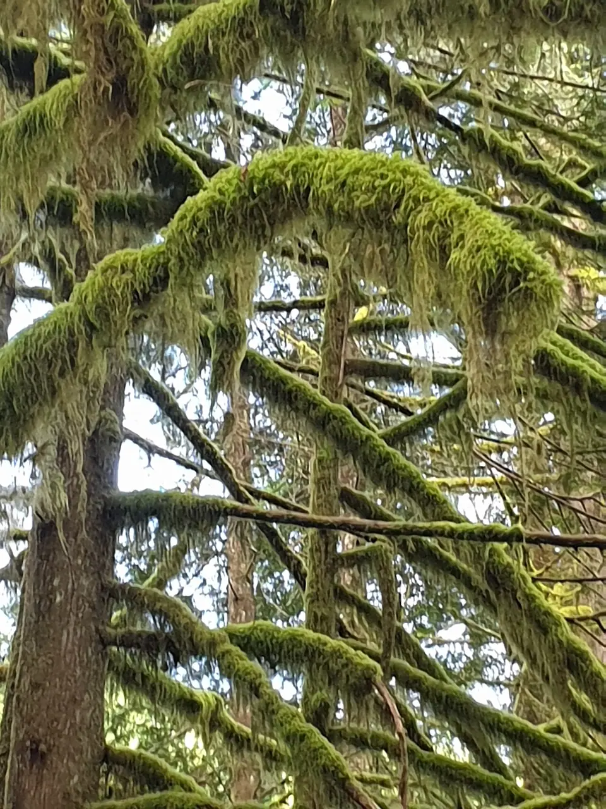

Velvety Landscape.jpg — Hchatrath / [CC BY-SA 4.0](https://creativecommons.org/licenses/by-sa/4.0) / [原典](https://commons.wikimedia.org/wiki/File:Velvety_Landscape.jpg)

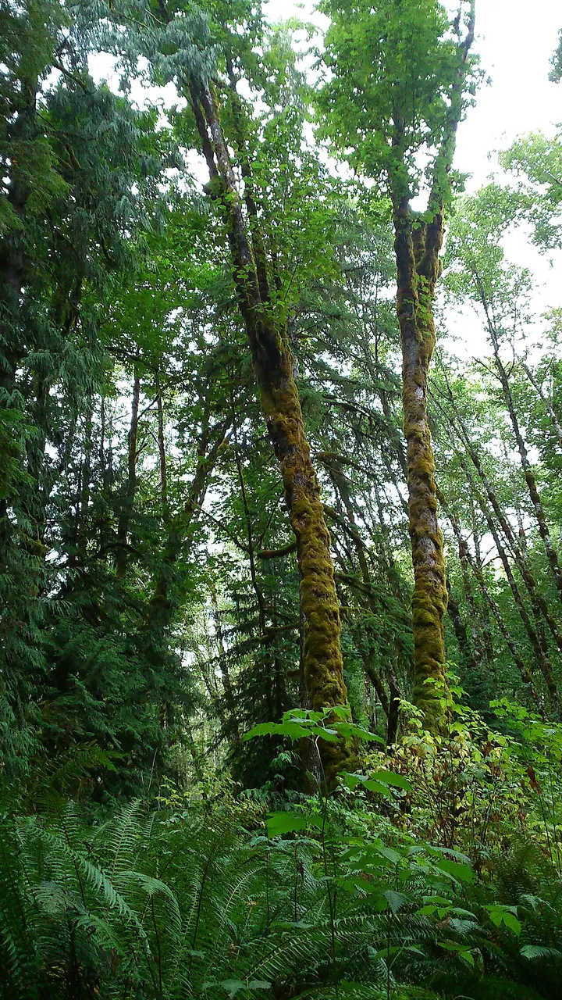

Moss on trees in Fossli park.jpg — Kevstan / [CC BY-SA 4.0](https://creativecommons.org/licenses/by-sa/4.0) / [原典](https://commons.wikimedia.org/wiki/File:Moss_on_trees_in_Fossli_park.jpg)

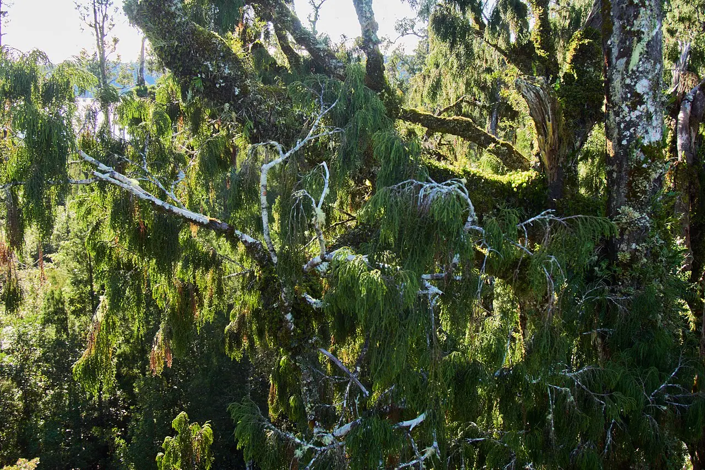

West Coast Treetop Walk, rimu rainforest - WestCoastTreetop8776.jpg — lumoplank / [CC0](https://creativecommons.org/publicdomain/zero/1.0/deed.en) / [原典](https://commons.wikimedia.org/wiki/File:West_Coast_Treetop_Walk%2C_rimu_rainforest_-_WestCoastTreetop8776.jpg)

## 海外自然：セコイアの森 — redwood-forest

制作で見るところ：巨大幹・林内の垂直感・根元と小さな植生

関連コード：`app/src/world/nature.js`、`app/src/world/landscape.js`、`app/src/world/sky.js`

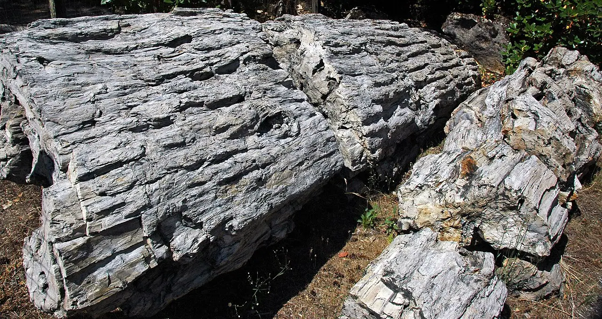

Sequoia sempervirens (fossil redwood tree trunk) (Sonoma Volcanics, Upper Pliocene, 3.2 to 3.4 Ma; Calistoga Petrified Forest, Calistoga, California, USA) 106 (49107302791).jpg — James St. John / [CC BY 2.0](https://creativecommons.org/licenses/by/2.0) / [原典](https://commons.wikimedia.org/wiki/File:Sequoia_sempervirens_%28fossil_redwood_tree_trunk%29_%28Sonoma_Volcanics%2C_Upper_Pliocene%2C_3.2_to_3.4_Ma%3B_Calistoga_Petrified_Forest%2C_Calistoga%2C_California%2C_USA%29_106_%2849107302791%29.jpg)

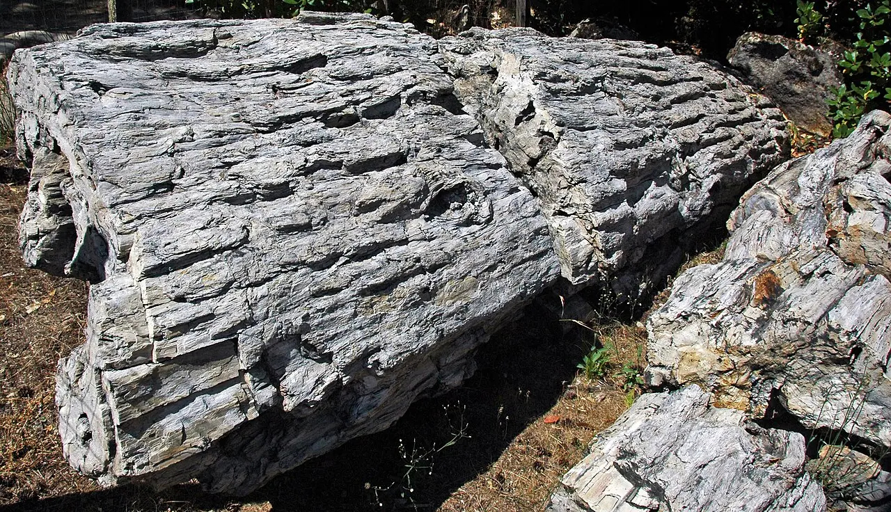

Sequoia sempervirens (fossil redwood tree trunk) (Sonoma Volcanics, Upper Pliocene, 3.2 to 3.4 Ma; Calistoga Petrified Forest, Calistoga, California, USA) 107 (49107492422).jpg — James St. John / [CC BY 2.0](https://creativecommons.org/licenses/by/2.0) / [原典](https://commons.wikimedia.org/wiki/File:Sequoia_sempervirens_%28fossil_redwood_tree_trunk%29_%28Sonoma_Volcanics%2C_Upper_Pliocene%2C_3.2_to_3.4_Ma%3B_Calistoga_Petrified_Forest%2C_Calistoga%2C_California%2C_USA%29_107_%2849107492422%29.jpg)

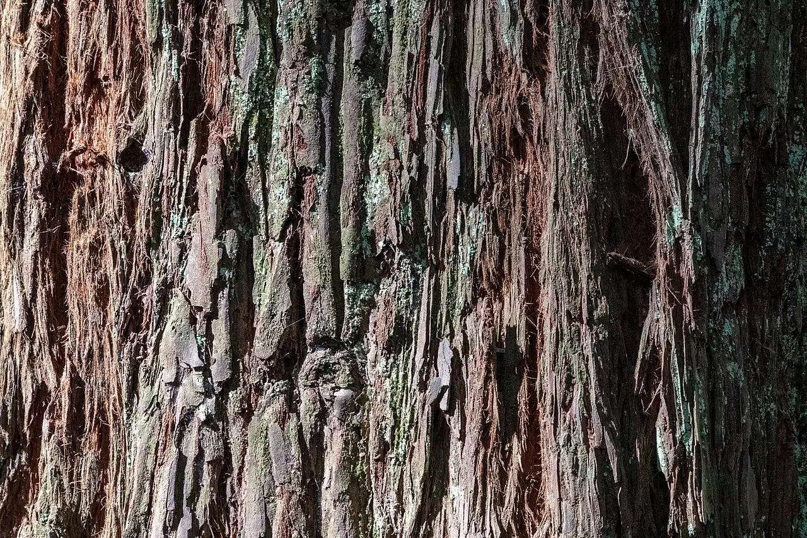

Beech Forest (AU), Great Otway National Park, Californian Redwoods -- 2019 -- 1416.jpg — Dietmar Rabich / [CC BY-SA 4.0](https://creativecommons.org/licenses/by-sa/4.0) / [原典](https://commons.wikimedia.org/wiki/File:Beech_Forest_%28AU%29%2C_Great_Otway_National_Park%2C_Californian_Redwoods_--_2019_--_1416.jpg)

## 海外自然：雲霧林 — cloud-forest

制作で見るところ：霧・着生植物・樹冠の湿り・枝上の苔

関連コード：`app/src/world/nature.js`、`app/src/world/landscape.js`、`app/src/world/sky.js`

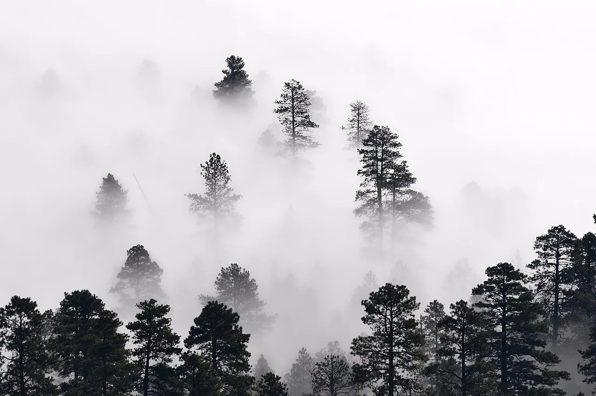

Trees in the mist (7699666560).jpg — Brady Smith; Coconino National Forest / [CC BY-SA 2.0](https://creativecommons.org/licenses/by-sa/2.0) / [原典](https://commons.wikimedia.org/wiki/File:Trees_in_the_mist_%287699666560%29.jpg)

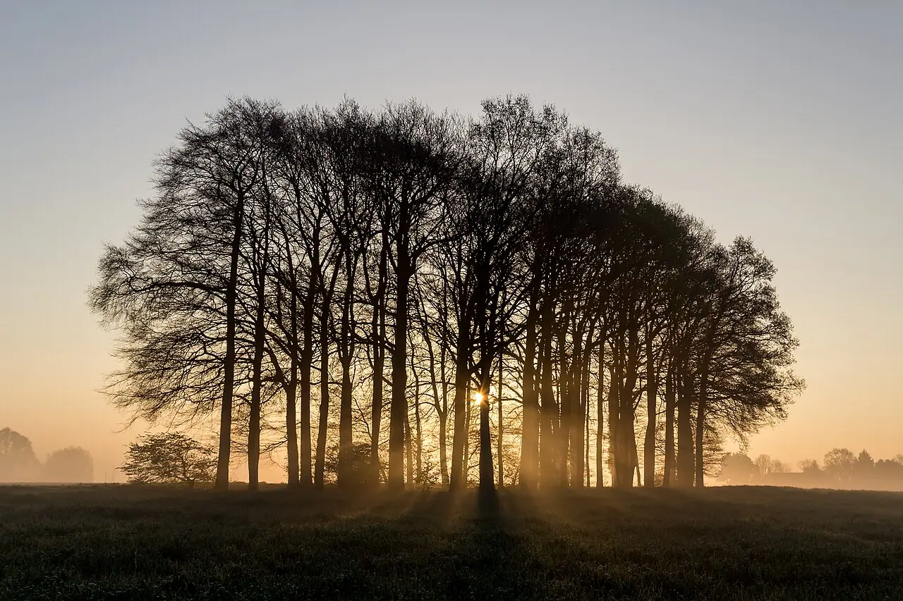

Dülmen, Umland -- 2014 -- 7056.jpg — Dietmar Rabich / [CC BY-SA 4.0](https://creativecommons.org/licenses/by-sa/4.0) / [原典](https://commons.wikimedia.org/wiki/File:D%C3%BClmen%2C_Umland_--_2014_--_7056.jpg)

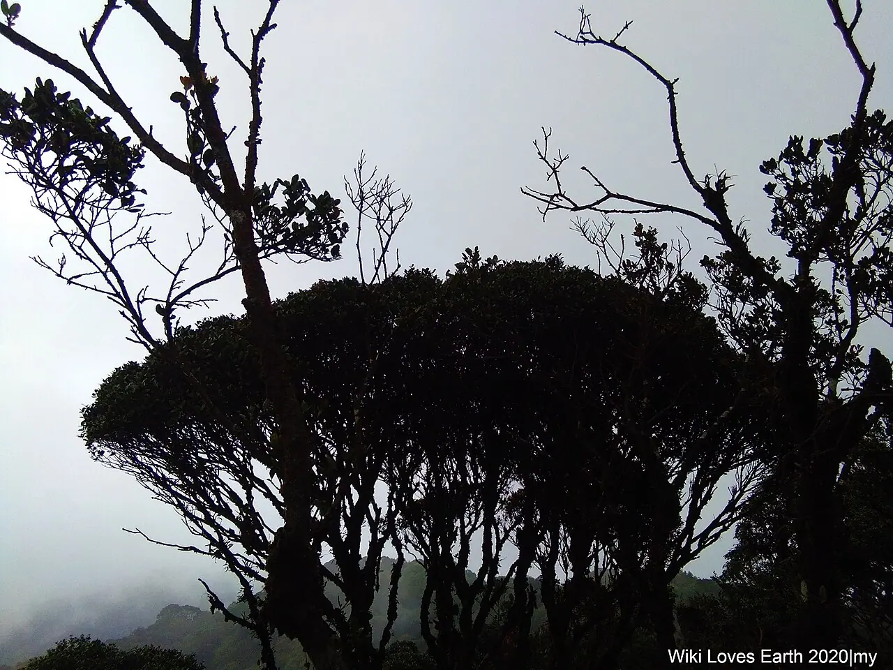

Trees of the misty, Mossy Forest, Cameron Highlands.jpg — Pro QueeNia / [CC BY-SA 4.0](https://creativecommons.org/licenses/by-sa/4.0) / [原典](https://commons.wikimedia.org/wiki/File:Trees_of_the_misty%2C_Mossy_Forest%2C_Cameron_Highlands.jpg)

## 海外自然：熱帯雨林 — tropical-rainforest

制作で見るところ：広い葉・樹冠の多層化・つる植物と密度、異世界の参考にも

関連コード：`app/src/world/nature.js`、`app/src/world/landscape.js`、`app/src/world/sky.js`

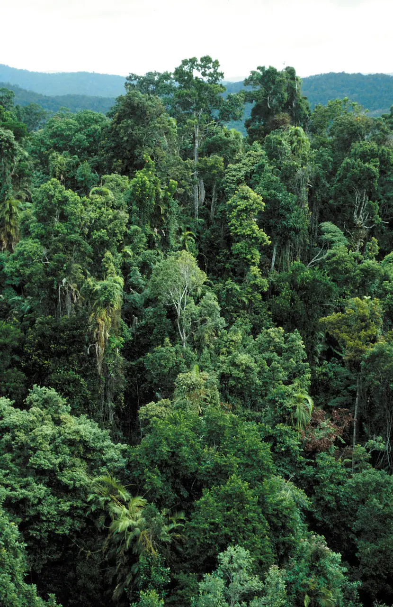

CSIRO ScienceImage 3829 Tropical rainforest canopy near Cairns QLD.jpg — Willem van Aken, CSIRO / [CC BY 3.0](https://creativecommons.org/licenses/by/3.0) / [原典](https://commons.wikimedia.org/wiki/File:CSIRO_ScienceImage_3829_Tropical_rainforest_canopy_near_Cairns_QLD.jpg)

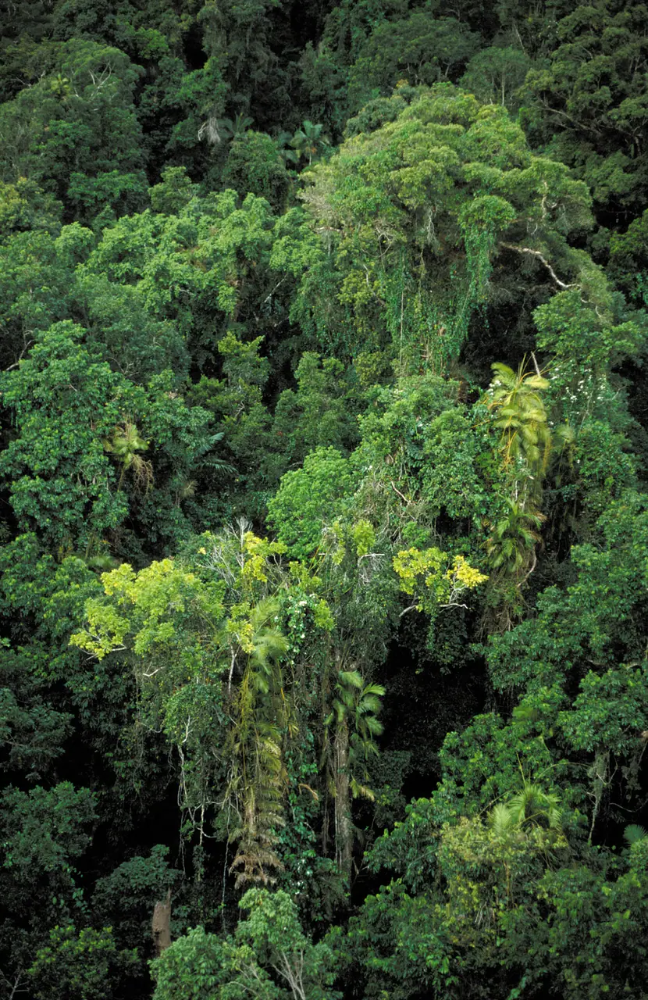

CSIRO ScienceImage 3830 Tropical rainforest canopy near Cairns QLD.jpg — Willem van Aken, CSIRO / [CC BY 3.0](https://creativecommons.org/licenses/by/3.0) / [原典](https://commons.wikimedia.org/wiki/File:CSIRO_ScienceImage_3830_Tropical_rainforest_canopy_near_Cairns_QLD.jpg)

## 海外自然：マングローブ林 — mangrove-woodland

制作で見るところ：水中に伸びる根・潮位・密集した林冠

関連コード：`app/src/world/nature.js`、`app/src/world/landscape.js`、`app/src/world/sky.js`

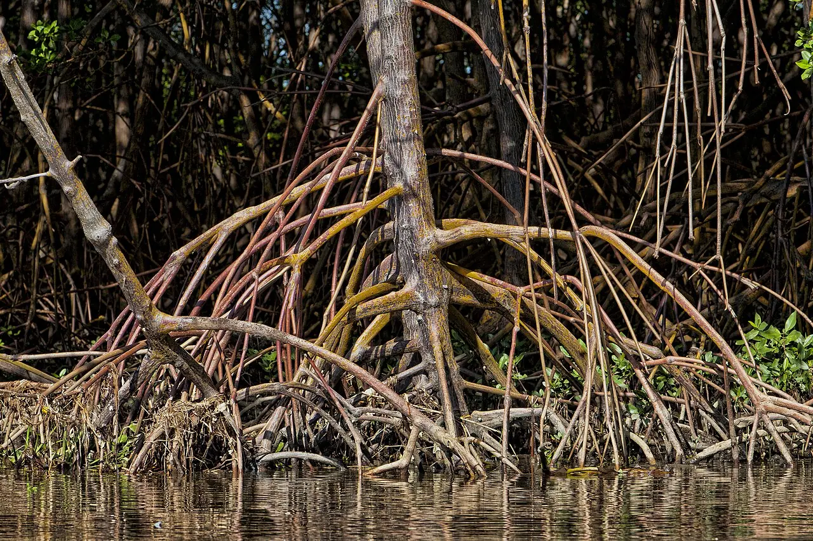

Detail of mangrove roots.jpg — Jonathan Wilkins / [CC BY-SA 3.0](https://creativecommons.org/licenses/by-sa/3.0) / [原典](https://commons.wikimedia.org/wiki/File:Detail_of_mangrove_roots.jpg)

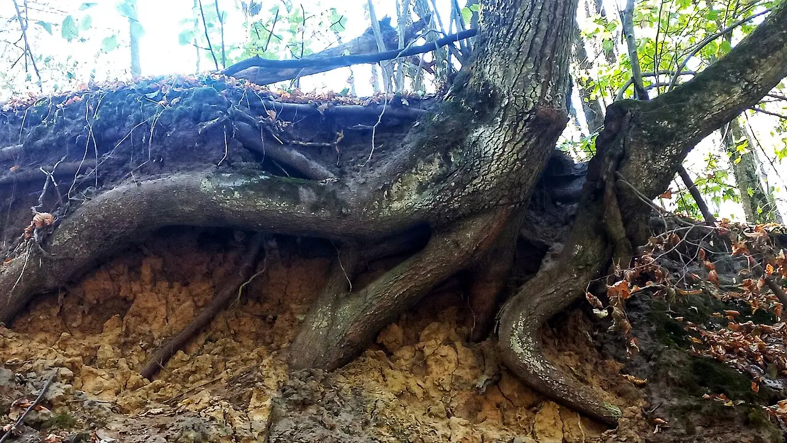

Roots of the Mangrove Forest 2024.jpg — Berser25 / [CC BY-SA 4.0](https://creativecommons.org/licenses/by-sa/4.0) / [原典](https://commons.wikimedia.org/wiki/File:Roots_of_the_Mangrove_Forest_2024.jpg)

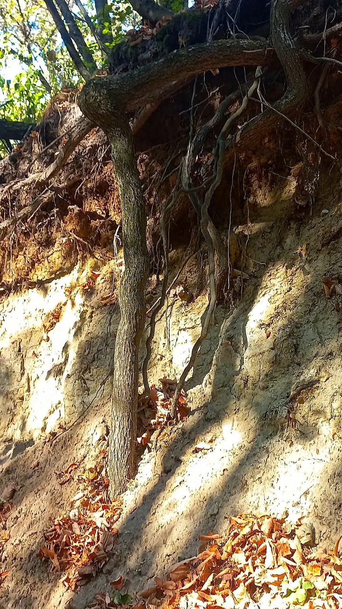

Roots of the Mangrove Forest.jpg — Berser25 / [CC BY-SA 4.0](https://creativecommons.org/licenses/by-sa/4.0) / [原典](https://commons.wikimedia.org/wiki/File:Roots_of_the_Mangrove_Forest.jpg)

## 海外自然：乾燥した常緑樹林 — mediterranean-oak-forest

制作で見るところ：疎らな林冠・岩肌・硬い小さな葉・乾燥地の地面

関連コード：`app/src/world/nature.js`、`app/src/world/landscape.js`、`app/src/world/sky.js`

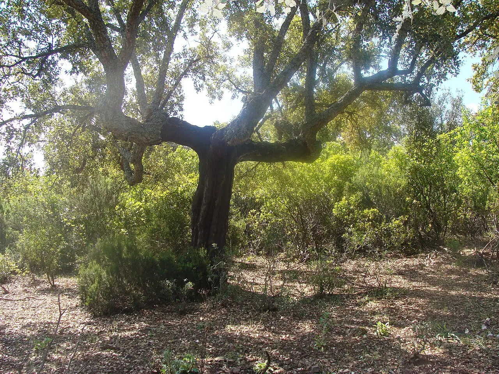

Quercus suber.001 - Monfrague.JPG — Fernando Losada Rodríguez] / [CC BY-SA 4.0](https://creativecommons.org/licenses/by-sa/4.0) / [原典](https://commons.wikimedia.org/wiki/File:Quercus_suber.001_-_Monfrague.JPG)

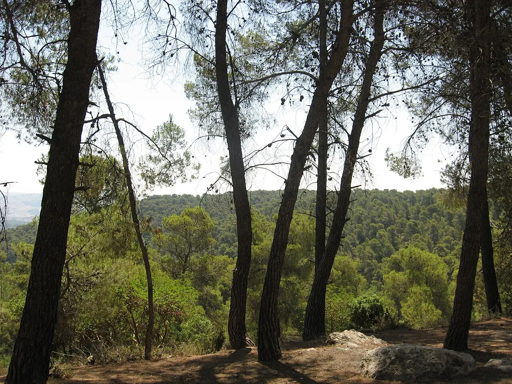

Dibeen Trees.jpg — The original uploader was Ldud at English Wikipedia. / [CC BY-SA 3.0](https://creativecommons.org/licenses/by-sa/3.0/) / [原典](https://commons.wikimedia.org/wiki/File:Dibeen_Trees.jpg)

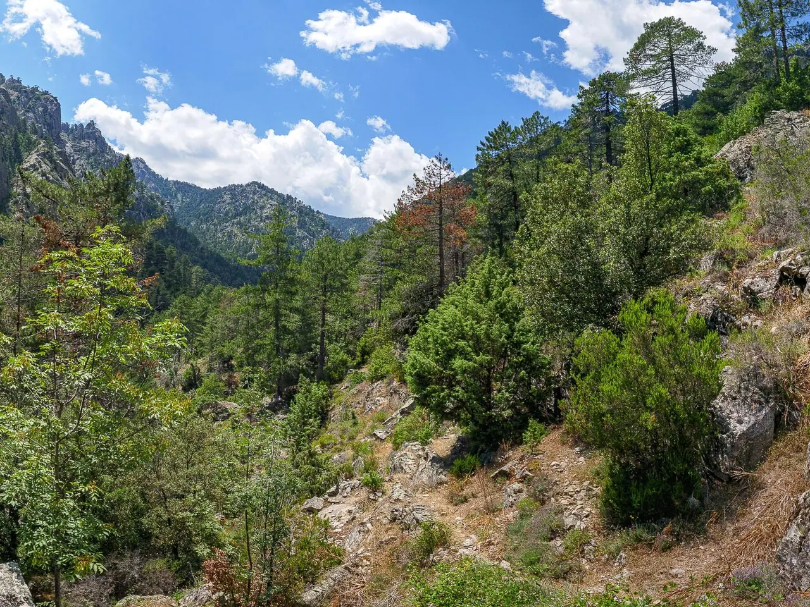

Upper meso-Mediterranean shrubland and forest in Corsica.jpg — Cardioceras / [CC BY 4.0](https://creativecommons.org/licenses/by/4.0) / [原典](https://commons.wikimedia.org/wiki/File:Upper_meso-Mediterranean_shrubland_and_forest_in_Corsica.jpg)

## 海外自然：湖と山の森 — wooded-alpine-lakes

制作で見るところ：湖の反射・針葉樹の遠景・林縁の境界

関連コード：`app/src/world/nature.js`、`app/src/world/landscape.js`、`app/src/world/sky.js`

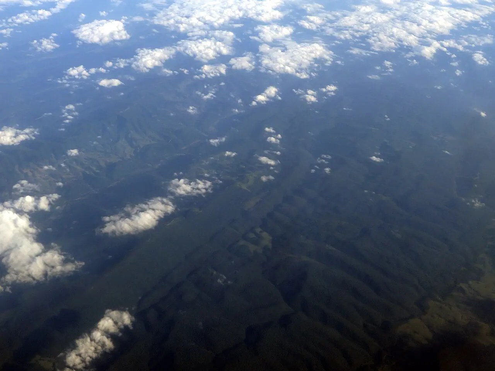

Spruce Knob, Allegheny Mountains, West Virginia (14494813301).jpg — Ken Lund from Reno, Nevada, USA / [CC BY-SA 2.0](https://creativecommons.org/licenses/by-sa/2.0) / [原典](https://commons.wikimedia.org/wiki/File:Spruce_Knob%2C_Allegheny_Mountains%2C_West_Virginia_%2814494813301%29.jpg)

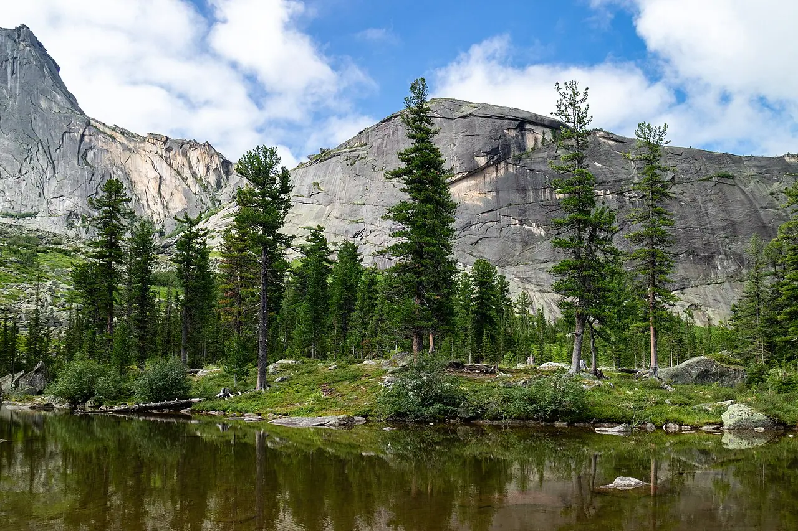

Ergaki, Lake Lazurnoye and pine forest, Sayan Mountains, Siberia, Russia.jpg — Vyacheslav Argenberg / [CC BY 4.0](https://creativecommons.org/licenses/by/4.0) / [原典](https://commons.wikimedia.org/wiki/File:Ergaki%2C_Lake_Lazurnoye_and_pine_forest%2C_Sayan_Mountains%2C_Siberia%2C_Russia.jpg)

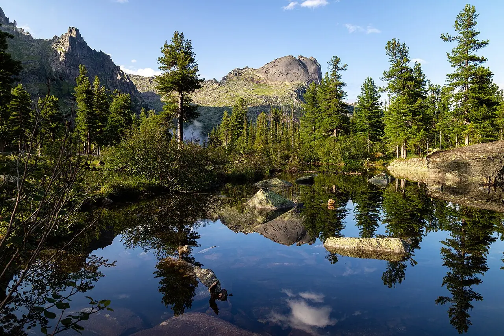

Ergaki, Artists' Lake and pine forest, Sayan Mountains, Russia.jpg — Vyacheslav Argenberg / [CC BY 4.0](https://creativecommons.org/licenses/by/4.0) / [原典](https://commons.wikimedia.org/wiki/File:Ergaki%2C_Artists%27_Lake_and_pine_forest%2C_Sayan_Mountains%2C_Russia.jpg)

## 海外自然：石灰岩と森 — karst-forest-landscape

制作で見るところ：岩山の急勾配・石灰岩の隙間に育つ樹木

関連コード：`app/src/world/nature.js`、`app/src/world/landscape.js`、`app/src/world/sky.js`

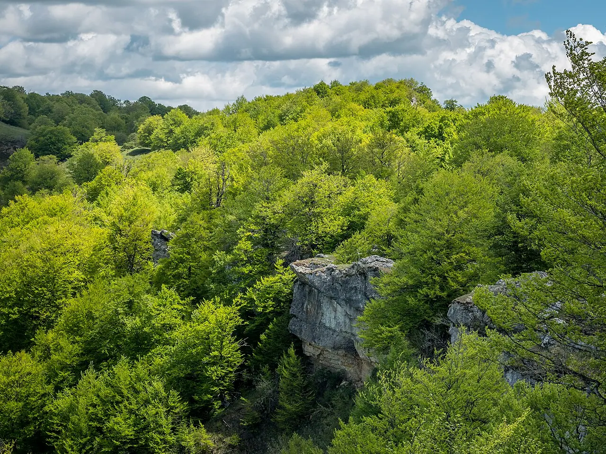

Entzia - Hayedo en el acantilado 01.jpg — Basotxerri / [CC BY-SA 4.0](https://creativecommons.org/licenses/by-sa/4.0) / [原典](https://commons.wikimedia.org/wiki/File:Entzia_-_Hayedo_en_el_acantilado_01.jpg)

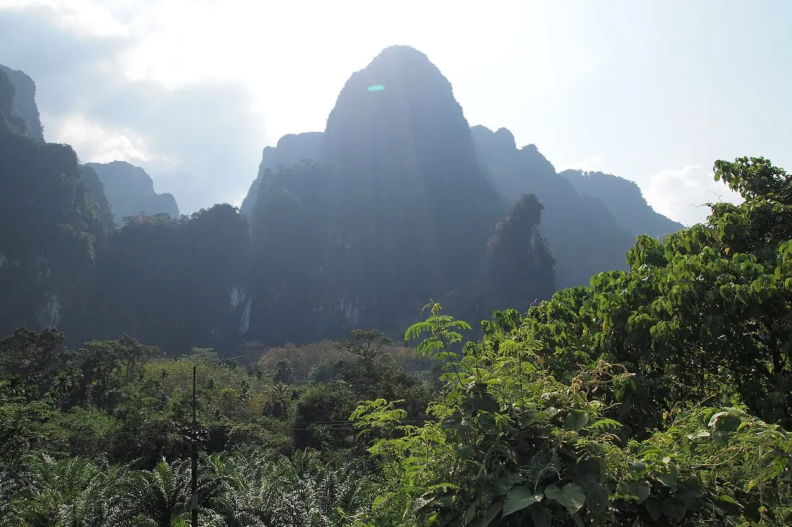

Dramatic karst landscape of Surat Thani, Khlong Phanom jungle, Thailand.jpg — Vyacheslav Argenberg / [CC BY 4.0](https://creativecommons.org/licenses/by/4.0) / [原典](https://commons.wikimedia.org/wiki/File:Dramatic_karst_landscape_of_Surat_Thani%2C_Khlong_Phanom_jungle%2C_Thailand.jpg)

## 海外自然：海辺の松林 — coastal-pine-woods

制作で見るところ：潮風による樹形、砂地と根・海辺の光

関連コード：`app/src/world/nature.js`、`app/src/world/landscape.js`、`app/src/world/sky.js`

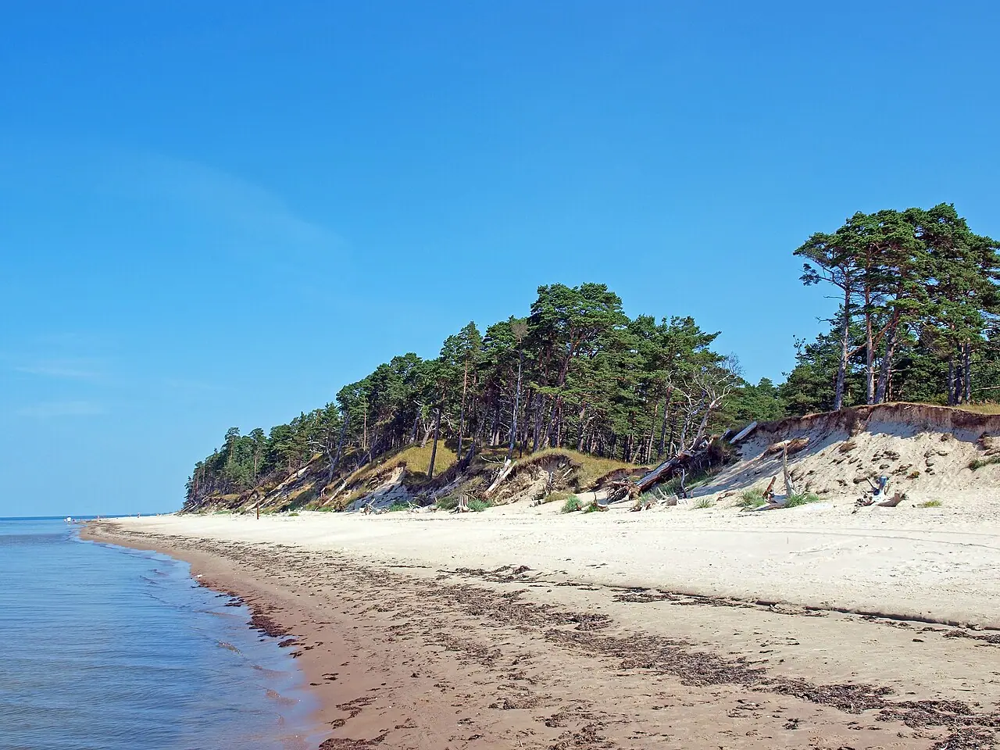

Coastal dunes 002.jpg — Nicenieks / [CC BY-SA 4.0](https://creativecommons.org/licenses/by-sa/4.0) / [原典](https://commons.wikimedia.org/wiki/File:Coastal_dunes_002.jpg)

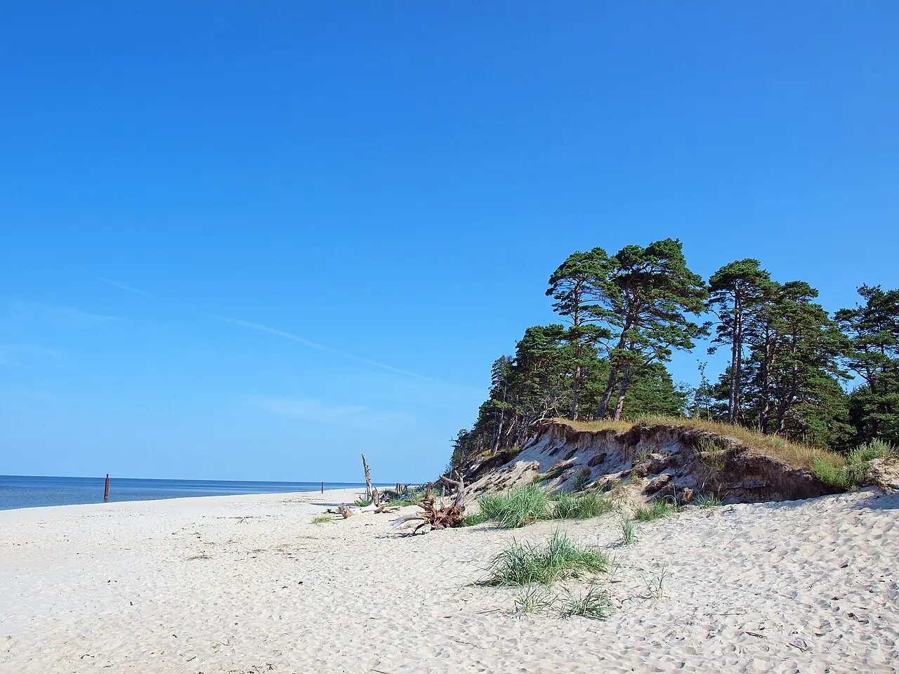

Coastal dunes 001.jpg — Nicenieks / [CC BY-SA 4.0](https://creativecommons.org/licenses/by-sa/4.0) / [原典](https://commons.wikimedia.org/wiki/File:Coastal_dunes_001.jpg)

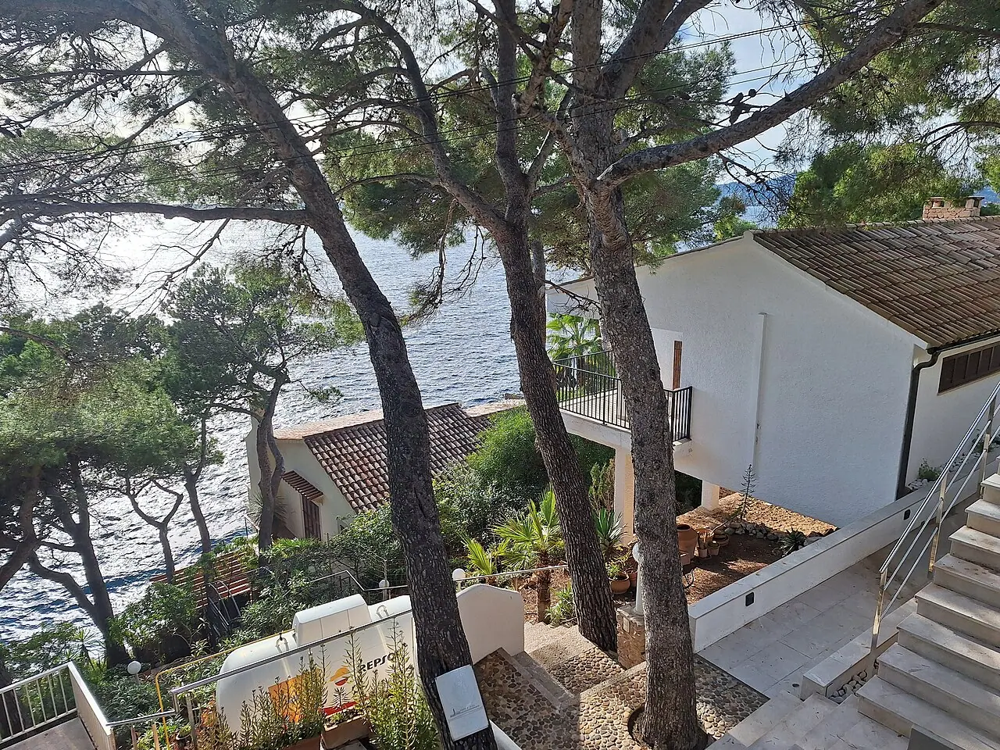

Pine trees and coastal residences Costa dels Pins Mallorca.jpg — Steffen Mokosch / [CC BY-SA 4.0](https://creativecommons.org/licenses/by-sa/4.0) / [原典](https://commons.wikimedia.org/wiki/File:Pine_trees_and_coastal_residences_Costa_dels_Pins_Mallorca.jpg)

## 海外自然：アンデスの山林 — andean-mountain-forests

制作で見るところ：雲・急斜面・広葉樹と山道・遠景の色

関連コード：`app/src/world/nature.js`、`app/src/world/landscape.js`、`app/src/world/sky.js`

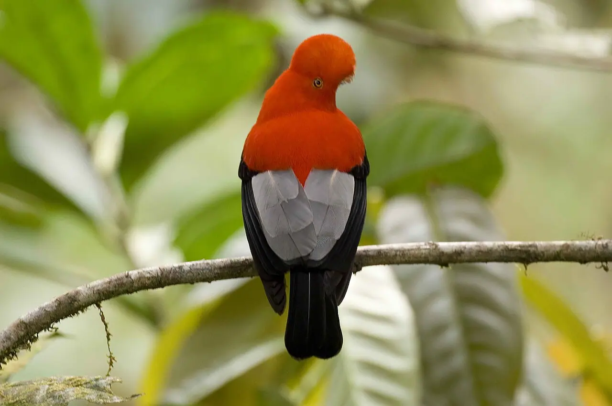

AndeanCock-of-the-Rock 1.JPG — Jdpecuador (talk) / [CC BY-SA 3.0](https://creativecommons.org/licenses/by-sa/3.0) / [原典](https://commons.wikimedia.org/wiki/File:AndeanCock-of-the-Rock_1.JPG)

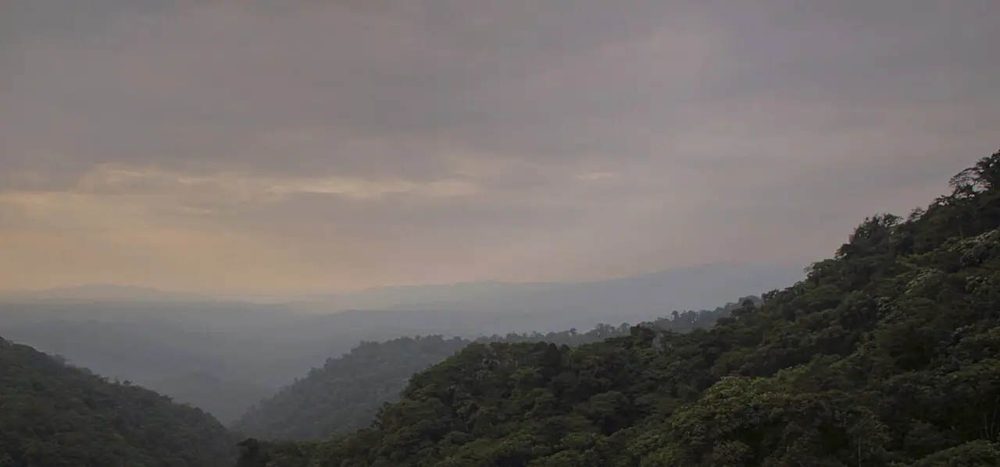

Andean cloudforest - Mindo.jpg — nearsjasmine / [CC BY-SA 2.0](https://creativecommons.org/licenses/by-sa/2.0) / [原典](https://commons.wikimedia.org/wiki/File:Andean_cloudforest_-_Mindo.jpg)

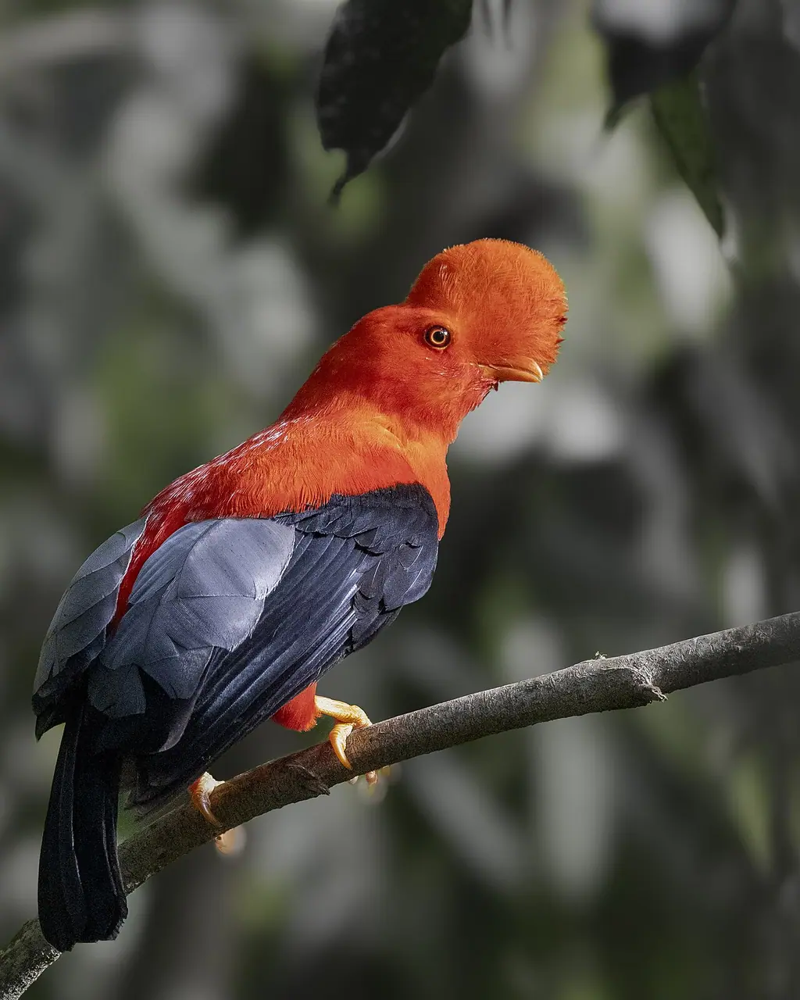

Andean Cock-of-the-rock.jpg — Das.upamanyu / [CC BY 4.0](https://creativecommons.org/licenses/by/4.0) / [原典](https://commons.wikimedia.org/wiki/File:Andean_Cock-of-the-rock.jpg)

## 海外自然：草原の疎林 — savanna-tree-groves

制作で見るところ：木が点在する間隔・群れ・木陰、通常の日本の森との違い

関連コード：`app/src/world/nature.js`、`app/src/world/landscape.js`、`app/src/world/sky.js`

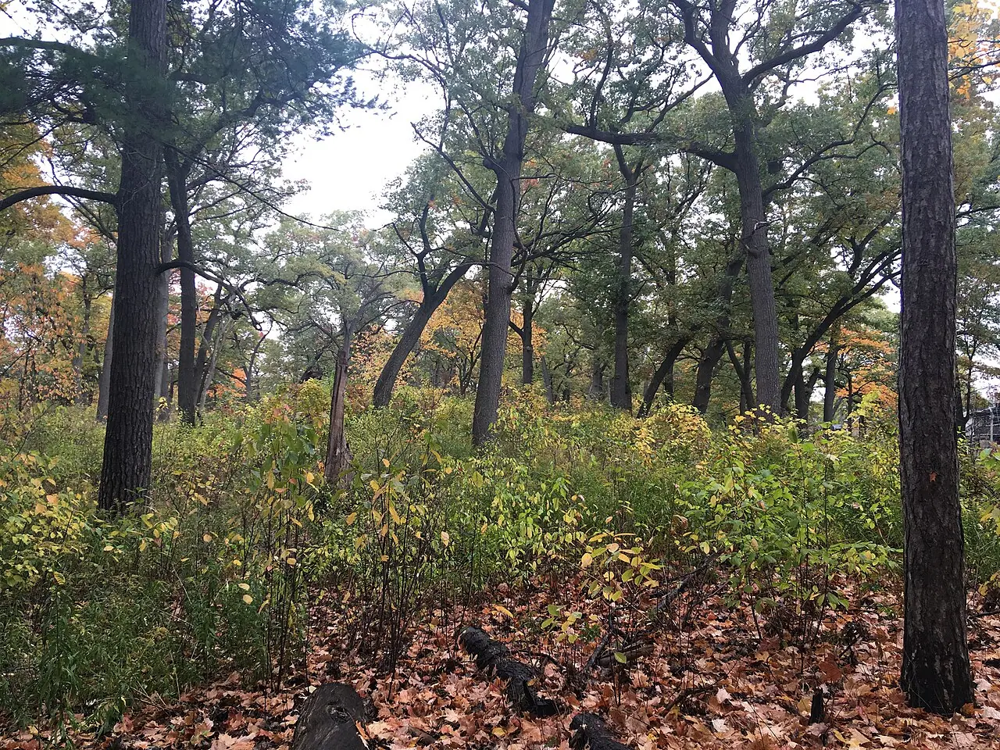

Black oak savannah in High Park, Toronto, Ontario, Canada, autumn 2020.jpg — NiceDerangedEpitaph89 / [CC BY-SA 4.0](https://creativecommons.org/licenses/by-sa/4.0) / [原典](https://commons.wikimedia.org/wiki/File:Black_oak_savannah_in_High_Park%2C_Toronto%2C_Ontario%2C_Canada%2C_autumn_2020.jpg)

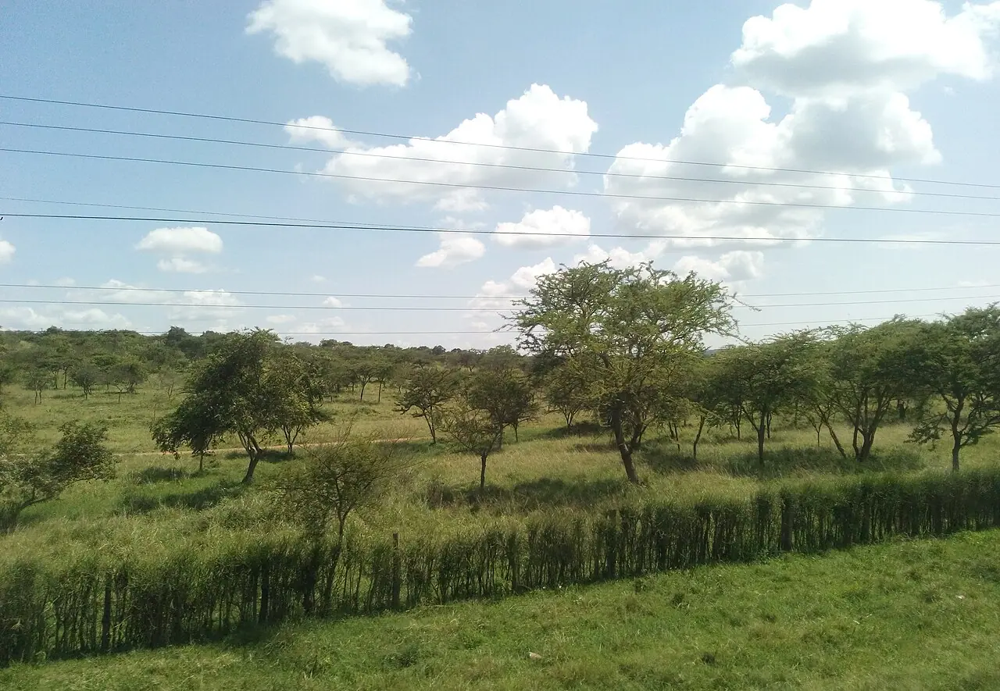

Savanna trees at a Ranch in Lyantonde District.jpg — Emma Oruk / [CC BY-SA 4.0](https://creativecommons.org/licenses/by-sa/4.0) / [原典](https://commons.wikimedia.org/wiki/File:Savanna_trees_at_a_Ranch_in_Lyantonde_District.jpg)

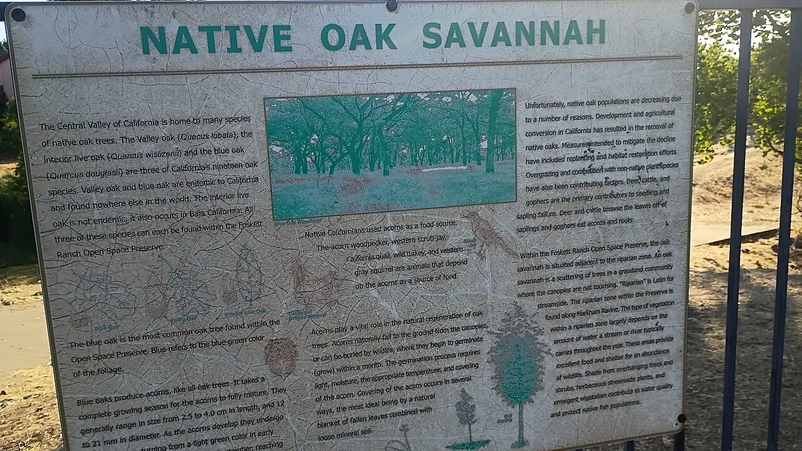

Native Oak Savannah.jpg — TheAriAlvarez / [CC0](https://creativecommons.org/publicdomain/zero/1.0/deed.en) / [原典](https://commons.wikimedia.org/wiki/File:Native_Oak_Savannah.jpg)

