# world-town — reference photos

[← Gallery index](./README.md) | [Credits](../catalog/CREDITS.md)

## 海外参考：北欧の木造集落 — nordic-wooden-villages

制作で見るところ：木の外壁・小さな窓・家の色・森と家の距離（日本の標準建築には直輸入しない）

関連コード：`app/src/world/town.js`、`app/src/world/house.js`、`app/src/world/road.js`

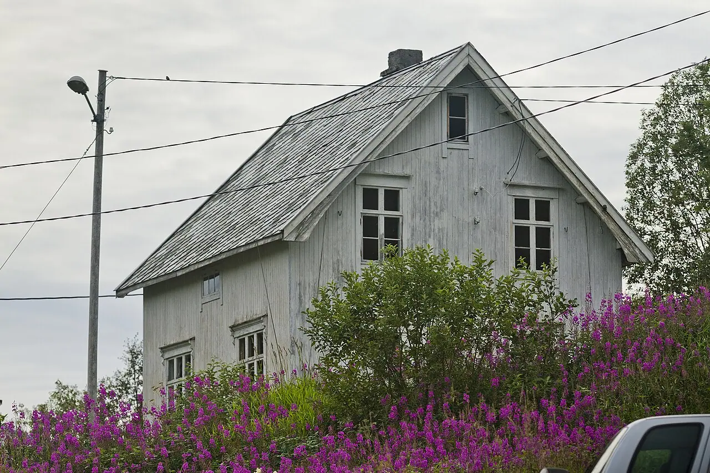

House in Torsken, Senja, Troms, Norway, 2014 August.jpg — Ximonic (Simo Räsänen) / [CC BY-SA 4.0](https://creativecommons.org/licenses/by-sa/4.0) / [原典](https://commons.wikimedia.org/wiki/File:House_in_Torsken%2C_Senja%2C_Troms%2C_Norway%2C_2014_August.jpg)

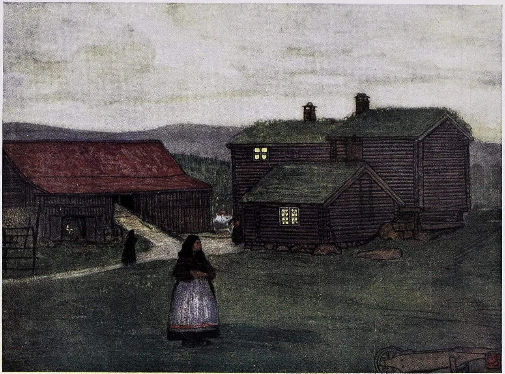

Nico Jungman (1872-1935) NORWAY Text by Beatrix Jungman publ. by A&C Black, London 1905 norway1905jung 0371 FARM-HOUSES BUILT OF POLES (wooden log houses) No known copyright restrictions.jpg — Nico Jungmann / [CC BY-SA 4.0](https://creativecommons.org/licenses/by-sa/4.0) / [原典](https://commons.wikimedia.org/wiki/File:Nico_Jungman_%281872-1935%29_NORWAY_Text_by_Beatrix_Jungman_publ._by_A%26C_Black%2C_London_1905_norway1905jung_0371_FARM-HOUSES_BUILT_OF_POLES_%28wooden_log_houses%29_No_known_copyright_restrictions.jpg)

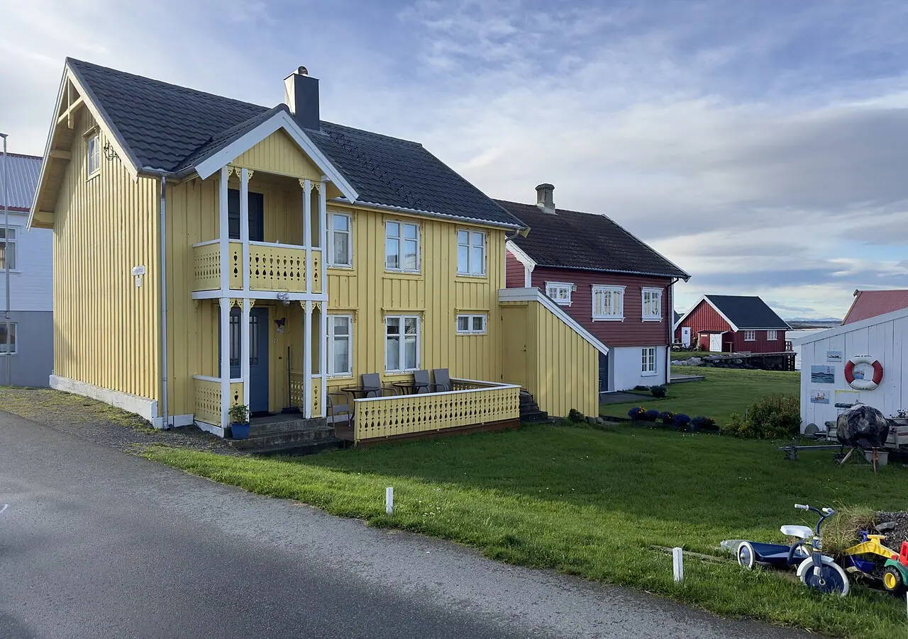

VEIHOLMEN fiskevær fishing village Smøla NORWAY 2024-09-11 Angelhus 1030 yellow wooden house IMG 9346.jpg — Wolfmann / [CC BY 4.0](https://creativecommons.org/licenses/by/4.0) / [原典](https://commons.wikimedia.org/wiki/File:VEIHOLMEN_fiskev%C3%A6r_fishing_village_Sm%C3%B8la_NORWAY_2024-09-11_Angelhus_1030_yellow_wooden_house_IMG_9346.jpg)

## 海外参考：アルプスの山村 — alpine-villages

制作で見るところ：屋根勾配、山地に沿った建物、木製ベランダと牧草地

関連コード：`app/src/world/town.js`、`app/src/world/house.js`、`app/src/world/road.js`

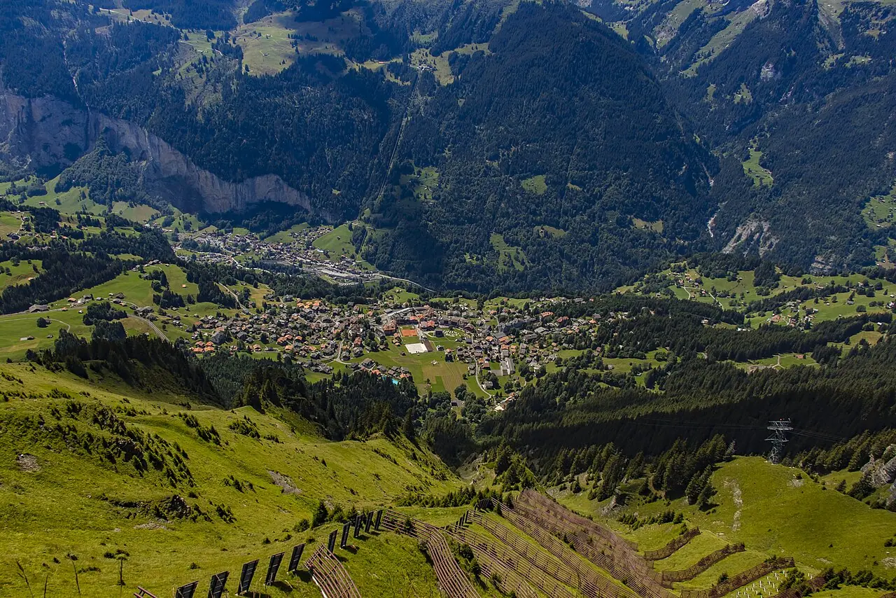

Wengen Village (222793359).jpeg — Kay Röllig / [CC BY 3.0](https://creativecommons.org/licenses/by/3.0) / [原典](https://commons.wikimedia.org/wiki/File:Wengen_Village_%28222793359%29.jpeg)

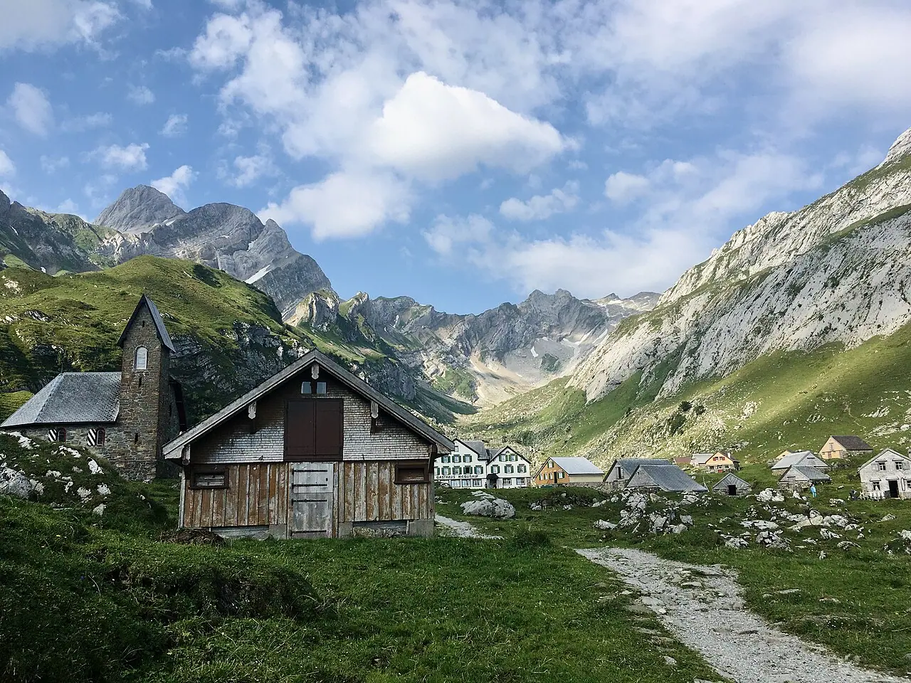

Le village de Meglisalp.jpg — Estela Aloha / [CC BY-SA 4.0](https://creativecommons.org/licenses/by-sa/4.0) / [原典](https://commons.wikimedia.org/wiki/File:Le_village_de_Meglisalp.jpg)

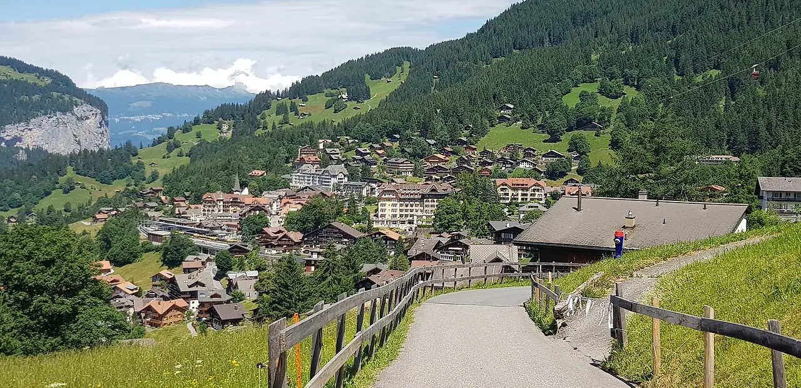

Wengen village view towards Lauterbrunnen valley.jpg — Armineaghayan / [CC BY-SA 4.0](https://creativecommons.org/licenses/by-sa/4.0) / [原典](https://commons.wikimedia.org/wiki/File:Wengen_village_view_towards_Lauterbrunnen_valley.jpg)

## 海外参考：英国の小さな家と路地 — british-cottage-lanes

制作で見るところ：石塀・植物・手入れされた庭・道路の幅と家の関係

関連コード：`app/src/world/town.js`、`app/src/world/house.js`、`app/src/world/road.js`

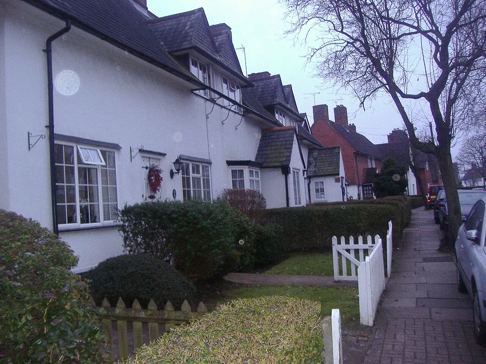

Cottages on Goldsmith Lane, Roe Green Village - geograph.org.uk - 4026161.jpg — David Howard / [CC BY-SA 2.0](https://creativecommons.org/licenses/by-sa/2.0) / [原典](https://commons.wikimedia.org/wiki/File:Cottages_on_Goldsmith_Lane%2C_Roe_Green_Village_-_geograph.org.uk_-_4026161.jpg)

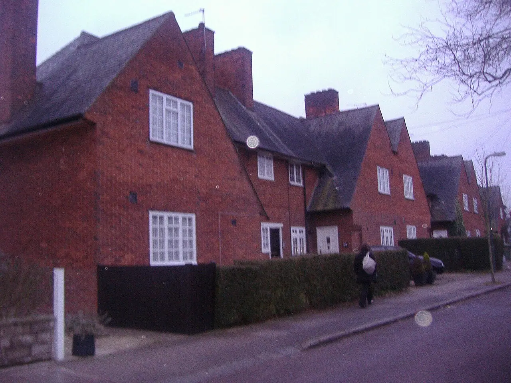

Cottages on Goldsmith Lane, Roe Green Village - geograph.org.uk - 4026191.jpg — David Howard / [CC BY-SA 2.0](https://creativecommons.org/licenses/by-sa/2.0) / [原典](https://commons.wikimedia.org/wiki/File:Cottages_on_Goldsmith_Lane%2C_Roe_Green_Village_-_geograph.org.uk_-_4026191.jpg)

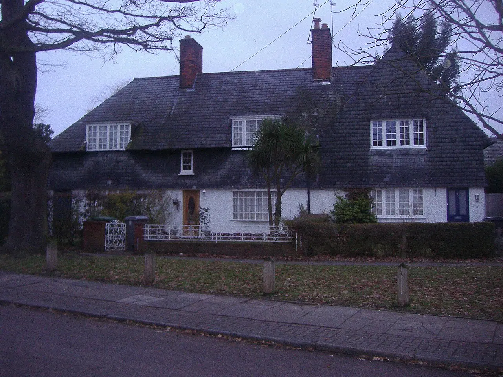

Cottages on Goldsmith Lane, Roe Green Village - geograph.org.uk - 4026207.jpg — David Howard / [CC BY-SA 2.0](https://creativecommons.org/licenses/by-sa/2.0) / [原典](https://commons.wikimedia.org/wiki/File:Cottages_on_Goldsmith_Lane%2C_Roe_Green_Village_-_geograph.org.uk_-_4026207.jpg)

## 海外参考：フランスの石造りの村 — french-stone-villages

制作で見るところ：石壁・窓枠・蔦・小路の奥行きと日差し

関連コード：`app/src/world/town.js`、`app/src/world/house.js`、`app/src/world/road.js`

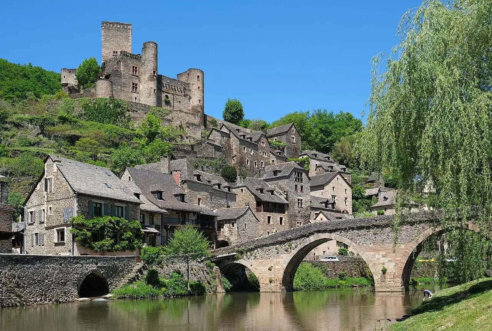

Belcastel 4.jpg — kallerna / [CC BY-SA 4.0](https://creativecommons.org/licenses/by-sa/4.0) / [原典](https://commons.wikimedia.org/wiki/File:Belcastel_4.jpg)

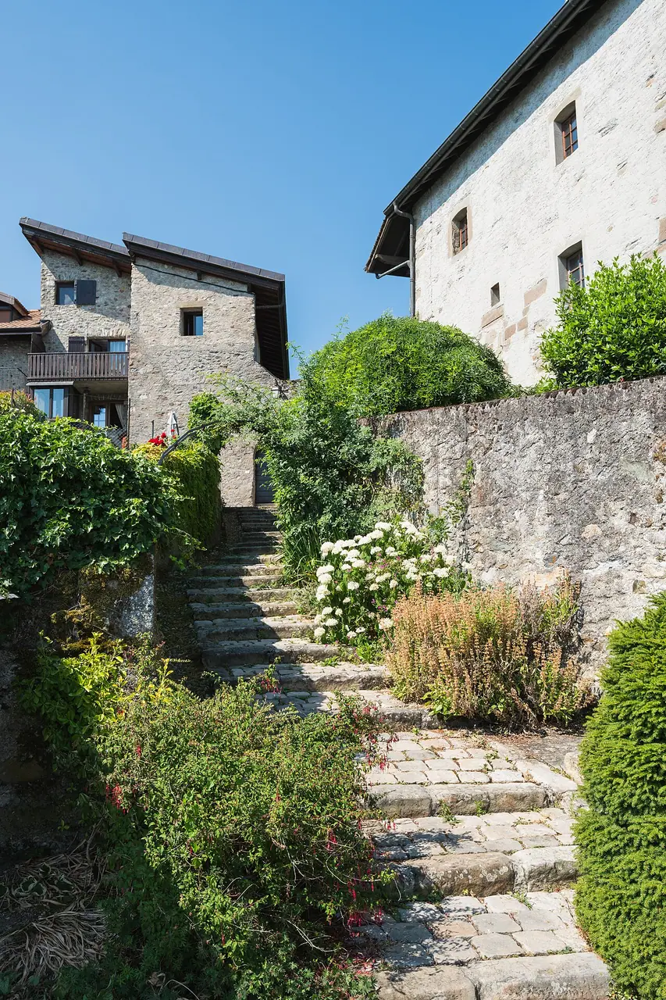

Flowered stone stairway, Yvoire, Haute-Savoie.jpg — Christian David / [CC BY-SA 4.0](https://creativecommons.org/licenses/by-sa/4.0) / [原典](https://commons.wikimedia.org/wiki/File:Flowered_stone_stairway%2C_Yvoire%2C_Haute-Savoie.jpg)

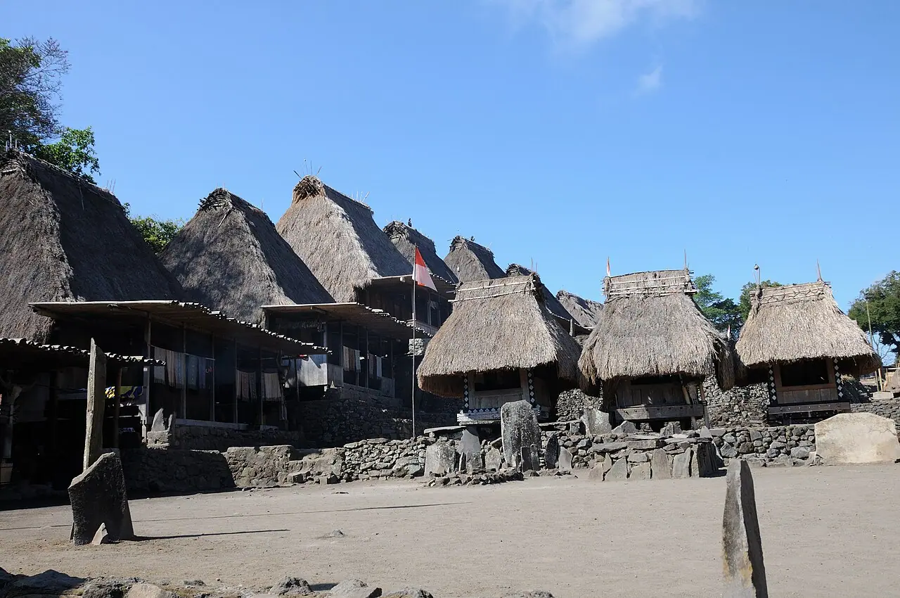

BTV - Traditional houses and stone structures in Bena village, Flores, Indonesia, 2019.jpg — Josep M. Gracia / [CC BY-SA 4.0](https://creativecommons.org/licenses/by-sa/4.0) / [原典](https://commons.wikimedia.org/wiki/File:BTV_-_Traditional_houses_and_stone_structures_in_Bena_village%2C_Flores%2C_Indonesia%2C_2019.jpg)

## 海外参考：イタリアの坂の町 — italian-hilltowns

制作で見るところ：段々に連なる家、階段、テラス、遠景の繋がり

関連コード：`app/src/world/town.js`、`app/src/world/house.js`、`app/src/world/road.js`

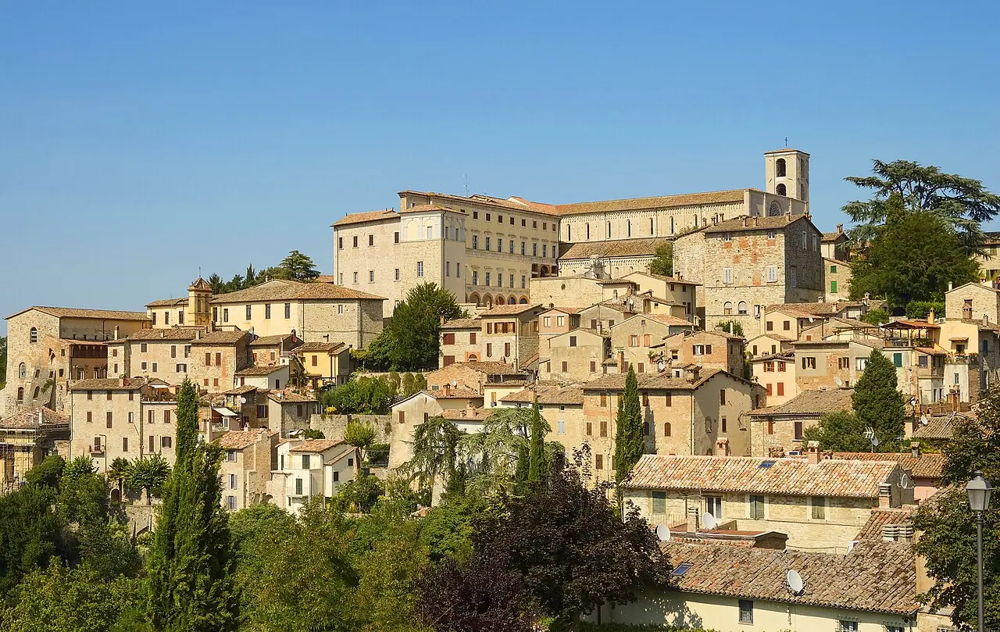

Todi panorama.jpg — Livioandronico2013 / [CC BY-SA 4.0](https://creativecommons.org/licenses/by-sa/4.0) / [原典](https://commons.wikimedia.org/wiki/File:Todi_panorama.jpg)

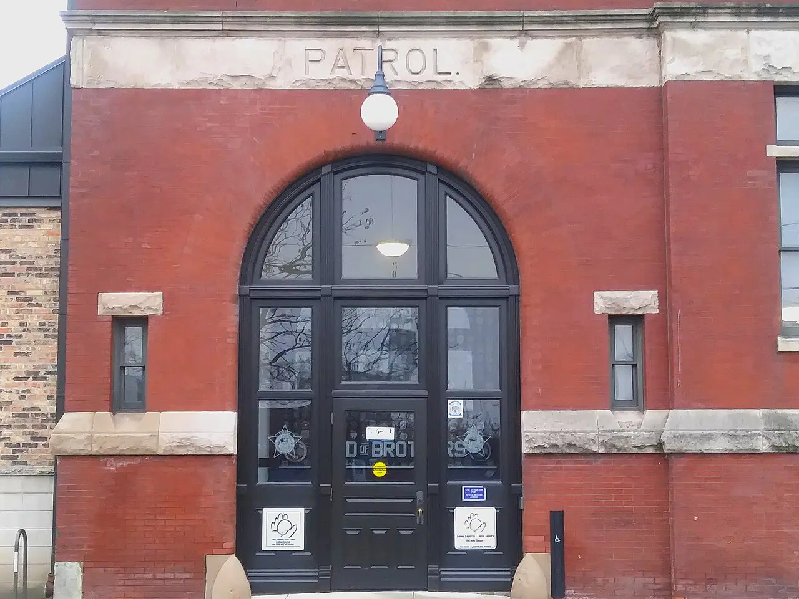

Former 7th District "Hill Street Blues" Police Station, Chicago.jpg — Stephen Hogan / [CC BY 2.0](https://creativecommons.org/licenses/by/2.0) / [原典](https://commons.wikimedia.org/wiki/File:Former_7th_District_%22Hill_Street_Blues%22_Police_Station%2C_Chicago.jpg)

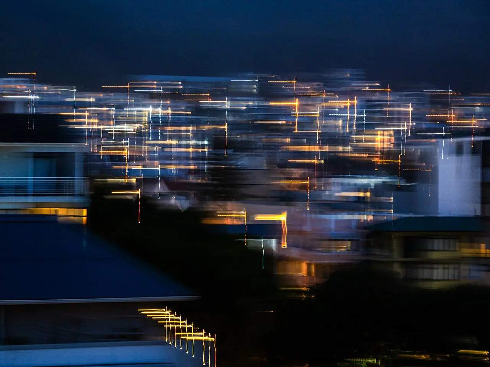

Cape Town (ZA), Sea Point, Nachtansicht -- 2024 -- 1867-70 - 2.jpg — Dietmar Rabich / [CC BY-SA 4.0](https://creativecommons.org/licenses/by-sa/4.0) / [原典](https://commons.wikimedia.org/wiki/File:Cape_Town_%28ZA%29%2C_Sea_Point%2C_Nachtansicht_--_2024_--_1867-70_-_2.jpg)

## 海外参考：イベリアの白壁と瓦 — iberian-village-streets

制作で見るところ：白壁・赤い屋根・日陰の路地・植木鉢

関連コード：`app/src/world/town.js`、`app/src/world/house.js`、`app/src/world/road.js`

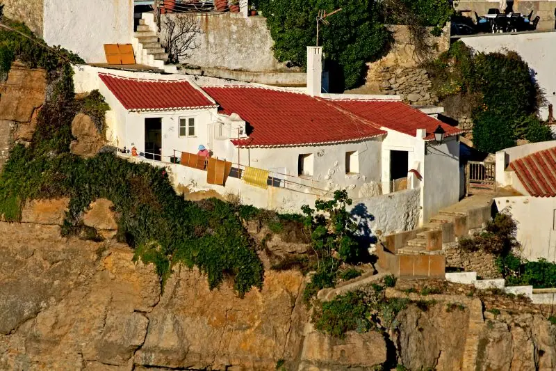

Atlantic Portuguese Village (2234668867).jpg — Francisco Antunes / [CC BY 2.0](https://creativecommons.org/licenses/by/2.0) / [原典](https://commons.wikimedia.org/wiki/File:Atlantic_Portuguese_Village_%282234668867%29.jpg)

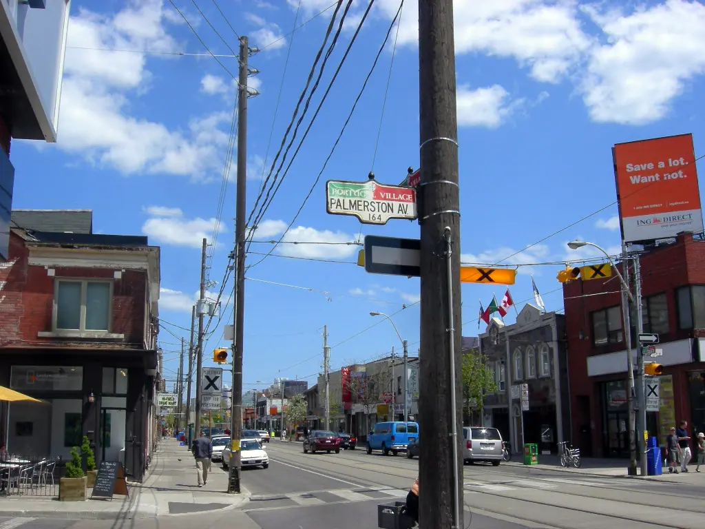

Portugal Village, Toronto.png — maren krüger / [CC BY 2.0](https://creativecommons.org/licenses/by/2.0) / [原典](https://commons.wikimedia.org/wiki/File:Portugal_Village%2C_Toronto.png)

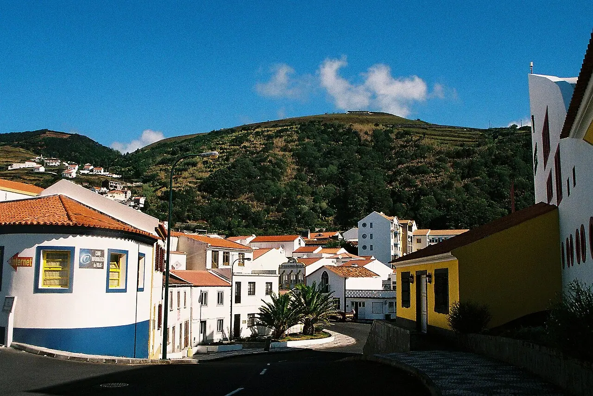

Village of Velas São Jorge Azores.jpg — Sudzie / [CC BY-SA 4.0](https://creativecommons.org/licenses/by-sa/4.0) / [原典](https://commons.wikimedia.org/wiki/File:Village_of_Velas_S%C3%A3o_Jorge_Azores.jpg)

## 海外参考：鉢植えの多い街路 — mediterranean-potted-streets

制作で見るところ：鉢や蔦が建物と道の隙間に入る様子、光と陰

関連コード：`app/src/world/town.js`、`app/src/world/house.js`、`app/src/world/road.js`

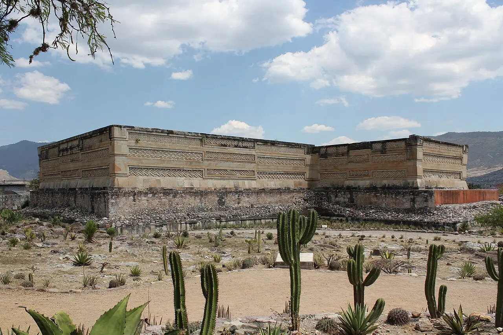

Mitla, Group of the Columns, Palace of Columns (20064199284).jpg — Arian Zwegers from Brussels, Belgium / [CC BY 2.0](https://creativecommons.org/licenses/by/2.0) / [原典](https://commons.wikimedia.org/wiki/File:Mitla%2C_Group_of_the_Columns%2C_Palace_of_Columns_%2820064199284%29.jpg)

## 海外参考：運河と水辺の住宅 — dutch-canals-and-houses

制作で見るところ：石橋・運河沿いの街路樹・水への建物の向き

関連コード：`app/src/world/town.js`、`app/src/world/house.js`、`app/src/world/road.js`

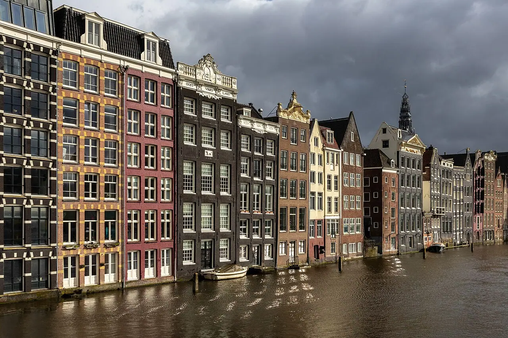

Colorful canal houses at golden hour in Damrak avenue Amsterdam the Netherlands.jpg — Basile Morin / [CC BY-SA 4.0](https://creativecommons.org/licenses/by-sa/4.0) / [原典](https://commons.wikimedia.org/wiki/File:Colorful_canal_houses_at_golden_hour_in_Damrak_avenue_Amsterdam_the_Netherlands.jpg)

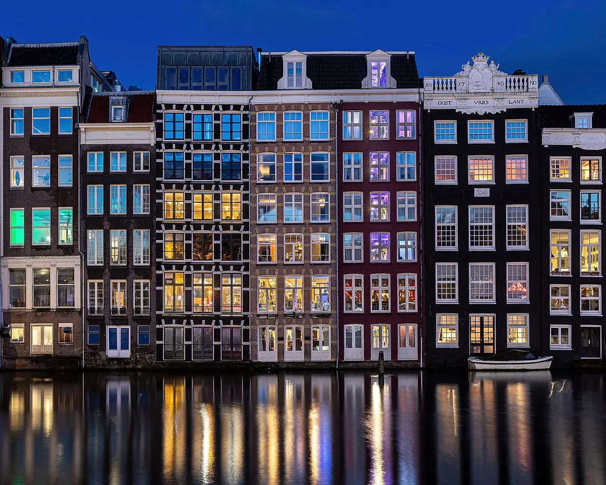

Water reflection of canal houses at blue hour in Damrak Amsterdam the Netherlands.jpg — Basile Morin / [CC BY-SA 4.0](https://creativecommons.org/licenses/by-sa/4.0) / [原典](https://commons.wikimedia.org/wiki/File:Water_reflection_of_canal_houses_at_blue_hour_in_Damrak_Amsterdam_the_Netherlands.jpg)

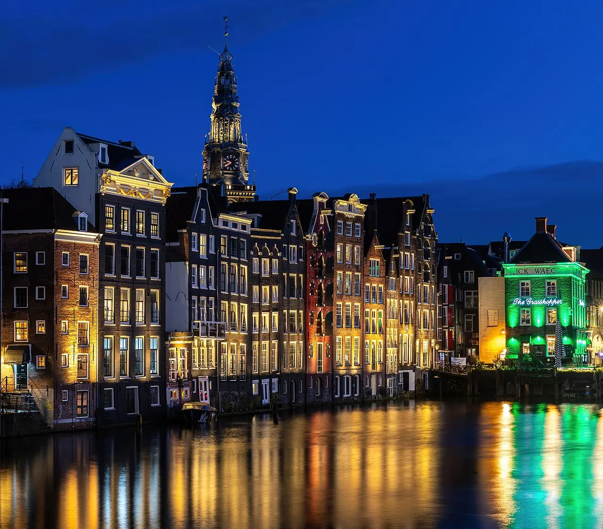

Canal houses and Oude Kerk at blue hour with water reflection in Damrak Amsterdam Netherlands.jpg — Basile Morin / [CC BY-SA 4.0](https://creativecommons.org/licenses/by-sa/4.0) / [原典](https://commons.wikimedia.org/wiki/File:Canal_houses_and_Oude_Kerk_at_blue_hour_with_water_reflection_in_Damrak_Amsterdam_Netherlands.jpg)

## 海外参考：ドイツの木骨造 — german-timber-villages

制作で見るところ：柱梁の見え方、外壁・屋根・窓の比率

関連コード：`app/src/world/town.js`、`app/src/world/house.js`、`app/src/world/road.js`

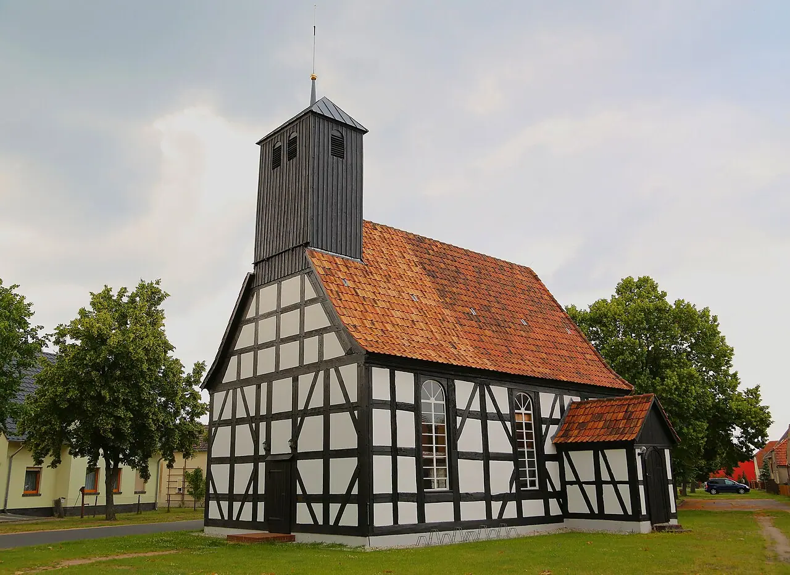

Dorfkirche Gross Lubolz 01.jpg — J.-H. Janßen / [CC BY-SA 3.0](https://creativecommons.org/licenses/by-sa/3.0) / [原典](https://commons.wikimedia.org/wiki/File:Dorfkirche_Gross_Lubolz_01.jpg)

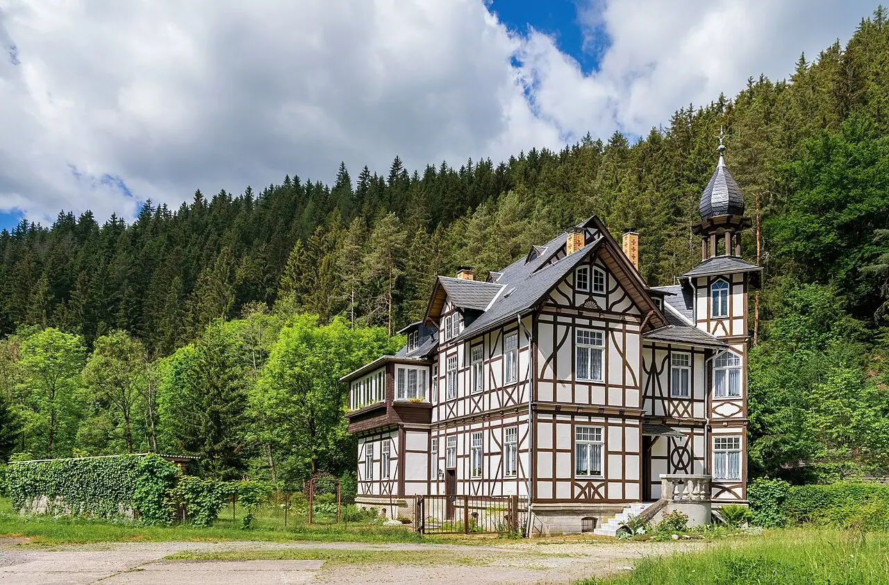

Half-timbered mansion, Zirkel, East view.jpg — Radomianin / [CC BY-SA 4.0](https://creativecommons.org/licenses/by-sa/4.0) / [原典](https://commons.wikimedia.org/wiki/File:Half-timbered_mansion%2C_Zirkel%2C_East_view.jpg)

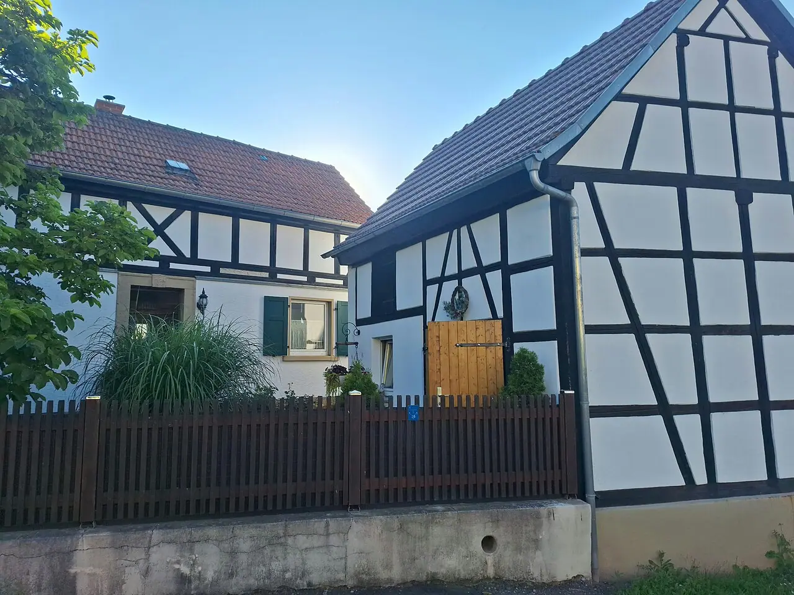

Half-timbered farmhouse at Ortsstraße 7, Klengel.jpg — Steffen Mokosch / [CC BY-SA 4.0](https://creativecommons.org/licenses/by-sa/4.0) / [原典](https://commons.wikimedia.org/wiki/File:Half-timbered_farmhouse_at_Ortsstra%C3%9Fe_7%2C_Klengel.jpg)

## 海外参考：海辺の石の港町 — coastal-stone-villages

制作で見るところ：防波堤・細道・石壁・港と家の高さ

関連コード：`app/src/world/town.js`、`app/src/world/house.js`、`app/src/world/road.js`

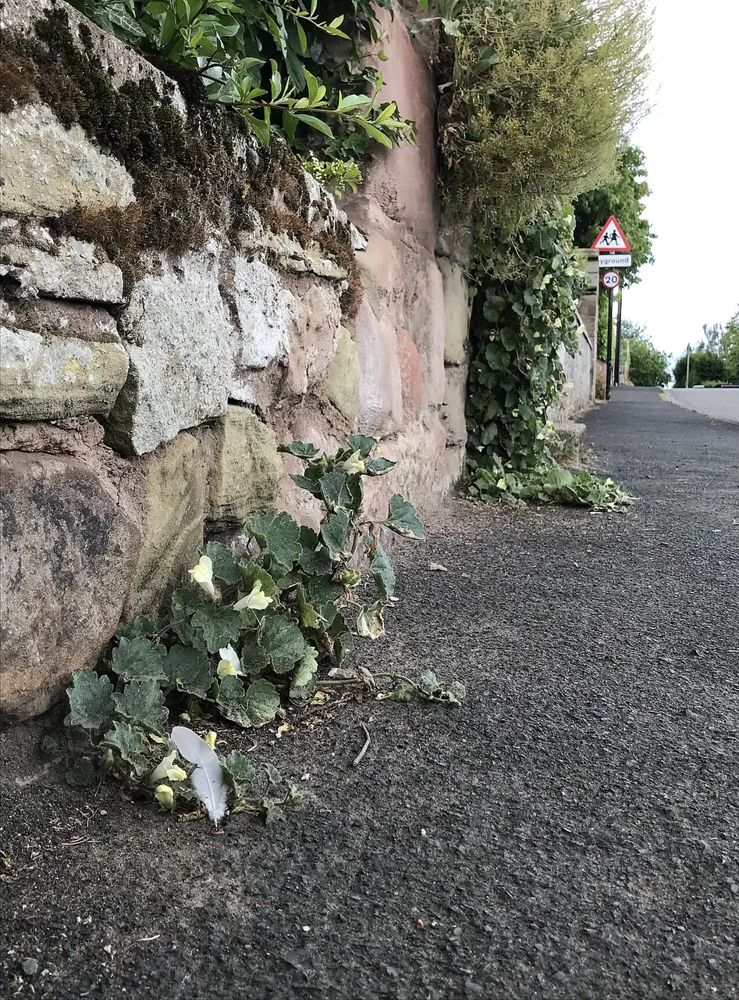

Asarina procumbens growing between wall and tarmac.jpg — Flobbadob / [CC BY-SA 4.0](https://creativecommons.org/licenses/by-sa/4.0) / [原典](https://commons.wikimedia.org/wiki/File:Asarina_procumbens_growing_between_wall_and_tarmac.jpg)

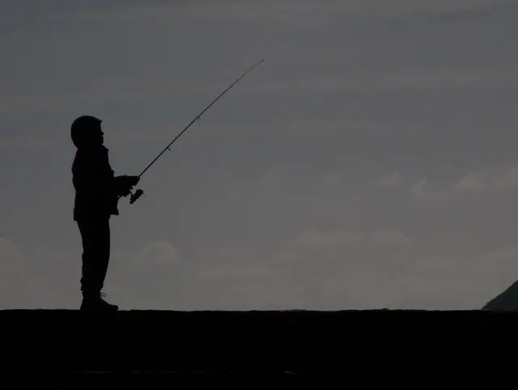

Charlestown, a boy fishing - geograph.org.uk - 4299710.jpg — Chris Downer / [CC BY-SA 2.0](https://creativecommons.org/licenses/by-sa/2.0) / [原典](https://commons.wikimedia.org/wiki/File:Charlestown%2C_a_boy_fishing_-_geograph.org.uk_-_4299710.jpg)

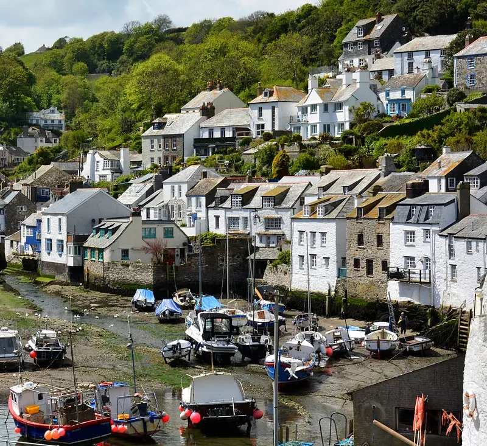

Fishing harbour, Polperro, Cornwall - geograph.org.uk - 4490120.jpg — Edmund Shaw / [CC BY-SA 2.0](https://creativecommons.org/licenses/by-sa/2.0) / [原典](https://commons.wikimedia.org/wiki/File:Fishing_harbour%2C_Polperro%2C_Cornwall_-_geograph.org.uk_-_4490120.jpg)

## 海外参考：韓国の韓屋路地 — korean-hanok-lanes

制作で見るところ：瓦・木の柱・軒下・塀と街路（日本の建築との違いも観察）

関連コード：`app/src/world/town.js`、`app/src/world/house.js`、`app/src/world/road.js`

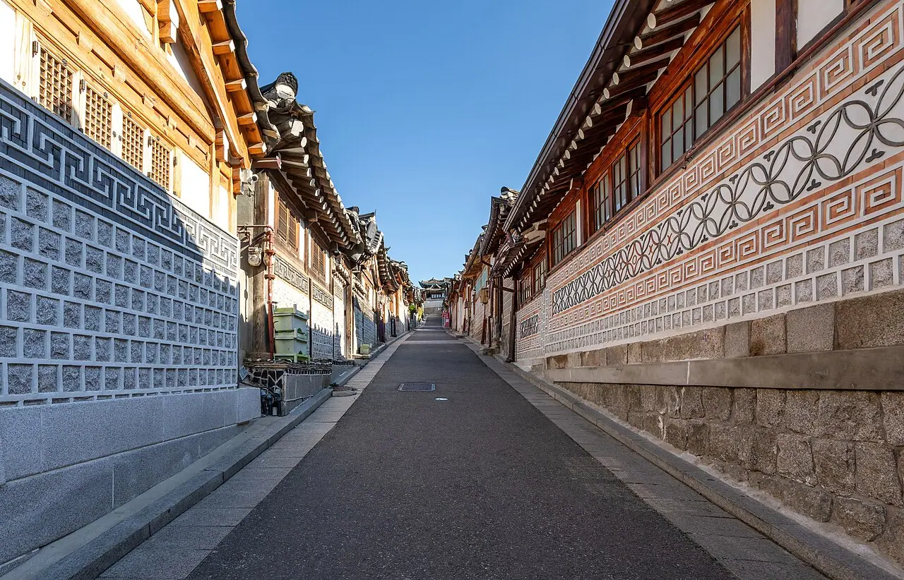

Bukchon-ro 11-gil street with hanok houses in Bukchon Hanok Village Seoul.jpg — Basile Morin / [CC BY-SA 4.0](https://creativecommons.org/licenses/by-sa/4.0) / [原典](https://commons.wikimedia.org/wiki/File:Bukchon-ro_11-gil_street_with_hanok_houses_in_Bukchon_Hanok_Village_Seoul.jpg)

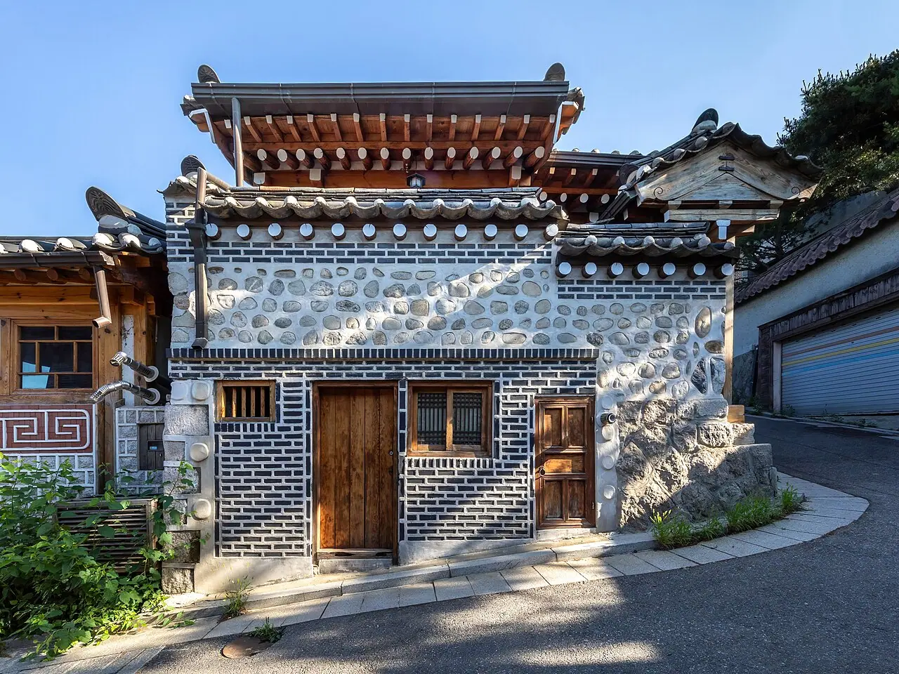

Traditional hanok house with wooden doors along a steeply sloping street in Bukchon Hanok Village Seoul.jpg — Basile Morin / [CC BY-SA 4.0](https://creativecommons.org/licenses/by-sa/4.0) / [原典](https://commons.wikimedia.org/wiki/File:Traditional_hanok_house_with_wooden_doors_along_a_steeply_sloping_street_in_Bukchon_Hanok_Village_Seoul.jpg)

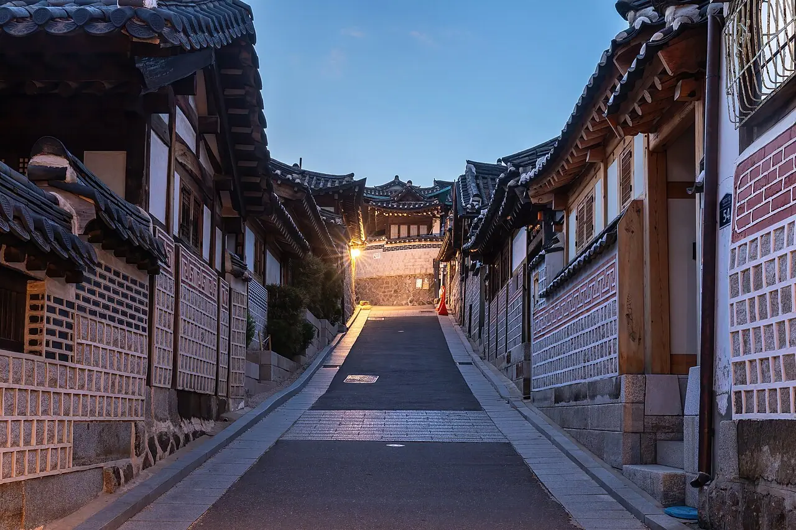

Bukchon-ro 11-gil street with hanok houses at blue hour in Bukchon Hanok Village Seoul.jpg — Basile Morin / [CC BY-SA 4.0](https://creativecommons.org/licenses/by-sa/4.0) / [原典](https://commons.wikimedia.org/wiki/File:Bukchon-ro_11-gil_street_with_hanok_houses_at_blue_hour_in_Bukchon_Hanok_Village_Seoul.jpg)

## 海外参考：台湾の山間の路地 — taiwan-mountain-streets

制作で見るところ：山に沿う階段、屋根と植生、店先の灯り

関連コード：`app/src/world/town.js`、`app/src/world/house.js`、`app/src/world/road.js`

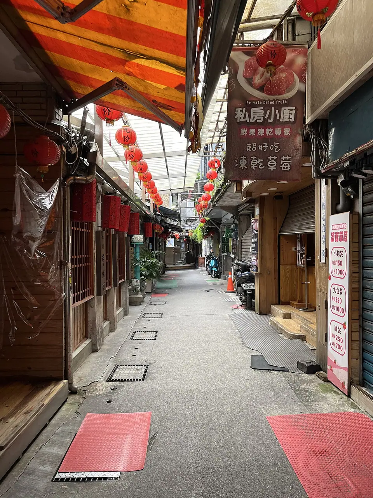

Jiufen, November 28, 2024 - 019.jpg — Another Believer / [CC BY-SA 4.0](https://creativecommons.org/licenses/by-sa/4.0) / [原典](https://commons.wikimedia.org/wiki/File:Jiufen%2C_November_28%2C_2024_-_019.jpg)

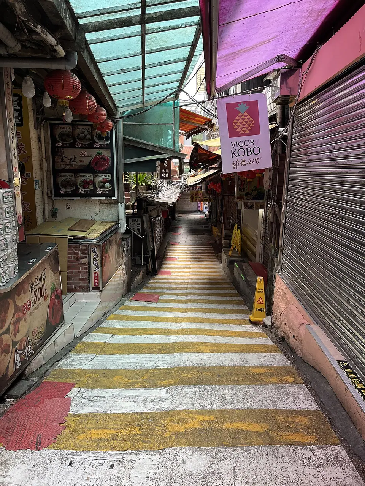

Jiufen, November 28, 2024 - 025.jpg — Another Believer / [CC BY-SA 4.0](https://creativecommons.org/licenses/by-sa/4.0) / [原典](https://commons.wikimedia.org/wiki/File:Jiufen%2C_November_28%2C_2024_-_025.jpg)

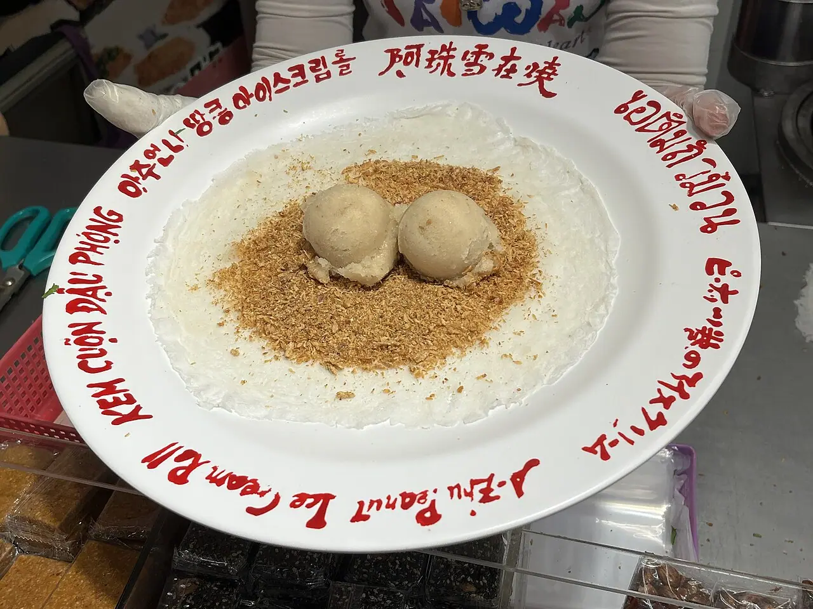

A-Zhu Peanut Ice Cream Roll, Jiufen Old Street, 2024.jpg — Another Believer / [CC BY-SA 4.0](https://creativecommons.org/licenses/by-sa/4.0) / [原典](https://commons.wikimedia.org/wiki/File:A-Zhu_Peanut_Ice_Cream_Roll%2C_Jiufen_Old_Street%2C_2024.jpg)

## 海外参考：中国の水郷 — chinese-water-towns

制作で見るところ：小橋・運河・木造家屋・岸と道の高さ

関連コード：`app/src/world/town.js`、`app/src/world/house.js`、`app/src/world/road.js`

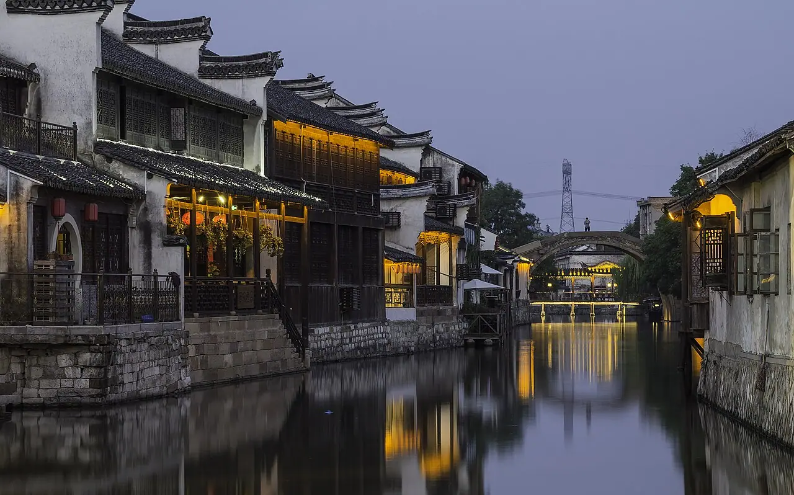

Nanxun - Ancient water town - 0081.jpg — Stefan Fussan / [CC BY-SA 3.0](https://creativecommons.org/licenses/by-sa/3.0) / [原典](https://commons.wikimedia.org/wiki/File:Nanxun_-_Ancient_water_town_-_0081.jpg)

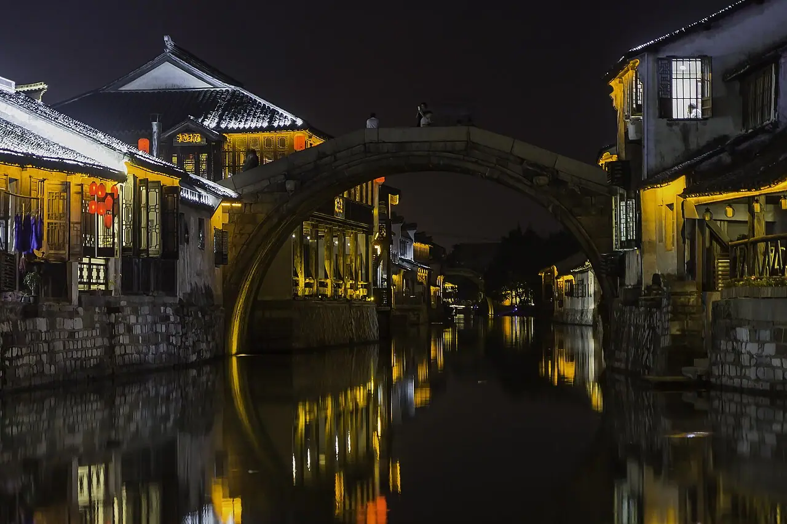

Nanxun - Ancient water town - 0095.jpg — Stefan Fussan / [CC BY-SA 3.0](https://creativecommons.org/licenses/by-sa/3.0) / [原典](https://commons.wikimedia.org/wiki/File:Nanxun_-_Ancient_water_town_-_0095.jpg)

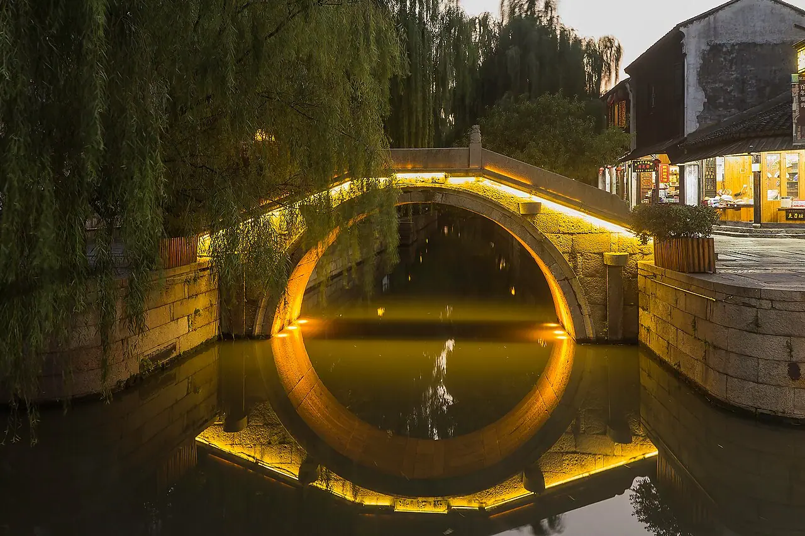

Nanxun - Ancient water town - 0333.jpg — Stefan Fussan / [CC BY-SA 3.0](https://creativecommons.org/licenses/by-sa/3.0) / [原典](https://commons.wikimedia.org/wiki/File:Nanxun_-_Ancient_water_town_-_0333.jpg)

## 海外参考：南米の色のある街 — latin-american-colorful-villages

制作で見るところ：壁色や窓の色の組み合わせ、緑と建物の調和だけ参考

関連コード：`app/src/world/town.js`、`app/src/world/house.js`、`app/src/world/road.js`

現時点でライセンス・画像条件を満たす写真なし（今後の収集対象）。

